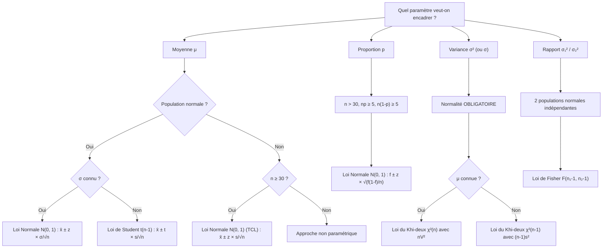

# 🧠 Fiche de Révision — Les Intervalles de Confiance

> ↖ [[MOC_Statistiques_Inferentielles|Statistiques Inférentielles (M1 IT)]] • 📖 [[02_Intervalles_de_Confiance|Cours Ch. 02]] • 🧰 [[TD1_Formules_et_Explications_Terre_a_Terre|TD 1 Formules]]

---

## 🧭 1. Arbre de Décision Rapide

---

## 📋 2. Tableau Maître des Formules (Connu / Inconnu)

| Paramètre cible | Condition (connu / inconnu / $n$) | Loi & ddl | Formule | Annexe |
| :--- | :--- | :--- | :--- | :---: |
| **Moyenne $\mu$** | Population normale, **$\sigma$ connu** | $\mathcal{N}(0, 1)$ | $\left[\bar{x} \pm z_{1-\alpha/2}\dfrac{\sigma}{\sqrt{n}}\right]$ | A.2 |
| **Moyenne $\mu$** | Population normale, **$\sigma$ inconnu** ($n < 30$ ou exact) | Student $t(n - 1)$ | $\left[\bar{x} \pm t_{n-1,\, 1-\alpha/2}\dfrac{s}{\sqrt{n}}\right]$ | C |
| **Moyenne $\mu$** | Loi quelconque, **$n \ge 30$** (TCL, $\sigma$ inconnu $\to s$) | $\mathcal{N}(0, 1)$ | $\left[\bar{x} \pm z_{1-\alpha/2}\dfrac{s}{\sqrt{n}}\right]$ | A.2 |
| **Moyenne $\mu$** | Loi non normale, **$n < 30$** | — | Approche non paramétrique (pas d'IC paramétrique) | — |
| **Proportion $p$** | $n > 30$, $np \ge 5$, $n(1-p) \ge 5$ (polycopié) | $\mathcal{N}(0, 1)$ | $\left]f \pm z_{1-\alpha/2}\sqrt{\dfrac{f(1-f)}{n-1}}\right[$ | A.2 |
| **Proportion $p$** | Grand $n$ (formule usuelle) | $\mathcal{N}(0, 1)$ | $\left]f \pm z_{1-\alpha/2}\sqrt{\dfrac{f(1-f)}{n}}\right[$ | A.2 |
| **Proportion $p$** | Règle rapide à $95\%$ ($f \simeq 0{,}5$) | $\mathcal{N}(0, 1)$ | $\left[f - \dfrac{1}{\sqrt{n}} \,;\, f + \dfrac{1}{\sqrt{n}}\right[$ | — |
| **Variance $\sigma^2$** | **Normalité obligatoire**, **$\mu$ connue** ($V^2 = \frac{1}{n}\sum (x_i - \mu)^2$) | $\chi^2(n)$ | $\left[\dfrac{nV^2}{\chi^2_{\text{grand}}(n)} \,;\, \dfrac{nV^2}{\chi^2_{\text{petit}}(n)}\right]$ | B |
| **Variance $\sigma^2$** | **Normalité obligatoire**, **$\mu$ inconnue** ($s^2 = \frac{1}{n-1}\sum (x_i - \bar{x})^2$, $nv^2 = (n-1)s^2$) | $\chi^2(n - 1)$ | $\left[\dfrac{(n-1)s^2}{\chi^2_{\text{grand}}(n-1)} \,;\, \dfrac{(n-1)s^2}{\chi^2_{\text{petit}}(n-1)}\right]$ | B |
| **Rapport $\sigma_1^2 / \sigma_2^2$** | **2 populations normales indépendantes** | $\mathcal{F}(n_1 - 1, \, n_2 - 1)$ | $\left[\dfrac{s_1^2 / s_2^2}{F_{\alpha/2}(\nu_1, \nu_2)} \,;\, \dfrac{s_1^2}{s_2^2} \cdot F_{\alpha/2}(\nu_2, \nu_1)\right]$ | D.2 |

> [!NOTE] Passage de $\sigma^2$ à $\sigma$ et test d'homoscédasticité
> - Pour obtenir l'IC de l'écart-type $\sigma$, prendre la racine carrée de chaque borne : $IC(\sigma) = [\sqrt{\text{borne inf}} \,;\, \sqrt{\text{borne sup}}]$.
> - Pour tester $H_0 : \sigma_1^2 = \sigma_2^2$ au seuil $\alpha$ : si **$1 \in IC_{1-\alpha}(\sigma_1^2 / \sigma_2^2)$**, on ne rejette pas $H_0$ (variances homogènes).

---

## 📏 3. Taille Minimale $n$ & Dynamique de Largeur

- **Longueur totale vs marge d'erreur :** Un intervalle $[\bar{x} - e \,;\, \bar{x} + e]$ a une longueur totale **$L = 2e$**, donc la marge d'erreur vaut **$e = L / 2$**.
- **Dimensionnement de $n$ pour $\mu$ :** Pour garantir une marge d'erreur $\le e$ au niveau $1 - \alpha$, il faut :
  $$n \ge \left(\frac{z_{1-\alpha/2} \cdot \sigma}{e}\right)^2$$
  *(Toujours arrondir **à l'entier supérieur** dès qu'il y a une décimale.)*
- **Arbitrages fondamentaux :**
  - À $n$ fixé, augmenter la confiance $(1 - \alpha)$ **élargit** l'intervalle ($L \nearrow$).
  - À confiance fixée, augmenter $n$ **rétrécit** l'intervalle proportionnellement à $1/\sqrt{n}$ (quadrupler $n$ divise la largeur par $2$).

---

## 📖 4. Mémo de Lecture des Tables (Annexes A, B, C, D)

### Loi Normale $\mathcal{N}(0, 1)$ (Annexe A)
On cherche $z_{1-\alpha/2}$ tel que $\Phi(z) = 1 - \frac{\alpha}{2}$ :

| Confiance ($1-\alpha$) | Risque $\alpha$ | $\Phi(z) = 1 - \alpha/2$ | Quantile $z_{1-\alpha/2}$ |
| :---: | :---: | :---: | :---: |
| **90%** | 0,10 | 0,950 | **1,645** |
| **95%** | 0,05 | 0,975 | **1,960** |
| **98%** | 0,02 | 0,990 | **2,326** |
| **99%** | 0,01 | 0,995 | **2,576** |
| **99,9%** | 0,001 | 0,9995 | **3,291** |

### Loi de Student (Annexe C)
- Lire la ligne $\nu = n - 1$ et la colonne correspondant au risque bilatéral $\alpha$ (ex. $0{,}05$ pour un IC à $95\%$). Quand $n$ grandit, $t_{n-1,\, 1-\alpha/2} \to z_{1-\alpha/2}$.

### Loi du Khi-deux $\chi^2$ (Annexe B — queue droite)
- La table donne $k$ tel que $P(X \ge k) = \text{colonne}$. Pour un IC à $95\%$ ($\alpha/2 = 0{,}025$) :
  - Colonne `0,025` $\to$ **grand** quantile $\implies$ au dénominateur de la **borne inférieure**.
  - Colonne `0,975` $\to$ **petit** quantile $\implies$ au dénominateur de la **borne supérieure**.
- **Règle invariante :** vérifier systématiquement que $\text{borne gauche} < \text{borne droite}$.

### Loi de Fisher-Snedecor $\mathcal{F}$ (Annexe D.2 — queue droite $\alpha/2$)
- Grâce à la réversibilité $f_{1-\alpha/2}(\nu_1, \nu_2) = \frac{1}{f_{\alpha/2}(\nu_2, \nu_1)}$, la lecture se fait uniquement dans la table queue droite $\alpha/2$ :
  - **Borne gauche :** on **divise** $s_1^2 / s_2^2$ par $F_{\alpha/2}(\nu_1, \nu_2)$ (ddl numérateur $\nu_1 = n_1 - 1$ en premier).
  - **Borne droite :** on **multiplie** $s_1^2 / s_2^2$ par $F_{\alpha/2}(\nu_2, \nu_1)$ (en **inversant** les deux degrés de liberté).

---

## 🔄 5. IC vs Zones de Rejet $R$ selon le sens (pour chaque loi)

> [!IMPORTANT] Règle clé : l'IC ne change pas de côté, seule la zone de rejet d'un test change
> - **Intervalle de confiance (IC) :** dans le cours, un IC est **toujours bilatéral** ($\alpha$ coupé en $\alpha/2$ à gauche et $\alpha/2$ à droite, centré sur l'estimation $\bar{x}, f, s^2$).
> - **Test d'hypothèse :** la **zone de rejet $R$** change à la fois **de côté** et **de seuil** selon $H_1$ ($\alpha/2$ de chaque côté en bilatéral, contre tout $\alpha$ d'un seul côté en unilatéral).

### Tableau comparatif des zones de rejet $R$ par loi (au risque $\alpha$)

| Loi sous $H_0$ | IC du cours *(toujours bilatéral)* | Test bilatéral ($H_1 : \ne$) | Unilatéral gauche ($H_1 : <$) | Unilatéral droit ($H_1 : >$) |
| :--- | :--- | :--- | :--- | :--- |
| **Normale $\mathcal{N}(0, 1)$**   *(ex. $\alpha = 5\%$)* | $\left[\bar{x} \pm u_{1-\alpha/2}\dfrac{\sigma}{\sqrt{n}}\right]$   *($\pm 1{,}96$)* | $]-\infty; -u_{1-\alpha/2}[ \cup ]u_{1-\alpha/2}; +\infty[$   *($]-\infty; -1{,}96[ \cup ]1{,}96; +\infty[$)* | $]-\infty; -u_{1-\alpha}[$   *($]-\infty; -1{,}645[$)* | $]u_{1-\alpha}; +\infty[$   *($]1{,}645; +\infty[$)* |
| **Student $t(\nu)$**   *($\nu = n-1$, ex. $\nu=10, 5\%$)* | $\left[\bar{x} \pm t_{\nu;\, 1-\alpha/2}\dfrac{s}{\sqrt{n}}\right]$   *($\pm 2{,}228$)* | $]-\infty; -t_{\nu;\, 1-\alpha/2}[ \cup ]t_{\nu;\, 1-\alpha/2}; +\infty[$   *($]-\infty; -2{,}228[ \cup ]2{,}228; +\infty[$)* | $]-\infty; -t_{\nu;\, 1-\alpha}[$   *($]-\infty; -1{,}812[$)* | $]t_{\nu;\, 1-\alpha}; +\infty[$   *($]1{,}812; +\infty[$)* |
| **Khi-deux $\chi^2(\nu)$**   *(positif, ex. $\nu=10, 5\%$)* | $\left[\dfrac{(n-1)s^2}{\chi^2_{\nu;\, 1-\alpha/2}} \,;\, \dfrac{(n-1)s^2}{\chi^2_{\nu;\, \alpha/2}}\right]$   *(div. par $20{,}483$ et $3{,}247$)* | $[0; \chi^2_{\nu;\, \alpha/2}[ \cup ]\chi^2_{\nu;\, 1-\alpha/2}; +\infty[$   *($[0; 3{,}247[ \cup ]20{,}483; +\infty[$)* | $[0; \chi^2_{\nu;\, \alpha}[$   *($[0; 3{,}940[$)* | $]\chi^2_{\nu;\, 1-\alpha}; +\infty[$   *($]18{,}307; +\infty[$ — aussi ajust./indép.)* |
| **Fisher $\mathcal{F}(\nu_1, \nu_2)$**   *(positif, asymétrique)* | $\left[\dfrac{s_1^2 / s_2^2}{f_{1-\alpha/2}(\nu_1,\nu_2)} \,;\, \dfrac{s_1^2}{s_2^2}f_{1-\alpha/2}(\nu_2,\nu_1)\right]$ | $[0; f_{\alpha/2}(\nu_1,\nu_2)[ \cup ]f_{1-\alpha/2}(\nu_1,\nu_2); +\infty[$   *(ou $s_{\max}^2/s_{\min}^2 > f_{1-\alpha/2}$ en Ann. D.2)* | $[0; f_{\alpha}(\nu_1,\nu_2)[$   *(avec $f_{\alpha}(\nu_1,\nu_2) = \frac{1}{f_{1-\alpha}(\nu_2,\nu_1)}$)* | $]f_{1-\alpha}(\nu_1,\nu_2); +\infty[$   *(toujours ce cas pour l'ANOVA, Ann. D.1)* |

- **Attention aux conventions d'indices dans les tables :** ci-dessus, $u_p, t_{\nu;\, p}, \chi^2_{\nu;\, p}, f_p$ notent le quantile d'aire cumulée **à gauche** $p$ (convention des slides Module 1). Dans le polycopié :
  - **Annexe C (Student)** est indexée par le risque bilatéral $\alpha$ (lire la colonne $2\alpha$ en unilatéral).
  - **Annexe B ($\chi^2$)** et **Annexes D.1/D.2 ($\mathcal{F}$)** sont indexées par la **queue droite** : $\chi^2_{\nu;\, 0{,}95}$ se lit en colonne `0,05`, et $f_{0{,}975}$ se lit dans la table $\alpha = 0{,}025$ (notée $F_{0{,}025}$).
- **Zone de non-rejet en unités réelles (autour de $\mu_0$ sous $\mathcal{N}(0,1)$) :** $\left[\mu_0 - u_{1-\alpha/2}\frac{\sigma}{\sqrt{n}} \,;\, \mu_0 + u_{1-\alpha/2}\frac{\sigma}{\sqrt{n}}\right]$ en bilatéral, $\left[\mu_0 - u_{1-\alpha}\frac{\sigma}{\sqrt{n}} \,;\, +\infty\right[$ en unilatéral gauche, et $\left]-\infty \,;\, \mu_0 + u_{1-\alpha}\frac{\sigma}{\sqrt{n}}\right]$ en unilatéral droit.

---

## ⚠️ 6. Pièges Classiques d'Examen

> [!warning] Les 6 erreurs à ne pas commettre
> 1. **Oublier la normalité stricte pour $\chi^2$ et $\mathcal{F}$ :** le TCL ne sauve pas l'IC d'une variance $\sigma^2$, même si $n \ge 30$.
> 2. **Inverser les bornes $\chi^2$ au dénominateur :** diviser par le grand quantile donne la petite borne (gauche) ; diviser par le petit quantile donne la grande borne (droite).
> 3. **Confondre longueur $L$ et marge d'erreur $e$ :** si l'énoncé fixe la largeur $L \le 1$, la marge d'erreur à injecter dans $n \ge (z\sigma/e)^2$ vaut $e = L/2 = 0{,}5$.
> 4. **Arrondir $n$ à l'entier inférieur :** un résultat $n \ge 52{,}016$ impose $n_{\min} = 53$ (jamais $52$).
> 5. **Confondre $v^2$ (variance empirique $\div n$) et $s^2$ (corrigée $\div (n-1)$) :** on a toujours $n v^2 = (n - 1) s^2$. Vérifier quel symbole donne l'énoncé avant d'appliquer $\chi^2$ ou $\mathcal{F}$.
> 6. **Mauvaise interprétation de l'IC :** un IC à $95\%$ encadre le **paramètre inconnu de la population** ($\mu, p, \sigma^2$), jamais la statistique observée ($\bar{x}, f$).

---

## 🧠 7. Active Recall

- [ ] **Q1 : Pour encadrer $\mu$, quand passe-t-on de Student $t(n-1)$ à $\mathcal{N}(0,1)$ ?**
  - *Réponse flash :* Dès que $\sigma$ est connu (sous population normale), ou lorsque $n \ge 30$ grâce au TCL (en remplaçant $\sigma$ par $s$ s'il est inconnu).
- [ ] **Q2 : Qu'est-ce qui change dans l'IC de $\sigma^2$ selon que $\mu$ est connue ou inconnue ?**
  - *Réponse flash :* Avec $\mu$ connue, on utilise $V^2 = \frac{1}{n}\sum (X_i - \mu)^2$ et $\chi^2(n)$ ($nV^2$ au numérateur). Avec $\mu$ inconnue, on utilise $S^2$ et $\chi^2(n-1)$ ($(n-1)S^2$ au numérateur).
- [ ] **Q3 : Pour un IC de $\sigma^2$ à 95% avec $n=10$ ($\mu$ inconnue), où place-t-on les valeurs lues en `0,025` et `0,975` dans l'Annexe B ?**
  - *Réponse flash :* Sur la ligne $\nu = 9$, la valeur `0,025` (la plus grande) divise $(n-1)s^2$ à **gauche**, et la valeur `0,975` (la plus petite) le divise à **droite**.
- [ ] **Q4 : Comment lire les deux bornes de l'IC de $\sigma_1^2/\sigma_2^2$ dans l'Annexe D.2 et conclure sur l'homoscédasticité ?**
  - *Réponse flash :* On divise $s_1^2/s_2^2$ par $F_{\alpha/2}(\nu_1,\nu_2)$ à gauche et on multiplie par $F_{\alpha/2}(\nu_2,\nu_1)$ à droite ; si $1$ appartient à l'intervalle, on ne rejette pas l'égalité des variances.
- [ ] **Q5 : Si l'on veut diviser la largeur d'un IC sur $\mu$ ($\sigma$ connu) par $2$ à confiance constante, par combien faut-il multiplier $n$ ?**
  - *Réponse flash :* Par $4$, car la demi-largeur évolue en $1/\sqrt{n}$.
