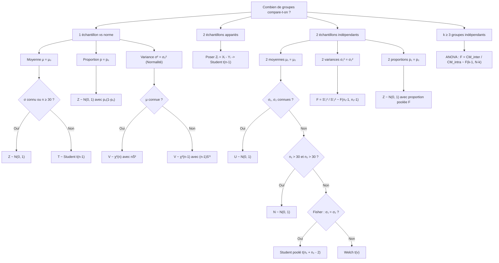

# 🧠 Fiche de Révision — Tests d'Hypothèses & Tests Paramétriques

> ↖ [[MOC_Statistiques_Inferentielles|Statistiques Inférentielles (M1 IT)]] • 📖 [[03_Generalites_Tests_Hypotheses|Cours Ch. 03]] • 📖 [[04_Tests_Parametriques|Cours Ch. 04]] • 🧰 [[TD2_Formules_et_Explications_Terre_a_Terre|TD 2 Formules]]

---

## 🎯 1. Généralités : Méthode, Décision & Risques (Ch. 03)

### Méthodologie en 6 étapes
1. Formuler $H_0$ (absence d'effet / égalité, formulée pour être rejetée) et $H_1$ (unilatérale ou bilatérale).
2. Choisir la statistique de test $S$.
3. Déterminer la **loi de probabilité de $S$ sous $H_0$**.
4. Fixer **a priori** le seuil de signification $\alpha$ ($0{,}05$, $0{,}01$ ou $0{,}001$) et la région critique $R_c$ telle que $P(S \in R_c \mid H_0) = \alpha$.
5. Calculer $S_{\text{obs}}$ (ou la $p$-value $\alpha_{\text{obs}}$) sur l'échantillon.
6. Conclure : **rejet de $H_0$** ($S_{\text{obs}} \in R_c$ ou $p\text{-value} < \alpha$) ou **non-rejet de $H_0$** (jamais « $H_0$ est prouvée vraie »).

### Les 4 familles de tests
- **Conformité :** comparer un paramètre d'échantillon ($\bar{x}, s^2, f$) à une référence théorique ($\mu_0, \sigma_0^2, p_0$).
- **Ajustement (adéquation) :** vérifier la compatibilité des données avec une loi choisie a priori (ex. $\chi^2$).
- **Homogénéité (comparaison) :** comparer $K \ge 2$ groupes (test $t$, ANOVA, Mann-Whitney, Kruskal-Wallis).
- **Indépendance (association) :** tester la liaison entre 2 variables ($\chi^2$ d'indépendance, corrélation).

### Risques d'erreur & Puissance ($1 - \beta$)

| Décision \ Réalité | $H_0$ vraie | $H_1$ vraie |
| :--- | :---: | :---: |
| **Ne pas rejeter $H_0$** | Décision correcte ($1 - \alpha$) | **Erreur de 2e espèce ($\beta$)** — *Faux négatif* |
| **Rejeter $H_0$** | **Erreur de 1re espèce ($\alpha$)** — *Faux positif* | **Puissance ($1 - \beta$)** — *Détection juste* |

- **4 leviers pour augmenter la puissance ($1 - \beta$) :** augmenter la taille d'échantillon $N$, écart réel grand entre $H_0$ et $H_1$, seuil $\alpha$ moins strict (réduire $\alpha$ à $N$ fixe augmente $\beta$), test **unilatéral** plutôt que bilatéral.

---

## 🧭 2. Arbre de Décision Rapide des Tests Paramétriques

---

## 📋 3. Tableau Maître des Tests Paramétriques (Connu / Inconnu / $n$)

### A. Conformité (1 échantillon)
tableau récapitulatif des conditions à respecter pour utilisé les lois

| Hypothèse $H_0$             | Condition (connu / inconnu / $n$)                                   | Statistique de test                                                                                   |   Loi sous $H_0$    |
| :-------------------------- | :------------------------------------------------------------------ | :---------------------------------------------------------------------------------------------------- | :-----------------: |
| **$\mu = \mu_0$**           | $\sigma$ connu (ou $n \ge 30$ par TCL : remplacer $\sigma$ par $s$) | $Z = \dfrac{\overline{X}_n - \mu_0}{\sigma / \sqrt{n}}$                                               | $\mathcal{N}(0, 1)$ |
| **$\mu = \mu_0$**           | $\sigma$ inconnu, $X \sim \mathcal{N}$ ($n < 30$ ou exact)          | $T = \dfrac{\overline{X}_n - \mu_0}{S_n / \sqrt{n}}$                                                  |     $t(n - 1)$      |
| **$\sigma^2 = \sigma_0^2$** | $X \sim \mathcal{N}$ obligatoire, **$\mu$ connue**                  | $V = \dfrac{n\overline{S}_n^2}{\sigma_0^2} = \sum_{k=1}^n \left(\dfrac{X_k - \mu}{\sigma_0}\right)^2$ |     $\chi^2(n)$     |
| **$\sigma^2 = \sigma_0^2$** | $X \sim \mathcal{N}$ obligatoire, **$\mu$ inconnue**                | $V = \dfrac{(n-1)S_n^{\prime\,2}}{\sigma_0^2} = \dfrac{n\overline{S}_n^2}{\sigma_0^2}$                |   $\chi^2(n - 1)$   |
| **$p = p_0$**               | $n$ grand ($np_0 \ge 5$, $n(1-p_0) \ge 5$)                          | $Z = \dfrac{f - p_0}{\sqrt{p_0(1 - p_0)/n}}$                                                          | $\mathcal{N}(0, 1)$ |

### B. Comparaison (2 échantillons & $k$ groupes)

| Hypothèse $H_0$ | Condition (connu / inconnu / $n$) | Statistique de test | Loi sous $H_0$ |
| :--- | :--- | :--- | :---: |
| **$\mu_1 = \mu_2$ (appariés)** | $n_1 = n_2 = n$, poser $Z_i = X_i - Y_i$, tester $\mu_Z = 0$ | $T = \dfrac{\overline{Z}}{S_Z / \sqrt{n}}$ | $t(n - 1)$ |
| **$\mu_1 = \mu_2$ (indép.)** | $\sigma_1, \sigma_2$ connues | $U = \dfrac{\overline{X}_{n_1} - \overline{Y}_{n_2}}{\sqrt{\sigma_1^2/n_1 + \sigma_2^2/n_2}}$ | $\mathcal{N}(0, 1)$ |
| **$\mu_1 = \mu_2$ (indép.)** | $\sigma$ inconnues, $n_1 > 30$ et $n_2 > 30$ | $N = \dfrac{\overline{X}_{n_1} - \overline{Y}_{n_2}}{\sqrt{S_{n_1}^{\prime\,2}/n_1 + S_{n_2}^{\prime\,2}/n_2}}$ | $\mathcal{N}(0, 1)$ |
| **$\mu_1 = \mu_2$ (indép.)** | $\sigma$ inconnues, $n_1$ ou $n_2 < 30$ et $\sigma_1 = \sigma_2$ (homoscédasticité) | $T = \dfrac{\overline{X}_{n_1} - \overline{Y}_{n_2}}{\sqrt{S_{n_1, n_2}^{\prime\,2}(1/n_1 + 1/n_2)}}$ | $t(n_1 + n_2 - 2)$ |
| **$\mu_1 = \mu_2$ (indép.)** | $\sigma$ inconnues, $n_1$ ou $n_2 < 30$ et $\sigma_1 \ne \sigma_2$ (Welch) | $T = \dfrac{\overline{X}_{n_1} - \overline{Y}_{n_2}}{\sqrt{S_{n_1}^{\prime\,2}/n_1 + S_{n_2}^{\prime\,2}/n_2}}$ | $t(\nu)$ |
| **$\sigma_1^2 = \sigma_2^2$** | Échantillons normaux indépendants | $F = \dfrac{S_{n_1}^{\prime\,2}}{S_{n_2}^{\prime\,2}}$ | $\mathcal{F}(n_1 - 1, \, n_2 - 1)$ |
| **$p_1 = p_2$** | Grands échantillons indépendants | $Z = \dfrac{f_1 - f_2}{\sqrt{F(1 - F)(1/n_1 + 1/n_2)}}$ | $\mathcal{N}(0, 1)$ |
| **$\mu_1 = \dots = \mu_k$ (ANOVA)** | $k \ge 3$ groupes, indépendance, normalité & homoscédasticité | $F = \dfrac{\text{CM}_{\text{inter}}}{\text{CM}_{\text{intra}}}$ | $\mathcal{F}(k - 1, \, N - k)$ |

### C. Formules auxiliaires indispensables

- **Variance poolée ($\sigma_1 = \sigma_2$) :**
  $$S_{n_1, n_2}^{\prime\,2} = \frac{(n_1 - 1)S_{n_1}^{\prime\,2} + (n_2 - 1)S_{n_2}^{\prime\,2}}{n_1 + n_2 - 2}$$
- **Degrés de liberté de Welch-Satterthwaite ($\sigma_1 \ne \sigma_2$, arrondi à l'entier le plus proche) :**
  $$\nu = \frac{\left(S_{n_1}^{\prime\,2}/n_1 + S_{n_2}^{\prime\,2}/n_2\right)^2}{\dfrac{(S_{n_1}^{\prime\,2}/n_1)^2}{n_1 - 1} + \dfrac{(S_{n_2}^{\prime\,2}/n_2)^2}{n_2 - 1}}$$
- **Proportion poolée ($H_0 : p_1 = p_2$) :**
  $$F = \frac{n_1 f_1 + n_2 f_2}{n_1 + n_2}$$
- **Tableau ANOVA à un facteur ($N = \sum_{j=1}^k n_j$, $\text{SC}_{\text{totale}} = \text{SC}_{\text{inter}} + \text{SC}_{\text{intra}}$) :**

| Source | Somme des carrés (SC) | ddl | Carré moyen (CM) | Statistique $F$ |
| :--- | :--- | :---: | :--- | :---: |
| **Inter-groupes** | $\text{SC}_{\text{inter}} = \sum_{j=1}^k n_j(\bar{x}_j - \bar{x}_T)^2$ | $k - 1$ | $\text{CM}_{\text{inter}} = \dfrac{\text{SC}_{\text{inter}}}{k - 1}$ | $F = \dfrac{\text{CM}_{\text{inter}}}{\text{CM}_{\text{intra}}}$ |
| **Intra-groupes** | $\text{SC}_{\text{intra}} = \sum_{j=1}^k \sum_{i=1}^{n_j} (x_{ij} - \bar{x}_j)^2$ | $N - k$ | $\text{CM}_{\text{intra}} = \dfrac{\text{SC}_{\text{intra}}}{N - k}$ | |
| **Totale** | $\text{SC}_{\text{totale}}$ | $N - 1$ | | |

---

## 📖 4. Régions Critiques $R_c$, $p$-value & Quantiles

### Régions de rejet au seuil $\alpha$

| Loi sous $H_0$ | Bilatéral ($H_1 : \ne$) | Unilatéral droit ($H_1 : >$) | Unilatéral gauche ($H_1 : <$) |
| :--- | :--- | :--- | :--- |
| **$\mathcal{N}(0, 1)$ ou $t(\nu)$** | $]-\infty; -q_{1-\alpha/2}[ \cup ]q_{1-\alpha/2}; +\infty[$ | $]q_{1-\alpha}; +\infty[$ | $]-\infty; -q_{1-\alpha}[$ |
| **$\chi^2(\nu)$** | $[0; \chi^2_{\alpha/2}(\nu)[ \cup ]\chi^2_{1-\alpha/2}(\nu); +\infty[$ | $]\chi^2_{1-\alpha}(\nu); +\infty[$ | $[0; \chi^2_{\alpha}(\nu)[$ |
| **Fisher $\mathcal{F}(\nu_1, \nu_2)$** | $[0; f_{\alpha/2}[ \cup ]f_{1-\alpha/2}; +\infty[$ | $]f_{1-\alpha}; +\infty[$ *(toujours pour ANOVA)* | $[0; f_{\alpha}[$ |

### Calcul de la $p$-value sous $\mathcal{N}(0, 1)$ et quantiles repères
- **Bilatéral :** $p\text{-value} = 2\big(1 - \Phi(|z_{\text{obs}}|)\big)$ • **Unilatéral droit :** $1 - \Phi(z_{\text{obs}})$ • **Unilatéral gauche :** $\Phi(z_{\text{obs}})$.

| Seuil $\alpha$ | Bilatéral ($z_{1-\alpha/2}$) | Unilatéral ($z_{1-\alpha}$) |
| :---: | :---: | :---: |
| **5%** ($0{,}05$) | **1,960** | **1,645** |
| **1%** ($0{,}01$) | **2,576** | **2,326** |

---

## ⚠️ 5. Pièges Classiques d'Examen & Coquilles du Polycopié

> [!warning] Les 7 points de vigilance
> 1. **Dissymétrie des conclusions :** ne jamais écrire « $H_0$ est vraie/acceptée » ; écrire **« on ne rejette pas $H_0$ »** (faute de preuve suffisante contre elle).
> 2. **Proportion ($p = p_0$) :** au dénominateur, utiliser **$p_0(1 - p_0)$** (valeur sous $H_0$), pas $f(1 - f)$ comme dans un IC. Pour 2 proportions, utiliser la **proportion poolée $F$**.
> 3. **Normalité stricte pour $\chi^2$ et $\mathcal{F}$ :** le TCL ne protège ni les tests de variance ($\chi^2(n)$ si $\mu$ connue, $\chi^2(n-1)$ si $\mu$ inconnue), ni le test de Fisher, ni l'ANOVA.
> 4. **Bilatéral vs Unilatéral dans les tables :** en bilatéral le risque est coupé en $\alpha/2$ par queue ; en unilatéral tout le risque $\alpha$ va dans une seule queue.
> 5. **2 moyennes à petits effectifs ($n_1$ ou $n_2 < 30$) :** passer d'abord par le test de Fisher ($\sigma_1^2 = \sigma_2^2$) pour trancher entre Student poolé ($n_1+n_2-2$) et Welch ($\nu$).
> 6. **ANOVA :** le test $F = \text{CM}_{\text{inter}}/\text{CM}_{\text{intra}}$ est **toujours unilatéral droit**. Rejeter $H_0$ indique qu'au moins une moyenne diffère (tests post-hoc requis pour identifier lesquelles).
> 7. **Coquilles du polycopié (Ch. 3–4) :** signes moins manquants dans les régions bilatérales p. 24–25 ($]-\infty; \mathbf{-}q_{1-\alpha/2}[$) ; loi du rapport de variances p. 26 = $\mathcal{F}(n_1 - \mathbf{1}, \, n_2 - 1)$ (et non $n_1 - 2$) ; dénominateur de Welch p. 25 divisé par $(n_1 - 1)$ et $(n_2 - 1)$.

---

## 🧠 6. Active Recall

- [ ] **Q1 : Que signifie exactement « on ne rejette pas $H_0$ » ($p = 0{,}18 > 0{,}05$) ?**
  - *Réponse flash :* Le test contrôle $\alpha$ (faux positif) mais pas $\beta$ (faux négatif). L'échantillon n'apporte pas de preuve suffisante contre $H_0$, ce qui ne démontre pas que $H_0$ est vraie.
- [ ] **Q2 : Pourquoi met-on $p_0(1-p_0)$ pour tester $p = p_0$, et la proportion poolée $F$ pour tester $p_1 = p_2$ ?**
  - *Réponse flash :* Parce que l'erreur standard du test est calculée sous l'hypothèse $H_0$ : $p = p_0$ dans le premier cas, et une proportion commune unique $p$ estimée par $F = \frac{n_1 f_1 + n_2 f_2}{n_1 + n_2}$ dans le second.
- [ ] **Q3 : Comment choisir le test adapté pour comparer 2 moyennes indépendantes quand $n_1$ ou $n_2 < 30$ ?**
  - *Réponse flash :* On vérifie d'abord la normalité et l'égalité des variances par un test de Fisher $\mathcal{F}(n_1-1, n_2-1)$ : si homoscédasticité, Student poolé à $n_1+n_2-2$ ddl ; sinon, Welch à $\nu$ ddl.
- [ ] **Q4 : Pourquoi passe-t-on de $\chi^2(n)$ à $\chi^2(n-1)$ dans le test de variance quand $\mu$ devient inconnue ?**
  - *Réponse flash :* Remplacer $\mu$ par $\overline{X}_n$ introduit une contrainte linéaire ($\sum (X_i - \overline{X}_n) = 0$) qui fait perdre $1$ degré de liberté.
- [ ] **Q5 : Pourquoi préférer une ANOVA à plusieurs tests $t$ deux à deux pour $k \ge 3$ groupes ?**
  - *Réponse flash :* Multiplier les tests $t$ fait exploser le risque global d'erreur de 1re espèce ($1 - (1-\alpha)^m$), alors que l'ANOVA maintient le risque global à $\alpha$ en un seul test $F$.
