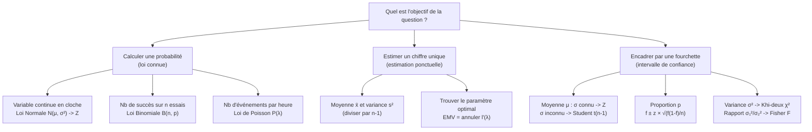

# 🧰 TD 1 — Formules & Explications Terre à Terre : Échantillonnage et Estimations

> ↖ [[MOC_Statistiques_Inferentielles|Statistiques Inférentielles (M1 IT)]] • 📄 [[TD1_Echantillonnage_et_Estimations|Corrigé officiel TD 1]] • 📖 [[01_Echantillonnage_et_Estimations|Ch. 01]] • [[02_Intervalles_de_Confiance|Ch. 02]] • 🎬 [[Fiche_Video_Echantillonnage_et_Estimation|Fiche Vidéo]]

---

## 🧭 Comment choisir la bonne formule ?

---

## 📋 Formulaire & Lexique récapitulatif du TD 1

> [!tip] Mémo rapide des formules utilisées dans le TD 1
> | Concept / Outil | Formule mathématique | Formule en français simple | Quand l'utiliser ? |
> | :--- | :--- | :--- | :--- |
> | **Centrage-réduction (Loi Normale)** | $Z = \dfrac{X - \mu}{\sigma} \sim \mathcal{N}(0, 1)$ | `(Valeur - Moyenne) ÷ Écart-type` | Dès qu'on a une loi normale $\mathcal{N}(\mu, \sigma^2)$ et qu'on lit l'Annexe A.1. |
> | **Règles de symétrie de $\Phi$** | $P(Z > a) = 1 - \Phi(a)$   $P(Z < -a) = 1 - \Phi(a)$   $P(a \le Z \le b) = \Phi(b) - \Phi(a)$ | Au-dessus de $a$ = `1 - aire à gauche` ; sous $-a$ = même queue qu'au-dessus de $+a$ ; entre $a$ et $b$ = `aire(b) - aire(a)` | Pour ramener toute probabilité vers une lecture directe $\Phi(\text{positif})$. |
> | **Loi Binomiale $\mathcal{B}(n, p)$** | $P(X=k) = \binom{n}{k} p^k (1-p)^{n-k}$   $E(X) = np$, $\text{Var}(X) = np(1-p)$ | `Nb combinaisons × (proba succès)^k × (proba échec)^(n-k)` | Comptage de succès sur $n$ essais indépendants de même probabilité $p$. |
> | **Moyenne empirique** | $\bar{x} = \dfrac{1}{n}\sum_{i=1}^{n} x_i$ | `Somme des valeurs ÷ Effectif n` | Estimation ponctuelle sans biais de la moyenne $\mu$. |
> | **Variance biaisée vs corrigée** | $\bar{s}^2 = \dfrac{1}{n}\sum x_i^2 - \bar{x}^2$   $s^2 = \dfrac{\sum x_i^2 - n\bar{x}^2}{n-1}$ | **Biaisée** = `Moyenne des carrés - Moyenne²` ; **Corrigée** = `(Somme carrés - n × Moyenne²) ÷ (n - 1)` | Toujours prendre $s^2$ ($\div (n-1)$) pour estimer $\sigma^2$ sans biais. |
> | **Loi de Poisson $\mathcal{P}(\lambda)$** | $P(X=k) = e^{-\lambda}\dfrac{\lambda^k}{k!}$   $E(X) = \text{Var}(X) = \lambda$ | Proba d'observer $k$ événements quand la moyenne sur la période vaut $\lambda$ | Comptage d'événements sur une durée fixe avec $\bar{x} \approx s^2$. |
> | **IC de $\mu$ ($\sigma$ inconnu)** | $\left[\bar{x} \pm t_{n-1,\, 1-\alpha/2}\dfrac{s}{\sqrt{n}}\right]$ | `Moyenne ± (Coeff Student × s ÷ √n)` | Quand $\sigma$ est inconnu et estimé par $s$ (Annexe C, $\nu = n-1$). |
> | **IC de $\mu$ ($\sigma$ connu)** | $\left[\bar{x} \pm z_{1-\alpha/2}\dfrac{\sigma}{\sqrt{n}}\right]$ | `Moyenne ± (Coeff Normal z × σ ÷ √n)` | Quand l'écart-type vrai $\sigma$ est fourni (Annexe A.2). |
> | **Taille d'échantillon minimale** | $n \ge \left(\dfrac{z_{1-\alpha/2} \cdot \sigma}{e}\right)^2$ *(avec $e = L/2$)* | `(Coeff z × Écart-type ÷ Marge voulue)²`, arrondi **au-dessus** | Dimensionner un échantillon pour atteindre une précision donnée. |
> | **IC d'une variance $\sigma^2$** | $\left[\dfrac{(n-1)s^2}{\chi^2_{n-1,\, 1-\alpha/2}} \;;\; \dfrac{(n-1)s^2}{\chi^2_{n-1,\, \alpha/2}}\right]$ | `[Somme carrés ÷ Grand χ² ; Somme carrés ÷ Petit χ²]` | Encadrer $\sigma^2$ (puis $\sqrt{\cdot}$ pour $\sigma$) sous normalité (Annexe B). |
> | **IC rapport $\sigma_1^2 / \sigma_2^2$** | $\left[\dfrac{s_1^2/s_2^2}{F_{\alpha/2}(\nu_1,\nu_2)} \;;\; \dfrac{s_1^2}{s_2^2}\cdot F_{\alpha/2}(\nu_2,\nu_1)\right]$ | `[Rapport ÷ F(ddl₁, ddl₂) ; Rapport × F(ddl₂, ddl₁)]` | Comparer deux variances ; si $1 \in \text{IC}$, variances homogènes (Annexe D.2). |
> | **IC d'une proportion $p$** | $\left[f \pm z_{1-\alpha/2}\sqrt{\dfrac{f(1-f)}{n}}\right]$ | `Fréquence ± Coeff z × √(f(1-f) ÷ n)` | Encadrer un pourcentage sur un grand échantillon. |
> | **EMV & Cramér-Rao** | $\ell(\lambda) = \ln L(\lambda)$, $\ell'(\hat{\lambda})=0$   $I_n(\lambda) = -E[\ell''(\lambda)]$, $\text{Var}(\hat{\theta}) \ge \dfrac{1}{I_n(\lambda)}$ | Passer au $\ln$ pour transformer le produit en somme, dériver, annuler ; vérifier que $\text{Var}(T)$ touche le plancher $1/I_n(\lambda)$ | Trouver l'estimateur optimal et prouver son efficacité. |

---

## 📌 Exercice 1 – Insertion professionnelle des diplômés

> [!question] Le problème en clair
> L'ANPE étudie combien de mois un jeune diplômé met pour trouver son premier emploi. On modélise cette durée $X$ par une loi normale de moyenne $\mu = 14$ mois et de variance $\sigma^2 = 36$. On demande les limites de ce modèle, puis la probabilité de chercher plus de $24$ mois, moins de $6$ mois, ou entre $6$ et $12$ mois.

> [!info] Comprendre la logique (terre à terre)
> **Pourquoi passer par $Z$ ?**
> La table statistique (Annexe A.1) ne connaît qu'une seule courbe en cloche universelle : la loi normale centrée en $0$ et d'écart-type $1$. Calculer $Z = (X - 14) \div 6$ convertit des mois en **nombre d'écarts-types d'écart par rapport à la moyenne** : par exemple, $24$ mois se trouve à $+1{,}67$ écart-type au-dessus de $14$ mois.
>
> **Comment lire la table avec les signes négatifs ?**
> La table ne donne que les aires à gauche d'un nombre positif : $\Phi(a) = P(Z \le a)$. Comme la cloche est parfaitement symétrique, la petite queue tout à gauche en dessous de $-1{,}33$ a exactement la même surface que la petite queue tout à droite au-dessus de $+1{,}33$, soit $1 - \Phi(1{,}33)$.

### Les formules utilisées
**Formule mathématique :**
$$Z = \frac{X - \mu}{\sigma} \sim \mathcal{N}(0, 1)$$
$$P(Z > a) = 1 - \Phi(a), \qquad P(Z < -a) = 1 - \Phi(a), \qquad P(a \le Z \le b) = \Phi(b) - \Phi(a)$$

**En français simple :**
`Score Z = (Valeur cherchée - Moyenne) ÷ Écart-type`
`Proba au-dessus de a = 1 - Proba lue dans la table pour a`
`Proba entre deux bornes = Aire cumulée borne haute - Aire cumulée borne basse`

### Résolution détaillée pas-à-pas

#### 1. Limites de la modélisation normale
Une courbe normale s'étend de $-\infty$ à $+\infty$ : elle attribue donc une probabilité non nulle à des durées négatives, ce qui est physiquement absurde, et suppose une symétrie parfaite alors que le chômage réel a une longue queue à droite :
$$P(X < 0) = P\!\left(Z < \frac{0 - 14}{6}\right) = \Phi(-2{,}33) = 1 - \Phi(2{,}33) \approx \mathbf{0{,}0098} \quad (\approx 1\%)$$

#### 2. Chercher plus de 2 ans ($X > 24$ mois)
On extrait d'abord l'écart-type $\sigma = \sqrt{36} = 6$ mois, puis on centre-réduit $24$ :
$$Z = \frac{24 - 14}{6} = \frac{10}{6} \approx 1{,}67$$
$$P(X > 24) = 1 - \Phi(1{,}67) \approx 1 - 0{,}9525 = \mathbf{0{,}0475} \quad (\text{exact } z = 5/3 : \mathbf{4{,}78\%})$$

#### 3. Trouver en moins de 6 mois ($X < 6$ mois)
On obtient une borne négative, qu'on retourne par symétrie :
$$Z = \frac{6 - 14}{6} = -\frac{8}{6} \approx -1{,}33$$
$$P(X < 6) = \Phi(-1{,}33) = 1 - \Phi(1{,}33) \approx 1 - 0{,}9082 = \mathbf{0{,}0918} \quad (\text{exact } z = -4/3 : \mathbf{9{,}12\%})$$

#### 4. Entre 6 mois et 1 an ($6 \le X \le 12$ mois)
On soustrait les deux aires cumulées après symétrie :
$$P(6 \le X \le 12) = \Phi\!\left(\frac{12 - 14}{6}\right) - \Phi\!\left(\frac{6 - 14}{6}\right) = \Phi(-0{,}33) - \Phi(-1{,}33)$$
$$P(6 \le X \le 12) = \big(1 - \Phi(0{,}33)\big) - \big(1 - \Phi(1{,}33)\big) = \Phi(1{,}33) - \Phi(0{,}33)$$
$$P(6 \le X \le 12) \approx 0{,}9082 - 0{,}6293 = \mathbf{0{,}2789} \quad (\text{exact : } \mathbf{27{,}82\%})$$

> [!warning] Piège d'examen n° 1
> L'énoncé écrit $\mathcal{N}(14, 36)$ : $36$ est la **variance** $\sigma^2$, pas l'écart-type ! Prends toujours $\sigma = \sqrt{36} = 6$ avant de calculer $Z$.

> [!check] Conclusion concrète
> Près de $9{,}1\%$ trouvent en moins de 6 mois, $27{,}8\%$ entre 6 et 12 mois, et seulement $4{,}8\%$ dépassent 2 ans.

---

## 📌 Exercice 2 – Qualité de service d'un réseau télécom

> [!question] Le problème en clair
> Un opérateur mobile au Togo garantit que $95\%$ des SMS API arrivent en moins d'une minute ($p = 0{,}95$). Un développeur teste $2$ SMS par jour (Q2), puis $20$ SMS le week-end (Q3–Q4).

> [!info] Comprendre la logique (terre à terre)
> **Quand dégainer la loi Binomiale ?**
> Dès que tu répètes $n$ fois le même test indépendant avec seulement 2 résultats possibles (Succès = à l'heure, Échec = en retard) et que tu comptes le nombre total de succès.
>
> **À quoi sert $\binom{n}{k}$ ?**
> Si sur 2 SMS, exactement 1 réussit, il y a 2 ordres possibles : (1er OK, 2e raté) OU (1er raté, 2e OK). $\binom{n}{k}$ compte ce nombre de scénarios différents.
>
> **Pourquoi passer par $1 - P(Y \le 9)$ à la question 4 ?**
> Calculer $P(Y \ge 10)$ directement oblige à additionner de $k=10$ à $k=20$. Soustraire de $k=0$ à $9$ est plus rapide et montre tout de suite que la somme des échecs est infinitésimale.

### Les formules utilisées
**Formules mathématiques :**
$$P(X = k) = \binom{n}{k} p^k (1 - p)^{n-k}, \qquad \binom{n}{k} = \frac{n!}{k!(n-k)!}$$
$$E(Y) = np, \qquad \text{Var}(Y) = np(1 - p), \qquad P(Y \ge 10) = 1 - P(Y \le 9)$$

**En français simple :**
`Proba d'avoir k succès = Nb de scénarios × (Proba d'un succès)^k × (Proba d'un échec)^(n - k)`
`Moyenne attendue = Nb d'envois × Taux de succès`

### Résolution détaillée pas-à-pas

#### 1. Un seul SMS
D'après l'engagement de l'opérateur :
$$p = \mathbf{0{,}95}$$

#### 2. Envoi de 2 SMS de test ($X \sim \mathcal{B}(2;\, 0{,}95)$)

| $k$ | Scénarios | Calcul détaillé | Probabilité |
| :---: | :--- | :--- | :---: |
| $0$ | 0 succès, 2 échecs | $1 \times 0{,}95^0 \times 0{,}05^2$ | **$\mathbf{0{,}0025}$** ($0{,}25\%$) |
| $1$ | 1 succès, 1 échec (S-É ou É-S) | $2 \times 0{,}95^1 \times 0{,}05^1$ | **$\mathbf{0{,}0950}$** ($9{,}50\%$) |
| $2$ | 2 succès, 0 échec | $1 \times 0{,}95^2 \times 0{,}05^0$ | **$\mathbf{0{,}9025}$** ($90{,}25\%$) |

#### 3 & 4. Campagne de 20 SMS ($Y \sim \mathcal{B}(20;\, 0{,}95)$)
On calcule d'abord l'espérance et la variance :
$$E(Y) = 20 \times 0{,}95 = \mathbf{19\text{ SMS}}, \qquad \text{Var}(Y) = 20 \times 0{,}95 \times 0{,}05 = \mathbf{0{,}95}$$

Puis la probabilité qu'au moins la moitié ($Y \ge 10$) arrive à temps :
$$P(Y \ge 10) = 1 - \sum_{k=0}^{9} \binom{20}{k}(0{,}95)^k (0{,}05)^{20-k} \approx 1 - 5{,}38 \times 10^{-10} \approx \mathbf{0{,}9999999995}$$

> [!check] Conclusion concrète
> Avec $19$ SMS à l'heure en moyenne sur $20$, la probabilité d'en réussir au moins $10$ frôle $100\%$ ($0{,}9999999995$).

---

## 📌 Exercice 3 – Analyse de données de simulation sous R

> [!question] Le problème en clair
> Un administrateur système exécute `round(rnorm(12, 10, 1), 1)` sous R pour simuler les temps de réponse (ms) d'une API et obtient $12$ valeurs : `10.7, 11.7, 11.6, 9.1, 11.1, 10.7, 10.7, 11.1, 9.5, 10.6, 12.0, 11.1`. On demande d'estimer la moyenne et la variance, puis d'expliquer le code R.

> [!info] Comprendre la logique (terre à terre)
> **Pourquoi diviser par $n - 1$ au lieu de $n$ pour la variance ?**
> Quand tu mesures l'écart de tes 12 points par rapport à leur **propre** moyenne $\bar{x}$ (et non la vraie moyenne inconnue $\mu$), les points sont mécaniquement un peu plus proches de $\bar{x}$ que de $\mu$. Diviser par $12$ sous-estime donc la vraie dispersion. Diviser par $11$ (correction de Bessel) corrige exactement ce biais car calculer $\bar{x}$ a déjà « consommé » $1$ degré de liberté.
>
> **Piège R :**
> Dans `rnorm(n, mean, sd)`, le 3e argument est l'**écart-type** (`sd`), jamais la variance ! Ici `1` donne $\sigma^2 = 1^2 = 1$, mais `rnorm(12, 10, 4)` simulerait une variance de $16$.

### Les formules utilisées
**Formules mathématiques :**
$$\bar{x} = \frac{1}{n}\sum_{i=1}^{n} x_i$$
$$\bar{s}^2 = \frac{1}{n}\sum_{i=1}^{n} (x_i - \bar{x})^2 = \frac{1}{n}\sum_{i=1}^n x_i^2 - \bar{x}^2$$
$$s^2 = \frac{1}{n - 1}\sum_{i=1}^{n} (x_i - \bar{x})^2 = \frac{\sum_{i=1}^n x_i^2 - n\bar{x}^2}{n - 1}, \qquad s = \sqrt{s^2}$$

**En français simple :**
`Moyenne = Somme des 12 mesures ÷ 12`
`Variance biaisée = (Somme des carrés des mesures ÷ 12) - Moyenne²`
`Variance corrigée (sans biais) = (Somme des carrés des écarts) ÷ (12 - 1)`

### Résolution détaillée pas-à-pas

| Mesure $i$ | $x_i$ | $x_i - \bar{x}$ | $(x_i - \bar{x})^2$ | $x_i^2$ *(Koenig-Huygens)* |
| :---: | :---: | :---: | :---: | :---: |
| 1 | $10{,}7$ | $-0{,}125$ | $0{,}015625$ | $114{,}49$ |
| 2 | $11{,}7$ | $+0{,}875$ | $0{,}765625$ | $136{,}89$ |
| 3 | $11{,}6$ | $+0{,}775$ | $0{,}600625$ | $134{,}56$ |
| 4 | $9{,}1$ | $-1{,}725$ | $2{,}975625$ | $82{,}81$ |
| 5 | $11{,}1$ | $+0{,}275$ | $0{,}075625$ | $123{,}21$ |
| 6 | $10{,}7$ | $-0{,}125$ | $0{,}015625$ | $114{,}49$ |
| 7 | $10{,}7$ | $-0{,}125$ | $0{,}015625$ | $114{,}49$ |
| 8 | $11{,}1$ | $+0{,}275$ | $0{,}075625$ | $123{,}21$ |
| 9 | $9{,}5$ | $-1{,}325$ | $1{,}755625$ | $90{,}25$ |
| 10 | $10{,}6$ | $-0{,}225$ | $0{,}050625$ | $112{,}36$ |
| 11 | $12{,}0$ | $+1{,}175$ | $1{,}380625$ | $144{,}00$ |
| 12 | $11{,}1$ | $+0{,}275$ | $0{,}075625$ | $123{,}21$ |
| **Total ($\sum$)** | **$129{,}9$** | **$0$** | **$7{,}802500$** | **$1\,413{,}97$** |

On calcule la moyenne, puis les deux variances et l'écart-type :
$$\bar{x} = \frac{129{,}9}{12} = \mathbf{10{,}825\text{ ms}}$$
$$\bar{s}^2 = \frac{7{,}8025}{12} = \frac{1\,413{,}97}{12} - 10{,}825^2 \approx \mathbf{0{,}6502\text{ ms}^2}$$
$$s^2 = \frac{7{,}8025}{11} = \frac{1\,413{,}97 - 12 \times 10{,}825^2}{11} \approx \mathbf{0{,}7093\text{ ms}^2}$$
$$s = \sqrt{0{,}7093} \approx \mathbf{0{,}8422\text{ ms}}$$

**Lecture du code R :**
`rnorm(12, 10, 1)` tire $12$ réalisations indépendantes selon $\mathcal{N}(\mu = 10, \sigma = 1)$, puis `round(..., 1)` arrondit chaque nombre à $1$ décimale.

> [!check] Conclusion concrète
> Pour estimer la population, on retient la variance corrigée $s^2 \approx \mathbf{0{,}7093\text{ ms}^2}$ (et $\bar{x} = \mathbf{10{,}825\text{ ms}}$).

---

## 📌 Exercice 4 – Modélisation du trafic de requêtes réseau

> [!question] Énoncé résumé & Données
> Sur $53$ heures d'observation d'un serveur de commandes à Lomé, on compte combien d'heures ($N_i$) ont reçu $0, 1, 2, \dots, 9$ appels ($x_i$). On demande d'estimer le mode, la moyenne et la variance, puis de proposer une loi adaptée.

> [!info] Comprendre la logique (terre à terre)
> **Comment reconnaître la loi de Poisson à coup sûr ?**
> Deux indices réunis suffisent : d'abord, on compte des événements entiers ($0, 1, 2, \dots$ appels) sur un intervalle de temps fixe (1 heure) ; ensuite, la moyenne et la variance calculées sont presque égales ($\bar{x} = 4{,}00$ et $s^2 = 3{,}92$). C'est la signature unique de la loi de Poisson $\mathcal{P}(\lambda)$.

### Les formules utilisées
**Formules mathématiques :**
$$\bar{x} = \frac{1}{n}\sum N_i x_i$$
$$\bar{s}^2 = \frac{1}{n}\sum N_i (x_i - \bar{x})^2 = \frac{1}{n}\sum N_i x_i^2 - \bar{x}^2, \qquad s^2 = \frac{1}{n - 1}\sum N_i (x_i - \bar{x})^2$$

**En français simple :**
`Mode = Valeur x_i ayant le plus grand effectif N_i`
`Moyenne pondérée = Somme de (Nb d'heures × Nb d'appels) ÷ 53`
`Variance biaisée = (Somme de (Nb d'heures × Carré des appels) ÷ 53) - Moyenne²`

### Résolution détaillée pas-à-pas

| $x_i$ | $N_i$ | $N_i x_i$ | $x_i - \bar{x}$ | $N_i(x_i - \bar{x})^2$ | $N_i x_i^2$ *(Koenig-Huygens)* |
| :---: | :---: | :---: | :---: | :---: | :---: |
| 0 | 1 | 0 | $-4$ | 16 | 0 |
| 1 | 4 | 4 | $-3$ | 36 | 4 |
| 2 | 7 | 14 | $-2$ | 28 | 28 |
| 3 | 11 | 33 | $-1$ | 11 | 99 |
| 4 | 10 | 40 | $0$ | 0 | 160 |
| 5 | 9 | 45 | $+1$ | 9 | 225 |
| 6 | 5 | 30 | $+2$ | 20 | 180 |
| 7 | 3 | 21 | $+3$ | 27 | 147 |
| 8 | 2 | 16 | $+4$ | 32 | 128 |
| 9 | 1 | 9 | $+5$ | 25 | 81 |
| **Total ($\sum$)** | **$53$** | **$212$** | — | **$204$** | **$1\,052$** |

Le mode correspond à la ligne d'effectif maximal ($N_3 = 11$) :
$$\text{Mo} = \mathbf{3\text{ appels/h}}$$

La moyenne et les variances valent :
$$\bar{x} = \frac{212}{53} = \mathbf{4{,}00\text{ appels/h}}$$
$$\bar{s}^2 = \frac{204}{53} = \frac{1\,052}{53} - 4^2 \approx \mathbf{3{,}8491}$$
$$s^2 = \frac{204}{52} \approx \mathbf{3{,}9231} \quad (s \approx \mathbf{1{,}9807})$$

> [!check] Conclusion concrète
> Comme il s'agit d'un comptage horaire et que $\bar{x} = 4{,}00 \approx s^2 = 3{,}92$, on modélise le trafic par une **loi de Poisson $\mathcal{P}(\lambda = 4)$**.

---

## 📌 Exercice 5 – Estimation et intervalles de confiance du trafic Web

> [!question] Énoncé résumé & Données
> On relève le nombre journalier de connexions uniques sur un site e-commerce pendant $n = 10$ jours (`759, 750, 755, 756, 761, 765, 770, 752, 760, 767`), supposé normal $\mathcal{N}(\mu, \sigma^2)$. On demande d'estimer $\mu$ et $\sigma^2$, de construire les IC à $90\%$ et $99\%$, d'étudier une division par 2 de la largeur, de dimensionner $n$ pour $L \le 1$, et de comparer avec le cas $\sigma^2 = 42$ connu.

> [!info] Comprendre la logique (terre à terre)
> **Pourquoi utiliser Student à la Q2, puis la loi Normale à la Q5 ?**
> Quand tu ne connais pas $\sigma$, tu cumules deux sources de flou : estimer la vraie moyenne $\mu$ ET estimer la vraie dispersion $\sigma$ avec seulement $10$ jours. La loi de Student $t(9)$ compense ce double flou par des multiplicateurs plus grands ($1{,}8331$ vs $1{,}6449$), produisant des fourchettes plus larges que la loi normale.
>
> **Le piège « longueur vs marge d'erreur » (Q4) :**
> Un intervalle s'écrit $[\bar{x} - e \,;\, \bar{x} + e]$. Sa **longueur totale** $L$ vaut donc **$2e$**, pas $e$ ! Si on exige $L \le 1$, la marge d'erreur tolérée de chaque côté vaut $0{,}5$.

### Les formules utilisées
**Formules mathématiques :**
$$IC_{1-\alpha}(\mu) = \left[\bar{x} \pm t_{n-1,\, 1-\alpha/2}\frac{s}{\sqrt{n}}\right] \quad (\sigma \text{ inconnu})$$
$$IC_{1-\alpha}(\mu) = \left[\bar{x} \pm z_{1-\alpha/2}\frac{\sigma}{\sqrt{n}}\right] \quad (\sigma \text{ connu})$$
$$L = 2\, z_{0{,}975}\frac{s}{\sqrt{n}} \le 1 \implies n \ge (2\, z_{0{,}975}\, s)^2$$

**En français simple :**
`IC = Moyenne observée ± (Multiplicateur de table × Erreur standard)`
`Erreur standard = Écart-type ÷ √(Effectif)`

### Résolution détaillée pas-à-pas

#### 1. Estimations ponctuelles de $\mu$ et $\sigma^2$

| Jour $i$ | $x_i$ | $x_i - \bar{x}$ | $(x_i - \bar{x})^2$ | $x_i^2$ *(Koenig-Huygens)* |
| :---: | :---: | :---: | :---: | :---: |
| 1 | $759$ | $-0{,}5$ | $0{,}25$ | $576\,081$ |
| 2 | $750$ | $-9{,}5$ | $90{,}25$ | $562\,500$ |
| 3 | $755$ | $-4{,}5$ | $20{,}25$ | $570\,025$ |
| 4 | $756$ | $-3{,}5$ | $12{,}25$ | $571\,536$ |
| 5 | $761$ | $+1{,}5$ | $2{,}25$ | $579\,121$ |
| 6 | $765$ | $+5{,}5$ | $30{,}25$ | $585\,225$ |
| 7 | $770$ | $+10{,}5$ | $110{,}25$ | $592\,900$ |
| 8 | $752$ | $-7{,}5$ | $56{,}25$ | $565\,504$ |
| 9 | $760$ | $+0{,}5$ | $0{,}25$ | $577\,600$ |
| 10 | $767$ | $+7{,}5$ | $56{,}25$ | $588\,289$ |
| **Total ($\sum$)** | **$7\,595$** | **$0$** | **$378{,}5$** | **$5\,768\,781$** |

$$\bar{x} = \frac{7\,595}{10} = \mathbf{759{,}5}$$
$$s^2 = \frac{378{,}5}{9} = \frac{5\,768\,781 - 10 \times 759{,}5^2}{9} \approx \mathbf{42{,}0556}$$
$$s = \sqrt{42{,}0556} \approx \mathbf{6{,}4850} \quad (\text{biaisée : } \bar{s}^2 = 37{,}85)$$

#### 2. Intervalles de confiance ($\sigma$ inconnu, Student $\nu = 9$)
L'erreur standard vaut :
$$\frac{s}{\sqrt{10}} = \frac{6{,}4850}{3{,}1623} \approx 2{,}0507$$

Pour **90%** ($\alpha = 0{,}10$, Annexe C : $t_{9,\, 0{,}95} = 1{,}8331$) :
$$\text{Marge} = 1{,}8331 \times 2{,}0507 = 3{,}7592 \implies IC_{90\%}(\mu) = \mathbf{[755{,}74 \,;\, 763{,}26]}$$

Pour **99%** ($\alpha = 0{,}01$, Annexe C : $t_{9,\, 0{,}995} = 3{,}2498$) :
$$\text{Marge} = 3{,}2498 \times 2{,}0507 = 6{,}6645 \implies IC_{99\%}(\mu) = \mathbf{[752{,}84 \,;\, 766{,}16]}$$

#### 3. Intervalle deux fois plus étroit qu'à 90%
Diviser la demi-largeur par $2$ revient à diviser le quantile $t$ par $2$ :
$$t_{\text{nouveau}} = \frac{1{,}8331}{2} \approx \mathbf{0{,}9166}$$

Dans l'Annexe C ($\nu = 9$), $0{,}9166$ se situe entre $\alpha = 0{,}500$ ($t = 0{,}7027$, confiance $50\%$) et $\alpha = 0{,}300$ ($t = 1{,}0997$, confiance $70\%$). Le niveau exact vaut $\mathbf{61{,}67\%}$.

#### 4. Taille minimale $n$ pour $L \le 1$ à 95%
$$n \ge (2 \times 1{,}96 \times 6{,}4850)^2 = 646{,}24 \implies \mathbf{n \ge 647\text{ jours}}$$
*(Affiné avec $t_{648, 0{,}975} \approx 1{,}9636$ : $\mathbf{649}$ jours ; avec $\bar{s}^2 = 37{,}85$ : $582$ jours.)*

#### 5. Impact si $\sigma^2 = 42$ connu ($\sigma = \sqrt{42} \approx 6{,}4807$)
On passe en loi normale $\mathcal{N}(0, 1)$, ce qui rétrécit les intervalles :
$$IC_{90\%}(\mu) = \left[759{,}5 \pm 1{,}6449 \times \frac{\sqrt{42}}{\sqrt{10}}\right] = \mathbf{[756{,}13 \,;\, 762{,}87]} \quad (\text{largeur } 6{,}74 \text{ vs } 7{,}52)$$
$$IC_{99\%}(\mu) = \left[759{,}5 \pm 2{,}5758 \times \frac{\sqrt{42}}{\sqrt{10}}\right] = \mathbf{[754{,}22 \,;\, 764{,}78]} \quad (\text{largeur } 10{,}56 \text{ vs } 13{,}33)$$

> [!check] Conclusion concrète
> Plus on exige de confiance ($90\% \to 99\%$), plus la fourchette s'élargit ; plus on veut de précision ($L \le 1$), plus il faut observer de jours ($n \ge 647$) ou réduire l'incertitude en connaissant $\sigma$.

---

## 📌 Exercice 6 – Comparaison de la qualité des matériaux de construction

> [!question] Le problème en clair
> On compare la variabilité de résistance du béton provenant de deux centrales : Centrale 1 ($n_1 = 25, \bar{x}_1 = 90{,}6, v_1^2 = 65{,}42$) et Centrale 2 ($n_2 = 23, \bar{x}_2 = 94{,}4, v_2^2 = 58{,}24$). On demande les IC à $95\%$ de chaque variance/écart-type, puis celui de leur rapport $\sigma_1^2 / \sigma_2^2$.
> *(Convention du cours p. 4 & 14 : $v^2$ est la variance empirique divisée par $n$, donc $(n-1)s^2 = n v^2$. Les valeurs entre parenthèses correspondent au cas où $v^2$ serait déjà corrigée.)*

> [!info] Comprendre la logique (terre à terre)
> **Pourquoi les bornes du $\chi^2$ s'inversent-elles dans la formule ?**
> Les quantiles du $\chi^2$ sont placés au **dénominateur** ! Diviser par le **grand** nombre ($39{,}36$) donne le **petit** résultat (borne gauche), et diviser par le **petit** nombre ($12{,}40$) donne le **grand** résultat (borne droite). C'est l'erreur n° 1 à éviter en examen.
>
> **Pourquoi tester si $1$ est dans l'intervalle du rapport $\sigma_1^2 / \sigma_2^2$ ?**
> Si les deux centrales ont exactement la même variance ($\sigma_1^2 = \sigma_2^2$), leur quotient vaut $\mathbf{1}$. Si $1$ appartient à la fourchette plausible à $95\%$, l'homogénéité est acceptée.
>
> **Symétrie inversée dans Fisher :**
> À gauche on divise par $F(\nu_1, \nu_2)$ (ddl numérateur d'abord) ; à droite on multiplie par $F(\nu_2, \nu_1)$ (en inversant les deux degrés de liberté).

### Les formules utilisées
**Formules mathématiques :**
$$IC_{1-\alpha}(\sigma^2) = \left[\frac{n v^2}{\chi^2_{n-1,\, 1-\alpha/2}} \;;\; \frac{n v^2}{\chi^2_{n-1,\, \alpha/2}}\right], \qquad IC_{1-\alpha}(\sigma) = \left[\sqrt{\text{Borne inf}} \;;\; \sqrt{\text{Borne sup}}\right]$$
$$s_k^2 = \frac{n_k}{n_k - 1}v_k^2, \qquad IC_{1-\alpha}\!\left(\frac{\sigma_1^2}{\sigma_2^2}\right) = \left[\frac{s_1^2 / s_2^2}{F_{\alpha/2}(\nu_1, \nu_2)} \;;\; \frac{s_1^2}{s_2^2} \cdot F_{\alpha/2}(\nu_2, \nu_1)\right]$$

**En français simple :**
`IC(variance) = [Somme des carrés ÷ Grand χ² ; Somme des carrés ÷ Petit χ²]`
`IC(rapport) = [Rapport variances corrigées ÷ Fisher(ddl₁, ddl₂) ; Rapport variances corrigées × Fisher(ddl₂, ddl₁)]`

### Résolution détaillée pas-à-pas

#### 1 & 2. IC à 95% de $\sigma^2$ et $\sigma$ pour chaque centrale
Pour la **Centrale 1** ($\nu_1 = 24$), l'Annexe B donne $k_{\text{sup}} = 39{,}3641$ et $k_{\text{inf}} = 12{,}4012$, avec $n_1 v_1^2 = 25 \times 65{,}42 = 1\,635{,}5$ :
$$IC_{95\%}(\sigma_1^2) = \left[\frac{1\,635{,}5}{39{,}3641} \,;\, \frac{1\,635{,}5}{12{,}4012}\right] = \mathbf{[41{,}55 \,;\, 131{,}88]} \implies IC_{95\%}(\sigma_1) = \mathbf{[6{,}45 \,;\, 11{,}48]}$$
*(Si $v_1^2$ déjà corrigée : $[39{,}89 \,;\, 126{,}61]$.)*

Pour la **Centrale 2** ($\nu_2 = 22$), l'Annexe B donne $k_{\text{sup}} = 36{,}7807$ et $k_{\text{inf}} = 10{,}9823$, avec $n_2 v_2^2 = 23 \times 58{,}24 = 1\,339{,}52$ :
$$IC_{95\%}(\sigma_2^2) = \left[\frac{1\,339{,}52}{36{,}7807} \,;\, \frac{1\,339{,}52}{10{,}9823}\right] = \mathbf{[36{,}42 \,;\, 121{,}97]} \implies IC_{95\%}(\sigma_2) = \mathbf{[6{,}03 \,;\, 11{,}04]}$$
*(Si $v_2^2$ déjà corrigée : $[34{,}84 \,;\, 116{,}67]$.)*

Ces deux intervalles se recouvrent très largement : impossible d'en déduire une différence.

#### 3. IC à 95% pour le rapport $\sigma_1^2 / \sigma_2^2$
On passe aux variances corrigées, puis on interpole dans l'Annexe D.2 ($\alpha = 0{,}025$) :
$$s_1^2 = \frac{25}{24}(65{,}42) = 68{,}1458, \qquad s_2^2 = \frac{23}{22}(58{,}24) = 60{,}8873, \qquad \frac{s_1^2}{s_2^2} = 1{,}1192$$
$$F_{0{,}025}(24, 22) \approx 2{,}342, \qquad F_{0{,}025}(22, 24) \approx 2{,}306$$
$$IC_{95\%}\!\left(\frac{\sigma_1^2}{\sigma_2^2}\right) = \left[\frac{1{,}1192}{2{,}342} \,;\, 1{,}1192 \times 2{,}306\right] = \mathbf{[0{,}478 \,;\, 2{,}581]}$$
*(Avec $v_1^2 / v_2^2 = 1{,}1233$ : $[0{,}480 \,;\, 2{,}590]$.)*

> [!check] Conclusion concrète
> Comme **$1 \in [0{,}478 \,;\, 2{,}581]$**, la variabilité des deux centrales est statistiquement homogène au seuil de $5\%$.

---

## 📌 Exercice 7 – Sondage d'opinion et prédiction électorale

> [!question] Énoncé résumé & Données
> Dans un sondage auprès de $n = 500$ électeurs, $C_1$ recueille $150$ intentions de vote et $C_2$ en recueille $140$. Peut-on prédire le gagnant avec des intervalles de confiance à $95\%$ ?

> [!info] Comprendre la logique (terre à terre)
> **Lire un sondage sans se faire piéger :**
> Sur $500$ personnes, la marge d'erreur à $95\%$ avoisine $\pm 4\%$. Dire que $C_1$ devance $C_2$ parce que $30\% > 28\%$ est prématuré : l'écart observé ($2\%$) est deux fois plus petit que l'incertitude du sondage ($\pm 4\%$). Dans la population réelle, $C_1$ pourrait très bien valoir $27\%$ et $C_2$ valoir $31\%$.

### Les formules utilisées
**Formules mathématiques :**
$$f = \frac{k}{n}, \qquad IC_{95\%}(p) = \left[f - z_{0{,}975}\sqrt{\frac{f(1-f)}{n}} \;;\; f + z_{0{,}975}\sqrt{\frac{f(1-f)}{n}}\right]$$

**En français simple :**
`Fréquence = Nombre de partisans ÷ Taille du sondage`
`IC = Score observé ± 1,96 × √(Score × (1 - Score) ÷ n)`

### Résolution détaillée pas-à-pas
On calcule les proportions ponctuelles et les intervalles à $95\%$ ($z_{0{,}975} = 1{,}96$) :
$$f_1 = \frac{150}{500} = 0{,}30 \ (\mathbf{30\%}), \qquad f_2 = \frac{140}{500} = 0{,}28 \ (\mathbf{28\%})$$
$$IC_{95\%}(C_1) = 0{,}30 \pm 1{,}96\sqrt{\frac{0{,}30 \times 0{,}70}{500}} = 0{,}30 \pm 0{,}0402 = \mathbf{[25{,}98\% \,;\, 34{,}02\%]}$$
$$IC_{95\%}(C_2) = 0{,}28 \pm 1{,}96\sqrt{\frac{0{,}28 \times 0{,}72}{500}} = 0{,}28 \pm 0{,}0394 = \mathbf{[24{,}06\% \,;\, 31{,}94\%]}$$

> [!check] Conclusion concrète
> **Non** : les deux fourchettes se chevauchent sur $[25{,}98\% \,;\, 31{,}94\%]$, empêchant toute prédiction fiable.

---

## 📌 Exercice 8 – Estimation par maximum de vraisemblance (Notifications / Poisson)

> [!question] Énoncé résumé & Données
> On observe le nombre de notifications reçues pendant une séance de cours sur $n = 10$ étudiants (`1, 4, 1, 3, 1, 6, 3, 0, 0, 0`), modélisé par une loi de Poisson $\mathcal{P}(\lambda)$. On étudie la vraisemblance, l'estimateur du maximum de vraisemblance $T$, sa moyenne/variance, l'information de Fisher et la borne de Cramér-Rao.

> [!info] Comprendre la logique (terre à terre)
> **Qu'est-ce que le Maximum de Vraisemblance ?**
> Les $10$ données sont déjà devant toi. Tu te poses la question inverse : *« Quelle valeur du paramètre $\lambda$ rend la suite de chiffres que j'ai sous les yeux la plus probable possible ? »*
>
> **Pourquoi passer au logarithme $\ln$ ?**
> Dériver un produit de $10$ facteurs est pénible. Comme $\ln(A \times B) = \ln A + \ln B$ est strictement croissant, maximiser $\ell(\lambda) = \ln L(\lambda)$ donne exactement le même $\hat{\lambda}$, mais une somme se dérive en 2 lignes. Vérifier $\ell''(\lambda) < 0$ confirme qu'on est bien au sommet (maximum).
>
> **Cramér-Rao, c'est quoi ?**
> C'est le « mur du son » des statistiques : aucun estimateur sans biais ne peut avoir une variance plus petite que $1 / I_n(\lambda)$. Si $\text{Var}(T)$ touche ce plancher, $T$ est mathématiquement imbattable (**efficace**).

### Les formules utilisées
**Formules mathématiques :**
$$L(x_1, \dots, x_n; \lambda) = \prod_{i=1}^n P(X_i = x_i) = \frac{e^{-n\lambda}\, \lambda^{\sum_{i=1}^n x_i}}{\prod_{i=1}^n x_i!}$$
$$\ell(\lambda) = \ln L = -n\lambda + \left(\sum_{i=1}^n X_i\right)\ln\lambda - \sum_{i=1}^n \ln(X_i!)$$
$$I_n(\lambda) = -E\!\left[\frac{\partial^2 \ell(\lambda)}{\partial \lambda^2}\right], \qquad \text{Borne de Cramér-Rao : } \text{Var}(\hat{\theta}) \ge \frac{1}{I_n(\lambda)}$$

**En français simple :**
`Vraisemblance = Produit des probabilités de chaque observation`
`Log-vraisemblance = Somme des logarithmes (transforme le produit en somme)`
`Info de Fisher = - Moyenne de la courbure de la log-vraisemblance`

### Résolution détaillée pas-à-pas

#### 1 à 3. Sens de $\lambda$, vraisemblance et application numérique ($n = 10$)
$\lambda$ est le nombre moyen (et la variance) de notifications par étudiant et par séance. Avec $\sum x_i = 19$ et $\prod x_i! = 4!\,3!\,6!\,3! = 622\,080$ :
$$L(\lambda) = \frac{e^{-10\lambda}\lambda^{19}}{622\,080}$$
$$L(1) \approx \mathbf{7{,}298 \times 10^{-11}}, \qquad L(2) \approx \mathbf{1{,}737 \times 10^{-9}}, \qquad L(1{,}9) \approx \mathbf{1{,}782 \times 10^{-9}}\ (\text{max})$$

#### 4 & 5. Dérivation de l'EMV $T$
On dérive $\ell(\lambda)$ par rapport à $\lambda$ :
$$\frac{\partial \ell}{\partial \lambda} = -n + \frac{\sum_{i=1}^n X_i}{\lambda} = 0 \iff \hat{\lambda} = \frac{1}{n}\sum_{i=1}^n X_i = \overline{X}$$
$$\frac{\partial^2 \ell}{\partial \lambda^2} = -\frac{\sum_{i=1}^n X_i}{\lambda^2} < 0 \quad (\text{maximum vérifié})$$
$$\hat{\lambda}_{\text{EMV}} = \bar{x} = \frac{19}{10} = \mathbf{1{,}9\text{ notifications/séance}}$$

#### 6 à 8. Espérance, variance, Information de Fisher et efficacité
Pour $X_i \sim \mathcal{P}(\lambda)$ ($E(X_i) = \text{Var}(X_i) = \lambda$) :
$$E(T) = E(\overline{X}) = \lambda, \qquad \text{Var}(T) = \frac{\text{Var}(X)}{n} = \frac{\lambda}{n}$$
$$I_n(\lambda) = -E\!\left[-\frac{\sum_{i=1}^n X_i}{\lambda^2}\right] = \frac{n\lambda}{\lambda^2} = \frac{n}{\lambda}$$
$$\frac{1}{I_n(\lambda)} = \frac{\lambda}{n} = \text{Var}(T)$$

> [!check] Conclusion concrète
> $T = \overline{X}$ atteint exactement la borne inférieure de Cramér-Rao $\frac{\lambda}{n}$ : c'est un estimateur sans biais et **efficace** de $\lambda$.

---

## 📌 Exercice 9 – Estimation ponctuelle et par intervalle de confiance (Cacao)

> [!question] Énoncé résumé & Données
> On pèse la récolte de cacao (en kg) sur $n = 10$ pieds dans la région des Plateaux : `2.4, 3.4, 3.6, 4.1, 4.3, 4.7, 5.4, 5.9, 6.5, 6.9`, modélisée par $\mathcal{N}(\mu, \sigma^2)$. On résume ici les trois grandes familles d'IC ($\mu$ via Student, $\sigma^2$ via $\chi^2$, $\mu$ via Normale si $\sigma = 1{,}4$ connu) puis la taille minimale $n$ pour $\pm 0{,}5$ kg à $99\%$.

> [!info] Comprendre la logique (terre à terre)
> **Pourquoi arrondir $52{,}016$ à $53$ et jamais à $52$ ?**
> La contrainte est « marge d'erreur $\le 0{,}5$ kg ». Avec $52$ pieds, l'incertitude vaut $0{,}5001$ kg : la consigne n'est pas respectée ! Pour toute taille minimale $n$, dès qu'il y a la moindre décimale après la virgule, on arrondit **toujours à l'entier supérieur**.

### Les formules utilisées
**Formules mathématiques :**
$$IC_{95\%}(\mu) = \left[\bar{x} \pm t_{9,\, 0{,}975}\frac{s}{\sqrt{10}}\right], \qquad IC_{95\%}(\sigma^2) = \left[\frac{(n-1)s^2}{\chi^2_{9,\, 0{,}975}} \;;\; \frac{(n-1)s^2}{\chi^2_{9,\, 0{,}025}}\right]$$
$$IC_{95\%}(\mu) = \left[\bar{x} \pm z_{0{,}975}\frac{\sigma}{\sqrt{10}}\right], \qquad n \ge \left(\frac{z_{0{,}995}\cdot \sigma}{0{,}5}\right)^2$$

**En français simple :**
`Student pour μ si σ inconnu ; Khi-deux pour σ² ; Normale z pour μ si σ connu`
`Taille minimale n ≥ (Coeff z × Écart-type ÷ Marge tolérée)², arrondi au-dessus`

### Résolution détaillée pas-à-pas

| Pied $i$ | $x_i$ (kg) | $x_i - \bar{x}$ | $(x_i - \bar{x})^2$ | $x_i^2$ *(Koenig-Huygens)* |
| :---: | :---: | :---: | :---: | :---: |
| 1 | $2{,}4$ | $-2{,}32$ | $5{,}3824$ | $5{,}76$ |
| 2 | $3{,}4$ | $-1{,}32$ | $1{,}7424$ | $11{,}56$ |
| 3 | $3{,}6$ | $-1{,}12$ | $1{,}2544$ | $12{,}96$ |
| 4 | $4{,}1$ | $-0{,}62$ | $0{,}3844$ | $16{,}81$ |
| 5 | $4{,}3$ | $-0{,}42$ | $0{,}1764$ | $18{,}49$ |
| 6 | $4{,}7$ | $-0{,}02$ | $0{,}0004$ | $22{,}09$ |
| 7 | $5{,}4$ | $+0{,}68$ | $0{,}4624$ | $29{,}16$ |
| 8 | $5{,}9$ | $+1{,}18$ | $1{,}3924$ | $34{,}81$ |
| 9 | $6{,}5$ | $+1{,}78$ | $3{,}1684$ | $42{,}25$ |
| 10 | $6{,}9$ | $+2{,}18$ | $4{,}7524$ | $47{,}61$ |
| **Total ($\sum$)** | **$47{,}2$** | **$0$** | **$18{,}7160$** | **$241{,}50$** |

#### 1. Estimations ponctuelles sans biais
$$\hat{\mu} = \bar{x} = \frac{47{,}2}{10} = \mathbf{4{,}72\text{ kg}}$$
$$\hat{\sigma}^2 = s^2 = \frac{18{,}716}{9} = \frac{241{,}50 - 10 \times 4{,}72^2}{9} \approx \mathbf{2{,}0796\text{ kg}^2}, \qquad s \approx \mathbf{1{,}4421\text{ kg}}$$

#### 2. IC à 95% pour $\mu$ (Student $\nu = 9$, $t_{9,\, 0{,}975} = 2{,}2622$)
$$IC_{95\%}(\mu) = \left[4{,}72 \pm 2{,}2622 \times \frac{1{,}4421}{\sqrt{10}}\right] = [4{,}72 \pm 1{,}0316] = \mathbf{[3{,}69 \,;\, 5{,}75]\text{ kg}}$$

#### 3. IC à 95% pour $\sigma^2$ ($\chi^2$ à $\nu = 9$, $k_{0{,}975} = 19{,}0228$, $k_{0{,}025} = 2{,}7004$)
$$IC_{95\%}(\sigma^2) = \left[\frac{18{,}716}{19{,}0228} \,;\, \frac{18{,}716}{2{,}7004}\right] = \mathbf{[0{,}98 \,;\, 6{,}93]\text{ kg}^2}$$

#### 4. IC à 95% pour $\mu$ avec $\sigma = 1{,}4$ connu ($z_{0{,}975} = 1{,}96$)
$$IC_{95\%}(\mu) = \left[4{,}72 \pm 1{,}96 \times \frac{1{,}4}{\sqrt{10}}\right] = [4{,}72 \pm 0{,}8677] = \mathbf{[3{,}85 \,;\, 5{,}59]\text{ kg}}$$

#### 5. Nombre minimal de pieds à 99% ($z_{0{,}995} = 2{,}5758$, marge $\le 0{,}5$ kg)
$$\sqrt{n} \ge \frac{2{,}5758 \times 1{,}4}{0{,}5} = 7{,}2122 \implies n \ge 52{,}016 \implies \mathbf{n_{\min} = 53\text{ pieds}}$$
*(Identique avec $z = 2{,}576$ : $52{,}025 \implies 53$ pieds.)*

> [!check] Conclusion concrète
> Un échantillon de $10$ pieds donne déjà une bonne estimation ($\bar{x} = 4{,}72$ kg), mais obtenir une précision garantie à $\pm 0{,}5$ kg avec $99\%$ de confiance impose d'observer au moins **$53$ pieds**.
