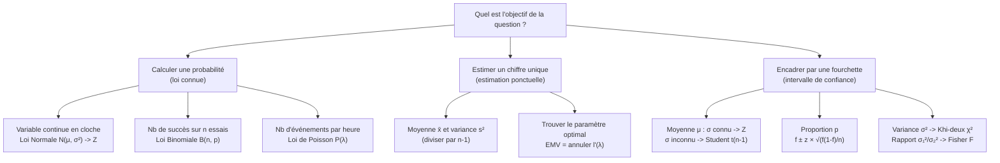

# 🧰 TD 1 — Formules & Explications Terre à Terre : Échantillonnage et Estimations

> ↖ [[MOC_Statistiques_Inferentielles|Statistiques Inférentielles (M1 IT)]] • 📄 [[TD1_Echantillonnage_et_Estimations|Corrigé officiel TD 1]] • 📖 [[01_Echantillonnage_et_Estimations|Ch. 01]] • [[02_Intervalles_de_Confiance|Ch. 02]] • 🎬 [[Fiche_Video_Echantillonnage_et_Estimation|Fiche Vidéo]]

---

## 🧭 Comment choisir la bonne formule ?



---

## 📋 Formulaire & Lexique récapitulatif du TD 1

> [!tip] Mémo rapide des formules utilisées dans le TD 1
> | Concept / Outil | Formule mathématique | Formule en français simple | Quand l'utiliser ? |
> | :--- | :--- | :--- | :--- |
> | **Centrage-réduction (Loi Normale)** | $Z = \dfrac{X - \mu}{\sigma} \sim \mathcal{N}(0, 1)$ | `(Valeur - Moyenne) ÷ Écart-type` | Dès qu'on a une loi normale $\mathcal{N}(\mu, \sigma^2)$ et qu'on lit l'Annexe A.1. |
> | **Règles de symétrie de $\Phi$** | $P(Z > a) = 1 - \Phi(a)$ <br> $P(Z < -a) = 1 - \Phi(a)$ <br> $P(a \le Z \le b) = \Phi(b) - \Phi(a)$ | Au-dessus de $a$ = `1 - aire à gauche` ; sous $-a$ = même queue qu'au-dessus de $+a$ ; entre $a$ et $b$ = `aire(b) - aire(a)` | Pour ramener toute probabilité vers une lecture directe $\Phi(\text{positif})$. |
> | **Loi Binomiale $\mathcal{B}(n, p)$** | $P(X=k) = \binom{n}{k} p^k (1-p)^{n-k}$ <br> $E(X) = np$, $\text{Var}(X) = np(1-p)$ | `Nb combinaisons × (proba succès)^k × (proba échec)^(n-k)` | Comptage de succès sur $n$ essais indépendants de même probabilité $p$. |
> | **Moyenne empirique** | $\bar{x} = \dfrac{1}{n}\sum_{i=1}^{n} x_i$ | `Somme des valeurs ÷ Effectif n` | Estimation ponctuelle sans biais de la moyenne $\mu$. |
> | **Variance biaisée vs corrigée** | $\bar{s}^2 = \dfrac{1}{n}\sum x_i^2 - \bar{x}^2$ <br> $s^2 = \dfrac{\sum x_i^2 - n\bar{x}^2}{n-1}$ | **Biaisée** = `Moyenne des carrés - Moyenne²` ; **Corrigée** = `(Somme carrés - n × Moyenne²) ÷ (n - 1)` | Toujours prendre $s^2$ ($\div (n-1)$) pour estimer $\sigma^2$ sans biais. |
> | **Loi de Poisson $\mathcal{P}(\lambda)$** | $P(X=k) = e^{-\lambda}\dfrac{\lambda^k}{k!}$ <br> $E(X) = \text{Var}(X) = \lambda$ | Proba d'observer $k$ événements quand la moyenne sur la période vaut $\lambda$ | Comptage d'événements sur une durée fixe avec $\bar{x} \approx s^2$. |
> | **IC de $\mu$ ($\sigma$ inconnu)** | $\left[\bar{x} \pm t_{n-1,\, 1-\alpha/2}\dfrac{s}{\sqrt{n}}\right]$ | `Moyenne ± (Coeff Student × s ÷ √n)` | Quand $\sigma$ est inconnu et estimé par $s$ (Annexe C, $\nu = n-1$). |
> | **IC de $\mu$ ($\sigma$ connu)** | $\left[\bar{x} \pm z_{1-\alpha/2}\dfrac{\sigma}{\sqrt{n}}\right]$ | `Moyenne ± (Coeff Normal z × σ ÷ √n)` | Quand l'écart-type vrai $\sigma$ est fourni (Annexe A.2). |
> | **Taille d'échantillon minimale** | $n \ge \left(\dfrac{z_{1-\alpha/2} \cdot \sigma}{e}\right)^2$ *(avec $e = L/2$)* | `(Coeff z × Écart-type ÷ Marge voulue)²`, arrondi **au-dessus** | Dimensionner un échantillon pour atteindre une précision donnée. |
> | **IC d'une variance $\sigma^2$** | $\left[\dfrac{(n-1)s^2}{\chi^2_{n-1,\, 1-\alpha/2}} \;;\; \dfrac{(n-1)s^2}{\chi^2_{n-1,\, \alpha/2}}\right]$ | `[Somme carrés ÷ Grand χ² ; Somme carrés ÷ Petit χ²]` | Encadrer $\sigma^2$ (puis $\sqrt{\cdot}$ pour $\sigma$) sous normalité (Annexe B). |
> | **IC rapport $\sigma_1^2 / \sigma_2^2$** | $\left[\dfrac{s_1^2/s_2^2}{F_{\alpha/2}(\nu_1,\nu_2)} \;;\; \dfrac{s_1^2}{s_2^2}\cdot F_{\alpha/2}(\nu_2,\nu_1)\right]$ | `[Rapport ÷ F(ddl₁, ddl₂) ; Rapport × F(ddl₂, ddl₁)]` | Comparer deux variances ; si $1 \in \text{IC}$, variances homogènes (Annexe D.2). |
> | **IC d'une proportion $p$** | $\left[f \pm z_{1-\alpha/2}\sqrt{\dfrac{f(1-f)}{n}}\right]$ | `Fréquence ± Coeff z × √(f(1-f) ÷ n)` | Encadrer un pourcentage sur un grand échantillon. |
> | **EMV & Cramér-Rao** | $\ell(\lambda) = \ln L(\lambda)$, $\ell'(\hat{\lambda})=0$ <br> $I_n(\lambda) = -E[\ell''(\lambda)]$, $\text{Var}(\hat{\theta}) \ge \dfrac{1}{I_n(\lambda)}$ | Passer au $\ln$ pour transformer le produit en somme, dériver, annuler ; vérifier que $\text{Var}(T)$ touche le plancher $1/I_n(\lambda)$ | Trouver l'estimateur optimal et prouver son efficacité. |

> [!note] Mémo rapide — D'où viennent les seuils lus dans les tables ?
> - **Loi Normale $\mathcal{N}(0, 1)$ (Annexe A.1 / A.2) :** Pour un IC bilatéral de niveau $1 - \alpha$, on cherche $U_{1-\alpha/2} = z_{1-\alpha/2}$ tel que $\Phi(u) = 1 - \frac{\alpha}{2}$ (ex. à $95\%$, $\alpha = 0{,}05 \implies \Phi(u) = 0{,}9750 \implies$ ligne `1,9`, col. `0,06` de l'Annexe A.1 $\implies \mathbf{1{,}96}$ ; à $90\%$, $\Phi(u) = 0{,}9500 \implies \mathbf{1{,}6449}$ ; à $99\%$, $\Phi(u) = 0{,}9950 \implies \mathbf{2{,}5758}$).
> - **Loi de Student (Annexe C) :** Lire la ligne $\nu = n - 1$ et la colonne du risque bilatéral $\alpha$ (ex. $\nu = 9$, $\alpha = 0{,}05$ pour un IC à $95\%$ $\implies t_{9,\, 0{,}975} = 2{,}2622$).
> - **Loi du $\chi^2$ (Annexe B — queue droite) :** Pour un IC à $95\%$ à la ligne $\nu = n - 1$, la colonne `0,025` donne le **grand** quantile (au dénominateur de la **borne inférieure**) et la colonne `0,975` donne le **petit** quantile (au dénominateur de la **borne supérieure**).
> - **Loi de Fisher $\mathcal{F}$ (Annexe D.2 — $\alpha = 0{,}025$) :** Lire $F_{\alpha/2}(\nu_1, \nu_2)$ pour diviser à gauche, et inverser les ddl $F_{\alpha/2}(\nu_2, \nu_1)$ pour multiplier à droite (interpoler linéairement si $\nu$ est absent).

---

## 🧠 Méthode : comment savoir quelle formule utiliser ?

### 1. Les 4 questions à se poser, dans l'ordre
1. **Qu'est-ce qu'on te demande ?** Calculer une chance (loi connue), donner un seul chiffre (estimation), donner une fourchette (intervalle de confiance) ou vérifier une affirmation (test) ?
2. **Sur quoi ça porte ?** Une moyenne $\mu$, une proportion $p$, une variance $\sigma^2$ (ou $\sigma$), comparer deux variances, ou voir si deux trucs sont liés ?
3. **Qu'est-ce que tu as dans les données ?** Est-ce que $\sigma$ est donné ou pas, est-ce que $n \ge 30$ ou $n < 30$, est-ce que c'est une loi normale ?
4. **Quel sens pour le test ?** Les deux côtés (bilatéral) ou un seul côté (unilatéral), selon les mots exacts de l'énoncé ?

### 2. Tableau de traduction : Indice dans l'énoncé → Choix

| Indice lu dans l'énoncé | Choix de la loi / formule |
| :--- | :--- |
| « $\sigma = \dots$ » donné pour la population / « variance connue » | **Loi normale $\mathcal{N}(0, 1)$** ($z$) |
| $\sigma$ inconnu (on calcule $s$ soi-même), population normale, $n < 30$ | **Loi de Student $t(n - 1)$** |
| $n \ge 30$, même avec $\sigma$ inconnu (on utilise $s$) | **Loi normale $z$** par le TCL (Student $\approx$ normale) |
| « proportion », « \% », « $k$ personnes sur $n$ » | Calculer $f = k / n$, puis **loi normale $z$** (si $np \ge 5$ et $n(1-p) \ge 5$) |
| « variance », « écart-type », « variabilité », « dispersion » d'une population | **Loi du Khi-deux $\chi^2(n - 1)$** (normalité obligatoire) |
| Comparer deux variances / tester si les écarts se ressemblent | **Loi de Fisher $\mathcal{F}$** (rapport $s_1^2 / s_2^2$) |
| « égal à », « vaut », « différent de », « diffèrent-ils » | **Test bilatéral** ($\alpha/2$ de chaque côté, quantile $1 - \alpha/2$) |
| « au moins », « supérieur », « plus grand », « ne dépasse pas » | **Test unilatéral** ($\alpha$ d'un seul côté, quantile $1 - \alpha$) |
| Mêmes personnes mesurées avant / après | **Données appariées** : travailler sur les différences $d_i$ |
| $3$ groupes ou plus à comparer en même temps | **ANOVA à 1 facteur** (statistique $F$ de Fisher) |
| Tableau croisé de deux critères qualitatifs | **Test du $\chi^2$ d'indépendance** |
| « suit-elle une loi … ? », « loi candidate » | **Test du $\chi^2$ d'ajustement** ($E_i \ge 5$) |
| Petits effectifs, loi pas normale ou valeur extrême bizarre | **Test non paramétrique** (Wilcoxon ou Mann-Whitney) |

> [!tip] Pourquoi Student plutôt que la loi normale ?
> Parce que tu cumules deux trucs : ton groupe est petit ($n < 30$) ET tu ne connais pas le vrai écart-type $\sigma$ (tu as dû le calculer toi-même avec $s$). Comme $s$ est approximatif et change d'un tirage à l'autre, tu prends une marge de sécurité un peu plus large : c'est ça que fait la table de Student à $n - 1$ ddl. Dès que $n \ge 30$ ou que $\sigma$ est donné dans l'énoncé, tu repasses direct sur la loi normale ($Z$). Ça se voit dans l'Annexe C : à $95\%$, $t = 2{,}2622$ pour $\nu = 9$, puis ça descend doucement jusqu'à $1{,}96$ quand $n$ est très grand.

> [!tip] D'où vient la formule de l'intervalle de confiance ?
> On part de la statistique centrée-réduite encadrée entre $-t$ et $+t$ avec $1 - \alpha$ de chances, puis on isole $\mu$ au milieu :
>
> $$P\left(-t \le \frac{\bar{X}-\mu}{s/\sqrt{n}} \le t\right) = 1-\alpha \iff P\left(\bar{X} - t\frac{s}{\sqrt{n}} \le \mu \le \bar{X} + t\frac{s}{\sqrt{n}}\right) = 1-\alpha$$
>
> En vrai, tout IC a toujours la même tête : **ce que tu estimes ± chiffre de la table × erreur standard**. Seuls le chiffre de la table ($z$, $t$, $\chi^2$, $F$) et l'erreur standard changent d'un exo à l'autre.

---

## 📌 Exercice 1 – Insertion professionnelle des diplômés

> [!question] Énoncé résumé & Données
> L'ANPE étudie la durée $X$ de recherche d'un premier emploi (en mois) dans la région Maritime. On modélise cette durée par une loi normale de moyenne $\mu = 14$ mois et de variance $\sigma^2 = 36$ (soit un écart-type $\sigma = \sqrt{36} = 6$ mois), d'où $Z = \frac{X - 14}{6} \sim \mathcal{N}(0, 1)$. On demande les limites de ce modèle, puis la probabilité de chercher plus de $24$ mois, moins de $6$ mois, ou entre $6$ et $12$ mois.

### 1. Limites de la modélisation normale
*Pourquoi passer par $Z = \frac{X - \mu}{\sigma}$ ?* L'énoncé te donne déjà la loi et ses chiffres ($\mu = 14$, $\sigma^2 = 36$) : il n'y a rien à estimer, on cherche juste une probabilité. Mais la table (Annexe A.1) ne connaît qu'une seule courbe en cloche centrée en $0$ avec écart-type $1$. Calculer $Z$ convertit juste tes mois en écarts-types autour de la moyenne. *(Le piège classique ici : $36$ est la **variance** $\sigma^2$, donc prends bien la racine $\sigma = \sqrt{36} = 6$ avant de diviser !)*
- **Durées négatives impossibles :** une courbe normale va de $-\infty$ à $+\infty$, donc elle donne une petite chance à des durées négatives ($X < 0$), ce qui n'a aucun sens dans la vraie vie :
  $$Z = \frac{X - \mu}{\sigma} = \frac{0 - 14}{6} = -\frac{14}{6} \approx -2{,}33$$
  *Comment lire un chiffre négatif dans l'Annexe A.1 ?* La table ne montre que les nombres positifs. Comme la cloche est symétrique, la petite queue tout à gauche sous $-2{,}33$ a exactement la même taille que la petite queue tout à droite au-dessus de $+2{,}33$, soit $1 - \Phi(2{,}33)$. Dans l'Annexe A.1 (ligne `2,3`, col. `0,03`), $\Phi(2{,}33) = 0{,}9901$ :
  $$P(X < 0) = P(Z < -2{,}33) = 1 - \Phi(2{,}33) \approx 1 - 0{,}9901 = 0{,}0099 \quad (\text{exact } z = -7/3 : \mathbf{0{,}0098}, \text{ soit } 0{,}98\%)$$
- **Courbe trop symétrique :** en vrai, les durées de chômage traînent plutôt vers la droite (quelques personnes cherchent très longtemps), alors que la cloche normale est parfaitement symétrique.

### 2. Chercher plus de 2 ans ($X > 24$ mois)
*Pourquoi $1 - \Phi(a)$ ?* La table te donne toujours l'aire **à gauche** d'un nombre ($\Phi(a) = P(Z \le a)$). Comme toute la courbe fait $1$, l'aire **au-dessus** vaut $1 - \Phi(a)$. *En clair : `Score Z = (Valeur cherchée - Moyenne) ÷ Écart-type`.*
$$Z = \frac{X - \mu}{\sigma} = \frac{24 - 14}{6} = \frac{10}{6} \approx +1{,}67$$
Dans l'Annexe A.1 (ligne `1,6`, col. `0,07`), $\Phi(1{,}67) = 0{,}9525$ :
$$P(X > 24) = P(Z > 1{,}67) = 1 - \Phi(1{,}67) \approx 1 - 0{,}9525 = \mathbf{0{,}0475} \quad (\text{exact } z = 5/3 : 0{,}0478, \text{ soit } \mathbf{4{,}78\%})$$

### 3. Trouver en moins de 6 mois ($X < 6$ mois)
On calcule $Z$ : ça tombe sur du négatif, donc même astuce de symétrie qu'à la question 1 ($P(Z < -a) = 1 - \Phi(a)$) :
$$Z = \frac{X - \mu}{\sigma} = \frac{6 - 14}{6} = -\frac{8}{6} \approx -1{,}33$$
Dans l'Annexe A.1 (ligne `1,3`, col. `0,03`), $\Phi(1{,}33) = 0{,}9082$ :
$$P(X < 6) = P(Z < -1{,}33) = 1 - \Phi(1{,}33) \approx 1 - 0{,}9082 = \mathbf{0{,}0918} \quad (\text{exact } z = -4/3 : 0{,}0912, \text{ soit } \mathbf{9{,}12\%})$$

### 4. Entre 6 mois et 1 an ($6 \le X \le 12$ mois)
*Pourquoi $\Phi(b) - \Phi(a)$ ?* Pour avoir la surface coincée entre deux bornes, tu prends toute la surface jusqu'à la grande borne et tu enlèves ce qui est avant la petite borne :
$$z_{\text{inf}} = \frac{6 - 14}{6} = -\frac{8}{6} \approx -1{,}33, \qquad z_{\text{sup}} = \frac{12 - 14}{6} = -\frac{2}{6} \approx -0{,}33$$
On retourne les deux signes négatifs ($\Phi(-a) = 1 - \Phi(a)$), puis on lit l'Annexe A.1 ($\Phi(1{,}33) = 0{,}9082$ et ligne `0,3`, col. `0,03` $\implies \Phi(0{,}33) = 0{,}6293$) :
$$P(6 \le X \le 12) = \Phi(-0{,}33) - \Phi(-1{,}33) = \big(1 - \Phi(0{,}33)\big) - \big(1 - \Phi(1{,}33)\big) = \Phi(1{,}33) - \Phi(0{,}33)$$
$$P(6 \le X \le 12) \approx 0{,}9082 - 0{,}6293 = \mathbf{0{,}2789} \quad (\text{exact : } 0{,}2782, \text{ soit } \mathbf{27{,}82\%})$$

> [!check] Conclusion concrète
> D'après le modèle, environ $4{,}78\%$ cherchent plus de 2 ans, $9{,}12\%$ trouvent en moins de 6 mois et $27{,}82\%$ entre 6 mois et 1 an — tout en gardant en tête que les queues de la courbe sont approximatives (elle met $0{,}98\%$ sur des durées négatives).

---

## 📌 Exercice 2 – Qualité de service d'un réseau télécom

> [!question] Énoncé résumé & Données
> Un opérateur mobile au Togo s'engage à ce que $95\%$ des SMS de confirmation API arrivent en moins d'une minute ($p = 0{,}95$, échec $1 - p = 0{,}05$). On teste d'abord $n = 2$ SMS par jour, puis $n = 20$ SMS le dimanche.

### 1. Probabilité qu'un SMS arrive en moins d'une minute
Un seul envoi avec deux résultats possibles (à l'heure ou en retard), c'est juste la probabilité donnée dans l'énoncé :
$$p = \mathbf{0{,}95}$$

### 2. Loi pour 2 SMS de test ($X \sim \mathcal{B}(2;\, 0{,}95)$)
*Pourquoi la loi Binomiale et à quoi sert $\binom{n}{k}$ ?* Tu répètes $n = 2$ fois le même test indépendant avec la même chance $p = 0{,}95$, et tu comptes le nombre de réussites : c'est pile la **loi Binomiale $\mathcal{B}(n, p)$**. Le $\binom{2}{k} = \frac{2!}{k!(2-k)!}$ sert à compter le nombre d'ordres différents possibles (par ex., pour $1$ SMS réussi sur $2$, tu peux avoir Réussi-Raté OU Raté-Réussi, donc $2$ façons). *En clair : `Proba d'avoir k succès = Nb de façons × p^k × (1 - p)^(n - k)`.*
$$P(X = k) = \binom{n}{k} p^k (1 - p)^{n-k}$$

| $k$ | Scénarios $\binom{2}{k}$ | Substitution & Calcul détaillé | Probabilité | Pourcentage |
| :---: | :--- | :--- | :---: | :---: |
| $0$ | $\frac{2!}{0!\,2!} = 1$ | $1 \times 0{,}95^0 \times 0{,}05^2 = 1 \times 1 \times 0{,}0025$ | **$\mathbf{0{,}0025}$** | $0{,}25\%$ |
| $1$ | $\frac{2!}{1!\,1!} = 2$ | $2 \times 0{,}95^1 \times 0{,}05^1 = 2 \times 0{,}0475$ | **$\mathbf{0{,}0950}$** | $9{,}50\%$ |
| $2$ | $\frac{2!}{2!\,0!} = 1$ | $1 \times 0{,}95^2 \times 0{,}05^0 = 0{,}9025 \times 1$ | **$\mathbf{0{,}9025}$** | $90{,}25\%$ |

### 3. Modélisation pour 20 SMS par jour
Même principe avec $n = 20$ envois indépendants : $Y \sim \mathcal{B}(n = 20,\; p = 0{,}95)$. Pour une loi binomiale, la moyenne attendue et la variance ont deux formules directes : $E(Y) = np$ et $\text{Var}(Y) = np(1 - p)$ :
$$E(Y) = np = 20 \times 0{,}95 = \mathbf{19\text{ SMS}}$$
$$\text{Var}(Y) = np(1 - p) = 20 \times 0{,}95 \times (1 - 0{,}95) = 20 \times 0{,}95 \times 0{,}05 = \mathbf{0{,}95}$$

### 4. Probabilité qu'au moins la moitié arrive en moins d'une minute ($Y \ge 10$)
*Pourquoi faire $1 - P(Y \le 9)$ ?* Additionner de $k = 10$ jusqu'à $k = 20$ prend du temps ; passer par le contraire ($1$ moins la somme de $0$ à $9$) est beaucoup plus rapide et montre tout de suite que la chance d'échec est quasi nulle :
$$P(Y \ge 10) = 1 - P(Y \le 9) = 1 - \sum_{k=0}^{9} \binom{20}{k}(0{,}95)^k (0{,}05)^{20-k} \approx 1 - 5{,}38 \times 10^{-10} \approx \mathbf{0{,}9999999995}$$

> [!check] Conclusion concrète
> C'est **quasi certain** (plus de $99{,}9999999\%$ de chances) qu'au moins $10$ SMS sur $20$ arrivent en moins d'une minute.

---

## 📌 Exercice 3 – Analyse de données de simulation sous R

> [!question] Énoncé résumé & Données
> Un administrateur système simule sous R les temps de réponse (en ms) d'une API via la commande `round(rnorm(12, 10, 1), 1)` et obtient $n = 12$ valeurs :
> `10.7, 11.7, 11.6, 9.1, 11.1, 10.7, 10.7, 11.1, 9.5, 10.6, 12.0, 11.1`

### 1. Estimation ponctuelle de la moyenne et de la variance (pourquoi $n - 1 = 11$ ?)
Ici tu as $12$ chiffres bruts et on te demande d'estimer la moyenne et la variance réelles de la population (un chiffre pour chaque).

| Mesure $i$ | $x_i$ | $x_i - \bar{x}$ | $(x_i - \bar{x})^2$ | $x_i^2$ *(Koenig-Huygens)* |
| :---: | :---: | :---: | :---: | :---: |
| 1 | $10{,}7$ | $-0{,}125$ | $0{,}015625$ | $114{,}49$ |
| 2 | $11{,}7$ | $+0{,}875$ | $0{,}765625$ | $136{,}89$ |
| 3 | $11{,}6$ | $+0{,}775$ | $0{,}600625$ | $134{,}56$ |
| 4 | $9{,}1$ | $-1{,}725$ | $2{,}975625$ | $82{,}81$ |
| 5 | $11{,}1$ | $+0{,}275$ | $0{,}075625$ | $123{,}21$ |
| 6 | $10{,}7$ | $-0{,}125$ | $0{,}015625$ | $114{,}49$ |
| 7 | $10{,}7$ | $-0{,}125$ | $0{,}015625$ | $114{,}49$ |
| 8 | $11{,}1$ | $+0{,}275$ | $0{,}075625$ | $123{,}21$ |
| 9 | $9{,}5$ | $-1{,}325$ | $1{,}755625$ | $90{,}25$ |
| 10 | $10{,}6$ | $-0{,}225$ | $0{,}050625$ | $112{,}36$ |
| 11 | $12{,}0$ | $+1{,}175$ | $1{,}380625$ | $144{,}00$ |
| 12 | $11{,}1$ | $+0{,}275$ | $0{,}075625$ | $123{,}21$ |
| **Total ($\sum$)** | **$129{,}9$** | **$0$** | **$7{,}802500$** | **$1\,413{,}97$** |

- **Moyenne empirique (sans biais) :** *En clair : `Somme des 12 mesures ÷ 12`.*
  $$\bar{x} = \frac{1}{n}\sum_{i=1}^{12} x_i = \frac{129{,}9}{12} = \mathbf{10{,}825\text{ ms}}$$
- **Variance empirique (biaisée, $\div n$) :** ça mesure juste la dispersion de ces $12$ chiffres entre eux :
  $$\bar{s}^2 = \frac{1}{n}\sum_{i=1}^{12}(x_i - \bar{x})^2 = \frac{7{,}8025}{12} \approx \mathbf{0{,}6502\text{ ms}^2}$$
  *(Vérification Koenig-Huygens : $\bar{s}^2 = \frac{\sum x_i^2}{n} - \bar{x}^2 = \frac{1\,413{,}97}{12} - 10{,}825^2 = 117{,}8308 - 117{,}1806 = 0{,}6502$.)*
- **Variance corrigée (sans biais, $\div (n - 1)$) et écart-type :**
  *Pourquoi on divise par $n - 1 = 11$ et pas par $n = 12$ ?* En fait, tu n'as pas toute la population des temps de réponse, tu as juste un petit groupe de $12$. Comme tu calcules les écarts autour de $\bar{x}$ (la moyenne de ce même petit groupe), tes écarts sont un peu tassés (trop petits par rapport à la réalité). En divisant par $n - 1 = 11$ au lieu de $12$, tu remontes légèrement le résultat pour corriger ça. Retiens simple : dès que tu estimes la population, tu divises par $n - 1$.
  $$s^2 = \frac{1}{n - 1}\sum_{i=1}^{12}(x_i - \bar{x})^2 = \frac{7{,}8025}{12 - 1} = \frac{7{,}8025}{11} \approx \mathbf{0{,}7093\text{ ms}^2}$$
  *(Koenig-Huygens : $s^2 = \frac{\sum x_i^2 - n\bar{x}^2}{n - 1} = \frac{1\,413{,}97 - 12 \times 10{,}825^2}{11} = \frac{1\,413{,}97 - 1\,406{,}1675}{11} = \frac{7{,}8025}{11} \approx 0{,}7093$.)*
  $$s = \sqrt{s^2} = \sqrt{0{,}7093} \approx \mathbf{0{,}8422\text{ ms}}$$

### 2. Interprétation exacte de `round(rnorm(12, 10, 1), 1)`
1. `rnorm(12, 10, 1)` tire **12 nombres au hasard** dans une loi normale de moyenne $\mu = 10$ et d'**écart-type** $\sigma = 1$ *(le piège dans R : le 3e argument de `rnorm` est toujours l'écart-type `sd`, jamais la variance ! Ici `1` donne $\sigma^2 = 1^2 = 1$, mais `rnorm(12, 10, 4)` donnerait une variance de $16$)*.
2. `round(..., 1)` arrondit chacun de ces 12 nombres à **1 chiffre après la virgule**.

> [!check] Conclusion concrète
> On estime la moyenne de la population à $\hat{\mu} = \mathbf{10{,}825\text{ ms}}$ et sa variance sans biais à $\hat{\sigma}^2 = \mathbf{0{,}7093\text{ ms}^2}$ ($s \approx 0{,}8422\text{ ms}$), ce qui reste bien proche des réglages de départ ($\mu = 10$ et $\sigma^2 = 1$).

---

## 📌 Exercice 4 – Modélisation du trafic de requêtes réseau

> [!question] Énoncé résumé & Données
> Une entreprise e-commerce à Lomé relève pendant $n = 53$ heures le nombre de requêtes de service reçues par heure ($x_i \in \{0, \dots, 9\}$) ainsi que leurs occurrences $N_i$. On demande d'estimer le mode, la moyenne et la variance, puis de proposer une loi adaptée.

### 1. Mode, moyenne et variances sur tableau d'effectifs
Comme les $53$ heures sont regroupées en tableau (chaque valeur $x_i$ revient $N_i$ fois), on multiplie par $N_i$ à chaque ligne. *Rappel :* $\bar{s}^2$ ($\div 53$) décrit juste les $53$ heures observées, alors que $s^2$ ($\div 52$) corrige les écarts tassés pour estimer la vraie variance sans biais.

| $x_i$ (appels/h) | $N_i$ (heures) | $N_i x_i$ | $x_i - \bar{x}$ | $N_i(x_i - \bar{x})^2$ | $N_i x_i^2$ *(Koenig-Huygens)* |
| :---: | :---: | :---: | :---: | :---: | :---: |
| 0 | 1 | $1 \times 0 = 0$ | $-4$ | $16$ | $0$ |
| 1 | 4 | $4 \times 1 = 4$ | $-3$ | $36$ | $4$ |
| 2 | 7 | $7 \times 2 = 14$ | $-2$ | $28$ | $28$ |
| 3 | 11 | $11 \times 3 = 33$ | $-1$ | $11$ | $99$ |
| 4 | 10 | $10 \times 4 = 40$ | $0$ | $0$ | $160$ |
| 5 | 9 | $9 \times 5 = 45$ | $+1$ | $9$ | $225$ |
| 6 | 5 | $5 \times 6 = 30$ | $+2$ | $20$ | $180$ |
| 7 | 3 | $3 \times 7 = 21$ | $+3$ | $27$ | $147$ |
| 8 | 2 | $2 \times 8 = 16$ | $+4$ | $32$ | $128$ |
| 9 | 1 | $1 \times 9 = 9$ | $+5$ | $25$ | $81$ |
| **Total ($\sum$)** | **$53$** | **$212$** | — | **$204$** | **$1\,052$** |

- **Mode :** la valeur qui revient le plus souvent ($N_3 = 11$) $\implies \text{Mo} = \mathbf{3\text{ appels/h}}$.
- **Moyenne empirique :**
  $$\bar{x} = \frac{1}{n}\sum N_i x_i = \frac{212}{53} = \mathbf{4{,}00\text{ appels/h}}$$
- **Variance empirique (biaisée, $\div n$) :**
  $$\bar{s}^2 = \frac{1}{n}\sum N_i(x_i - \bar{x})^2 = \frac{204}{53} \approx \mathbf{3{,}8491}$$
  *(Vérification Koenig-Huygens : $\bar{s}^2 = \frac{1\,052}{53} - 4^2 = 19{,}8491 - 16 = 3{,}8491$.)*
- **Variance corrigée (sans biais, $\div (n - 1)$) et écart-type :**
  $$s^2 = \frac{1}{n - 1}\sum N_i(x_i - \bar{x})^2 = \frac{204}{53 - 1} = \frac{204}{52} \approx \mathbf{3{,}9231}$$
  *(Koenig-Huygens : $s^2 = \frac{1\,052 - 53 \times 4^2}{52} = \frac{1\,052 - 848}{52} = \frac{204}{52} \approx 3{,}9231$, d'où $s = \sqrt{3{,}9231} \approx \mathbf{1{,}9807}$.)*

### 2. Pourquoi proposer la loi de Poisson $\mathcal{P}(4)$ ?
Deux indices te le montrent à coup sûr : d'abord tu comptes des nombres entiers ($0, 1, 2, \dots$ appels) sur une durée fixe (1 heure), ensuite la moyenne et la variance sont presque les mêmes ($\bar{x} = 4{,}00 \approx s^2 = 3{,}9231$). C'est la signature exacte de la **loi de Poisson $\mathcal{P}(\lambda)$**.

> [!check] Conclusion concrète
> Le trafic d'appels par heure suit une **loi de Poisson de paramètre $\lambda = 4$**, notée $\mathcal{P}(4)$.

---

## 📌 Exercice 5 – Estimation et intervalles de confiance du trafic Web

> [!question] Énoncé résumé & Données
> Une boutique informatique en ligne relève son nombre journalier de connexions uniques sur $n = 10$ jours, supposé normal selon $\mathcal{N}(\mu, \sigma^2)$ :
> `759, 750, 755, 756, 761, 765, 770, 752, 760, 767`
> On demande d'estimer $\mu$ et $\sigma^2$, de construire les IC à $90\%$ et $99\%$, d'étudier une division par 2 de la largeur, de dimensionner $n$ pour $L \le 1$, et de comparer avec le cas $\sigma^2 = 42$ connu.

### 1. Estimations sans biais de $\mu$ et $\sigma^2$ (pourquoi $n - 1 = 9$ ?)

| Jour $i$ | $x_i$ | $x_i - \bar{x}$ | $(x_i - \bar{x})^2$ | $x_i^2$ *(Koenig-Huygens)* |
| :---: | :---: | :---: | :---: | :---: |
| 1 | $759$ | $-0{,}5$ | $0{,}25$ | $576\,081$ |
| 2 | $750$ | $-9{,}5$ | $90{,}25$ | $562\,500$ |
| 3 | $755$ | $-4{,}5$ | $20{,}25$ | $570\,025$ |
| 4 | $756$ | $-3{,}5$ | $12{,}25$ | $571\,536$ |
| 5 | $761$ | $+1{,}5$ | $2{,}25$ | $579\,121$ |
| 6 | $765$ | $+5{,}5$ | $30{,}25$ | $585\,225$ |
| 7 | $770$ | $+10{,}5$ | $110{,}25$ | $592\,900$ |
| 8 | $752$ | $-7{,}5$ | $56{,}25$ | $565\,504$ |
| 9 | $760$ | $+0{,}5$ | $0{,}25$ | $577\,600$ |
| 10 | $767$ | $+7{,}5$ | $56{,}25$ | $588\,289$ |
| **Total ($\sum$)** | **$7\,595$** | **$0$** | **$378{,}5$** | **$5\,768\,781$** |

- **Moyenne estimée :**
  $$\hat{\mu} = \bar{x} = \frac{1}{n}\sum_{i=1}^{10} x_i = \frac{7\,595}{10} = \mathbf{759{,}5\text{ connexions/jour}}$$
- **Variance corrigée et écart-type :**
  *Pourquoi on divise par $n - 1 = 9$ et pas par $n = 10$ ?* En fait, tu n'as que $10$ jours sous les yeux et tu calcules les écarts autour de $\bar{x}$ (la moyenne de ces mêmes $10$ jours), donc tes écarts sont un peu tassés. Diviser par $n - 1 = 9$ corrige ça (variance corrigée sans biais) et te permet d'utiliser Student juste après.
  $$s^2 = \frac{1}{n - 1}\sum_{i=1}^{10}(x_i - \bar{x})^2 = \frac{378{,}5}{10 - 1} = \frac{378{,}5}{9} \approx \mathbf{42{,}0556}$$
  *(Koenig-Huygens : $10 \times 759{,}5^2 = 5\,768\,402{,}5 \implies s^2 = \frac{5\,768\,781 - 5\,768\,402{,}5}{9} = \frac{378{,}5}{9} \approx 42{,}0556$ ; biaisée : $\bar{s}^2 = \frac{378{,}5}{10} = 37{,}85$.)*
  $$s = \sqrt{42{,}0556} \approx \mathbf{6{,}4850}$$

### 2. IC à 90% et 99% pour $\mu$ (pourquoi Student $t(9)$ et comment former les bornes ?)
*Pourquoi Student et pas la loi normale ?* Parce que tu cumules deux trucs : ton groupe est petit ($n = 10 < 30$) ET tu ne connais pas le vrai écart-type $\sigma$ (tu as dû le calculer toi-même avec $s$). Comme $s$ est approximatif, tu prends une marge un peu plus large avec **Student $t(9)$**.
*Comment trouver les bornes ?* Toujours pareil : $\text{Borne inf} = \bar{x} - e$ et $\text{Borne sup} = \bar{x} + e$, avec $e = t_{9,\, 1-\alpha/2} \times \frac{s}{\sqrt{n}}$ :
1. **Erreur standard ($\text{ES}$) :**
   $$\text{ES} = \frac{s}{\sqrt{n}} = \frac{6{,}4850}{\sqrt{10}} = \frac{6{,}4850}{3{,}1623} \approx \mathbf{2{,}0507}$$
2. **Calcul des marges $e$ et des intervalles de confiance :**
   - **À $90\%$** ($\alpha = 0{,}10$, Annexe C ligne $\nu = 9$ col. `0,10` $\implies t_{9,\, 0{,}95} = 1{,}8331$, $e_{90\%} = 1{,}8331 \times 2{,}0507 = 3{,}7592$) :
     $$\text{IC}_{90\%}(\mu) = \left[\bar{x} - t_{n-1,\, 1-\alpha/2}\frac{s}{\sqrt{n}} \,;\, \bar{x} + t_{n-1,\, 1-\alpha/2}\frac{s}{\sqrt{n}}\right] = \left[759{,}5 - 3{,}7592 \,;\, 759{,}5 + 3{,}7592\right] = \mathbf{\left[755{,}74 \,;\, 763{,}26\right]}$$
   - **À $99\%$** ($\alpha = 0{,}01$, Annexe C ligne $\nu = 9$ col. `0,01` $\implies t_{9,\, 0{,}995} = 3{,}2498$, $e_{99\%} = 3{,}2498 \times 2{,}0507 = 6{,}6645$) :
     $$\text{IC}_{99\%}(\mu) = \left[\bar{x} - t_{n-1,\, 1-\alpha/2}\frac{s}{\sqrt{n}} \,;\, \bar{x} + t_{n-1,\, 1-\alpha/2}\frac{s}{\sqrt{n}}\right] = \left[759{,}5 - 6{,}6645 \,;\, 759{,}5 + 6{,}6645\right] = \mathbf{\left[752{,}84 \,;\, 766{,}16\right]}$$

| Niveau de confiance | $\alpha$ | Quantile $t_{9,\, 1-\alpha/2}$ (Annexe C) | Marge d'erreur $e$ | $IC_{1-\alpha}(\mu) = [\bar{x} - e \,;\, \bar{x} + e]$ |
| :---: | :---: | :---: | :---: | :---: |
| **90%** | $0{,}10$ | $1{,}8331$ | $3{,}7592$ | **$\mathbf{[755{,}74 \,;\, 763{,}26]}$** |
| **99%** | $0{,}01$ | $3{,}2498$ | $6{,}6645$ | **$\mathbf{[752{,}84 \,;\, 766{,}16]}$** |

### 3. Intervalle deux fois plus étroit qu'à 90%
Comme l'erreur standard ne bouge pas, diviser la largeur de l'intervalle par $2$ revient tout simplement à diviser le chiffre de la table ($t$) par $2$ :
$$t_{9,\, 1-\alpha/2} = \frac{1{,}8331}{2} \approx \mathbf{0{,}9166}$$
Dans l'Annexe C ($\nu = 9$), pour $\alpha = 0{,}500$ ($50\%$ de confiance) on lit $t = 0{,}7027$, et pour $\alpha = 0{,}300$ ($70\%$ de confiance) on lit $t = 1{,}0997$. Le niveau de confiance est donc **entre 50% et 70%** *(valeur exacte : $P(|T_9| \le 0{,}91655) \approx \mathbf{61{,}67\%}$)*.

### 4. Taille minimale $n$ pour une longueur $L \le 1$ à 95%
*Le piège ici, c'est « longueur vs marge d'erreur » :* l'intervalle va de $\bar{x} - e$ à $\bar{x} + e$, donc sa **longueur totale** vaut $L = 2e$. Si on veut $L \le 1$, la marge d'erreur $e$ de chaque côté vaut au maximum $0{,}5$. Comme $n$ va être grand, on remplace Student par $z_{0{,}975} = 1{,}96$ (Annexe A.1, $\Phi(u) = 0{,}9750$) :
$$L = 2 \times 1{,}96 \times \frac{6{,}4850}{\sqrt{n}} \le 1 \iff \sqrt{n} \ge 2 \times 1{,}96 \times 6{,}4850 = 25{,}4212$$
$$n \ge (25{,}4212)^2 = 646{,}24 \implies \mathbf{n \ge 647\text{ jours}}$$
*Pourquoi arrondir au-dessus ($647$ et jamais $646$) ?* Avec $646$ jours, la longueur dépasserait juste un peu $1$ : dès qu'il reste une virgule, tu prends toujours l'entier au-dessus pour respecter la consigne.
*(En affinant avec $t_{648, 0{,}975} \approx 1{,}9636$, on obtient $(2 \times 1{,}9636 \times 6{,}4850)^2 = 648{,}64 \implies \mathbf{649\text{ jours}}$. Avec $\bar{s}^2 = 37{,}85$, le calcul donnerait $582$ jours.)*

### 5. Impact si $\sigma^2 = 42$ est connue (pourquoi passer à la loi Normale $z$ ?)
*Pourquoi changer de loi ?* Dès qu'on te donne la vraie variance $\sigma^2 = 42$, tu n'as plus besoin de deviner $\sigma$ avec $s$ : le flou en moins te permet de quitter Student et de repasser direct sur la **loi normale $\mathcal{N}(0, 1)$**. Comme les chiffres $z$ sont plus petits que ceux de Student, les fourchettes deviennent plus serrées (avec $\text{ES} = \frac{\sqrt{42}}{\sqrt{10}} = \frac{6{,}4807}{3{,}1623} \approx \mathbf{2{,}0494}$) :
- **À $90\%$** ($z_{0{,}95} = 1{,}6449$, $e = 1{,}6449 \times 2{,}0494 = 3{,}3711$, largeur $6{,}74$ contre $7{,}52$) :
  $$\text{IC}_{90\%}(\mu) = \left[\bar{x} - z_{1-\alpha/2}\frac{\sigma}{\sqrt{n}} \,;\, \bar{x} + z_{1-\alpha/2}\frac{\sigma}{\sqrt{n}}\right] = \left[759{,}5 - 3{,}3711 \,;\, 759{,}5 + 3{,}3711\right] = \mathbf{\left[756{,}13 \,;\, 762{,}87\right]}$$
- **À $99\%$** ($z_{0{,}995} = 2{,}5758$, $e = 2{,}5758 \times 2{,}0494 = 5{,}2788$, largeur $10{,}56$ contre $13{,}33$) :
  $$\text{IC}_{99\%}(\mu) = \left[\bar{x} - z_{1-\alpha/2}\frac{\sigma}{\sqrt{n}} \,;\, \bar{x} + z_{1-\alpha/2}\frac{\sigma}{\sqrt{n}}\right] = \left[759{,}5 - 5{,}2788 \,;\, 759{,}5 + 5{,}2788\right] = \mathbf{\left[754{,}22 \,;\, 764{,}78\right]}$$

| Niveau | Quantile $z$ | $IC(\mu)$ avec $\sigma$ connu | Largeur (vs Student) |
| :---: | :---: | :---: | :---: |
| **90%** | $1{,}6449$ | **$[756{,}13 \,;\, 762{,}87]$** | $6{,}74$ (contre $7{,}52$) |
| **99%** | $2{,}5758$ | **$[754{,}22 \,;\, 764{,}78]$** | $10{,}56$ (contre $13{,}33$) |

> [!check] Conclusion concrète
> Sans connaître $\sigma$, on a $\mu \in [755{,}74 \,;\, 763{,}26]$ à $90\%$ et $[752{,}84 \,;\, 766{,}16]$ à $99\%$. Pour tenir une largeur $\le 1$ à $95\%$, il faut au moins **$647$ jours** (ou $649$ en Student exact). Quand on connaît $\sigma$, les fourchettes se resserrent tout de suite.

---

## 📌 Exercice 6 – Comparaison de la qualité des matériaux de construction

> [!question] Énoncé résumé & Données
> On évalue la résistance d'un béton bitumineux issu de deux centrales (prélèvements par tranche de $115\text{ m}^3$) :
> Centrale 1 : $n_1 = 25$, $\bar{x}_1 = 90{,}6$, $v_1^2 = 65{,}42$
> Centrale 2 : $n_2 = 23$, $\bar{x}_2 = 94{,}4$, $v_2^2 = 58{,}24$
> *(Convention du cours p. 4 & 14 : $v^2$ désigne la variance empirique divisée par $n$, d'où $(n-1)s^2 = n v^2$. Les résultats entre parenthèses correspondent au cas alternatif où $v^2$ serait déjà corrigée.)*

### 1. IC à 95% de $\sigma^2$ et $\sigma$ de chaque centrale (pourquoi $\chi^2(n - 1)$ et inversion des bornes ?)
*Pourquoi le $\chi^2(n - 1)$ ?* Dès qu'on veut encadrer une **variance $\sigma^2$** (avec $\mu$ inconnue et une loi normale obligatoire), la formule passe par le **$\chi^2(n - 1)$**.
*Pourquoi on met le grand chiffre à gauche et le petit à droite ?* Tout bêtement parce qu'on **divise** par ce chiffre dans $IC_{1-\alpha}(\sigma^2) = \left[\frac{n v^2}{\chi^2_{n-1,\, 1-\alpha/2}} \;;\; \frac{n v^2}{\chi^2_{n-1,\, \alpha/2}}\right]$ ! Quand tu divises par un gros nombre (colonne `0,025` en Annexe B), ça te donne un petit résultat (borne inf), et quand tu divises par un petit nombre (colonne `0,975`), ça te donne un gros résultat (borne sup). Pour passer ensuite à $\sigma$, tu prends juste la racine carrée des deux bornes.
- **Centrale 1 ($\nu_1 = 25 - 1 = 24$) :**
  - Somme des carrés : $n_1 v_1^2 = 25 \times 65{,}42 = \mathbf{1\,635{,}50}$.
  - Quantiles Annexe B ($\nu_1 = 24$) : $\chi^2_{\text{sup}} = 39{,}3641$ (col. `0,025`) et $\chi^2_{\text{inf}} = 12{,}4012$ (col. `0,975`).
    $$\text{IC}_{95\%}(\sigma_1^2) = \left[\frac{n_1 v_1^2}{\chi^2_{n_1-1,\, 1-\alpha/2}} \,;\, \frac{n_1 v_1^2}{\chi^2_{n_1-1,\, \alpha/2}}\right] = \left[\frac{1\,635{,}50}{39{,}3641} \,;\, \frac{1\,635{,}50}{12{,}4012}\right] = \mathbf{\left[41{,}55 \,;\, 131{,}88\right]}$$
    $$\text{IC}_{95\%}(\sigma_1) = \left[\sqrt{\frac{n_1 v_1^2}{\chi^2_{n_1-1,\, 1-\alpha/2}}} \,;\, \sqrt{\frac{n_1 v_1^2}{\chi^2_{n_1-1,\, \alpha/2}}}\right] = \left[\sqrt{41{,}55} \,;\, \sqrt{131{,}88}\right] = \mathbf{\left[6{,}45 \,;\, 11{,}48\right]}$$
- **Centrale 2 ($\nu_2 = 23 - 1 = 22$) :**
  - Somme des carrés : $n_2 v_2^2 = 23 \times 58{,}24 = \mathbf{1\,339{,}52}$.
  - Quantiles Annexe B ($\nu_2 = 22$) : $\chi^2_{\text{sup}} = 36{,}7807$ (col. `0,025`) et $\chi^2_{\text{inf}} = 10{,}9823$ (col. `0,975`).
    $$\text{IC}_{95\%}(\sigma_2^2) = \left[\frac{n_2 v_2^2}{\chi^2_{n_2-1,\, 1-\alpha/2}} \,;\, \frac{n_2 v_2^2}{\chi^2_{n_2-1,\, \alpha/2}}\right] = \left[\frac{1\,339{,}52}{36{,}7807} \,;\, \frac{1\,339{,}52}{10{,}9823}\right] = \mathbf{\left[36{,}42 \,;\, 121{,}97\right]}$$
    $$\text{IC}_{95\%}(\sigma_2) = \left[\sqrt{\frac{n_2 v_2^2}{\chi^2_{n_2-1,\, 1-\alpha/2}}} \,;\, \sqrt{\frac{n_2 v_2^2}{\chi^2_{n_2-1,\, \alpha/2}}}\right] = \left[\sqrt{36{,}42} \,;\, \sqrt{121{,}97}\right] = \mathbf{\left[6{,}03 \,;\, 11{,}04\right]}$$

| Centrale | $\nu = n - 1$ | $n v^2$ | $\chi^2_{\text{inf}}$ (`0,975`) | $\chi^2_{\text{sup}}$ (`0,025`) | $IC_{95\%}(\sigma^2)$ | $IC_{95\%}(\sigma)$ |
| :--- | :---: | :---: | :---: | :---: | :---: | :---: |
| **Centrale 1** | 24 | $1\,635{,}50$ | $12{,}4012$ | $39{,}3641$ | **$\mathbf{[41{,}55 \,;\, 131{,}88]}$** | **$\mathbf{[6{,}45 \,;\, 11{,}48]}$** |
| **Centrale 2** | 22 | $1\,339{,}52$ | $10{,}9823$ | $36{,}7807$ | **$\mathbf{[36{,}42 \,;\, 121{,}97]}$** | **$\mathbf{[6{,}03 \,;\, 11{,}04]}$** |

*(Si $v^2$ déjà corrigée : Centrale 1 donne $24 \times 65{,}42 = 1\,570{,}08 \implies [39{,}89 \,;\, 126{,}61]$ ; Centrale 2 donne $22 \times 58{,}24 = 1\,281{,}28 \implies [34{,}84 \,;\, 116{,}67]$.)*

### 2. Pourquoi le recouvrement des deux IC ne suffit-il pas pour conclure ?
Les deux fourchettes $[41{,}55 \,;\, 131{,}88]$ et $[36{,}42 \,;\, 121{,}97]$ **se chevauchent presque entièrement**. On sent déjà qu'elles n'ont pas l'air différentes, mais pour en être sûr proprement, il faut encadrer le **rapport $\sigma_1^2 / \sigma_2^2$**.

### 3. IC à 95% du rapport $\sigma_1^2 / \sigma_2^2$ (pourquoi Fisher $\mathcal{F}$ et le chiffre $1$ ?)
*Pourquoi Fisher et pourquoi passer à $s_k^2$ ?* Un quotient de deux variances corrigées suit une **loi de Fisher $\mathcal{F}(n_1 - 1, n_2 - 1)$**. Il faut donc d'abord passer de $v_k^2$ ($\div n_k$) à $s_k^2$ ($\div (n_k - 1)$) avec $s_k^2 = \frac{n_k}{n_k - 1}v_k^2$. À gauche on **divise** par $F_{\alpha/2}(\nu_1, \nu_2)$, et à droite on **multiplie** par $F_{\alpha/2}(\nu_2, \nu_1)$ (en inversant les deux ddl).
1. **Variances corrigées et rapport :**
   $$s_1^2 = \frac{25}{24} \times 65{,}42 = 68{,}1458, \qquad s_2^2 = \frac{23}{22} \times 58{,}24 = 60{,}8873, \qquad \frac{s_1^2}{s_2^2} = \frac{68{,}1458}{60{,}8873} = \mathbf{1{,}1192}$$
2. **Interpolation linéaire dans l'Annexe D.2 ($\alpha = 0{,}025$) :**
   - Pour $\nu_1 = 24$ ($24$ est à $40\%$ entre $20$ et $30$, car $\frac{24-20}{30-20} = 0{,}4$) et $\nu_2 = 22$ :
     $$F_{0{,}025}(24, 22) \approx 2{,}39 - 0{,}4(2{,}39 - 2{,}27) = 2{,}39 - 0{,}048 = \mathbf{2{,}342}$$
   - Pour $\nu_2 = 22$ ($22$ est à $20\%$ entre $20$ et $30$, car $\frac{22-20}{30-20} = 0{,}2$) et $\nu_1 = 24$ :
     $$F_{0{,}025}(22, 24) \approx 2{,}33 - 0{,}2(2{,}33 - 2{,}21) = 2{,}33 - 0{,}024 = \mathbf{2{,}306}$$
3. **Calcul des bornes :**
   $$\text{IC}_{95\%}\!\left(\frac{\sigma_1^2}{\sigma_2^2}\right) = \left[\frac{s_1^2 / s_2^2}{F_{\alpha/2}(\nu_1, \nu_2)} \,;\, \frac{s_1^2}{s_2^2} \cdot F_{\alpha/2}(\nu_2, \nu_1)\right] = \left[\frac{1{,}1192}{2{,}342} \,;\, 1{,}1192 \times 2{,}306\right] = \mathbf{\left[0{,}478 \,;\, 2{,}581\right]}$$
   *(Avec $v_1^2 / v_2^2 = 1{,}1233$ : $[0{,}480 \,;\, 2{,}590]$.)*
   *Pourquoi regarder si $1$ est dans l'intervalle ?* Si les deux centrales ont les mêmes écarts ($\sigma_1^2 = \sigma_2^2$), leur division vaut $\mathbf{1}$.

> [!check] Conclusion concrète
> Comme **$1 \in [0{,}478 \,;\, 2{,}581]$**, on ne rejette pas l'égalité des variances : les deux centrales ont des écarts comparables au seuil de $5\%$.

---

## 📌 Exercice 7 – Sondage d'opinion et prédiction électorale

> [!question] Énoncé résumé & Données
> Lors d'un sondage pré-électoral sur $n = 500$ électeurs, $k_1 = 150$ déclarent voter pour le candidat $C_1$ et $k_2 = 140$ pour le candidat $C_2$. Peut-on prédire le gagnant avec des intervalles de confiance à $95\%$ ?

### 1. Proportions observées $f_1$ et $f_2$
$$f_1 = \frac{150}{500} = \mathbf{0{,}30} \ (30\%), \qquad f_2 = \frac{140}{500} = \mathbf{0{,}28} \ (28\%)$$

### 2. IC à 95% des intentions de vote (pourquoi loi Normale $z$ et $f(1-f)$ sous la racine ?)
On encadre un pourcentage sur un grand sondage ($n = 500 > 30$) : c'est la **loi normale $z$**. Et comme on fait un **intervalle de confiance** (on n'a pas de $p_0$ imposé au départ), on met la fréquence observée $f(1 - f)$ sous la racine. À $95\%$, $\Phi(z) = 1 - \frac{0{,}05}{2} = 0{,}9750 \implies z_{0{,}975} = \mathbf{1{,}96}$ (Annexe A.1, ligne `1,9`, col. `0,06`). *En clair : `IC = Score observé ± 1,96 × √(Score × (1 - Score) ÷ n)`.*
- **Pour le candidat $C_1$ :**
  $$e_1 = z_{1-\alpha/2}\sqrt{\frac{f_1(1 - f_1)}{n}} = 1{,}96\sqrt{\frac{0{,}30 \times (1 - 0{,}30)}{500}} = 1{,}96\sqrt{\frac{0{,}21}{500}} = 1{,}96\sqrt{0{,}00042} = 1{,}96 \times 0{,}02049 = \mathbf{0{,}0402}$$
  $$\text{IC}_{95\%}(C_1) = \left[f_1 - z_{1-\alpha/2}\sqrt{\frac{f_1(1 - f_1)}{n}} \,;\, f_1 + z_{1-\alpha/2}\sqrt{\frac{f_1(1 - f_1)}{n}}\right] = \left[0{,}30 - 0{,}0402 \,;\, 0{,}30 + 0{,}0402\right] = \left[0{,}2598 \,;\, 0{,}3402\right] = \mathbf{\left[25{,}98\% \,;\, 34{,}02\%\right]}$$
- **Pour le candidat $C_2$ :**
  $$e_2 = z_{1-\alpha/2}\sqrt{\frac{f_2(1 - f_2)}{n}} = 1{,}96\sqrt{\frac{0{,}28 \times (1 - 0{,}28)}{500}} = 1{,}96\sqrt{\frac{0{,}2016}{500}} = 1{,}96\sqrt{0{,}0004032} = 1{,}96 \times 0{,}02008 = \mathbf{0{,}0394}$$
  $$\text{IC}_{95\%}(C_2) = \left[f_2 - z_{1-\alpha/2}\sqrt{\frac{f_2(1 - f_2)}{n}} \,;\, f_2 + z_{1-\alpha/2}\sqrt{\frac{f_2(1 - f_2)}{n}}\right] = \left[0{,}28 - 0{,}0394 \,;\, 0{,}28 + 0{,}0394\right] = \left[0{,}2406 \,;\, 0{,}3194\right] = \mathbf{\left[24{,}06\% \,;\, 31{,}94\%\right]}$$

| Candidat | Voix $k$ | Proportion $f$ | Marge d'erreur ($95\%$) | $IC_{95\%}(p)$ |
| :---: | :---: | :---: | :---: | :---: |
| **$C_1$** | $150$ | $0{,}30$ ($\mathbf{30\%}$) | $\pm 0{,}0402$ | **$\mathbf{[25{,}98\% \,;\, 34{,}02\%]}$** |
| **$C_2$** | $140$ | $0{,}28$ ($\mathbf{28\%}$) | $\pm 0{,}0394$ | **$\mathbf{[24{,}06\% \,;\, 31{,}94\%]}$** |

### 3. Pourquoi on ne peut pas prédire le vainqueur ?
La marge d'erreur ($\approx \pm 4\%$) est **deux fois plus grande** que la petite avance observée ($30\% - 28\% = 2\%$). Les deux fourchettes se chevauchent de $25{,}98\%$ à $31{,}94\%$ : en vrai, $C_1$ pourrait très bien faire $27\%$ et $C_2$ faire $31\%$.

> [!check] Conclusion concrète
> **Non**, impossible de prédire qui gagne : les deux fourchettes se croisent largement sur $[25{,}98\% \,;\, 31{,}94\%]$ et la marge d'erreur ($\approx \pm 4\%$) dépasse l'écart de $2\%$.

---

## 📌 Exercice 8 – Estimation par maximum de vraisemblance du flux de notifications

> [!question] Énoncé résumé & Données
> Le nombre $X$ de notifications reçues par un étudiant pendant une séance suit une loi de Poisson $\mathcal{P}(\lambda)$ :
> $$P(X = k) = e^{-\lambda}\frac{\lambda^k}{k!}, \qquad k \in \mathbb{N}, \; \lambda > 0$$
> Échantillon relevé sur $n = 10$ étudiants : `1, 4, 1, 3, 1, 6, 3, 0, 0, 0`.

### 1. Signification de $\lambda$
$\lambda$ est le **nombre moyen de notifications reçues par un étudiant pendant un cours** (et aussi sa variance, parce que dans une loi de Poisson $E(X) = \text{Var}(X) = \lambda$).

### 2. Fonction de vraisemblance $L(\lambda)$ (pourquoi un produit ?)
Tu as déjà tes $10$ chiffres tirés indépendamment les uns des autres. Du coup, la chance d'obtenir exactement ces $10$ chiffres à la suite pour un $\lambda$ donné, c'est la **multiplication** de la probabilité de chacun :
$$L(x_1, \dots, x_n; \lambda) = \prod_{i=1}^n P(X_i = x_i) = \prod_{i=1}^n e^{-\lambda}\frac{\lambda^{x_i}}{x_i!} = \frac{e^{-n\lambda}\, \lambda^{\sum_{i=1}^n x_i}}{\prod_{i=1}^n x_i!}$$

### 3. Application numérique ($n = 10$)
Effectifs : $k=0$ ($3$ fois), $k=1$ ($3$ fois), $k=3$ ($2$ fois), $k=4$ ($1$ fois), $k=6$ ($1$ fois).

```text
Effectif
  3 |  █    █
  2 |  █    █         █
  1 |  █    █         █    █         █
  0 +--0----1----2----3----4----5----6--> Nb notifications
```

- Somme : $\sum_{i=1}^{10} x_i = 1 + 4 + 1 + 3 + 1 + 6 + 3 + 0 + 0 + 0 = \mathbf{19}$.
- Produit des factorielles ($0!=1$, $1!=1$, $3!=6$, $4!=24$, $6!=720$) :
  $$\prod_{i=1}^{10} x_i! = 4!\,3!\,6!\,3! = 24 \times 6 \times 720 \times 6 = \mathbf{622\,080}$$
- Essais numériques de $L(\lambda) = \frac{e^{-10\lambda}\,\lambda^{19}}{622\,080}$ :
  $$L(1) = \frac{e^{-10} \times 1^{19}}{622\,080} = \frac{4{,}5400 \times 10^{-5}}{622\,080} \approx \mathbf{7{,}298 \times 10^{-11}}$$
  $$L(2) = \frac{e^{-20} \times 2^{19}}{622\,080} = \frac{2{,}0612 \times 10^{-9} \times 524\,288}{622\,080} \approx \mathbf{1{,}737 \times 10^{-9}}$$
  Le sommet est atteint en $\hat{\lambda} = \frac{19}{10} = \mathbf{1{,}9}$, où $L(1{,}9) = \frac{e^{-19} \times 1{,}9^{19}}{622\,080} \approx \mathbf{1{,}782 \times 10^{-9}}$.

### 4. EMV via la log-vraisemblance (pourquoi passer au $\ln$ et vérifier $\ell'' < 0$ ?)
*Pourquoi on met un $\ln$ devant ?* Parce que dériver une multiplication de $10$ morceaux, c'est galère. Le $\ln$ transforme la multiplication en une simple addition, super facile à dériver, sans changer l'endroit où se trouve le maximum. Et comme la dérivée seconde est négative ($\ell''(\lambda) < 0$), la courbe fait une bosse vers le haut : on est bien tout en haut d'un pic (maximum), pas au fond d'un creux.
$$\ell(\lambda) = \ln L(X_1, \dots, X_n; \lambda) = -n\lambda + \left(\sum_{i=1}^n X_i\right)\ln\lambda - \sum_{i=1}^n \ln(X_i!)$$
$$\frac{\partial \ell}{\partial \lambda} = -n + \frac{\sum_{i=1}^n X_i}{\lambda} = 0 \iff \frac{\sum_{i=1}^n X_i}{\lambda} = n \iff \hat{\lambda} = \frac{1}{n}\sum_{i=1}^n X_i = \overline{X}$$
$$\frac{\partial^2 \ell}{\partial \lambda^2} = -\frac{\sum_{i=1}^n X_i}{\lambda^2} < 0 \quad (\text{c'est bien un maximum})$$
L'estimateur du maximum de vraisemblance est donc **$T = \overline{X}$**.

### 5. Estimation numérique
$$\hat{\lambda}_{\text{EMV}} = \bar{x} = \frac{19}{10} = \mathbf{1{,}9\text{ notifications/séance}}$$

### 6. Espérance et variance de $T = \overline{X}$
Puisque $X_i \sim \mathcal{P}(\lambda)$ ($E(X_i) = \lambda$ et $\text{Var}(X_i) = \lambda$) :
$$E(T) = E\!\left(\frac{1}{n}\sum_{i=1}^n X_i\right) = \frac{1}{n}(n\lambda) = \lambda \quad (\text{estimateur sans biais})$$
$$\text{Var}(T) = \text{Var}\!\left(\frac{1}{n}\sum_{i=1}^n X_i\right) = \frac{1}{n^2}\sum_{i=1}^n \text{Var}(X_i) = \frac{n\lambda}{n^2} = \mathbf{\frac{\lambda}{n}}$$

### 7. Information de Fisher $I_n(\lambda)$
*À quoi ça sert ?* Elle mesure combien d'information nos $n$ observations apportent sur $\lambda$ (la courbure moyenne de la bosse) :
$$I_n(\lambda) = -E\!\left[\frac{\partial^2 \ell(\lambda)}{\partial \lambda^2}\right] = -E\!\left[-\frac{\sum_{i=1}^n X_i}{\lambda^2}\right] = \frac{\sum_{i=1}^n E(X_i)}{\lambda^2} = \frac{n\lambda}{\lambda^2} = \mathbf{\frac{n}{\lambda}}$$

### 8. Efficacité via la borne de Cramér-Rao (le plancher $1 / I_n(\lambda)$)
*La borne de Cramér-Rao, c'est quoi ?* C'est la limite minimale possible : aucun calcul sans biais ne peut faire plus précis que $1 / I_n(\lambda)$ :
$$\text{Var}(\hat{\theta}) \ge \frac{1}{I_n(\lambda)} = \frac{1}{n / \lambda} = \frac{\lambda}{n}$$

> [!check] Conclusion concrète
> Comme $\text{Var}(T) = \frac{\lambda}{n}$ tombe pile sur cette limite minimale de Cramér-Rao, on ne peut pas faire mieux : $T = \overline{X}$ est un estimateur sans biais et **efficace** de $\lambda$. $\blacksquare$

---

## 📌 Exercice 9 – Estimation ponctuelle et par intervalle de confiance (Cacao)

> [!question] Énoncé résumé & Données
> On pèse la production de cacao (en kg) de $n = 10$ pieds tirés au hasard dans la région des Plateaux, modélisée par $\mathcal{N}(\mu, \sigma^2)$ :
> `2.4, 3.4, 3.6, 4.1, 4.3, 4.7, 5.4, 5.9, 6.5, 6.9`
> On résume ici les estimations ponctuelles, les trois grandes familles d'IC ($\mu$ via Student, $\sigma^2$ via $\chi^2$, $\mu$ via Normale si $\sigma = 1{,}4$ connu) puis la taille minimale $n$ pour $\pm 0{,}5$ kg à $99\%$.

### 1. Estimations sans biais de $\mu$ et $\sigma^2$ (pourquoi $n - 1 = 9$ ?)

| Pied $i$ | $x_i$ (kg) | $x_i - \bar{x}$ | $(x_i - \bar{x})^2$ | $x_i^2$ *(Koenig-Huygens)* |
| :---: | :---: | :---: | :---: | :---: |
| 1 | $2{,}4$ | $-2{,}32$ | $5{,}3824$ | $5{,}76$ |
| 2 | $3{,}4$ | $-1{,}32$ | $1{,}7424$ | $11{,}56$ |
| 3 | $3{,}6$ | $-1{,}12$ | $1{,}2544$ | $12{,}96$ |
| 4 | $4{,}1$ | $-0{,}62$ | $0{,}3844$ | $16{,}81$ |
| 5 | $4{,}3$ | $-0{,}42$ | $0{,}1764$ | $18{,}49$ |
| 6 | $4{,}7$ | $-0{,}02$ | $0{,}0004$ | $22{,}09$ |
| 7 | $5{,}4$ | $+0{,}68$ | $0{,}4624$ | $29{,}16$ |
| 8 | $5{,}9$ | $+1{,}18$ | $1{,}3924$ | $34{,}81$ |
| 9 | $6{,}5$ | $+1{,}78$ | $3{,}1684$ | $42{,}25$ |
| 10 | $6{,}9$ | $+2{,}18$ | $4{,}7524$ | $47{,}61$ |
| **Total ($\sum$)** | **$47{,}2$** | **$0$** | **$18{,}7160$** | **$241{,}50$** |

- **Moyenne estimée :**
  $$\hat{\mu} = \bar{x} = \frac{1}{n}\sum_{i=1}^{10} x_i = \frac{47{,}2}{10} = \mathbf{4{,}72\text{ kg}}$$
- **Variance sans biais et écart-type :**
  *Pourquoi diviser par $n - 1 = 9$ et pas par $n = 10$ ?* En fait, tu n'as que $10$ pieds de cacao sous les yeux et tu calcules les écarts autour de $\bar{x}$ (tirée de ces mêmes $10$ pieds), donc tes écarts sont un peu tassés. Diviser par $n - 1 = 9$ corrige ça pour estimer sans biais la vraie dispersion, et te permet d'utiliser Student et le $\chi^2$ juste après.
  $$\hat{\sigma}^2 = s^2 = \frac{1}{n - 1}\sum_{i=1}^{10}(x_i - \bar{x})^2 = \frac{18{,}716}{10 - 1} = \frac{18{,}716}{9} \approx \mathbf{2{,}0796\text{ kg}^2}$$
  *(Koenig-Huygens : $10 \times 4{,}72^2 = 222{,}784 \implies s^2 = \frac{241{,}50 - 222{,}784}{9} = \frac{18{,}716}{9} \approx 2{,}0796$, d'où $s = \sqrt{2{,}0796} \approx \mathbf{1{,}4421\text{ kg}}$.)*

### 2. IC à 95% de $\mu$ avec $\sigma$ inconnu (pourquoi Student $t(9)$ ?)
*Pourquoi Student ?* Parce que tu as un petit groupe ($n = 10 < 30$), une loi normale, et tu ne connais pas le vrai $\sigma$ (tu as dû le remplacer par $s$) $\implies$ **Student $t(9)$**.
- Erreur standard : $\text{ES} = \frac{s}{\sqrt{n}} = \frac{1{,}4421}{\sqrt{10}} = \frac{1{,}4421}{3{,}1623} = \mathbf{0{,}4560\text{ kg}}$.
- En Annexe C (ligne $\nu = 9$, col. bilatérale `0,05`), $t_{9,\, 0{,}975} = \mathbf{2{,}2622}$, d'où la marge $e = 2{,}2622 \times 0{,}4560 = \mathbf{1{,}0316\text{ kg}}$.
- **Intervalle de confiance à $95\%$ de $\mu$ :**
  $$\text{IC}_{95\%}(\mu) = \left[\bar{x} - t_{n-1,\, 1-\alpha/2}\frac{s}{\sqrt{n}} \,;\, \bar{x} + t_{n-1,\, 1-\alpha/2}\frac{s}{\sqrt{n}}\right] = \left[4{,}72 - 1{,}0316 \,;\, 4{,}72 + 1{,}0316\right] = \mathbf{\left[3{,}69 \,;\, 5{,}75\right]\text{ kg}}$$

### 3. IC à 95% de $\sigma^2$ (pourquoi Khi-deux $\chi^2(9)$ ?)
*Pourquoi $\chi^2$ et pourquoi cet ordre ?* On veut encadrer la **variance $\sigma^2$** sous loi normale ($\frac{(n-1)s^2}{\sigma^2} \sim \chi^2(9)$). Comme on divise $(n-1)s^2 = 18{,}716$ par les chiffres de la table, on divise par le **grand** chiffre (col. `0,025` en Annexe B : $k_{0{,}975} = 19{,}0228$) pour avoir la petite borne à gauche, et par le **petit** chiffre (col. `0,975` : $k_{0{,}025} = 2{,}7004$) pour avoir la grande borne à droite :
$$\text{IC}_{95\%}(\sigma^2) = \left[\frac{(n - 1)s^2}{\chi^2_{n-1,\, 1-\alpha/2}} \,;\, \frac{(n - 1)s^2}{\chi^2_{n-1,\, \alpha/2}}\right] = \left[\frac{18{,}716}{19{,}0228} \,;\, \frac{18{,}716}{2{,}7004}\right] = \mathbf{\left[0{,}98 \,;\, 6{,}93\right]\text{ kg}^2}$$

### 4. IC à 95% de $\mu$ avec $\sigma = 1{,}4$ connu (pourquoi loi Normale $z$ ?)
*Pourquoi la loi normale ?* Comme on te donne $\sigma = 1{,}4$, tu n'as plus à deviner la dispersion : tu quittes Student et tu repasses direct sur la **loi normale $\mathcal{N}(0, 1)$** ($z_{0{,}975} = 1{,}96$ en Annexe A.1 pour $\Phi(z) = 0{,}9750$).
- Erreur standard : $\text{ES} = \frac{\sigma}{\sqrt{n}} = \frac{1{,}4}{\sqrt{10}} = \frac{1{,}4}{3{,}1623} = \mathbf{0{,}4427\text{ kg}}$.
- Marge d'erreur : $e = 1{,}96 \times 0{,}4427 = \mathbf{0{,}8677\text{ kg}}$.
- **Intervalle de confiance à $95\%$ de $\mu$ :**
  $$\text{IC}_{95\%}(\mu) = \left[\bar{x} - z_{1-\alpha/2}\frac{\sigma}{\sqrt{n}} \,;\, \bar{x} + z_{1-\alpha/2}\frac{\sigma}{\sqrt{n}}\right] = \left[4{,}72 - 0{,}8677 \,;\, 4{,}72 + 0{,}8677\right] = \mathbf{\left[3{,}85 \,;\, 5{,}59\right]\text{ kg}}$$

### 5. Taille minimale $n$ à 99% (pourquoi arrondir $52{,}016$ à $53$ ?)
On veut que la marge d'erreur $z_{0{,}995}\frac{\sigma}{\sqrt{n}}$ ne dépasse pas $0{,}5$ kg, avec $z_{0{,}995} = 2{,}5758$ (Annexe A.1/A.2 pour $\Phi(z) = 1 - \frac{0{,}01}{2} = 0{,}9950$) :
$$\sqrt{n} \ge \frac{z_{0{,}995} \cdot \sigma}{e} = \frac{2{,}5758 \times 1{,}4}{0{,}5} = \frac{3{,}6061}{0{,}5} = 7{,}2122 \implies n \ge (7{,}2122)^2 = 52{,}016 \implies \mathbf{n_{\min} = 53\text{ pieds}}$$
*Pourquoi $53$ et jamais $52$ ?* Avec $52$ pieds, ta marge d'erreur vaut $0{,}5001$ kg : ça dépasse $0{,}5$ kg ! Dès qu'il reste une virgule, tu arrondis **toujours au-dessus**. *(Identique avec $z = 2{,}576$ issu du tableau du chapitre 2 : $52{,}025 \implies 53$ pieds.)*

> [!check] Conclusion concrète
> En moyenne, un pied donne environ $\mathbf{4{,}72\text{ kg}}$ ($IC_{95\%} = [3{,}69 \,;\, 5{,}75]$ kg en Student, ou $[3{,}85 \,;\, 5{,}59]$ kg si $\sigma = 1{,}4$ est connu), et il faut observer au moins **$53$ pieds** pour être précis à $\pm 0{,}5$ kg avec $99\%$ de confiance.
