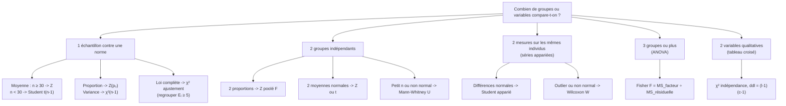

# 🧰 TD 2 — Formules & Explications Terre à Terre : Tests d'Hypothèses

> ↖ [[MOC_Statistiques_Inferentielles|Statistiques Inférentielles (M1 IT)]] • 📄 [[TD2_Tests_Hypotheses|Corrigé officiel TD 2]] • 📖 [[03_Generalites_Tests_Hypotheses|Ch. 03]] • [[04_Tests_Parametriques|Ch. 04]] • [[05_Tests_Non_Parametriques|Ch. 05]]

---

## 🧭 Comment choisir le bon test statistique ?

---

## 📋 Formulaire & Lexique récapitulatif du TD 2

> [!tip] Mémo rapide des formules utilisées dans le TD 2
> | Concept / Test | Formule mathématique | Formule en français simple | Quand l'utiliser ? |
> | :--- | :--- | :--- | :--- |
> | **Squelette d'un test paramétrique** | $\text{Stat} = \dfrac{\hat{\theta} - \theta_0}{\text{ES}}$ | `(Observé - Attendu sous H₀) ÷ Erreur standard` | Mesure combien d'erreurs standards séparent l'échantillon de $H_0$. |
> | **Test $Z$ sur moyenne ($n \ge 30$)** | $Z = \dfrac{\overline{X} - \mu_0}{s / \sqrt{n}} \sim \mathcal{N}(0,1)$ | `(Moyenne mesurée - Cible μ₀) ÷ (Écart-type ÷ √n)` | Conformité d'une moyenne sur grand échantillon (TCL). |
> | **Test $t$ sur moyenne ($n < 30$)** | $t = \dfrac{\overline{X} - \mu_0}{s / \sqrt{n}} \sim t(n-1)$ | Même calcul que $Z$, mais lu dans **Student** à $n-1$ ddl | Conformité d'une moyenne sur petit échantillon normal ($\sigma$ inconnu). |
> | **Test $Z$ sur proportion** | $Z = \dfrac{f - p_0}{\sqrt{\dfrac{p_0(1-p_0)}{n}}}$ | `(Fréquence observée - Taux H₀) ÷ √(p₀(1-p₀) ÷ n)` | Si $np_0 \ge 5$ et $n(1-p_0) \ge 5$. |
> | **Test $\chi^2$ sur variance** | $V = \dfrac{(n-1)s^2}{\sigma_0^2} \sim \chi^2(n-1)$ | `Somme carrés des écarts ÷ Variance cible σ₀²` | Tester si $\sigma$ respecte un seuil (normalité requise). |
> | **Test $\chi^2$ d'ajustement** | $\chi^2_{\text{obs}} = \sum_{i=1}^k \dfrac{(O_i - E_i)^2}{E_i}$, $\nu = k - 1 - p$ | `Somme de (Observé - Attendu)² ÷ Attendu` | Regrouper pour $E_i \ge 5$ ; $p$ = nb de paramètres estimés. |
> | **Comparaison 2 proportions** | $F = \dfrac{k_1 + k_2}{n_1 + n_2}$, $Z = \dfrac{f_1 - f_2}{\sqrt{F(1-F)\left(\frac{1}{n_1}+\frac{1}{n_2}\right)}}$ | `Taux commun = total succès ÷ total sondés`, puis écart ÷ erreur standard | Comparer 2 pourcentages sur 2 grands échantillons indépendants. |
> | **ANOVA à 1 facteur** | $V_T^2 = V_R^2 + V_A^2$, $F = \dfrac{\text{SC}_A / (K-1)}{\text{SC}_R / (n-K)}$ | `F = Signal moyen entre groupes ÷ Bruit moyen interne` | Comparer $K \ge 3$ moyennes simultanément (Annexe D.1). |
> | **Comparaison 2 moyennes** | $N = \dfrac{\bar{x}_1 - \bar{x}_2}{\sqrt{\frac{v_1^2}{n_1}+\frac{v_2^2}{n_2}}}$, $F_{\text{hom}} = \dfrac{s_{\max}^2}{s_{\min}^2}$ | `(Moyenne 1 - Moyenne 2) ÷ √(Var₁/n₁ + Var₂/n₂)` | Vérifier Shapiro-Wilk + homoscédasticité ($F$) avant. |
> | **Test $t$ apparié** | $d_i = X_{\text{après}, i} - X_{\text{avant}, i}$, $t = \dfrac{\bar{d}}{s_d / \sqrt{n}}$ | Calculer chaque écart $d_i$, puis tester si la moyenne des écarts vaut $0$ | Mesures Avant/Après sur les mêmes individus (normalité requise). |
> | **Wilcoxon (rangs signés)** | $W = \min(W^+, W^-)$, $W^+ + W^- = \dfrac{n(n+1)}{2}$ | Jeter les $0$, trier $\lvert d_i\rvert$, sommer rangs $+$ et $-$, prendre le min | Robuste aux outliers ; rejet si $W \le W_{\text{crit}}$. |
> | **Mann-Whitney $U$** | $U_1 = R_1 - \dfrac{n_1(n_1+1)}{2}$, $U_2 = n_1 n_2 - U_1$ | Classer tout ensemble, $U = \min(U_1, U_2)$ duels perdus/gagnés | Alternative non paramétrique à 2 moyennes ; rejet si $U \le U_{\text{crit}}$. |
> | **$\chi^2$ d'indépendance** | $E_{ij} = \dfrac{L_i \times C_j}{N}$, $\nu = (l-1)(c-1)$ | `Attendu = (Total ligne × Total colonne) ÷ Total global` | Lien entre 2 variables qualitatives (tous $E_{ij} \ge 5$). |

---

## 📌 Exercice 1 – Montant moyen des remboursements de crédit

> [!question] Le problème en clair
> Un ingénieur risque crédit à Lomé veut savoir si la mensualité moyenne de remboursement vaut bien $\mu_0 = 200$ €. Il prélève $n = 144$ clients et trouve $\bar{x} = 193{,}74$ € et $s = 48{,}24$ €. On teste à $\alpha = 5\%$ puis à $\alpha = 10\%$ avec la $p$-value.

> [!info] Comprendre la logique (terre à terre)
> **C'est quoi la $p$-value, concrètement ?**
> Imagine que le directeur dit vrai ($\mu = 200$ €). Si tu tires au sort $144$ clients, la $p$-value est la probabilité d'observer un écart d'au moins $\pm 6{,}26$ € par pur hasard. Ici elle vaut $11{,}94\%$ : c'est trop banal pour accuser la norme de $200$ € d'être fausse.
>
> **La règle d'or :**
> Si la $p$-value est plus petite que le risque toléré ($p < \alpha$), le hasard n'est plus crédible et on rejette $H_0$. Ici $11{,}94\% > 5\%$ et $11{,}94\% > 10\%$, donc on conserve $H_0$ dans les deux cas.

### Les formules utilisées
**Formules mathématiques :**
$$H_0 : \mu = 200 \quad \text{vs} \quad H_1 : \mu \ne 200$$
$$z_{\text{obs}} = \frac{\bar{x} - \mu_0}{s / \sqrt{n}}, \qquad p\text{-value} = 2\big(1 - \Phi(|z_{\text{obs}}|)\big)$$

**En français simple :**
`Score Z = (Moyenne mesurée - Moyenne prétendue) ÷ (Écart-type ÷ √Effectif)`
`p-value bilatérale = 2 × Probabilité d'être au-delà de |Z| sous la courbe normale`

### Résolution détaillée pas-à-pas
On calcule d'abord l'erreur standard puis la statistique $z_{\text{obs}}$ :
$$\text{Erreur standard} = \frac{48{,}24}{\sqrt{144}} = \frac{48{,}24}{12} = 4{,}02\text{ €}$$
$$z_{\text{obs}} = \frac{193{,}74 - 200}{4{,}02} = \frac{-6{,}26}{4{,}02} \approx \mathbf{-1{,}5572}$$

À $\alpha = 5\%$ en bilatéral ($z_{\text{crit}} = \pm 1{,}96$, soit $[192{,}12 \,;\, 207{,}88]$ €), $|z_{\text{obs}}| = 1{,}5572 < 1{,}96$. Avec l'Annexe A.1 ($\Phi(1{,}56) = 0{,}9406$) :
$$p\text{-value} \approx 2(1 - 0{,}9406) = 0{,}1188 \quad (\text{exact : } \mathbf{0{,}1194} = 11{,}94\%)$$

> [!check] Conclusion concrète
> Que le seuil soit $\alpha = 5\%$ ou $\alpha = 10\%$, comme $p = 11{,}94\% > \alpha$, **on ne rejette pas $H_0$** : l'écart de $6{,}26$ € reste dans la marge normale du hasard.

---

## 📌 Exercice 2 – Parité dans les filières informatiques

> [!question] Énoncé en clair
> Dans un Master IT de $n = 64$ étudiants, il y a $k = 28$ femmes ($f = 28/64 = 43{,}75\%$). Peut-on dire que la filière attire autant les femmes que les hommes ($p_0 = 50\%$) ?

> [!info] Comprendre la logique (terre à terre)
> **Pourquoi mettre $p_0$ et pas $f$ sous la racine carrée ?**
> Contrairement à un intervalle de confiance (où $p$ est inconnu et remplacé par $f$), dans un test d'hypothèse on se place **dans le monde où $H_0$ est vraie** ($p = 0{,}50$). On calcule donc la variabilité théorique avec $p_0(1 - p_0)$.

### Les formules utilisées
**Formule mathématique :**
$$z_{\text{obs}} = \frac{f - p_0}{\sqrt{\dfrac{p_0(1 - p_0)}{n}}}$$

**En français simple :**
`Score Z = (Proportion observée - 0,50) ÷ √(0,50 × 0,50 ÷ Effectif)`

### Résolution détaillée pas-à-pas
Les conditions $np_0 = 32 \ge 5$ et $n(1 - p_0) = 32 \ge 5$ sont vérifiées. Sous $H_0$ :
$$z_{\text{obs}} = \frac{0{,}4375 - 0{,}50}{\sqrt{\dfrac{0{,}50 \times 0{,}50}{64}}} = \frac{-0{,}0625}{0{,}0625} = \mathbf{-1{,}00}$$
$$p\text{-value} = 2\big(1 - \Phi(1{,}00)\big) = 2(1 - 0{,}8413) = \mathbf{0{,}3174}$$

> [!check] Conclusion concrète
> $|z_{\text{obs}}| = 1{,}00 < 1{,}96$ ($p = 31{,}74\% > 5\%$) : **on ne rejette pas $H_0$**, l'écart est trop faible pour conclure à un déséquilibre structurel.

---

## 📌 Exercice 3 – Variabilité sur les scores d'évaluation

> [!question] Le problème en clair
> Pour qu'un échantillon de $n = 30$ étudiants soit suffisamment homogène, le protocole impose que l'écart-type des scores ne dépasse pas $\sigma_0 = 20$ points ($\sigma_0^2 = 400$). On estime d'abord $s$ sans biais puis on teste au risque $\alpha = 5\%$.

> [!info] Comprendre la logique (terre à terre)
> **Attention à la condition cachée :**
> Le test du $\chi^2$ sur une variance exige impérativement que les scores suivent une **loi normale** (contrairement aux tests sur la moyenne avec $n \ge 30$, le TCL ne protège pas la variance).
>
> **Lecture de la table (Annexe B) :**
> Pour un test unilatéral droit ($H_1 : \sigma > 20$), tout le risque $\alpha = 5\%$ est placé dans la queue droite : on lit directement la colonne `0,05` à $\nu = 29$ ddl ($\chi^2 = 42{,}5570$).

### Les formules utilisées
**Formules mathématiques :**
$$s^2 = \frac{1}{n - 1}\sum_{i=1}^n (x_i - \bar{x})^2 = \frac{\sum_{i=1}^n x_i^2 - n\bar{x}^2}{n - 1}, \qquad V = \frac{(n - 1)s^2}{\sigma_0^2} \sim \chi^2(n - 1)$$

**En français simple :**
`Statistique V = Somme des carrés des écarts ÷ Variance maximale tolérée (400)`

### Résolution détaillée pas-à-pas

| Étudiant $i$ | $x_i$ | $x_i - \bar{x}$ | $(x_i - \bar{x})^2$ | $x_i^2$ *(Koenig-Huygens)* |
| :---: | :---: | :---: | :---: | :---: |
| 1 | $131$ | $+27$ | $729$ | $17\,161$ |
| 2 | $108$ | $+4$ | $16$ | $11\,664$ |
| 3 | $85$ | $-19$ | $361$ | $7\,225$ |
| 4 | $96$ | $-8$ | $64$ | $9\,216$ |
| 5 | $86$ | $-18$ | $324$ | $7\,396$ |
| 6 | $126$ | $+22$ | $484$ | $15\,876$ |
| 7 | $128$ | $+24$ | $576$ | $16\,384$ |
| 8 | $107$ | $+3$ | $9$ | $11\,449$ |
| 9 | $119$ | $+15$ | $225$ | $14\,161$ |
| 10 | $87$ | $-17$ | $289$ | $7\,569$ |
| 11 | $103$ | $-1$ | $1$ | $10\,609$ |
| 12 | $110$ | $+6$ | $36$ | $12\,100$ |
| 13 | $125$ | $+21$ | $441$ | $15\,625$ |
| 14 | $77$ | $-27$ | $729$ | $5\,929$ |
| 15 | $90$ | $-14$ | $196$ | $8\,100$ |
| 16 | $109$ | $+5$ | $25$ | $11\,881$ |
| 17 | $109$ | $+5$ | $25$ | $11\,881$ |
| 18 | $129$ | $+25$ | $625$ | $16\,641$ |
| 19 | $95$ | $-9$ | $81$ | $9\,025$ |
| 20 | $117$ | $+13$ | $169$ | $13\,689$ |
| 21 | $107$ | $+3$ | $9$ | $11\,449$ |
| 22 | $102$ | $-2$ | $4$ | $10\,404$ |
| 23 | $83$ | $-21$ | $441$ | $6\,889$ |
| 24 | $114$ | $+10$ | $100$ | $12\,996$ |
| 25 | $72$ | $-32$ | $1\,024$ | $5\,184$ |
| 26 | $99$ | $-5$ | $25$ | $9\,801$ |
| 27 | $103$ | $-1$ | $1$ | $10\,609$ |
| 28 | $97$ | $-7$ | $49$ | $9\,409$ |
| 29 | $109$ | $+5$ | $25$ | $11\,881$ |
| 30 | $97$ | $-7$ | $49$ | $9\,409$ |
| **Total ($\sum$)** | **$3\,120$** | **$0$** | **$7\,132$** | **$331\,612$** |

$$\bar{x} = \frac{3\,120}{30} = \mathbf{104{,}00}, \qquad s^2 = \frac{7\,132}{29} = \frac{331\,612 - 30 \times 104^2}{29} \approx \mathbf{245{,}9310}, \qquad s \approx \mathbf{15{,}6822}$$
$$V = \frac{7\,132}{400} = \mathbf{17{,}8300} < \chi^2_{0{,}95}(29) = \mathbf{42{,}5570} \quad (p = 0{,}9477)$$

> [!check] Conclusion concrète
> **On ne rejette pas $H_0$** : $s = 15{,}68$ est nettement inférieur au plafond toléré de $20$ points.

---

## 📌 Exercice 4 – Conformité d'une norme d'aménagement municipal

> [!question] Le problème en clair
> La loi recommande aux communes de consacrer au moins $25\%$ de leur budget aux infrastructures numériques. On relève ce taux dans $n = 10$ communes (`25.6, 24.5, 24.3, 25.0, 29.5, 24.1, 24.8, 24.7, 25.2, 24.9`) et on teste au risque $\alpha = 2{,}5\%$.

> [!info] Comprendre la logique (terre à terre)
> **Comment lire la table de Student (Annexe C) pour un test unilatéral ?**
> La table indique souvent le risque **bilatéral** (les deux queues additionnées). Si ton test est **unilatéral à $\alpha = 2{,}5\%$** (une seule queue à gauche), cherche la colonne où chaque queue vaut $2{,}5\%$, donc la colonne bilatérale **$2\alpha = 5\% = 0{,}050$** !
>
> **L'esprit critique de l'ingénieur :**
> La moyenne ($25{,}26\%$) dépasse $25\%$, donc le test valide la norme. Mais regarde les $10$ lignes du tableau : **$7$ communes sur $10$ sont sous $25\%$** ! Une seule commune à $29{,}5\%$ tire toute la moyenne vers le haut.

### Les formules utilisées
**Formule mathématique :**
$$H_0 : \mu \ge 25 \quad \text{vs} \quad H_1 : \mu < 25, \qquad t_{\text{obs}} = \frac{\bar{x} - \mu_0}{s / \sqrt{n}} \sim t(n - 1)$$

**En français simple :**
`t_obs = (Moyenne des 10 communes - Norme 25) ÷ (Écart-type corrigé ÷ √10)`

### Résolution détaillée pas-à-pas

| Commune $i$ | $x_i$ (%) | $x_i - \bar{x}$ | $(x_i - \bar{x})^2$ | $x_i^2$ *(Koenig-Huygens)* |
| :---: | :---: | :---: | :---: | :---: |
| 1 | $25{,}6$ | $+0{,}34$ | $0{,}1156$ | $655{,}36$ |
| 2 | $24{,}5$ | $-0{,}76$ | $0{,}5776$ | $600{,}25$ |
| 3 | $24{,}3$ | $-0{,}96$ | $0{,}9216$ | $590{,}49$ |
| 4 | $25{,}0$ | $-0{,}26$ | $0{,}0676$ | $625{,}00$ |
| 5 | $29{,}5$ | $+4{,}24$ | $17{,}9776$ | $870{,}25$ |
| 6 | $24{,}1$ | $-1{,}16$ | $1{,}3456$ | $580{,}81$ |
| 7 | $24{,}8$ | $-0{,}46$ | $0{,}2116$ | $615{,}04$ |
| 8 | $24{,}7$ | $-0{,}56$ | $0{,}3136$ | $610{,}09$ |
| 9 | $25{,}2$ | $-0{,}06$ | $0{,}0036$ | $635{,}04$ |
| 10 | $24{,}9$ | $-0{,}36$ | $0{,}1296$ | $620{,}01$ |
| **Total ($\sum$)** | **$252{,}6$** | **$0$** | **$21{,}6640$** | **$6\,402{,}34$** |

$$\bar{x} = \frac{252{,}6}{10} = \mathbf{25{,}26\%}, \qquad s^2 = \frac{21{,}664}{9} = 2{,}4071 \implies s = \mathbf{1{,}5515\%}$$
$$t_{\text{obs}} = \frac{25{,}26 - 25}{1{,}5515 / \sqrt{10}} = \frac{0{,}26}{0{,}4906} \approx \mathbf{+0{,}5299} > -t_{9,\, 0{,}975} = -2{,}2622$$

> [!check] Conclusion concrète
> **On ne rejette pas $H_0$** : le quota est respecté en moyenne au seuil de $2{,}5\%$, même si la médiane est sous $25\%$ à cause d'une valeur extrême ($29{,}5\%$).

---

## 📌 Exercice 5 – Test d'ajustement du Khi-deux et dimensionnement

> [!question] Le problème en clair
> Un centre d'appels relève le nombre d'appels par heure sur $n = 53$ heures (TD 1 Ex. 4). On teste si la loi de Poisson $\mathcal{P}(4)$ s'ajuste bien à ces données ($\alpha = 5\%$), puis on cherche combien d'opérateurs ($7$ appels/h chacun) couvrent au moins $95\%$ des appels.

> [!info] Comprendre la logique (terre à terre)
> **Pourquoi fusionner les petites classes jusqu'à $E_i \ge 5$ ?**
> Regarde la fraction $\frac{(O_i - E_i)^2}{E_i}$ : si $E_i$ est minuscule (par ex. $E_0 = 0{,}97$), un écart banal de $1$ appel divise par $0{,}97$ et fait exploser artificiellement le $\chi^2$. Exiger $E_i \ge 5$ garantit que la statistique suit bien la loi du $\chi^2$.
>
> **Pourquoi retirer $1 + 1 = 2$ aux degrés de liberté ?**
> On part de $6$ classes après regroupement. On perd $1$ ddl car le total est fixé à $53$, et on perd encore $1$ ddl parce que le paramètre $\lambda = 4$ n'était pas connu d'avance mais estimé sur l'échantillon. Il reste $6 - 2 = 4$ ddl.

### Les formules utilisées
**Formules mathématiques :**
$$p_k = e^{-4}\frac{4^k}{k!}, \qquad E_k = n \cdot p_k, \qquad \chi^2_{\text{obs}} = \sum_{i=1}^{c} \frac{(O_i - E_i)^2}{E_i}, \qquad \nu = c - 1 - p$$

**En français simple :**
`Effectif attendu E_k = 53 × Probabilité théorique de Poisson`
`χ² observé = Somme des (Nb d'heures réel - Nb d'heures théorique)² ÷ Nb d'heures théorique`

### Résolution détaillée pas-à-pas

| Classe | $O_i$ | $E_i$ | $\dfrac{(O_i - E_i)^2}{E_i}$ |
| :--- | :---: | :---: | :---: |
| **0–2** | 12 | 12,6195 | 0,0304 |
| **3** | 11 | 10,3544 | 0,0402 |
| **4** | 10 | 10,3544 | 0,0121 |
| **5** | 9 | 8,2836 | 0,0620 |
| **6** | 5 | 5,5224 | 0,0494 |
| **7 et +** | 6 | 5,8657 | 0,0031 |
| **Total ($\sum$)** | **53** | **53,0000** | **$\mathbf{0{,}1972}$** |

$$\nu = 6 - 1 - 1 = \mathbf{4}, \qquad \chi^2_{\text{obs}} = \mathbf{0{,}1972} \ll \chi^2_{0{,}95}(4) = \mathbf{9{,}4877} \quad (p = 0{,}9954)$$

Sous $\mathcal{P}(4)$, $P(X \le 7) = 0{,}94887 < 0{,}95$ (1 opérateur insuffisant) mais $P(X \le 8) = 0{,}97864 \ge 0{,}95$.

> [!check] Conclusion concrète
> L'ajustement à $\mathcal{P}(4)$ est excellent, et il faut employer **2 opérateurs** (capacité $14$ appels/h, couverture $99{,}998\%$).

---

## 📌 Exercice 6 – Comparaison de deux proportions (Tmoney / Flooz)

> [!question] Le problème en clair
> Sur $2\,000$ personnes à Lomé, $1\,040$ utilisent Tmoney/Flooz ($52\%$). Sur $1\,500$ personnes à Kara, $915$ l'utilisent ($61\%$). Cet écart est-il significatif au risque $\alpha = 5\%$ ?

> [!info] Comprendre la logique (terre à terre)
> **À quoi sert la proportion poolée $F$ ?**
> Sous $H_0$, on suppose que Lomé et Kara ont **exactement le même taux d'usage** $p_1 = p_2 = p$. Si c'est le même taux dans les deux villes, le moyen le plus précis de l'estimer est de mélanger tout le monde dans un seul panier de $3\,500$ sondés.

### Les formules utilisées
**Formules mathématiques :**
$$F = \frac{k_1 + k_2}{n_1 + n_2}, \qquad z_{\text{obs}} = \frac{f_1 - f_2}{\sqrt{F(1 - F)\left(\dfrac{1}{n_1} + \dfrac{1}{n_2}\right)}}$$

**En français simple :**
`Taux commun F = Total utilisateurs (Lomé + Kara) ÷ Total sondés (Lomé + Kara)`
`Score Z = (Taux Lomé - Taux Kara) ÷ Erreur standard calculée avec F`

### Résolution détaillée pas-à-pas
$$F = \frac{1\,040 + 915}{2\,000 + 1\,500} = \frac{1\,955}{3\,500} \approx \mathbf{0{,}5586}$$
$$z_{\text{obs}} = \frac{0{,}52 - 0{,}61}{\sqrt{0{,}5586 \times 0{,}4414 \times \left(\dfrac{1}{2\,000} + \dfrac{1}{1\,500}\right)}} = \frac{-0{,}09}{0{,}01696} \approx \mathbf{-5{,}3064}$$

> [!check] Conclusion concrète
> $|z_{\text{obs}}| = 5{,}31 > 1{,}96$ ($p < 10^{-6}$) : **rejet catégorique de $H_0$**, l'usage du paiement mobile est nettement plus élevé à Kara ($61\%$) qu'à Lomé ($52\%$).

---

## 📌 Exercice 7 – ANOVA : Impact d'une campagne publicitaire (7 régions)

> [!question] Le problème en clair
> Une assurance analyse les nouveaux clients récoltés par $n = 48$ agents répartis dans $K = 7$ régions du Togo. On démontre l'identité $V_T^2 = V_R^2 + V_A^2$ puis on teste si la campagne a eu le même effet dans toutes les régions ($\alpha = 5\%$).

> [!info] Comprendre la logique (terre à terre)
> **Pourquoi le double produit disparaît-il dans la démonstration ?**
> Parce que dans chaque région $k$, la somme des écarts à sa propre moyenne vaut toujours **zéro** ($\sum (X_k^i - \overline{X}_k) = 0$). C'est ce qui rend la décomposition $V_T^2 = V_R^2 + V_A^2$ aussi propre que le théorème de Pythagore.
>
> **Pourquoi tester des moyennes avec un rapport de variances $F$ ?**
> Si la campagne avait le même effet partout, les moyennes des $7$ régions seraient très proches les unes des autres ($V_A^2$ petit) comparé au bruit interne entre agents d'une même région ($V_R^2$). Un grand $F$ ($5{,}42$) prouve que les écarts entre régions dépassent largement le bruit interne.

### Les formules utilisées
**Formules mathématiques :**
$$V_T^2 = V_R^2 + V_A^2, \qquad \overline{X} = \frac{1}{n}\sum_{k=1}^K n_k \overline{X}_k$$
$$\text{SC}_A = n V_A^2, \qquad \text{SC}_R = n V_R^2, \qquad F_{\text{obs}} = \frac{\text{SC}_A / (K - 1)}{\text{SC}_R / (n - K)}$$

**En français simple :**
`Variance Totale = Bruit interne aux régions (V_R²) + Écart entre régions (V_A²)`
`F = Variance moyenne entre régions (÷ 6) ÷ Variance moyenne interne (÷ 41)`

### Résolution détaillée pas-à-pas

| Région $k$ | $n_k$ | $\bar{x}_k$ | $v_k^2$ | $n_k\bar{x}_k$ | $n_k(\bar{x}_k - \bar{x})^2$ | $n_k v_k^2$ |
| :---: | :---: | :---: | :---: | :---: | :---: | :---: |
| 1 | 9 | $26{,}88$ | $13{,}54$ | $241{,}92$ | $78{,}4664$ | $121{,}86$ |
| 2 | 7 | $22{,}34$ | $12{,}59$ | $156{,}38$ | $17{,}6365$ | $88{,}13$ |
| 3 | 7 | $19{,}54$ | $12{,}87$ | $136{,}78$ | $134{,}7383$ | $90{,}09$ |
| 4 | 6 | $18{,}95$ | $13{,}42$ | $113{,}70$ | $148{,}6406$ | $80{,}52$ |
| 5 | 7 | $27{,}17$ | $13{,}17$ | $190{,}19$ | $73{,}6061$ | $92{,}19$ |
| 6 | 6 | $25{,}87$ | $12{,}56$ | $155{,}22$ | $22{,}6447$ | $75{,}36$ |
| 7 | 6 | $25{,}72$ | $12{,}64$ | $154{,}32$ | $19{,}2828$ | $75{,}84$ |
| **Total ($\sum$)** | **$48$** | — | — | **$1\,148{,}51$** | **$495{,}0154$** | **$623{,}99$** |

$$\overline{X} = \frac{1\,148{,}51}{48} \approx \mathbf{23{,}9273}$$
$$V_A^2 = \frac{495{,}0154}{48} \approx \mathbf{10{,}3128}, \qquad V_R^2 = \frac{623{,}99}{48} \approx \mathbf{12{,}9998}, \qquad V_T^2 = \mathbf{23{,}3126}$$
$$F_{\text{obs}} = \frac{495{,}0154 / 6}{623{,}99 / 41} = \frac{82{,}5026}{15{,}2193} \approx \mathbf{5{,}4209} > F_{0{,}05}(6, 41) \approx 2{,}33 \quad (p = 0{,}00034)$$
*(Variante si $s_k^2$ déjà corrigées : $V_R^2 = 11{,}1083$, $V_T^2 = 21{,}4212$, $F = 6{,}3440$.)*

> [!check] Conclusion concrète
> **On rejette $H_0$** : l'impact de la campagne varie significativement d'une région à l'autre.

---

## 📌 Exercice 8 – Taille des garçons vs filles en CP

> [!question] Le problème en clair
> On compare la taille moyenne de $n_1 = 41$ garçons ($\bar{x}_1 = 107\text{ cm}, v_1 = 8\text{ cm}$, Shapiro-Wilk $p_1 = 0{,}82$) et de $n_2 = 61$ filles ($\bar{x}_2 = 104\text{ cm}, v_2 = 9\text{ cm}$, Shapiro-Wilk $p_2 = 0{,}21$) en CP au risque $\alpha = 5\%$.

> [!info] Comprendre la logique (terre à terre)
> **À quoi servent Shapiro-Wilk et Fisher avant la formule finale ?**
> C'est le contrôle technique avant de rouler : Shapiro-Wilk vérifie la normalité de chaque groupe ($p > 0{,}05 \implies$ OK), et le quotient $F = v_{\max}^2 / v_{\min}^2$ vérifie que les deux groupes ont une dispersion comparable ($F < F_{\text{crit}} \implies$ OK).

### Les formules utilisées
**Formules mathématiques :**
$$F_{\text{hom}} = \frac{v_2^2}{v_1^2}, \qquad N_{\text{obs}} = \frac{\bar{x}_1 - \bar{x}_2}{\sqrt{\dfrac{v_1^2}{n_1} + \dfrac{v_2^2}{n_2}}}$$

**En français simple :**
`Statistique N = (Moyenne garçons - Moyenne filles) ÷ √(Var₁/n₁ + Var₂/n₂)`

### Résolution détaillée pas-à-pas
On vérifie l'homoscédasticité en Annexe D.2 puis on calcule $N_{\text{obs}}$ :
$$F_{\text{hom}} = \frac{9^2}{8^2} = 1{,}2656 < F_{0{,}025}(60, 40) \approx 1{,}84 \quad (\text{OK})$$
$$N_{\text{obs}} = \frac{107 - 104}{\sqrt{\dfrac{8^2}{41} + \dfrac{9^2}{61}}} = \frac{3}{1{,}6997} \approx \mathbf{1{,}7651} > z_{0{,}95} = 1{,}6449 \quad (p = 0{,}0388)$$
*(Avec le test $t$ poolé à $100$ ddl : $t = 1{,}7246$, $p = 0{,}0438$.)*

> [!check] Conclusion concrète
> **On rejette $H_0$** : les garçons de CP sont statistiquement plus grands en moyenne que les filles au seuil de $5\%$.

---

## 📌 Exercice 9 – Sécurité routière : alcool et temps de réaction

> [!question] Le problème en clair
> On mesure le temps de réaction au volant (en secondes) de conducteurs sans alcool puis avec alcool sur $n = 15$ paires d'observations. L'alcool modifie-t-il significativement le temps de réaction ($\alpha = 5\%$) ?

> [!info] Comprendre la logique (terre à terre)
> **Pourquoi soustraire paire par paire au lieu de comparer les deux colonnes séparément ?**
> Un conducteur naturellement rapide met peut-être $0{,}45\text{ s}$ sans alcool et $0{,}52\text{ s}$ avec ; un conducteur lent met $0{,}80\text{ s}$ et $0{,}88\text{ s}$. Si tu mélanges les groupes, la différence entre individus noie l'effet de l'alcool. En calculant $d_i = \text{Avec}_i - \text{Sans}_i$ pour **chaque** conducteur, tu élimines le niveau de base individuel et tu isoles uniquement l'effet de l'alcool.

### Les formules utilisées
**Formule mathématique :**
$$d_i = \text{Avec}_i - \text{Sans}_i, \qquad t_{\text{obs}} = \frac{\bar{d} - 0}{s_d / \sqrt{n}} \sim t(n - 1)$$

**En français simple :**
`t_obs = Moyenne des écarts (Avec - Sans) ÷ (Écart-type des écarts ÷ √15)`

### Résolution détaillée pas-à-pas

| Paire $i$ | Sans | Avec | $d_i$ | $d_i - \bar{d}$ | $(d_i - \bar{d})^2$ | $d_i^2$ *(Koenig-Huygens)* |
| :---: | :---: | :---: | :---: | :---: | :---: | :---: |
| 1 | $0{,}68$ | $0{,}73$ | $+0{,}05$ | $-0{,}0287$ | $0{,}000822$ | $0{,}0025$ |
| 2 | $0{,}64$ | $0{,}62$ | $-0{,}02$ | $-0{,}0987$ | $0{,}009735$ | $0{,}0004$ |
| 3 | $0{,}68$ | $0{,}76$ | $+0{,}08$ | $+0{,}0013$ | $0{,}000002$ | $0{,}0064$ |
| 4 | $0{,}82$ | $0{,}92$ | $+0{,}10$ | $+0{,}0213$ | $0{,}000455$ | $0{,}0100$ |
| 5 | $0{,}58$ | $0{,}68$ | $+0{,}10$ | $+0{,}0213$ | $0{,}000455$ | $0{,}0100$ |
| 6 | $0{,}80$ | $0{,}87$ | $+0{,}07$ | $-0{,}0087$ | $0{,}000075$ | $0{,}0049$ |
| 7 | $0{,}72$ | $0{,}77$ | $+0{,}05$ | $-0{,}0287$ | $0{,}000822$ | $0{,}0025$ |
| 8 | $0{,}65$ | $0{,}70$ | $+0{,}05$ | $-0{,}0287$ | $0{,}000822$ | $0{,}0025$ |
| 9 | $0{,}84$ | $0{,}88$ | $+0{,}04$ | $-0{,}0387$ | $0{,}001495$ | $0{,}0016$ |
| 10 | $0{,}73$ | $0{,}79$ | $+0{,}06$ | $-0{,}0187$ | $0{,}000348$ | $0{,}0036$ |
| 11 | $0{,}65$ | $0{,}72$ | $+0{,}07$ | $-0{,}0087$ | $0{,}000075$ | $0{,}0049$ |
| 12 | $0{,}59$ | $0{,}80$ | $+0{,}21$ | $+0{,}1313$ | $0{,}017248$ | $0{,}0441$ |
| 13 | $0{,}78$ | $0{,}78$ | $0$ | $-0{,}0787$ | $0{,}006188$ | $0{,}0000$ |
| 14 | $0{,}67$ | $0{,}86$ | $+0{,}19$ | $+0{,}1113$ | $0{,}012395$ | $0{,}0361$ |
| 15 | $0{,}65$ | $0{,}78$ | $+0{,}13$ | $+0{,}0513$ | $0{,}002635$ | $0{,}0169$ |
| **Total ($\sum$)** | — | — | **$1{,}18$** | **$0$** | **$0{,}053573$** | **$0{,}1464$** |

$$\bar{d} = \frac{1{,}18}{15} \approx \mathbf{0{,}0787\text{ s}}, \qquad s_d^2 = \frac{0{,}053573}{14} = \frac{0{,}1464 - 15 \times (1{,}18/15)^2}{14} \approx 0{,}003827 \implies s_d \approx \mathbf{0{,}0619\text{ s}}$$
$$t_{\text{obs}} = \frac{0{,}07867}{0{,}06186 / \sqrt{15}} \approx \mathbf{4{,}9252} > t_{\text{crit}} = 2{,}1448 \quad (p = 0{,}00022)$$
*(En groupes indépendants à $\nu = 28$ : $t = 2{,}6571 > 2{,}0484$, même rejet.)*

> [!check] Conclusion concrète
> **On rejette $H_0$** : l'alcool allonge très significativement le temps de réaction au volant.

---

## 📌 Exercice 10 – Efficacité d'un programme nutritionnel

> [!question] Le problème en clair
> On pèse $N = 10$ participants (en kg) avant puis après un suivi nutritionnel et sportif. Un participant passe de $158$ à $121$ kg ($d_3 = -37$ kg). Quel test choisir et quelle conclusion tirer ?

> [!info] Comprendre la logique (terre à terre)
> **Pourquoi Student échoue et comment Wilcoxon résiste à $-37$ kg :**
> L'individu 3 ($-37$ kg) fait exploser l'écart-type $s_d = 11{,}45$ kg, ce qui écrase le test $t$ de Student ($t = -1{,}3259$, $p = 0{,}2175$). Le test de **Wilcoxon** résout ce problème en remplaçant les valeurs par leur **rang** : que la perte soit de $10$ kg ou $37$ kg, son poids dans le calcul reste le rang $9$ sur $9$.
>
> **Sens de rejet inversé :**
> Dans $Z, t, \chi^2, F$, on rejette quand la statistique dépasse le seuil. Pour **Wilcoxon ($W$) et Mann-Whitney ($U$)**, on rejette quand la statistique est **inférieure ou égale** au seuil critique ($W \le W_{\text{crit}}$) !

### Les formules utilisées
**Formules mathématiques :**
$$W^+ = \sum_{d_i > 0} r_i, \qquad W^- = \sum_{d_i < 0} r_i, \qquad W = \min(W^+, W^-), \qquad W^+ + W^- = \frac{n(n + 1)}{2}$$

**Procédure en français simple :**
1. Jeter les $d_i = 0$ (il reste $n = 9$ paires).
2. Trier les écarts sans le signe ($\lvert d_i\rvert$) du plus petit au plus grand, donner un rang (moyenne si ex-æquo).
3. Additionner les rangs des positifs ($W^+$) et ceux des négatifs ($W^-$) ; retenir le plus petit ($W$).

### Résolution détaillée pas-à-pas

| Individu $i$ | Avant | Après | $d_i$ | $\lvert d_i \rvert$ | Rang | $W^+$ | $W^-$ |
| :---: | :---: | :---: | :---: | :---: | :---: | :---: | :---: |
| 1 | $67$ | $66$ | $-1$ | $1$ | $2{,}5$ | — | $2{,}5$ |
| 2 | $83$ | $84$ | $+1$ | $1$ | $2{,}5$ | $2{,}5$ | — |
| 3 | $158$ | $121$ | $-37$ | $37$ | $9{,}0$ | — | $9{,}0$ |
| 4 | $78$ | $76$ | $-2$ | $2$ | $6{,}0$ | — | $6{,}0$ |
| 5 | $87$ | $82$ | $-5$ | $5$ | $8{,}0$ | — | $8{,}0$ |
| 6 | $58$ | $58$ | $0$ | — *(exclu)* | — | — | — |
| 7 | $79$ | $77$ | $-2$ | $2$ | $6{,}0$ | — | $6{,}0$ |
| 8 | $63$ | $64$ | $+1$ | $1$ | $2{,}5$ | $2{,}5$ | — |
| 9 | $69$ | $68$ | $-1$ | $1$ | $2{,}5$ | — | $2{,}5$ |
| 10 | $72$ | $70$ | $-2$ | $2$ | $6{,}0$ | — | $6{,}0$ |
| **Total ($\sum$)** | — | — | — | — | **$45{,}0$** | **$5{,}0$** | **$40{,}0$** |

$$W^+ + W^- = 5{,}0 + 40{,}0 = 45{,}0 = \frac{9 \times 10}{2}$$
$$W = \min(5, 40) = \mathbf{5{,}0} \le W_{\text{crit}} = 5 \quad \left(p = \frac{22}{512} = \mathbf{0{,}0430} < 0{,}05\right)$$

> [!check] Conclusion concrète
> **On rejette $H_0$** au seuil de $5\%$ : le programme réduit significativement le poids ($7$ participants sur $10$ ont maigri).

---

## 📌 Exercice 11 – ANOVA : Temps de traitement selon le SGBD

> [!question] Le problème en clair
> On compare $k = 3$ SGBD (PostgreSQL, MongoDB, MySQL) avec $n_j = 5$ exécutions chacun ($\text{SC}_F = 320$, $\text{SC}_R = 240$, seuil $F_{0{,}05}(2, 12) = 3{,}89$).

> [!info] Comprendre la logique (terre à terre)
> **Recette mécanique de tout tableau ANOVA :**
> Il n'y a que 3 divisions à connaître par cœur : $\text{SC}_F \div (k - 1)$ donne $\text{MS}_F$ ; $\text{SC}_R \div (N - k)$ donne $\text{MS}_R$ ; $\text{MS}_F \div \text{MS}_R$ donne $F$. Si $F$ dépasse $F_{\text{crit}}$, l'effet du facteur domine le bruit.

### Les formules utilisées
**Formules mathématiques :**
$$\text{ddl}_F = k - 1, \qquad \text{ddl}_R = N - k, \qquad \text{MS}_F = \frac{\text{SC}_F}{\text{ddl}_F}, \qquad \text{MS}_R = \frac{\text{SC}_R}{\text{ddl}_R}, \qquad F = \frac{\text{MS}_F}{\text{MS}_R}$$

**En français simple :**
`Carré moyen (MS) = Somme des carrés ÷ Degrés de liberté`
`F = Carré moyen du SGBD ÷ Carré moyen du Bruit`

### Résolution détaillée pas-à-pas

| Source | SC | ddl | MS | Statistique $F$ |
| :--- | :---: | :---: | :---: | :---: |
| **Facteur (SGBD)** | $320$ | $3 - 1 = \mathbf{2}$ | $\dfrac{320}{2} = \mathbf{160}$ | $\dfrac{160}{20} = \mathbf{8{,}00}$ ($p = 0{,}0062$) |
| **Résiduelle (Intra)** | $240$ | $15 - 3 = \mathbf{12}$ | $\dfrac{240}{12} = \mathbf{20}$ | — |

> [!check] Conclusion concrète
> Comme $F = 8{,}00 > F_{0{,}05}(2, 12) = 3{,}89$, **on rejette $H_0$** : le choix du SGBD influence significativement le temps de traitement.

---

## 📌 Exercice 12 – ANOVA : Consommation RAM selon le langage

> [!question] Le problème en clair
> On mesure la RAM d'un microservice en $k = 4$ langages ($6$ mesures chacun, $N = 24$), donnant $\text{SCT} = 1\,200$ et $\text{SCR} = 300$. Tester à $\alpha = 1\%$ ($F_{0{,}01}(3, 20) = 4{,}94$).

> [!info] Comprendre la logique (terre à terre)
> **Le puzzle à 3 pièces :**
> $\text{SCT} = \text{SCE} + \text{SCR}$. Dès qu'on te donne 2 des 3 sommes de carrés, tu trouves la 3e par simple soustraction, puis tu déroules le même tableau qu'à l'Exercice 11.

### Les formules utilisées
**Formules mathématiques :**
$$\text{SCE} = \text{SCT} - \text{SCR}, \qquad F = \frac{\text{SCE} / (k - 1)}{\text{SCR} / (N - k)}$$

**En français simple :**
`Variation expliquée (langages) = Variation totale - Variation résiduelle`

### Résolution détaillée pas-à-pas

| Source | SC | ddl | MS | Statistique $F$ |
| :--- | :---: | :---: | :---: | :---: |
| **Facteur (Langage)** | $1\,200 - 300 = \mathbf{900}$ | $4 - 1 = \mathbf{3}$ | $\dfrac{900}{3} = \mathbf{300}$ | $\dfrac{300}{15} = \mathbf{20{,}00}$ ($p = 3{,}1 \times 10^{-6}$) |
| **Résiduelle (Intra)** | $300$ | $24 - 4 = \mathbf{20}$ | $\dfrac{300}{20} = \mathbf{15}$ | — |
| **Total** | $1\,200$ | $23$ | — | — |

> [!check] Conclusion concrète
> $F = 20{,}00 > F_{0{,}01}(3, 20) = 4{,}94$ : **rejet à $1\%$**, le langage influence fortement la consommation RAM.

---

## 📌 Exercice 13 – Mann-Whitney : Formation Agile (Présentiel vs E-learning)

> [!question] Le problème en clair
> On compare les notes de deux groupes de $n_1 = n_2 = 5$ développeurs : Présentiel A (`78, 85, 90, 92, 96`) et E-learning B (`60, 70, 75, 80, 88`). Existe-t-il une différence significative à $\alpha = 5\%$ ($U_{\text{critique}} = 2$) ?

> [!info] Comprendre la logique (terre à terre)
> **Ce que mesure vraiment $U$ :**
> Il y a $5 \times 5 = 25$ duels possibles entre un élève de A et un élève de B. $U_1 = 22$ signifie que dans **$22$ duels sur $25$**, l'élève de A bat celui de B, et dans $U_2 = 3$ duels seulement, B bat A ($88 > 78$, $88 > 85$, $80 > 78$). Avec seulement $5$ personnes par groupe, $U = 3$ reste juste au-dessus du seuil de rejet ($2$) : trop juste pour conclure en bilatéral.

### Les formules utilisées
**Formules mathématiques :**
$$U_1 = R_1 - \frac{n_1(n_1 + 1)}{2}, \qquad U_2 = n_1 n_2 - U_1, \qquad U = \min(U_1, U_2)$$

**En français simple :**
`U₁ = Somme des rangs de A - Somme minimale possible si A était tout en bas (1 + 2 + ... + n₁)`
`U₂ = (Nb total de duels n₁ × n₂) - U₁`

### Résolution détaillée pas-à-pas

| Rang | 1 | 2 | 3 | 4 | 5 | 6 | 7 | 8 | 9 | 10 |
| :---: | :---: | :---: | :---: | :---: | :---: | :---: | :---: | :---: | :---: | :---: |
| **Note** | $60$ | $70$ | $75$ | $78$ | $80$ | $85$ | $88$ | $90$ | $92$ | $96$ |
| **Groupe** | **B** | **B** | **B** | **A** | **B** | **A** | **B** | **A** | **A** | **A** |

$$R_1 = 4 + 6 + 8 + 9 + 10 = \mathbf{37} \quad (R_2 = 18)$$
$$U_1 = 37 - \frac{5 \times 6}{2} = 37 - 15 = \mathbf{22}, \qquad U_2 = 25 - 22 = \mathbf{3}, \qquad U = \min(22, 3) = \mathbf{3}$$

> [!check] Conclusion concrète
> Comme $U = 3 > U_{\text{critique}} = 2$, **on ne rejette pas $H_0$** au seuil bilatéral de $5\%$.

---

## 📌 Exercice 14 – Mann-Whitney : Temps de résolution d'incidents

> [!question] Le problème en clair
> On compare les temps de résolution d'incidents entre $n_1 = 6$ Juniors ($R_1 = 51$) et $n_2 = 6$ Seniors ($R_2 = 27$), soit $N = 12$ observations ($U_{\text{critique}} = 5$ à $\alpha = 5\%$).

> [!info] Comprendre la logique (terre à terre)
> **Deux vérifications gratuites pour zéro erreur de calcul :**
> D'abord, $R_1 + R_2$ doit **toujours** égaler $\frac{N(N+1)}{2}$ ; ensuite, $U_1 + U_2$ doit **toujours** égaler $n_1 \times n_2$. Si l'une des deux échoue, il y a une erreur d'addition ou de rang.

### Les formules utilisées
**Formules mathématiques :**
$$\sum \text{Rangs} = \frac{N(N + 1)}{2}, \qquad U_1 = R_1 - \frac{n_1(n_1 + 1)}{2}, \qquad U_2 = R_2 - \frac{n_2(n_2 + 1)}{2}, \qquad U = \min(U_1, U_2)$$

### Résolution détaillée pas-à-pas
$$R_1 + R_2 = 51 + 27 = 78 = \frac{12 \times 13}{2} \quad (\text{vérifié})$$
$$U_1 = 51 - \frac{6 \times 7}{2} = 51 - 21 = \mathbf{30}, \qquad U_2 = 27 - 21 = \mathbf{6} \quad (\text{vérif. } 30 + 6 = 36)$$
$$U = \min(30, 6) = \mathbf{6} > U_{\text{critique}} = 5$$

> [!check] Conclusion concrète
> **On ne rejette pas $H_0$** au seuil bilatéral de $5\%$ *(résultat très proche de la limite critique, où un test unilatéral à $5\%$ aurait rejeté)*.

---

## 📌 Exercice 15 – Chi-Deux : OS mobile et validation 2FA ($n = 100$)

> [!question] Le problème en clair
> Un RSSI veut savoir si le mode 2FA (App Mobile $60$ vs SMS $40$) dépend de l'OS mobile (iOS $50$ vs Android $50$) sur $n = 100$ salariés ($\chi^2_{\text{critique}} = 3{,}841$ à $\alpha = 5\%$).

> [!info] Comprendre la logique (terre à terre)
> **Pourquoi $\frac{\text{Total ligne} \times \text{Total colonne}}{N}$ représente-t-il l'indépendance ?**
> Globalement, $60\%$ des salariés utilisent l'App ($60/100$). Si l'OS n'avait aucune influence sur ce choix, on retrouverait ces mêmes $60\%$ chez les $50$ utilisateurs iOS ($60\% \times 50 = 30$) et chez les $50$ utilisateurs Android ($30$). Le $\chi^2$ mesure l'ampleur du décalage entre ce monde neutre ($30$) et la réalité ($35$ vs $25$).

### Les formules utilisées
**Formules mathématiques :**
$$E_{ij} = \frac{\text{Total ligne}_i \times \text{Total colonne}_j}{N}, \qquad \chi^2_{\text{obs}} = \sum \frac{(O_{ij} - E_{ij})^2}{E_{ij}}, \qquad \text{ddl} = (l - 1)(c - 1)$$

**En français simple :**
`Effectif attendu = (Total de sa ligne × Total de sa colonne) ÷ Effectif total`
`ddl = (Nb lignes - 1) × (Nb colonnes - 1)`

### Résolution détaillée pas-à-pas

| Case (OS / 2FA) | $O_i$ | $E_i$ | $(O_i - E_i)^2$ | $\dfrac{(O_i - E_i)^2}{E_i}$ |
| :--- | :---: | :---: | :---: | :---: |
| **iOS / App Mobile** | $35$ | $\dfrac{50 \times 60}{100} = 30$ | $25$ | $0{,}8333$ |
| **iOS / SMS** | $15$ | $\dfrac{50 \times 40}{100} = 20$ | $25$ | $1{,}2500$ |
| **Android / App Mobile** | $25$ | $\dfrac{50 \times 60}{100} = 30$ | $25$ | $0{,}8333$ |
| **Android / SMS** | $25$ | $\dfrac{50 \times 40}{100} = 20$ | $25$ | $1{,}2500$ |
| **Total ($\sum$)** | **$100$** | **$100$** | — | **$\mathbf{4{,}1667}$** |

$$\text{ddl} = (2 - 1)(2 - 1) = \mathbf{1}, \qquad \chi^2_{\text{obs}} = \mathbf{4{,}1667} > \chi^2_{\text{crit}} = 3{,}841 \quad (p = 0{,}0412)$$

> [!check] Conclusion concrète
> **On rejette $H_0$** : le choix du mode 2FA dépend significativement de l'OS mobile (iOS préfère l'app d'authentification).

---

## 📌 Exercice 16 – Chi-Deux : Architecture SI et satisfaction du DSI ($n = 200$)

> [!question] Le problème en clair
> Une étude sur $200$ entreprises examine le lien entre l'architecture SI (Monolithe, Microservices, Serverless) et la satisfaction du DSI (Satisfait / Non satisfait) au seuil $\alpha = 5\%$ ($\chi^2_{0{,}05}(2) = 5{,}991$).

> [!info] Comprendre la logique (terre à terre)
> **Lire les contributions pour comprendre d'où vient le résultat :**
> Le $\chi^2$ total te dit « il y a un lien », mais ce sont les **contributions individuelles** qui te disent *pourquoi*. Ici, la case *Monolithe / Non satisfait* pèse à elle seule **$15{,}0$ sur $28{,}89$** (plus de la moitié du score !) : c'est l'insatisfaction massive sur le Monolithe ($50\%$ de mécontents contre $12{,}5\%$ et $16{,}7\%$ ailleurs) qui crée la dépendance.

### Les formules utilisées
**Formules mathématiques :**
$$\chi^2_{\text{obs}} = \sum \frac{(O_{ij} - E_{ij})^2}{E_{ij}}, \qquad \text{ddl} = (l - 1)(c - 1) = (3 - 1)(2 - 1) = \mathbf{2}$$

### Résolution détaillée pas-à-pas

| Architecture / Satisfaction | $O_i$ | $E_i$ | $(O_i - E_i)^2$ | $\dfrac{(O_i - E_i)^2}{E_i}$ |
| :--- | :---: | :---: | :---: | :---: |
| **Monolithe / Satisfait** | $30$ | $45$ | $225$ | $5{,}0000$ |
| **Monolithe / Non satisfait** | $30$ | $15$ | $225$ | $15{,}0000$ |
| **Microservices / Satisfait** | $70$ | $60$ | $100$ | $1{,}6667$ |
| **Microservices / Non satisfait** | $10$ | $20$ | $100$ | $5{,}0000$ |
| **Serverless / Satisfait** | $50$ | $45$ | $25$ | $0{,}5556$ |
| **Serverless / Non satisfait** | $10$ | $15$ | $25$ | $1{,}6667$ |
| **Total ($\sum$)** | **$200$** | **$200$** | — | **$\mathbf{28{,}8889}$** |

$$\chi^2_{\text{obs}} = \frac{260}{9} \approx \mathbf{28{,}8889} \gg \chi^2_{0{,}05}(2) = 5{,}991 \quad (p = 5{,}3 \times 10^{-7})$$

> [!check] Conclusion concrète
> **Rejet net de $H_0$** : Microservices ($87{,}5\%$) et Serverless ($83{,}3\%$) procurent une satisfaction très supérieure au Monolithe ($50\%$).
