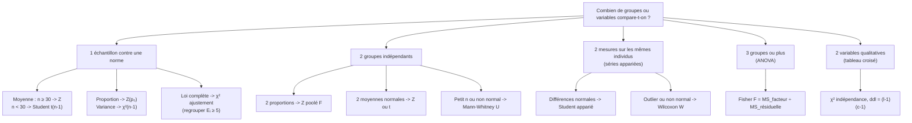

# 🧰 TD 2 — Formules & Explications Terre à Terre : Tests d'Hypothèses

> ↖ [[MOC_Statistiques_Inferentielles|Statistiques Inférentielles (M1 IT)]] • 📄 [[TD2_Tests_Hypotheses|Corrigé officiel TD 2]] • 📖 [[03_Generalites_Tests_Hypotheses|Ch. 03]] • [[04_Tests_Parametriques|Ch. 04]] • [[05_Tests_Non_Parametriques|Ch. 05]]

---

## 🧭 Comment choisir le bon test statistique ?



---

## 📋 Formulaire & Lexique récapitulatif du TD 2

> [!tip] Mémo rapide des formules utilisées dans le TD 2
> | Concept / Test | Formule mathématique | Formule en français simple | Quand l'utiliser ? |
> | :--- | :--- | :--- | :--- |
> | **Squelette d'un test paramétrique** | $\text{Stat} = \dfrac{\hat{\theta} - \theta_0}{\text{ES}}$ | `(Observé - Attendu sous H₀) ÷ Erreur standard` | Mesure combien d'erreurs standards séparent l'échantillon de $H_0$. |
> | **Test $Z$ sur moyenne ($n \ge 30$)** | $Z = \dfrac{\overline{X} - \mu_0}{s / \sqrt{n}} \sim \mathcal{N}(0,1)$ | `(Moyenne mesurée - Cible μ₀) ÷ (Écart-type ÷ √n)` | Conformité d'une moyenne sur grand échantillon (TCL). |
> | **Test $t$ sur moyenne ($n < 30$)** | $t = \dfrac{\overline{X} - \mu_0}{s / \sqrt{n}} \sim t(n-1)$ | Même calcul que $Z$, mais lu dans **Student** à $n-1$ ddl | Conformité d'une moyenne sur petit échantillon normal ($\sigma$ inconnu). |
> | **Test $Z$ sur proportion** | $Z = \dfrac{f - p_0}{\sqrt{\dfrac{p_0(1-p_0)}{n}}}$ | `(Fréquence observée - Taux H₀) ÷ √(p₀(1-p₀) ÷ n)` | Si $np_0 \ge 5$ et $n(1-p_0) \ge 5$. |
> | **Test $\chi^2$ sur variance** | $V = \dfrac{(n-1)s^2}{\sigma_0^2} \sim \chi^2(n-1)$ | `Somme carrés des écarts ÷ Variance cible σ₀²` | Tester si $\sigma$ respecte un seuil (normalité requise). |
> | **Test $\chi^2$ d'ajustement** | $\chi^2_{\text{obs}} = \sum_{i=1}^k \dfrac{(O_i - E_i)^2}{E_i}$, $\nu = k - 1 - p$ | `Somme de (Observé - Attendu)² ÷ Attendu` | Regrouper pour $E_i \ge 5$ ; $p$ = nb de paramètres estimés. |
> | **Comparaison 2 proportions** | $F = \dfrac{k_1 + k_2}{n_1 + n_2}$, $Z = \dfrac{f_1 - f_2}{\sqrt{F(1-F)\left(\frac{1}{n_1}+\frac{1}{n_2}\right)}}$ | `Taux commun = total succès ÷ total sondés`, puis écart ÷ erreur standard | Comparer 2 pourcentages sur 2 grands échantillons indépendants. |
> | **ANOVA à 1 facteur** | $V_T^2 = V_R^2 + V_A^2$, $F = \dfrac{\text{SC}_A / (K-1)}{\text{SC}_R / (n-K)}$ | `F = Signal moyen entre groupes ÷ Bruit moyen interne` | Comparer $K \ge 3$ moyennes simultanément (Annexe D.1). |
> | **Comparaison 2 moyennes** | $N = \dfrac{\bar{x}_1 - \bar{x}_2}{\sqrt{\frac{v_1^2}{n_1}+\frac{v_2^2}{n_2}}}$, $F_{\text{hom}} = \dfrac{s_{\max}^2}{s_{\min}^2}$ | `(Moyenne 1 - Moyenne 2) ÷ √(Var₁/n₁ + Var₂/n₂)` | Vérifier Shapiro-Wilk + homoscédasticité ($F$) avant. |
> | **Test $t$ apparié** | $d_i = X_{\text{après}, i} - X_{\text{avant}, i}$, $t = \dfrac{\bar{d}}{s_d / \sqrt{n}}$ | Calculer chaque écart $d_i$, puis tester si la moyenne des écarts vaut $0$ | Mesures Avant/Après sur les mêmes individus (normalité requise). |
> | **Wilcoxon (rangs signés)** | $W = \min(W^+, W^-)$, $W^+ + W^- = \dfrac{n(n+1)}{2}$ | Jeter les $0$, trier $\lvert d_i\rvert$, sommer rangs $+$ et $-$, prendre le min | Robuste aux outliers ; rejet si $W \le W_{\text{crit}}$. |
> | **Mann-Whitney $U$** | $U_1 = R_1 - \dfrac{n_1(n_1+1)}{2}$, $U_2 = n_1 n_2 - U_1$ | Classer tout ensemble, $U = \min(U_1, U_2)$ duels perdus/gagnés | Alternative non paramétrique à 2 moyennes ; rejet si $U \le U_{\text{crit}}$. |
> | **$\chi^2$ d'indépendance** | $E_{ij} = \dfrac{L_i \times C_j}{N}$, $\nu = (l-1)(c-1)$ | `Attendu = (Total ligne × Total colonne) ÷ Total global` | Lien entre 2 variables qualitatives (tous $E_{ij} \ge 5$). |

> [!note] Mémo rapide — D'où viennent les seuils lus dans les tables ?
> - **Loi Normale $\mathcal{N}(0, 1)$ (Annexe A.1 / A.2) :** On cherche $U_{1-\alpha/2} = z_{1-\alpha/2}$ tel que l'aire cumulée à gauche vaille $\Phi(u) = 1 - \frac{\alpha}{2}$ en **bilatéral** (ou $\Phi(u) = 1 - \alpha$ en **unilatéral**). Ex. à $\alpha = 5\%$ bilatéral : $\Phi(u) = 1 - 0{,}025 = 0{,}9750 \implies$ on repère `0,9750` *dans* l'Annexe A.1 $\to$ ligne **`1,9`** et colonne **`0,06`** $\implies \mathbf{1{,}96}$. À $\alpha = 10\%$ bilatéral (ou $5\%$ unilatéral) : $\Phi(u) = 0{,}9500 \implies \mathbf{1{,}6449}$ (entre `1,64` et `1,65`).
> - **Loi de Student (Annexe C) :** Lire la ligne $\nu = \text{ddl}$ et la colonne **bilatérale** $\alpha$. Pour un test **unilatéral** au risque $\alpha$, placer tout $\alpha$ d'un seul côté revient à lire la colonne bilatérale **$2\alpha$** (ex. unilatéral à $\alpha = 2{,}5\%$ $\to$ colonne bilatérale `0,050`).
> - **Loi du $\chi^2$ (Annexe B — queue droite) :** La table donne $k$ tel que $P(X \ge k) = \text{colonne}$ à la ligne $\nu = \text{ddl}$ (ex. test unilatéral droit à $\alpha = 5\%$ $\to$ colonne `0,05`).
> - **Loi de Fisher-Snedecor $\mathcal{F}$ (Annexe D.1 / D.2) :** Lire le croisement $\nu_1$ (ddl numérateur, en colonne) et $\nu_2$ (ddl dénominateur, en ligne). Utiliser Annexe D.1 pour l'ANOVA ($\alpha = 0{,}05$ ou $0{,}01$) et Annexe D.2 ($\alpha = 0{,}025$) pour le test bilatéral d'homoscédasticité.

---

## 🧠 Méthode : comment savoir quelle formule utiliser ?

### 1. Les 4 questions à se poser, dans l'ordre
1. **Qu'est-ce qu'on te demande ?** Calculer une chance (loi connue), donner un seul chiffre (estimation), donner une fourchette (intervalle de confiance) ou vérifier une affirmation (test) ?
2. **Sur quoi ça porte ?** Une moyenne $\mu$, une proportion $p$, une variance $\sigma^2$ (ou $\sigma$), comparer deux variances, ou voir si deux trucs sont liés ?
3. **Qu'est-ce que tu as dans les données ?** Est-ce que $\sigma$ est donné ou pas, est-ce que $n \ge 30$ ou $n < 30$, est-ce que c'est une loi normale ?
4. **Quel sens pour le test ?** Les deux côtés (bilatéral) ou un seul côté (unilatéral), selon les mots exacts de l'énoncé ?

### 2. Tableau de traduction : Indice dans l'énoncé → Choix

| Indice lu dans l'énoncé | Choix de la loi / formule |
| :--- | :--- |
| « $\sigma = \dots$ » donné pour la population / « variance connue » | **Loi normale $\mathcal{N}(0, 1)$** ($z$) |
| $\sigma$ inconnu (on calcule $s$ soi-même), population normale, $n < 30$ | **Loi de Student $t(n - 1)$** |
| $n \ge 30$, même avec $\sigma$ inconnu (on utilise $s$) | **Loi normale $z$** par le TCL (Student $\approx$ normale) |
| « proportion », « \% », « $k$ personnes sur $n$ » | Calculer $f = k / n$, puis **loi normale $z$** (si $np \ge 5$ et $n(1-p) \ge 5$) |
| « variance », « écart-type », « variabilité », « dispersion » d'une population | **Loi du Khi-deux $\chi^2(n - 1)$** (normalité obligatoire) |
| Comparer deux variances / tester si les écarts se ressemblent | **Loi de Fisher $\mathcal{F}$** (rapport $s_1^2 / s_2^2$) |
| « égal à », « vaut », « différent de », « diffèrent-ils » | **Test bilatéral** ($\alpha/2$ de chaque côté, quantile $1 - \alpha/2$) |
| « au moins », « supérieur », « plus grand », « ne dépasse pas » | **Test unilatéral** ($\alpha$ d'un seul côté, quantile $1 - \alpha$) |
| Mêmes personnes mesurées avant / après | **Données appariées** : travailler sur les différences $d_i$ |
| $3$ groupes ou plus à comparer en même temps | **ANOVA à 1 facteur** (statistique $F$ de Fisher) |
| Tableau croisé de deux critères qualitatifs | **Test du $\chi^2$ d'indépendance** |
| « suit-elle une loi … ? », « loi candidate » | **Test du $\chi^2$ d'ajustement** ($E_i \ge 5$) |
| Petits effectifs, loi pas normale ou valeur extrême bizarre | **Test non paramétrique** (Wilcoxon ou Mann-Whitney) |

> [!tip] Pourquoi Student plutôt que la loi normale ?
> Parce que tu cumules deux trucs : ton groupe est petit ($n < 30$) ET tu ne connais pas le vrai écart-type $\sigma$ (tu as dû le calculer toi-même avec $s$). Comme $s$ est approximatif et change d'un tirage à l'autre, tu prends une marge de sécurité un peu plus large : c'est ça que fait la table de Student à $n - 1$ ddl. Dès que $n \ge 30$ ou que $\sigma$ est donné dans l'énoncé, tu repasses direct sur la loi normale ($Z$). Ça se voit dans l'Annexe C : à $95\%$, $t = 2{,}2622$ pour $\nu = 9$, puis ça descend doucement jusqu'à $1{,}96$ quand $n$ est très grand.

> [!tip] Logique commune à tous les tests
> 1. Tu poses $H_0$ (l'hypothèse de départ) et $H_1$ (ce que tu soupçonnes) d'après les mots de l'énoncé.
> 2. Tu choisis ta formule avec le tableau juste au-dessus.
> 3. Tu calcules ta statistique : `(Ce qu'on observe - Ce qu'on attend sous H₀) ÷ Erreur standard`.
> 4. Tu compares au seuil de la table (ou tu compares la $p$-value à $\alpha$).
> 5. Tu conclus simple : **ne pas rejeter $H_0$ ne veut pas dire qu'elle est prouvée à 100 %**, ça veut juste dire qu'on n'a pas assez de preuves pour dire qu'elle est fausse.

---

## 📌 Exercice 1 – Montant moyen des remboursements de crédit

> [!question] Énoncé résumé & Données
> Un ingénieur risque crédit à Lomé veut vérifier si la mensualité moyenne de remboursement des clients vaut $\mu_0 = 200$ €. Sur un échantillon de $n = 144$ clients, il observe $\bar{x} = 193{,}74$ € et un écart-type corrigé $s = 48{,}24$ €. On demande de poser les hypothèses, de conclure au risque $\alpha = 5\%$, de tracer le schéma des régions, de calculer la $p$-value, puis de répondre pour $\alpha = 10\%$.

### 1. Hypothèses et choix de la loi du test
Regarde le mot dans l'énoncé : on veut vérifier si la moyenne « **vaut** $\mu_0 = 200$ € ». Comme ça peut être faux en dessous comme au-dessus de $200$ €, on pose un **test bilatéral** :
$$H_0 : \mu = 200\text{ €} \qquad \text{contre} \qquad H_1 : \mu \ne 200\text{ €}$$
En fait, même si on ne connaît pas le vrai écart-type $\sigma$ de tous les clients (on utilise $s = 48{,}24$ €), notre échantillon est grand ($n = 144 \ge 30$). Grâce au Théorème Central Limite (TCL), on passe direct sur la **loi normale $\mathcal{N}(0, 1)$** ($Z$) sous $H_0$ : pas besoin de Student ici.

### 2. Décision au risque $\alpha = 5\%$ (erreur standard, score $Z$ et bornes)
1. **Calcul de l'erreur standard ($\text{ES}$) :**
   La moyenne de $144$ clients bouge beaucoup moins qu'un seul client pris au hasard : sa marge d'erreur est divisée par $\sqrt{n}$. *En clair : `Erreur standard = Écart-type ÷ √Effectif`.*
   $$\text{ES} = \frac{s}{\sqrt{n}} = \frac{48{,}24}{\sqrt{144}} = \frac{48{,}24}{12} = \mathbf{4{,}02\text{ €}}$$
2. **Calcul de la statistique observée ($z_{\text{obs}}$) :**
   On regarde combien d'erreurs standards séparent notre moyenne ($193{,}74$ €) de la cible ($200$ €), pour pouvoir comparer ça à la table normale. *En clair : `Score Z = (Moyenne mesurée - Cible μ₀) ÷ Erreur standard`.*
   $$z_{\text{obs}} = \frac{\bar{x} - \mu_0}{\text{ES}} = \frac{193{,}74 - 200}{4{,}02} = \frac{-6{,}26}{4{,}02} \approx \mathbf{-1{,}5572}$$
3. **D'où vient $U_{1-\alpha/2} = 1{,}96$ et calcul de la marge d'erreur ($e$) :**
   À $\alpha = 5\% = 0{,}05$ en **bilatéral**, tu coupes le risque en deux : $0{,}025$ à gauche et $0{,}025$ à droite. Du coup, toute la zone à gauche du seuil droit vaut $\Phi(U_{1-\alpha/2}) = 1 - \frac{0{,}05}{2} = 0{,}9750$. Tu cherches `0,9750` *à l'intérieur* de l'Annexe A.1 : c'est à la ligne **`1,9`** et colonne **`0,06`**, d'où $U_{0{,}975} = \mathbf{1{,}96}$ (seuils critiques $z_{\text{crit}} = \pm 1{,}96$).
   Pour passer ce $1{,}96$ en euros, on le multiplie par l'erreur standard :
   $$e = U_{1-\alpha/2} \times \frac{s}{\sqrt{n}} = 1{,}96 \times 4{,}02 = 7{,}8792 \approx \mathbf{7{,}88\text{ €}}$$
4. **Calcul des bornes inférieures et supérieures :**
   C'est tout simple : tu enlèves $e$ pour la borne du bas, et tu ajoutes $e$ pour la borne du haut :
   - **Zone où on garde $H_0$** (centrée sur $\mu_0 = 200$ €) :
     - Borne inférieure : $\mu_0 - e = 200 - 7{,}88 = \mathbf{192{,}12\text{ €}}$
     - Borne supérieure : $\mu_0 + e = 200 + 7{,}88 = \mathbf{207{,}88\text{ €}}$
   - **Intervalle de confiance à $95\%$ de $\mu$** (centré sur $\bar{x} = 193{,}74$ €) :
     - Borne inférieure : $\bar{x} - e = 193{,}74 - 7{,}88 = \mathbf{185{,}86\text{ €}}$
     - Borne supérieure : $\bar{x} + e = 193{,}74 + 7{,}88 = \mathbf{201{,}62\text{ €}}$

Comme $|z_{\text{obs}}| = 1{,}5572 < 1{,}96$ (pareil que de dire $193{,}74 \in [192{,}12 \,;\, 207{,}88]$ ou $200 \in [185{,}86 \,;\, 201{,}62]$), **on ne rejette pas $H_0$**.

### 3. Schéma des régions d'acceptation et de rejet
Comme le test est bilatéral ($H_1 : \mu \ne 200$), on a deux petites zones de rejet aux deux bouts ($\alpha/2 = 2{,}5\%$ chacune) : si notre $Z$ tombe dedans (trop petit ou trop grand), on rejette $H_0$.

```text
             Densité N(0,1) sous H0
                      ^
                     / \
                    /   \
   Rejet (α/2)     /  |  \      Rejet (α/2)
   p/2   |        /   |   \         |  p/2
  ███████░░░░░░░░/░░░░|░░░░\░░░░░░░░███████
 ────────┴───────┴────┼────┴───────┴────────> Z
       -1,96  -1,56   0  +1,56   +1,96
       (192,12€)         (207,88€)
  ████ Région de rejet α = 5% (|Z| > 1,96)
  ░░░░ Aires correspondant à la p-value totale = 2 × P(Z ≤ -1,5572)
```

### 4. Calcul et sens concret de la $p$-value
En vrai, la $p$-value te dit juste : *« Si la moyenne vaut vraiment $200$ €, j'avais combien de chances d'observer un écart d'au moins $6{,}26$ € juste par hasard ? »*
Comme on est en bilatéral (l'écart peut être en moins ou en plus), on multiplie l'aire d'une queue par $2$. Dans l'Annexe A.1 (ligne `1,5`, col. `0,06`), $\Phi(1{,}56) = 0{,}9406$ :
$$p\text{-value} = 2\big(1 - \Phi(|z_{\text{obs}}|)\big) \approx 2(1 - 0{,}9406) = 2 \times 0{,}0594 = \mathbf{0{,}1188} \quad (\text{exact : } \mathbf{0{,}1194}, \text{ soit } \mathbf{11{,}94\%})$$
$11{,}94\%$ de chances par pur hasard, c'est beaucoup plus grand que les $5\%$ qu'on s'autorise : rien de bizarre.

### 5. Décision au risque $\alpha = 10\%$
Retiens simple : on rejette $H_0$ seulement si $p\text{-value} < \alpha$. Ici $11{,}94\% > 10\%$, donc **on ne rejette toujours pas $H_0$**.
- *Vérification avec les bornes à $90\%$ ($\alpha = 0{,}10$ bilatéral) :* $\Phi(U_{0{,}95}) = 1 - \frac{0{,}10}{2} = 0{,}9500 \implies U_{0{,}95} = \mathbf{1{,}6449}$. Marge : $e = 1{,}6449 \times 4{,}02 = 6{,}6125 \approx \mathbf{6{,}61\text{ €}}$, soit $[200 - 6{,}61 \,;\, 200 + 6{,}61] = \mathbf{[193{,}39 \,;\, 206{,}61]\text{ €}}$ autour de $200$ € (et $\text{IC}_{90\%}(\mu) = [193{,}74 - 6{,}61 \,;\, 193{,}74 + 6{,}61] = \mathbf{[187{,}13 \,;\, 200{,}35]\text{ €}}$), avec $|z_{\text{obs}}| = 1{,}5572 < 1{,}6449$.

> [!check] Conclusion concrète
> À $5\%$ comme à $10\%$, **on ne rejette pas $H_0$** : en clair, le petit écart qu'on voit ($193{,}74$ € au lieu de $200$ €) peut très bien venir juste du hasard du tirage.

---

## 📌 Exercice 2 – Parité dans les filières informatiques

> [!question] Énoncé résumé & Données
> Dans une promotion de Master IT à Lomé de $n = 64$ étudiants, on compte $k = 28$ femmes. Peut-on soutenir que la filière attire autant les hommes que les femmes ($p_0 = 0{,}50$, $\alpha = 5\%$) ?

### 1. Fréquence observée, hypothèses et conditions d'application
Ici on ne parle pas de moyenne mais d'une **proportion** ($28$ femmes sur $64$). « Attire autant les hommes que les femmes » veut dire $50\%$ de femmes ($p_0 = 0{,}50$), peu importe que ce soit en plus ou en moins $\implies$ **test bilatéral** :
$$f = \frac{k}{n} = \frac{28}{64} = \mathbf{0{,}4375} \quad (43{,}75\%)$$
$$H_0 : p = 0{,}50 \qquad \text{contre} \qquad H_1 : p \ne 0{,}50$$
Avant d'utiliser la loi normale $Z$, on vérifie vite fait que l'échantillon est assez grand ($np_0 \ge 5$ et $n(1 - p_0) \ge 5$) :
$$n p_0 = 64 \times 0{,}50 = 32 \ge 5 \qquad \text{et} \qquad n(1 - p_0) = 64 \times (1 - 0{,}50) = 32 \ge 5 \quad (\text{c'est bon})$$

### 2. Statistique $Z$, $p$-value et décision ($\alpha = 5\%$)
1. **Erreur standard sous $H_0$ ($\text{ES}_0$) :**
   *Pourquoi on met $0{,}50$ sous la racine et pas $0{,}4375$ ?* Parce que dans un test, tu fais comme si $H_0$ disait vrai ($p = 0{,}50$) jusqu'à preuve du contraire. Dans un intervalle de confiance, tu n'as aucune valeur de départ, donc là tu mets $f$.
   $$\text{ES}_0 = \sqrt{\frac{p_0(1 - p_0)}{n}} = \sqrt{\frac{0{,}50 \times 0{,}50}{64}} = \sqrt{\frac{0{,}25}{64}} = \frac{0{,}50}{8} = \mathbf{0{,}0625}$$
2. **Statistique observée ($z_{\text{obs}}$) :**
   *En clair : `Score Z = (Proportion observée - 0,50) ÷ Erreur standard sous H₀`.*
   $$z_{\text{obs}} = \frac{f - p_0}{\text{ES}_0} = \frac{0{,}4375 - 0{,}50}{0{,}0625} = \frac{-0{,}0625}{0{,}0625} = \mathbf{-1{,}00}$$
3. **Seuil critique et $p$-value :**
   À $5\%$ bilatéral ($\Phi(u) = 0{,}9750$ en Annexe A.1), le seuil vaut $z_{\text{crit}} = \pm 1{,}96$. Avec $\Phi(1{,}00) = 0{,}8413$ (Annexe A.1, ligne `1,0`, col. `0,00`), et $\times 2$ pour le bilatéral :
   $$p\text{-value} = 2\big(1 - \Phi(|z_{\text{obs}}|)\big) = 2(1 - 0{,}8413) = 2 \times 0{,}1587 = \mathbf{0{,}3174} \quad (31{,}74\%)$$

> [!check] Conclusion concrète
> Comme $|z_{\text{obs}}| = 1{,}00 < 1{,}96$ ($p = 31{,}74\% > 5\%$), **on ne rejette pas $H_0$** : avoir $28$ femmes sur $64$ reste tout à fait normal si la filière attire autant les hommes que les femmes.

---

## 📌 Exercice 3 – Variabilité sur les scores d'évaluation

> [!question] Énoncé résumé & Données
> La Direction de l'Évaluation sélectionne $n = 30$ étudiants pour un test standardisé dont l'écart-type ne doit pas dépasser $\sigma_0 = 20$ points ($\sigma_0^2 = 20^2 = 400$), au risque $\alpha = 5\%$. On demande d'estimer $\sigma$ sans biais puis de réaliser le test d'hypothèse.

### 1. Estimation sans biais de $\sigma$ (pourquoi diviser par $n - 1 = 29$ ?)

| Étudiant $i$ | $x_i$ | $x_i - \bar{x}$ | $(x_i - \bar{x})^2$ | $x_i^2$ *(Koenig-Huygens)* |
| :---: | :---: | :---: | :---: | :---: |
| 1 | $131$ | $+27$ | $729$ | $17\,161$ |
| 2 | $108$ | $+4$ | $16$ | $11\,664$ |
| 3 | $85$ | $-19$ | $361$ | $7\,225$ |
| 4 | $96$ | $-8$ | $64$ | $9\,216$ |
| 5 | $86$ | $-18$ | $324$ | $7\,396$ |
| 6 | $126$ | $+22$ | $484$ | $15\,876$ |
| 7 | $128$ | $+24$ | $576$ | $16\,384$ |
| 8 | $107$ | $+3$ | $9$ | $11\,449$ |
| 9 | $119$ | $+15$ | $225$ | $14\,161$ |
| 10 | $87$ | $-17$ | $289$ | $7\,569$ |
| 11 | $103$ | $-1$ | $1$ | $10\,609$ |
| 12 | $110$ | $+6$ | $36$ | $12\,100$ |
| 13 | $125$ | $+21$ | $441$ | $15\,625$ |
| 14 | $77$ | $-27$ | $729$ | $5\,929$ |
| 15 | $90$ | $-14$ | $196$ | $8\,100$ |
| 16 | $109$ | $+5$ | $25$ | $11\,881$ |
| 17 | $109$ | $+5$ | $25$ | $11\,881$ |
| 18 | $129$ | $+25$ | $625$ | $16\,641$ |
| 19 | $95$ | $-9$ | $81$ | $9\,025$ |
| 20 | $117$ | $+13$ | $169$ | $13\,689$ |
| 21 | $107$ | $+3$ | $9$ | $11\,449$ |
| 22 | $102$ | $-2$ | $4$ | $10\,404$ |
| 23 | $83$ | $-21$ | $441$ | $6\,889$ |
| 24 | $114$ | $+10$ | $100$ | $12\,996$ |
| 25 | $72$ | $-32$ | $1\,024$ | $5\,184$ |
| 26 | $99$ | $-5$ | $25$ | $9\,801$ |
| 27 | $103$ | $-1$ | $1$ | $10\,609$ |
| 28 | $97$ | $-7$ | $49$ | $9\,409$ |
| 29 | $109$ | $+5$ | $25$ | $11\,881$ |
| 30 | $97$ | $-7$ | $49$ | $9\,409$ |
| **Total ($\sum$)** | **$3\,120$** | **$0$** | **$7\,132$** | **$331\,612$** |

- **Moyenne empirique :**
  $$\bar{x} = \frac{1}{n}\sum_{i=1}^{30} x_i = \frac{3\,120}{30} = \mathbf{104{,}00\text{ points}}$$
- **Variance corrigée (sans biais) :**
  *Pourquoi on divise par $n - 1 = 29$ et pas par $n = 30$ ?* En fait, tu n'as pas toute la population des étudiants, tu as juste un groupe de $30$. Comme tu calcules les écarts autour de la moyenne $\bar{x}$ de ce même groupe (et pas autour de la vraie moyenne inconnue), tes écarts sont un peu tassés (trop petits par rapport à la réalité). En divisant par $n - 1 = 29$ au lieu de $30$, tu remontes légèrement le résultat pour corriger ça (variance corrigée sans biais). Retiens simple : dès que tu estimes la population, tu divises par $n - 1$.
  $$s^2 = \frac{1}{n - 1}\sum_{i=1}^{30}(x_i - \bar{x})^2 = \frac{7\,132}{30 - 1} = \frac{7\,132}{29} \approx \mathbf{245{,}9310}$$
  *(Vérification par Koenig-Huygens : $s^2 = \frac{\sum x_i^2 - n\bar{x}^2}{n - 1} = \frac{331\,612 - 30 \times 104^2}{29} = \frac{331\,612 - 324\,480}{29} = \frac{7\,132}{29} \approx 245{,}9310$. La variance empirique divisée par $30$ vaudrait $\bar{s}^2 = \frac{7\,132}{30} \approx 237{,}7333$.)*
- **Écart-type corrigé :**
  $$s = \sqrt{s^2} = \sqrt{245{,}9310} \approx \mathbf{15{,}6822\text{ points}}$$

### 2. Test du Khi-deux sur l'écart-type ($\sigma_0 = 20 \implies \sigma_0^2 = 400$, $\alpha = 5\%$)
*Pourquoi cette formule et quelle condition ?* On veut tester si la **dispersion** ($\sigma$) dépasse une limite (« ne doit pas dépasser $\sigma_0 = 20$ »). Dès que le test porte sur une variance ou un écart-type, on utilise la **loi du Khi-deux $\chi^2(n - 1)$** — mais attention, ça ne marche que si les notes suivent une **loi normale** (même avec $n = 30$, le TCL ne sauve pas la variance). « Ne doit pas dépasser » donne un **test unilatéral droit** :
$$H_0 : \sigma \le 20 \ (\sigma^2 \le 400) \qquad \text{contre} \qquad H_1 : \sigma > 20 \ (\sigma^2 > 400)$$
*En clair : `Statistique V = Somme des carrés des écarts ÷ Variance maximale tolérée (400)`.*
$$V = \frac{(n - 1)s^2}{\sigma_0^2} = \frac{29 \times 245{,}9310}{20^2} = \frac{7\,132}{400} = \mathbf{17{,}8300} \sim \chi^2(29)$$
*Lecture de l'Annexe B :* Pour un test unilatéral droit à $\alpha = 5\%$, tu lis direct la ligne $\nu = n - 1 = 29$ et la colonne `0,05`, soit $\chi^2_{0{,}95}(29) = \mathbf{42{,}5570}$.

> [!check] Conclusion concrète
> Comme $V = 17{,}8300 < 42{,}5570$ ($p = 0{,}9477$), **on ne rejette pas $H_0$** : les scores restent bien regroupés, largement sous le plafond des $20$ points ($s = 15{,}68$).

---

## 📌 Exercice 4 – Conformité d'une norme d'aménagement municipal

> [!question] Énoncé résumé & Données
> Une réglementation impose aux communes de consacrer au moins $25\%$ de leur budget aux infrastructures numériques. On relève ces pourcentages dans $n = 10$ communes (supposés normaux) au risque $\alpha = 2{,}5\%$ :
> `25.6, 24.5, 24.3, 25.0, 29.5, 24.1, 24.8, 24.7, 25.2, 24.9`

### 1. Hypothèses du test (pourquoi unilatéral gauche ?)
Regarde les mots : la loi demande « **au moins** $25\%$ » ($\mu \ge 25\%$). On s'inquiète seulement si les communes sont en dessous de $25\%$, donc c'est un **test unilatéral gauche** :
$$H_0 : \mu \ge 25\% \ (\text{norme respectée}) \qquad \text{contre} \qquad H_1 : \mu < 25\% \ (\text{quota non respecté})$$

### 2. Moyenne et variance corrigée (pourquoi $n - 1 = 9$ ?)

| Commune $i$ | $x_i$ (%) | $x_i - \bar{x}$ | $(x_i - \bar{x})^2$ | $x_i^2$ *(Koenig-Huygens)* |
| :---: | :---: | :---: | :---: | :---: |
| 1 | $25{,}6$ | $+0{,}34$ | $0{,}1156$ | $655{,}36$ |
| 2 | $24{,}5$ | $-0{,}76$ | $0{,}5776$ | $600{,}25$ |
| 3 | $24{,}3$ | $-0{,}96$ | $0{,}9216$ | $590{,}49$ |
| 4 | $25{,}0$ | $-0{,}26$ | $0{,}0676$ | $625{,}00$ |
| 5 | $29{,}5$ | $+4{,}24$ | $17{,}9776$ | $870{,}25$ |
| 6 | $24{,}1$ | $-1{,}16$ | $1{,}3456$ | $580{,}81$ |
| 7 | $24{,}8$ | $-0{,}46$ | $0{,}2116$ | $615{,}04$ |
| 8 | $24{,}7$ | $-0{,}56$ | $0{,}3136$ | $610{,}09$ |
| 9 | $25{,}2$ | $-0{,}06$ | $0{,}0036$ | $635{,}04$ |
| 10 | $24{,}9$ | $-0{,}36$ | $0{,}1296$ | $620{,}01$ |
| **Total ($\sum$)** | **$252{,}6$** | **$0$** | **$21{,}6640$** | **$6\,402{,}34$** |

- **Moyenne empirique :**
  $$\bar{x} = \frac{1}{n}\sum_{i=1}^{10} x_i = \frac{252{,}6}{10} = \mathbf{25{,}26\%}$$
- **Variance corrigée et écart-type :**
  *Pourquoi diviser par $n - 1 = 9$ et pas par $n = 10$ ?* En fait, tu n'as que $10$ communes et tu ne connais pas le vrai écart-type $\sigma$ de toutes les communes. Comme tu calcules les écarts autour de $\bar{x}$ (tirée de ces mêmes $10$ communes), tes écarts sont un peu tassés. Diviser par $n - 1 = 9$ corrige ça, et c'est obligatoire pour pouvoir lire ensuite la table de Student à $9$ ddl.
  $$s^2 = \frac{1}{n - 1}\sum_{i=1}^{10}(x_i - \bar{x})^2 = \frac{21{,}6640}{10 - 1} = \frac{21{,}6640}{9} \approx \mathbf{2{,}4071}$$
  *(Koenig-Huygens : $s^2 = \frac{6\,402{,}34 - 10 \times 25{,}26^2}{9} = \frac{6\,402{,}34 - 6\,380{,}676}{9} = \frac{21{,}664}{9} \approx 2{,}4071$.)*
  $$s = \sqrt{2{,}4071} \approx \mathbf{1{,}5515\%}$$

### 3. Statistique de Student $t(9)$, lecture de table et décision
*Pourquoi Student $t(9)$ et pas la loi normale $Z$ ?* Trois indices sont réunis : la loi est normale, tu ne connais pas $\sigma$ (tu utilises $s$) et ton échantillon est petit ($n = 10 < 30$). Comme $s$ est estimé sur peu de données, tu prends la marge de sécurité de **Student $t(9)$**. *En clair : `t_obs = (Moyenne des 10 communes - Norme 25) ÷ (Écart-type corrigé ÷ √10)`.*
1. **Erreur standard ($\text{ES}$) :**
   $$\text{ES} = \frac{s}{\sqrt{n}} = \frac{1{,}5515}{\sqrt{10}} = \frac{1{,}5515}{3{,}1623} \approx \mathbf{0{,}4906\%}$$
2. **Statistique observée ($t_{\text{obs}}$) :**
   $$t_{\text{obs}} = \frac{\bar{x} - \mu_0}{\text{ES}} = \frac{25{,}26 - 25}{0{,}4906} = \frac{+0{,}26}{0{,}4906} \approx \mathbf{+0{,}5299} \sim t(9)$$
3. **Lecture de l'Annexe C :** La table de Student donne le risque **bilatéral** (les deux queues ensemble). Ici ton test est **unilatéral à gauche à $\alpha = 2{,}5\%$**, donc tu cherches la colonne où chaque queue vaut $2{,}5\%$, c'est-à-dire la colonne bilatérale **$2\alpha = 5\% = 0{,}050$** à la ligne $\nu = 9$. Ça donne $-t_{9,\, 0{,}975} = \mathbf{-2{,}2622}$ (on rejette si $t_{\text{obs}} < -2{,}2622$).

> [!check] Conclusion concrète
> Comme $t_{\text{obs}} = +0{,}53 > -2{,}2622$ ($p = 0{,}6090$ en bilatéral), **on ne rejette pas $H_0$** : en moyenne, le quota de $25\%$ est respecté *(petit bémol à noter : regarde le tableau, **$7$ communes sur $10$** sont en dessous de $25\%$ ; c'est juste la commune n° 5 à $29{,}5\%$ qui tire toute la moyenne vers le haut)*.

---

## 📌 Exercice 5 – Test d'ajustement du Khi-deux et dimensionnement

> [!question] Énoncé résumé & Données
> Une plateforme d'assistance à Lomé relève pendant $n = 53$ heures le nombre d'appels reçus par heure ($x_i \in \{0, \dots, 9\}$) et le nombre d'heures correspondantes ($N_i$) :
> `x_i = 0 (1h), 1 (4h), 2 (7h), 3 (11h), 4 (10h), 5 (9h), 6 (5h), 7 (3h), 8 (2h), 9 (1h)`.
> On demande d'estimer l'espérance et la variance, de tester l'ajustement à la loi candidate au risque $\alpha = 5\%$, puis de trouver combien d'opérateurs (capacité $7$ appels/h chacun) couvrent au moins $95\%$ des appels.

### 1. Moyenne, variances pondérées et choix de la loi de Poisson ($n = 53$ heures)
Les données sont regroupées dans un tableau d'effectifs (chaque valeur $x_i$ revient $N_i$ fois), donc on multiplie par $N_i$ à chaque ligne. On calcule la moyenne $\bar{x}$, la variance empirique $\bar{s}^2$ ($\div 53$, qui décrit juste ces $53$ heures) et la variance corrigée sans biais $s^2$ ($\div 52$, car on calcule autour de $\bar{x}$ tirée de ces mêmes $53$ heures, ce qui tasse un peu les écarts et oblige à diviser par $n - 1$ pour estimer la réalité).

| $x_i$ (appels/h) | $N_i$ (heures) | $N_i x_i$ | $x_i - \bar{x}$ | $N_i(x_i - \bar{x})^2$ | $N_i x_i^2$ *(Koenig-Huygens)* |
| :---: | :---: | :---: | :---: | :---: | :---: |
| 0 | 1 | $1 \times 0 = 0$ | $0 - 4 = -4$ | $1 \times (-4)^2 = 16$ | $1 \times 0^2 = 0$ |
| 1 | 4 | $4 \times 1 = 4$ | $1 - 4 = -3$ | $4 \times (-3)^2 = 36$ | $4 \times 1^2 = 4$ |
| 2 | 7 | $7 \times 2 = 14$ | $2 - 4 = -2$ | $7 \times (-2)^2 = 28$ | $7 \times 2^2 = 28$ |
| 3 | 11 | $11 \times 3 = 33$ | $3 - 4 = -1$ | $11 \times (-1)^2 = 11$ | $11 \times 3^2 = 99$ |
| 4 | 10 | $10 \times 4 = 40$ | $4 - 4 = 0$ | $10 \times 0^2 = 0$ | $10 \times 4^2 = 160$ |
| 5 | 9 | $9 \times 5 = 45$ | $5 - 4 = +1$ | $9 \times 1^2 = 9$ | $9 \times 5^2 = 225$ |
| 6 | 5 | $5 \times 6 = 30$ | $6 - 4 = +2$ | $5 \times 2^2 = 20$ | $5 \times 6^2 = 180$ |
| 7 | 3 | $3 \times 7 = 21$ | $7 - 4 = +3$ | $3 \times 3^2 = 27$ | $3 \times 7^2 = 147$ |
| 8 | 2 | $2 \times 8 = 16$ | $8 - 4 = +4$ | $2 \times 4^2 = 32$ | $2 \times 8^2 = 128$ |
| 9 | 1 | $1 \times 9 = 9$ | $9 - 4 = +5$ | $1 \times 5^2 = 25$ | $1 \times 9^2 = 81$ |
| **Total ($\sum$)** | **$53$** | **$212$** | — | **$204$** | **$1\,052$** |

- **Espérance estimée (moyenne empirique) :**
  $$\bar{x} = \frac{1}{n}\sum N_i x_i = \frac{212}{53} = \mathbf{4{,}00\text{ appels/h}}$$
- **Variance empirique (biaisée, $\div n$) :**
  $$\bar{s}^2 = \frac{1}{n}\sum N_i(x_i - \bar{x})^2 = \frac{204}{53} \approx \mathbf{3{,}8491}$$
  *(Vérification Koenig-Huygens : $\bar{s}^2 = \frac{\sum N_i x_i^2}{n} - \bar{x}^2 = \frac{1\,052}{53} - 4^2 = 19{,}8491 - 16 = 3{,}8491$.)*
- **Variance corrigée (sans biais, $\div (n - 1)$) :**
  $$s^2 = \frac{1}{n - 1}\sum N_i(x_i - \bar{x})^2 = \frac{204}{53 - 1} = \frac{204}{52} \approx \mathbf{3{,}9231}$$
  *(Vérification Koenig-Huygens : $s^2 = \frac{1\,052 - 53 \times 4^2}{52} = \frac{1\,052 - 848}{52} = \frac{204}{52} \approx 3{,}9231$.)*

*Pourquoi choisir la loi de Poisson $\mathcal{P}(4)$ ?* Deux trucs le montrent tout de suite : tu comptes des événements entiers ($0, 1, 2, \dots$ appels) sur $1$ heure fixe, et la moyenne est presque égale à la variance ($\bar{x} = 4{,}00 \approx s^2 = 3{,}9231$). C'est le signal clair de la **loi de Poisson $\mathcal{P}(\lambda = 4)$**. On teste donc : $H_0 : X \sim \mathcal{P}(4)$ contre $H_1 : X \not\sim \mathcal{P}(4)$.

### 2. Test d'ajustement du Khi-deux ($\alpha = 5\%$)
*Pourquoi ce test ?* Pour vérifier si nos chiffres réels ($O_k$) collent à la courbe théorique de Poisson, on calcule d'abord la chance théorique $p_k = e^{-4}\frac{4^k}{k!}$ (avec $e^{-4} \approx 0{,}018316$), puis combien d'heures sur $53$ ça devrait donner ($E_k = 53 \times p_k$), et on fait un **$\chi^2$ d'ajustement**.

| $k$ | Calcul de $p_k = e^{-4}\dfrac{4^k}{k!}$ | Probabilité $p_k$ | Calcul de $E_k = 53 \times p_k$ | Effectif attendu $E_k$ |
| :---: | :--- | :---: | :--- | :---: |
| $0$ | $0{,}018316 \times \frac{4^0}{0!} = 0{,}018316 \times 1$ | $0{,}01832$ | $53 \times 0{,}018316$ | $0{,}9707$ *(à regrouper)* |
| $1$ | $0{,}018316 \times \frac{4^1}{1!} = 0{,}018316 \times 4$ | $0{,}07326$ | $53 \times 0{,}073263$ | $3{,}8829$ *(à regrouper)* |
| $2$ | $0{,}018316 \times \frac{4^2}{2!} = 0{,}018316 \times \frac{16}{2}$ | $0{,}14653$ | $53 \times 0{,}146525$ | $7{,}7658$ *(regroupé avec $0,1$)* |
| $3$ | $0{,}018316 \times \frac{4^3}{3!} = 0{,}018316 \times \frac{64}{6}$ | $0{,}19537$ | $53 \times 0{,}195367$ | $10{,}3544$ |
| $4$ | $0{,}018316 \times \frac{4^4}{4!} = 0{,}018316 \times \frac{256}{24}$ | $0{,}19537$ | $53 \times 0{,}195367$ | $10{,}3544$ |
| $5$ | $0{,}018316 \times \frac{4^5}{5!} = 0{,}018316 \times \frac{1\,024}{120}$ | $0{,}15629$ | $53 \times 0{,}156293$ | $8{,}2836$ |
| $6$ | $0{,}018316 \times \frac{4^6}{6!} = 0{,}018316 \times \frac{4\,096}{720}$ | $0{,}10420$ | $53 \times 0{,}104196$ | $5{,}5224$ |
| $7$ | $0{,}018316 \times \frac{4^7}{7!} = 0{,}018316 \times \frac{16\,384}{5\,040}$ | $0{,}05954$ | $53 \times 0{,}059540$ | $3{,}1556$ *(à regrouper)* |
| $8$ | $0{,}018316 \times \frac{4^8}{8!} = 0{,}018316 \times \frac{65\,536}{40\,320}$ | $0{,}02977$ | $53 \times 0{,}029770$ | $1{,}5778$ *(à regrouper)* |
| $9+$ | $1 - \sum_{k=0}^8 p_k = 1 - 0{,}97864$ | $0{,}02136$ | $53 \times 0{,}021364$ | $1{,}1323$ *(à regrouper)* |

*Pourquoi fusionner les petites lignes jusqu'à $E_i \ge 5$ ?* Regarde la division $\frac{(O_i - E_i)^2}{E_i}$ : si $E_i$ est tout petit (comme $E_0 = 0{,}97$), le moindre écart de $1$ appel divise par $0{,}97$ et fait exploser le $\chi^2$ pour rien. En regroupant les extrêmes pour avoir au moins $E_i \ge 5$, le test reste propre :
- **Classe `0–2` :** $O = 1 + 4 + 7 = \mathbf{12}$ ; $E = 0{,}9707 + 3{,}8829 + 7{,}7658 = \mathbf{12{,}6195} \ge 5$.
- **Classe `7 et +` :** $O = 3 + 2 + 1 = \mathbf{6}$ ; $E = 3{,}1556 + 1{,}5778 + 1{,}1323 = \mathbf{5{,}8657} \ge 5$.

| Classe | $O_i$ | $E_i$ | Calcul de $\dfrac{(O_i - E_i)^2}{E_i}$ | Contribution |
| :--- | :---: | :---: | :--- | :---: |
| **0–2** | 12 | 12,6195 | $\frac{(12 - 12{,}6195)^2}{12{,}6195} = \frac{(-0{,}6195)^2}{12{,}6195} = \frac{0{,}3838}{12{,}6195}$ | $0{,}0304$ |
| **3** | 11 | 10,3544 | $\frac{(11 - 10{,}3544)^2}{10{,}3544} = \frac{0{,}6456^2}{10{,}3544} = \frac{0{,}4168}{10{,}3544}$ | $0{,}0402$ |
| **4** | 10 | 10,3544 | $\frac{(10 - 10{,}3544)^2}{10{,}3544} = \frac{(-0{,}3544)^2}{10{,}3544} = \frac{0{,}1256}{10{,}3544}$ | $0{,}0121$ |
| **5** | 9 | 8,2836 | $\frac{(9 - 8{,}2836)^2}{8{,}2836} = \frac{0{,}7164^2}{8{,}2836} = \frac{0{,}5132}{8{,}2836}$ | $0{,}0620$ |
| **6** | 5 | 5,5224 | $\frac{(5 - 5{,}5224)^2}{5{,}5224} = \frac{(-0{,}5224)^2}{5{,}5224} = \frac{0{,}2729}{5{,}5224}$ | $0{,}0494$ |
| **7 et +** | 6 | 5,8657 | $\frac{(6 - 5{,}8657)^2}{5{,}8657} = \frac{0{,}1343^2}{5{,}8657} = \frac{0{,}0180}{5{,}8657}$ | $0{,}0031$ |
| **Total ($\sum$)** | **53** | **53,0000** | $0{,}0304 + 0{,}0402 + 0{,}0121 + 0{,}0620 + 0{,}0494 + 0{,}0031$ | **$\chi^2_{\text{obs}} = 0{,}1972$** |

*Pourquoi $\nu = 6 - 1 - 1 = 4$ ?* On a $c = 6$ lignes après regroupement. On enlève $1$ parce que le total doit faire $53$, et encore $p = 1$ parce qu'on a dû estimer $\lambda = 4$ à partir de nos données (au lieu de le connaître d'avance) :
$$\nu = c - 1 - p = 6 - 1 - 1 = \mathbf{4}$$
En Annexe B ($\nu = 4$, colonne `0,05`), $\chi^2_{0{,}95}(4) = \mathbf{9{,}4877}$. Comme $\chi^2_{\text{obs}} = 0{,}1972 \ll 9{,}4877$ ($p = 0{,}9954$), on ne rejette pas $H_0$ : nos données collent super bien à $\mathcal{P}(4)$. *(Avec le regroupement $\{0,1\}$ [$E=4{,}85$] et $\{6+\}$, $\chi^2 = 0{,}2075$, même conclusion.)*

### 3. Nombre d'opérateurs pour couvrir au moins $95\%$ des appels
Maintenant qu'on sait que $\mathcal{P}(4)$ marche, on additionne les chances $p_k$ depuis $k = 0$ jusqu'à dépasser $0{,}95$ :
- **Avec $1$ opérateur (max $7$ appels/h, soit $X \le 7$) :**
  $$P(X \le 7) = \sum_{k=0}^{7} p_k = 0{,}01832 + 0{,}07326 + 0{,}14653 + 0{,}19537 + 0{,}19537 + 0{,}15629 + 0{,}10420 + 0{,}05954 = \mathbf{0{,}94887} \quad (94{,}89\% < 95\%)$$
  Un seul opérateur s'arrête à $94{,}89\%$ : il en manque un tout petit peu pour atteindre $95\%$.
- **En ajoutant $X = 8$ (donc il faut $2$ opérateurs, capacité $2 \times 7 = 14$ appels/h) :**
  $$P(X \le 8) = P(X \le 7) + p_8 = 0{,}94887 + 0{,}02977 = \mathbf{0{,}97864} \quad (97{,}86\% \ge 95\%)$$
  Et avec $2$ opérateurs (jusqu'à $14$ appels/h), la couverture réelle monte à $P(X \le 14) \approx \mathbf{99{,}998\%}$.

> [!check] Conclusion concrète
> La loi de Poisson $\mathcal{P}(4)$ est validée ($\chi^2 = 0{,}1972 < 9{,}4877$) et il faut **2 opérateurs** pour couvrir au moins $95\%$ des heures (ils couvrent en fait $99{,}998\%$ des heures).

---

## 📌 Exercice 6 – Comparaison de deux proportions (Tmoney / Flooz)

> [!question] Énoncé résumé & Données
> À Lomé, $k_1 = 1\,040$ personnes sur $n_1 = 2\,000$ utilisent régulièrement le paiement mobile. À Kara, elles sont $k_2 = 915$ sur $n_2 = 1\,500$. Ces taux diffèrent-ils au risque $\alpha = 5\%$ ?

### 1. Hypothèses et proportion commune (poolée) $F$
On compare deux pourcentages sur deux villes différentes ; comme on demande « diffèrent-ils ? » sans préciser qui est devant, c'est un **test bilatéral** ($H_0 : p_1 = p_2$ contre $H_1 : p_1 \ne p_2$).
$$f_1 = \frac{k_1}{n_1} = \frac{1\,040}{2\,000} = \mathbf{0{,}52} \ (52\%), \qquad f_2 = \frac{k_2}{n_2} = \frac{915}{1\,500} = \mathbf{0{,}61} \ (61\%)$$
*À quoi sert la proportion poolée $F$ ?* Sous $H_0$, on fait comme si Lomé et Kara avaient **exactement le même taux** $p_1 = p_2 = p$. Pour estimer ce taux commun le plus proprement possible, on met tout le monde dans le même panier ($3\,500$ personnes). *En clair : `Taux commun F = Total utilisateurs ÷ Total sondés`.*
$$F = \frac{k_1 + k_2}{n_1 + n_2} = \frac{1\,040 + 915}{2\,000 + 1\,500} = \frac{1\,955}{3\,500} \approx \mathbf{0{,}5586} \implies 1 - F = 1 - 0{,}5586 = \mathbf{0{,}4414}$$

### 2. Statistique $Z$ et décision ($\alpha = 5\%$)
Les deux groupes sont grands ($2\,000$ et $1\,500$) et séparés, donc on utilise la **loi normale $Z$** :
1. **Erreur standard poolée (dénominateur) :**
   $$\frac{1}{n_1} + \frac{1}{n_2} = \frac{1}{2\,000} + \frac{1}{1\,500} = 0{,}0005 + 0{,}0006667 = 0{,}0011667$$
   $$\text{ES} = \sqrt{F(1 - F)\left(\frac{1}{n_1} + \frac{1}{n_2}\right)} = \sqrt{0{,}5586 \times 0{,}4414 \times 0{,}0011667} = \sqrt{0{,}0002877} \approx \mathbf{0{,}01696}$$
2. **Statistique observée ($z_{\text{obs}}$) :** *En clair : `Score Z = (Taux Lomé - Taux Kara) ÷ Erreur standard`.*
   $$z_{\text{obs}} = \frac{f_1 - f_2}{\text{ES}} = \frac{0{,}52 - 0{,}61}{0{,}01696} = \frac{-0{,}09}{0{,}01696} \approx \mathbf{-5{,}3064}$$
3. **Seuil critique :** À $\alpha = 5\%$ bilatéral ($\Phi(u) = 0{,}9750$ en Annexe A.1), le seuil vaut $z_{\text{crit}} = \pm 1{,}96$.

> [!check] Conclusion concrète
> Comme $|z_{\text{obs}}| = 5{,}31 > 1{,}96$ ($p < 10^{-6}$), **on rejette $H_0$ sans hésiter** : on utilise vraiment beaucoup plus le paiement mobile à Kara ($61\%$) qu'à Lomé ($52\%$).

---

## 📌 Exercice 7 – ANOVA : Impact d'une campagne publicitaire (7 régions)

> [!question] Énoncé résumé & Données
> Une compagnie d'assurance étudie le nombre de nouveaux clients obtenus par $n = 48$ agents généraux répartis dans $K = 7$ régions du Togo. On demande d'interpréter $\overline{X}_k$ et $\overline{X}$, de démontrer l'équation de décomposition de variance, de calculer $V_T^2, V_A^2, V_R^2$ et de conclure l'ANOVA au seuil $\alpha = 5\%$.

### 1. Interprétation de $\overline{X}_k$ et $\overline{X}$
- $\overline{X}_k$ est le **nombre moyen de nouveaux clients par agent dans la région $k$**.
- $\overline{X}$ est la **moyenne globale** sur les $48$ agents. Comme les régions n'ont pas toutes le même nombre d'agents $n_k$, il faut pondérer chaque région par son effectif : $\overline{X} = \frac{1}{n}\sum_{k=1}^K n_k \overline{X}_k$.

### 2. Démonstration de $V_T^2 = V_R^2 + V_A^2$
*Pourquoi le bloc du milieu disparaît ?* Parce que dans chaque région $k$, quand tu additionnes les écarts en plus et en moins autour de la moyenne $\overline{X}_k$ de cette région, ça fait toujours **zéro** ($\sum (X_k^i - \overline{X}_k) = 0$). Du coup tout le double produit tombe à $0$, exactement comme un théorème de Pythagore.

Partons de $X_k^i - \overline{X} = (X_k^i - \overline{X}_k) + (\overline{X}_k - \overline{X})$. En élevant au carré et en sommant sur $k = 1 \dots K$ et $i = 1 \dots n_k$ :
$$\sum_{k=1}^K \sum_{i=1}^{n_k} (X_k^i - \overline{X})^2 = \sum_{k=1}^K \sum_{i=1}^{n_k} (X_k^i - \overline{X}_k)^2 + \sum_{k=1}^K \sum_{i=1}^{n_k} (\overline{X}_k - \overline{X})^2 + 2\sum_{k=1}^K (\overline{X}_k - \overline{X})\underbrace{\sum_{i=1}^{n_k} (X_k^i - \overline{X}_k)}_{= 0}$$
Or $\sum_{i=1}^{n_k} (X_k^i - \overline{X}_k) = n_k\overline{X}_k - n_k\overline{X}_k = 0$ pour tout $k$. Le double produit s'annule donc complètement. Comme $(\overline{X}_k - \overline{X})^2$ ne dépend pas de $i$, sa somme sur $i = 1 \dots n_k$ vaut $n_k(\overline{X}_k - \overline{X})^2$. En divisant par $n$ :
$$\underbrace{\frac{1}{n}\sum_{k=1}^K \sum_{i=1}^{n_k} (X_k^i - \overline{X})^2}_{V_T^2} = \underbrace{\frac{1}{n}\sum_{k=1}^K \sum_{i=1}^{n_k} (X_k^i - \overline{X}_k)^2}_{V_R^2} + \underbrace{\frac{1}{n}\sum_{k=1}^K n_k (\overline{X}_k - \overline{X})^2}_{V_A^2} \quad \blacksquare$$

### 3. Calcul numérique de $V_T^2$, $V_A^2$ et $V_R^2$
*Pourquoi diviser ici par $n = 48$ ?* Cette question demande les variances empiriques de la formule $V_T^2 = V_R^2 + V_A^2$ qu'on vient de prouver (juste après, en Q4, on divise les sommes des carrés $\text{SC}_A = nV_A^2$ et $\text{SC}_R = nV_R^2$ par $K - 1$ et $n - K$ pour le test $F$).

1. **Moyenne globale :**
   $$\overline{X} = \frac{1}{n}\sum_{k=1}^7 n_k \bar{x}_k = \frac{241{,}92 + 156{,}38 + 136{,}78 + 113{,}70 + 190{,}19 + 155{,}22 + 154{,}32}{48} = \frac{1\,148{,}51}{48} \approx \mathbf{23{,}9273}$$
2. **Tableau de calcul** (ex. pour la **Région 1** : $n_1\bar{x}_1 = 9 \times 26{,}88 = 241{,}92$, $n_1(\bar{x}_1 - \bar{x})^2 = 9 \times (26{,}88 - 23{,}9273)^2 = 78{,}4664$, et $n_1 v_1^2 = 9 \times 13{,}54 = 121{,}86$) :

| Région $k$ | $n_k$ | $\bar{x}_k$ | $v_k^2$ | $n_k\bar{x}_k$ | $n_k(\bar{x}_k - \bar{x})^2$ | $n_k v_k^2$ |
| :---: | :---: | :---: | :---: | :---: | :---: | :---: |
| 1 | 9 | $26{,}88$ | $13{,}54$ | $241{,}92$ | $78{,}4664$ | $121{,}86$ |
| 2 | 7 | $22{,}34$ | $12{,}59$ | $156{,}38$ | $17{,}6365$ | $88{,}13$ |
| 3 | 7 | $19{,}54$ | $12{,}87$ | $136{,}78$ | $134{,}7383$ | $90{,}09$ |
| 4 | 6 | $18{,}95$ | $13{,}42$ | $113{,}70$ | $148{,}6406$ | $80{,}52$ |
| 5 | 7 | $27{,}17$ | $13{,}17$ | $190{,}19$ | $73{,}6061$ | $92{,}19$ |
| 6 | 6 | $25{,}87$ | $12{,}56$ | $155{,}22$ | $22{,}6447$ | $75{,}36$ |
| 7 | 6 | $25{,}72$ | $12{,}64$ | $154{,}32$ | $19{,}2828$ | $75{,}84$ |
| **Total ($\sum$)** | **$48$** | — | — | **$1\,148{,}51$** | **$495{,}0154$** | **$623{,}99$** |

3. **Calcul des trois variances :**
   $$V_A^2 = \frac{1}{n}\sum n_k(\bar{x}_k - \bar{x})^2 = \frac{495{,}0154}{48} \approx \mathbf{10{,}3128}$$
   $$V_R^2 = \frac{1}{n}\sum n_k v_k^2 = \frac{623{,}99}{48} \approx \mathbf{12{,}9998}$$
   $$V_T^2 = V_A^2 + V_R^2 = 10{,}3128 + 12{,}9998 = \mathbf{23{,}3126}$$
   *(Note : si les variances du tableau étaient déjà corrigées par $n_k - 1$, on aurait $V_R^2 = \frac{533{,}20}{48} = 11{,}1083$ et $V_T^2 = 10{,}3128 + 11{,}1083 = 21{,}4212$.)*

### 4. Tableau ANOVA, statistique $F$ de Fisher et décision ($\alpha = 5\%$)
*Pourquoi une ANOVA au lieu de comparer les régions deux par deux ?* Avec $7$ régions, ça ferait $21$ tests $t$ à la suite et le risque de se tromper exploserait. L'ANOVA compare tout d'un coup ($H_0 : \mu_1 = \mu_2 = \dots = \mu_7$ vs $H_1 :$ au moins une région diffère) avec un seul chiffre $F$ : l'écart moyen *entre* régions ($\text{MS}_A = \text{SC}_A \div (K - 1)$) divisé par le bruit interne *dans* les régions ($\text{MS}_R = \text{SC}_R \div (n - K)$).
- $\text{SC}_A = 495{,}0154$ avec $\text{ddl}_A = K - 1 = 7 - 1 = \mathbf{6} \implies \text{MS}_A = \frac{\text{SC}_A}{K - 1} = \frac{495{,}0154}{6} = \mathbf{82{,}5026}$
- $\text{SC}_R = 623{,}9900$ avec $\text{ddl}_R = n - K = 48 - 7 = \mathbf{41} \implies \text{MS}_R = \frac{\text{SC}_R}{n - K} = \frac{623{,}9900}{41} = \mathbf{15{,}2193}$
- Statistique de Fisher :
  $$F_{\text{obs}} = \frac{\text{MS}_A}{\text{MS}_R} = \frac{82{,}5026}{15{,}2193} \approx \mathbf{5{,}4209} \quad (p = 0{,}00034)$$

| Source de variation | Somme des carrés (SC) | ddl | Carré moyen (MS) | Statistique $F_{\text{obs}}$ |
| :--- | :---: | :---: | :---: | :---: |
| **Inter-groupes (Région)** | $495{,}0154$ | $6$ | $82{,}5026$ | **$\mathbf{5{,}4209}$** ($p = 0{,}00034$) |
| **Résiduelle (Intra)** | $623{,}9900$ | $41$ | $15{,}2193$ | — |

*(Avec la variante $s_k^2$ corrigée : $F_{\text{obs}} = \mathbf{6{,}3440}$, $p = 8{,}8 \times 10^{-5}$.)*
En Annexe D.1 ($\nu_1 = 6$, $\nu_2 = 40$), $F_{0{,}05}(6, 40) = 2{,}34$ (soit $F_{0{,}05}(6, 41) \approx \mathbf{2{,}33}$).

> [!check] Conclusion concrète
> Comme $F_{\text{obs}} = 5{,}42 > 2{,}33$, **on rejette $H_0$** : la campagne publicitaire n'a pas eu le même effet dans toutes les régions.

---

## 📌 Exercice 8 – Taille des garçons vs filles en CP

> [!question] Énoncé résumé & Données
> Dans une école primaire de Lomé, on mesure $n_1 = 41$ garçons ($\bar{x}_1 = 107\text{ cm}$, $v_1 = 8\text{ cm}$, Shapiro-Wilk $p_1 = 0{,}82$) et $n_2 = 61$ filles ($\bar{x}_2 = 104\text{ cm}$, $v_2 = 9\text{ cm}$, Shapiro-Wilk $p_2 = 0{,}21$). Peut-on affirmer que les garçons sont plus grands au risque $\alpha = 5\%$ ?

### 1. Vérification des prérequis (Shapiro-Wilk et Fisher)
Avant de comparer les moyennes, on vérifie deux feux verts :
- **Shapiro-Wilk :** vérifie si les tailles suivent une loi normale ($p > 0{,}05 \implies$ feu vert). Ici $p_1 = 0{,}82 > 0{,}05$ et $p_2 = 0{,}21 > 0{,}05$ $\implies$ c'est bon.
- **Test de Fisher :** le cours appelle ça l'**homoscédasticité**, mais en vrai ça veut juste dire : est-ce que les deux groupes ont à peu près les mêmes écarts ? On met la plus grande variance en haut et on compare à l'Annexe D.2 ($\alpha = 0{,}025$, $\nu_1 = 60$, $\nu_2 = 40$) :
  $$F_{\text{hom}} = \frac{v_2^2}{v_1^2} = \frac{9^2}{8^2} = \frac{81}{64} = \mathbf{1{,}2656} < F_{0{,}025}(60, 40) \approx 1{,}84 \quad (\text{écarts comparables, feu vert})$$

### 2. Hypothèses, statistique $N$ et décision en unilatéral droit ($\alpha = 5\%$)
On compare deux moyennes de groupes séparés et la question « sont plus grands » donne un **test unilatéral droit** :
$$H_0 : \mu_1 = \mu_2 \qquad \text{contre} \qquad H_1 : \mu_1 > \mu_2$$
Comme les deux groupes sont grands ($n_1 = 41 \ge 30$ et $n_2 = 61 \ge 30$), on utilise la **loi normale $\mathcal{N}(0, 1)$**. *En clair : `Statistique N = (Moyenne garçons - Moyenne filles) ÷ √(Var₁/n₁ + Var₂/n₂)`.*
1. **Erreur standard (dénominateur) :**
   $$\frac{v_1^2}{n_1} = \frac{8^2}{41} = \frac{64}{41} \approx 1{,}5610, \qquad \frac{v_2^2}{n_2} = \frac{9^2}{61} = \frac{81}{61} \approx 1{,}3279$$
   $$\text{ES} = \sqrt{1{,}5610 + 1{,}3279} = \sqrt{2{,}8889} \approx \mathbf{1{,}6997}$$
2. **Statistique observée ($N_{\text{obs}}$) :**
   $$N_{\text{obs}} = \frac{\bar{x}_1 - \bar{x}_2}{\text{ES}} = \frac{107 - 104}{1{,}6997} = \frac{3}{1{,}6997} \approx \mathbf{1{,}7651}$$
3. **Pourquoi le seuil vaut $1{,}6449$ et non $1{,}96$ ?** Comme on teste un seul côté (à droite), on met tout $\alpha = 5\%$ d'un seul côté : tu cherches $\Phi(u) = 1 - 0{,}05 = 0{,}9500$ en Annexe A.1, ce qui donne $z_{0{,}95} = \mathbf{1{,}6449}$ (et $p = 1 - \Phi(1{,}7651) = \mathbf{0{,}0388}$).
*(Avec le test $t$ poolé à $n_1 + n_2 - 2 = 100$ ddl : $s_p = 8{,}613$, $t_{\text{obs}} = 1{,}7246$, $p_{\text{unilat}} = 0{,}0438$.)*

> [!check] Conclusion concrète
> Comme $N_{\text{obs}} = 1{,}7651 > z_{0{,}95} = 1{,}6449$ ($p = 3{,}88\% < 5\%$), **on rejette $H_0$** : au seuil de $5\%$, les garçons de CP sont en moyenne plus grands que les filles.

---

## 📌 Exercice 9 – Sécurité routière : alcool et temps de réaction

> [!question] Énoncé résumé & Données
> On mesure en simulateur le temps de réaction (en s) de conducteurs sans alcool puis avec alcool sur $n = 15$ paires d'observations *(bien que l'énoncé introductif mentionne 30 chauffeurs)*. L'alcool a-t-il un effet significatif au risque $\alpha = 5\%$ ?

### 1. Pourquoi travailler sur les différences $d_i$ et calculer $s_d^2$ avec $n - 1 = 14$ ?
*Pourquoi soustraire paire par paire au lieu de comparer les deux colonnes séparément ?* Un conducteur rapide de base met $0{,}45\text{ s}$ sans alcool et $0{,}52\text{ s}$ avec ; un conducteur lent met $0{,}80\text{ s}$ et $0{,}88\text{ s}$. Si tu compares les deux groupes en vrac, les écarts entre personnes cachent l'effet de l'alcool. Comme ce sont **les mêmes conducteurs** testés deux fois (**données appariées**), tu fais $d_i = \text{Avec}_i - \text{Sans}_i$ pour chacun : ça efface le niveau de base de chaque personne et il ne reste que l'effet pur de l'alcool. La question « a-t-il un effet ? » donne un test **bilatéral** :
$$H_0 : \mu_d = 0 \qquad \text{contre} \qquad H_1 : \mu_d \ne 0$$

| Paire $i$ | Sans | Avec | $d_i$ | $d_i - \bar{d}$ | $(d_i - \bar{d})^2$ | $d_i^2$ *(Koenig-Huygens)* |
| :---: | :---: | :---: | :---: | :---: | :---: | :---: |
| 1 | $0{,}68$ | $0{,}73$ | $+0{,}05$ | $-0{,}0287$ | $0{,}000822$ | $0{,}0025$ |
| 2 | $0{,}64$ | $0{,}62$ | $-0{,}02$ | $-0{,}0987$ | $0{,}009735$ | $0{,}0004$ |
| 3 | $0{,}68$ | $0{,}76$ | $+0{,}08$ | $+0{,}0013$ | $0{,}000002$ | $0{,}0064$ |
| 4 | $0{,}82$ | $0{,}92$ | $+0{,}10$ | $+0{,}0213$ | $0{,}000455$ | $0{,}0100$ |
| 5 | $0{,}58$ | $0{,}68$ | $+0{,}10$ | $+0{,}0213$ | $0{,}000455$ | $0{,}0100$ |
| 6 | $0{,}80$ | $0{,}87$ | $+0{,}07$ | $-0{,}0087$ | $0{,}000075$ | $0{,}0049$ |
| 7 | $0{,}72$ | $0{,}77$ | $+0{,}05$ | $-0{,}0287$ | $0{,}000822$ | $0{,}0025$ |
| 8 | $0{,}65$ | $0{,}70$ | $+0{,}05$ | $-0{,}0287$ | $0{,}000822$ | $0{,}0025$ |
| 9 | $0{,}84$ | $0{,}88$ | $+0{,}04$ | $-0{,}0387$ | $0{,}001495$ | $0{,}0016$ |
| 10 | $0{,}73$ | $0{,}79$ | $+0{,}06$ | $-0{,}0187$ | $0{,}000348$ | $0{,}0036$ |
| 11 | $0{,}65$ | $0{,}72$ | $+0{,}07$ | $-0{,}0087$ | $0{,}000075$ | $0{,}0049$ |
| 12 | $0{,}59$ | $0{,}80$ | $+0{,}21$ | $+0{,}1313$ | $0{,}017248$ | $0{,}0441$ |
| 13 | $0{,}78$ | $0{,}78$ | $0$ | $-0{,}0787$ | $0{,}006188$ | $0{,}0000$ |
| 14 | $0{,}67$ | $0{,}86$ | $+0{,}19$ | $+0{,}1113$ | $0{,}012395$ | $0{,}0361$ |
| 15 | $0{,}65$ | $0{,}78$ | $+0{,}13$ | $+0{,}0513$ | $0{,}002635$ | $0{,}0169$ |
| **Total ($\sum$)** | — | — | **$1{,}18$** | **$0$** | **$0{,}053573$** | **$0{,}1464$** |

- **Moyenne des différences :**
  $$\bar{d} = \frac{1}{n}\sum_{i=1}^{15} d_i = \frac{1{,}18}{15} \approx \mathbf{0{,}0787\text{ s}}$$
- **Variance corrigée et écart-type des différences :**
  *Pourquoi on divise par $n - 1 = 14$ et pas par $n = 15$ ?* En fait, tu n'as pas tous les conducteurs du monde, tu as juste $15$ paires. Comme tu calcules les écarts autour de $\bar{d}$ (la moyenne de ces mêmes $15$ paires), tes écarts sont un peu tassés (trop petits par rapport à la réalité). En divisant par $n - 1 = 14$ au lieu de $15$, tu remontes légèrement le résultat pour corriger ça (variance corrigée sans biais), et ça te donne pile ce qu'il faut pour faire un Student à $14$ ddl juste après.
  $$s_d^2 = \frac{1}{n - 1}\sum_{i=1}^{15}(d_i - \bar{d})^2 = \frac{0{,}053573}{15 - 1} = \frac{0{,}053573}{14} \approx \mathbf{0{,}003827}$$
  *(Koenig-Huygens : $s_d^2 = \frac{0{,}1464 - 15 \times (1{,}18/15)^2}{14} = \frac{0{,}1464 - 0{,}092827}{14} \approx 0{,}003827$.)*
  $$s_d = \sqrt{0{,}003827} \approx \mathbf{0{,}0619\text{ s}}$$

### 2. Pourquoi utiliser Student $t(14)$, calcul de $t_{\text{obs}}$ et décision ($\alpha = 5\%$)
*Pourquoi Student et pas la loi normale ?* Parce que tu cumules deux trucs : ton groupe est petit ($n = 15 < 30$) ET tu ne connais pas le vrai écart-type $\sigma_d$ (tu as dû le calculer toi-même avec $s_d$). Du coup tu prends la marge de sécurité de **Student $t(14)$**. *En clair : `t_obs = Moyenne des écarts ÷ (Écart-type corrigé des écarts ÷ √15)`.*
1. **Erreur standard ($\text{ES}$) :**
   $$\text{ES} = \frac{s_d}{\sqrt{n}} = \frac{0{,}06186}{\sqrt{15}} = \frac{0{,}06186}{3{,}8730} \approx \mathbf{0{,}01597\text{ s}}$$
2. **Statistique observée ($t_{\text{obs}}$) :**
   $$t_{\text{obs}} = \frac{\bar{d} - 0}{\text{ES}} = \frac{0{,}07867}{0{,}01597} \approx \mathbf{4{,}9252} \sim t(14)$$
3. **Seuil critique :** En Annexe C (ligne $\nu = 14$, colonne bilatérale `0,050`), le seuil critique vaut $t_{\text{crit}} = \mathbf{2{,}1448}$ ($p = 0{,}00022$).

> [!check] Conclusion concrète
> Comme $4{,}9252 > 2{,}1448$ ($p = 0{,}00022$), **on rejette $H_0$** : l'alcool rallonge vraiment le temps de réaction au volant *(même en comparant deux groupes séparés à $\nu = 28$, $t = 2{,}6571 > 2{,}0484$ donne le même rejet)*.

---

## 📌 Exercice 10 – Efficacité d'un programme nutritionnel

> [!question] Énoncé résumé & Données
> On pèse $N = 10$ participants (en kg) avant et après un programme nutritionnel et sportif. Un participant passe de $158$ à $121$ kg ($d_3 = -37$ kg). Quel test choisir et quelle conclusion tirer au risque $\alpha = 5\%$ ?

### 1. Pourquoi le test $t$ de Student est faussé ici (valeur extrême $-37$ kg)
Comme ce sont les mêmes $10$ personnes avant/après, on pourrait vouloir faire un test $t$ apparié comme à l'Exo 9. Mais regarde la personne n° 3 : elle passe de $158$ à $121$ kg ($d_3 = -37$ kg) ! Cet écart énorme casse la loi normale et fait gonfler l'écart-type $s_d$ :
$$\bar{d} = \frac{-48}{10} = -4{,}8\text{ kg}, \qquad s_d = 11{,}45\text{ kg} \implies t = \frac{\bar{d}}{s_d / \sqrt{10}} = \frac{-4{,}8}{11{,}45 / 3{,}1623} = \frac{-4{,}8}{3{,}6208} = -1{,}3259 \quad (p = 0{,}2175)$$
Le test $t$ conclut à tort qu'il n'y a rien, juste parce que ce $-37$ kg fait exploser le dénominateur $s_d$.

### 2. Pourquoi Wilcoxon résiste et calcul des rangs signés ($W^+$, $W^-$, $W$)
*Pourquoi choisir le test de Wilcoxon ?* Au lieu de calculer avec les kilos exacts, il remplace chaque écart par son **rang** (sa place du plus petit au plus grand). Que la personne n° 3 ait perdu $10$ kg ou $37$ kg, elle prend juste le rang $9$ sur $9$, et ça ne casse plus rien. On teste $H_0 : \text{médiane des } d_i = 0$ vs $H_1 : \text{médiane} \ne 0$.
1. **Enlever les $0$ :** la personne n° 6 ($58 \to 58$) donne $d_6 = 0$, on l'enlève $\implies$ il reste $n = 9$ paires.
2. **Trier sans le signe ($\lvert d_i\rvert$) et donner les rangs (moyenne des rangs s'il y a égalité) :**

| Individu $i$ | Avant | Après | $d_i = \text{Après} - \text{Avant}$ | $\lvert d_i \rvert$ | Rang | $W^+$ ($d_i > 0$) | $W^-$ ($d_i < 0$) |
| :---: | :---: | :---: | :---: | :---: | :---: | :---: | :---: |
| 1 | $67$ | $66$ | $-1$ | $1$ | $2{,}5$ | — | $2{,}5$ |
| 2 | $83$ | $84$ | $+1$ | $1$ | $2{,}5$ | $2{,}5$ | — |
| 3 | $158$ | $121$ | $-37$ | $37$ | $9{,}0$ | — | $9{,}0$ |
| 4 | $78$ | $76$ | $-2$ | $2$ | $6{,}0$ | — | $6{,}0$ |
| 5 | $87$ | $82$ | $-5$ | $5$ | $8{,}0$ | — | $8{,}0$ |
| 6 | $58$ | $58$ | $0$ | — *(exclu)* | — | — | — |
| 7 | $79$ | $77$ | $-2$ | $2$ | $6{,}0$ | — | $6{,}0$ |
| 8 | $63$ | $64$ | $+1$ | $1$ | $2{,}5$ | $2{,}5$ | — |
| 9 | $69$ | $68$ | $-1$ | $1$ | $2{,}5$ | — | $2{,}5$ |
| 10 | $72$ | $70$ | $-2$ | $2$ | $6{,}0$ | — | $6{,}0$ |
| **Total ($\sum$)** | — | — | — | — | **$45{,}0$** | **$5{,}0$** | **$40{,}0$** |

- Les $4$ écarts $\lvert d \rvert = 1$ (places $1, 2, 3, 4$) prennent la moyenne $\frac{1 + 2 + 3 + 4}{4} = \mathbf{2{,}5}$.
- Les $3$ écarts $\lvert d \rvert = 2$ (places $5, 6, 7$) prennent la moyenne $\frac{5 + 6 + 7}{3} = \mathbf{6{,}0}$.
- **Sommes $W^+$, $W^-$ et statistique $W$ :**
  $$W^+ = 2{,}5 + 2{,}5 = \mathbf{5{,}0}, \qquad W^- = 2{,}5 + 9{,}0 + 6{,}0 + 8{,}0 + 6{,}0 + 2{,}5 + 6{,}0 = \mathbf{40{,}0}$$
  $$\text{Vérification : } W^+ + W^- = 5{,}0 + 40{,}0 = 45{,}0 = \frac{n(n+1)}{2} = \frac{9 \times 10}{2}$$
  $$W = \min(W^+, W^-) = \min(5{,}0 \,;\, 40{,}0) = \mathbf{5{,}0}$$

### 3. Décision à $\alpha = 5\%$ (pourquoi rejeter quand $W \le W_{\text{crit}}$ ?)
*Attention, sens inversé :* dans $Z, t, \chi^2, F$, on rejette quand le score dépasse le seuil. Ici, plus le programme marche dans un seul sens, plus le plus petit des deux tas ($W$) devient **petit** : on rejette donc quand **$W \le W_{\text{crit}}$**. Pour $n = 9$ à $\alpha = 5\%$ bilatéral, la table donne $W_{\text{crit}} = \mathbf{5}$ (et $p\text{-value exacte} = \frac{22}{512} = \mathbf{0{,}0430} < 0{,}05$).

> [!check] Conclusion concrète
> Comme $W = 5 \le W_{\text{crit}} = 5$ ($p = 4{,}30\% < 5\%$), **on rejette $H_0$** : le programme fait bien baisser le poids ($7$ participants sur $10$ ont maigri).

---

## 📌 Exercice 11 – ANOVA : Temps de traitement selon le SGBD

> [!question] Énoncé résumé & Données
> On compare les temps de traitement de $k = 3$ SGBD (PostgreSQL, MongoDB, MySQL) avec $n_j = 5$ exécutions par groupe ($\text{SC}_{\text{Facteur}} = 320$, $\text{SC}_{\text{Résiduelle}} = 240$, $F_{0{,}05}(2, 12) = 3{,}89$).

### 1. Pourquoi une ANOVA et construction du tableau (ddl, $\text{MS}$, $F$)
On compare $k = 3$ moyennes en même temps ($H_0 : \mu_{\text{PostgreSQL}} = \mu_{\text{MongoDB}} = \mu_{\text{MySQL}}$ contre $H_1 :$ au moins un SGBD diffère) avec les sommes de carrés déjà données : c'est une **ANOVA à 1 facteur**.
Le tableau se remplit toujours avec les 3 mêmes divisions : $\text{SC}_F \div (k - 1)$ donne la variation moyenne due au SGBD ($\text{MS}_F$), $\text{SC}_R \div (N - k)$ donne le bruit moyen interne ($\text{MS}_R$), et $F = \text{MS}_F \div \text{MS}_R$.
- Total de mesures : $N = k \times n_j = 3 \times 5 = \mathbf{15}$.
- Degrés de liberté : $\text{ddl}_F = k - 1 = 3 - 1 = \mathbf{2}$, $\text{ddl}_R = N - k = 15 - 3 = \mathbf{12}$.
- Carrés moyens : $\text{MS}_F = \frac{\text{SC}_F}{\text{ddl}_F} = \frac{320}{2} = \mathbf{160}$, $\text{MS}_R = \frac{\text{SC}_R}{\text{ddl}_R} = \frac{240}{12} = \mathbf{20}$.
- Statistique de Fisher : $F_{\text{obs}} = \frac{\text{MS}_F}{\text{MS}_R} = \frac{160}{20} = \mathbf{8{,}00}$ ($p = 0{,}0062$).

| Source de variation | SC | ddl | Carré moyen (MS) | Statistique $F$ |
| :--- | :---: | :---: | :---: | :---: |
| **Facteur (SGBD)** | $320$ | $2$ | $160$ | **$\mathbf{8{,}00}$** ($p = 0{,}0062$) |
| **Résiduelle (Intra)** | $240$ | $12$ | $20$ | — |

### 2. Décision au seuil $\alpha = 5\%$
On compare $F_{\text{obs}} = 8{,}00$ au seuil critique donné (Annexe D.1) : $F_{0{,}05}(2, 12) = \mathbf{3{,}89}$.

> [!check] Conclusion concrète
> Comme $F = 8{,}00 > F_{0{,}05}(2, 12) = 3{,}89$, **on rejette $H_0$** : le choix du SGBD change vraiment le temps de traitement.

---

## 📌 Exercice 12 – ANOVA : Consommation RAM selon le langage

> [!question] Énoncé résumé & Données
> Un audit Green IT mesure la RAM d'un microservice en $k = 4$ langages ($6$ mesures par langage, $N = 4 \times 6 = 24$), donnant $\text{SCT} = 1\,200$ et $\text{SCR} = 300$. On teste l'influence du langage à $\alpha = 1\%$ ($F_{0{,}01}(3, 20) = 4{,}94$).

### 1. Pourquoi $\text{SCE} = \text{SCT} - \text{SCR}$ et calcul
On compare $k = 4$ moyennes ($H_0 : \mu_1 = \mu_2 = \mu_3 = \mu_4$ vs $H_1 :$ au moins un langage diffère) par ANOVA. La variation totale ($\text{SCT}$) est toujours la somme de ce que les langages expliquent ($\text{SCE}$) plus le bruit restant ($\text{SCR}$) : $\text{SCT} = \text{SCE} + \text{SCR}$. Du coup, une simple soustraction donne $\text{SCE}$ :
$$\text{SCE} = \text{SCT} - \text{SCR} = 1\,200 - 300 = \mathbf{900}$$

### 2. Tableau ANOVA et décision à $\alpha = 1\%$
- Degrés de liberté : $\text{ddl}_F = k - 1 = 4 - 1 = \mathbf{3}$, $\text{ddl}_R = N - k = 24 - 4 = \mathbf{20}$, $\text{ddl}_{\text{Total}} = N - 1 = 24 - 1 = \mathbf{23}$.
- Carrés moyens : $\text{MS}_F = \frac{\text{SCE}}{\text{ddl}_F} = \frac{900}{3} = \mathbf{300}$, $\text{MS}_R = \frac{\text{SCR}}{\text{ddl}_R} = \frac{300}{20} = \mathbf{15}$.
- Statistique de Fisher : $F_{\text{obs}} = \frac{\text{MS}_F}{\text{MS}_R} = \frac{300}{15} = \mathbf{20{,}00}$ ($p = 3{,}1 \times 10^{-6}$).

| Source de variation | SC | ddl | Carré moyen (MS) | Statistique $F$ |
| :--- | :---: | :---: | :---: | :---: |
| **Facteur (Langage)** | $900$ | $3$ | $300$ | **$\mathbf{20{,}00}$** ($p = 3{,}1 \times 10^{-6}$) |
| **Résiduelle (Intra)** | $300$ | $20$ | $15$ | — |
| **Total** | $1\,200$ | $23$ | — | — |

On compare $F_{\text{obs}} = 20{,}00$ au seuil critique donné : $F_{0{,}01}(3, 20) = \mathbf{4{,}94}$.

> [!check] Conclusion concrète
> Comme $F = 20{,}00 > F_{0{,}01}(3, 20) = 4{,}94$, **on rejette $H_0$ au seuil de $1\%$** : le choix du langage pèse énormément sur la consommation de RAM.

---

## 📌 Exercice 13 – Mann-Whitney : Formation Agile (Présentiel vs E-learning)

> [!question] Énoncé résumé & Données
> Deux groupes de $n_1 = n_2 = 5$ développeurs passent un test Agile : Méthode A Présentiel (`78, 85, 90, 92, 96`) et Méthode B E-learning (`60, 70, 75, 80, 88`). On réalise le test de Mann-Whitney à $\alpha = 5\%$ ($U_{\text{critique}} = 2$).

### 1. Pourquoi Mann-Whitney et classement conjoint en rangs
On compare deux groupes **séparés** tout petits ($5$ personnes chacun, $n < 30$) sans savoir si c'est normal, et on te donne $U_{\text{critique}} = 2$ : c'est le test de **Mann-Whitney** (alternative sans loi normale au test $t$). On classe toutes les notes ensemble de la plus petite à la plus grande ($H_0 :$ mêmes notes globales vs $H_1 :$ une méthode fait mieux que l'autre).

| Rang | 1 | 2 | 3 | 4 | 5 | 6 | 7 | 8 | 9 | 10 |
| :---: | :---: | :---: | :---: | :---: | :---: | :---: | :---: | :---: | :---: | :---: |
| **Note** | $60$ | $70$ | $75$ | $78$ | $80$ | $85$ | $88$ | $90$ | $92$ | $96$ |
| **Groupe** | **B** | **B** | **B** | **A** | **B** | **A** | **B** | **A** | **A** | **A** |

$$R_1 = 4 + 6 + 8 + 9 + 10 = \mathbf{37} \quad \left(R_2 = 1 + 2 + 3 + 5 + 7 = 18, \text{ vérif. } 37 + 18 = 55 = \frac{10 \times 11}{2}\right)$$

### 2. Calcul de $U_1$ (pourquoi retrancher $\frac{n_1(n_1+1)}{2}$ ?)
*Qu'est-ce qu'on mesure avec $U_1$ ?* Même si le groupe A avait les $5$ pires notes tout en bas (rangs $1, 2, 3, 4, 5$), sa somme vaudrait déjà $1 + 2 + 3 + 4 + 5 = \frac{5 \times 6}{2} = 15$. Enlever ce minimum à $R_1$ compte exactement combien de **duels** un élève de A gagne contre un élève de B ($22$ sur $25$) :
$$U_1 = R_1 - \frac{n_1(n_1 + 1)}{2} = 37 - \frac{5 \times (5 + 1)}{2} = 37 - \frac{30}{2} = 37 - 15 = \mathbf{22}$$

### 3. Calcul de $U_2$ et de $U = \min(U_1, U_2)$
Il y a $n_1 n_2 = 5 \times 5 = 25$ duels possibles au total, donc $U_2$ compte les duels gagnés par B ($88 > 78$, $88 > 85$, $80 > 78$) :
$$U_2 = n_1 n_2 - U_1 = 25 - 22 = \mathbf{3}, \qquad U = \min(U_1, U_2) = \min(22, 3) = \mathbf{3}$$

### 4. Décision à $\alpha = 5\%$ (sens de rejet inversé $U \le U_{\text{crit}}$)
*Rappel :* comme pour Wilcoxon, plus un groupe écrase l'autre, plus $\min(U_1, U_2)$ devient **petit**. Donc on rejette $H_0$ seulement si $U \le U_{\text{critique}} = \mathbf{2}$.

> [!check] Conclusion concrète
> Comme $U = 3 > U_{\text{critique}} = 2$, **on ne rejette pas $H_0$** : le présentiel est devant sur ce petit groupe, mais avec seulement $5$ personnes par groupe l'écart n'est pas assez net pour trancher à $5\%$.

---

## 📌 Exercice 14 – Mann-Whitney : Temps de résolution d'incidents

> [!question] Énoncé résumé & Données
> On compare les temps de résolution d'incidents ITIL entre $n_1 = 6$ Juniors ($R_1 = 51$) et $n_2 = 6$ Seniors ($R_2 = 27$), soit $N = 6 + 6 = 12$ observations ($U_{\text{critique}} = 5$ à $\alpha = 5\%$).

### 1. Pourquoi Mann-Whitney et contrôle de la somme des rangs
On compare deux petits groupes séparés ($6$ et $6$), déjà classés en rangs ($R_1, R_2$), avec $U_{\text{critique}} = 5$ ($H_0 :$ mêmes temps vs $H_1 :$ temps différents).
*Vérif rapide :* la somme des entiers de $1$ à $12$ vaut toujours $\frac{N(N+1)}{2}$, donc $R_1 + R_2$ doit tomber juste dessus :
$$\sum \text{Rangs} = R_1 + R_2 = 51 + 27 = 78, \qquad \frac{N(N + 1)}{2} = \frac{12 \times (12 + 1)}{2} = \frac{156}{2} = \mathbf{78} \quad (\text{c'est bon})$$

### 2. Calcul de $U_1$ et $U_2$ et second contrôle
On enlève à chaque somme de rangs le minimum possible $\frac{n_k(n_k + 1)}{2}$ :
$$U_1 = R_1 - \frac{n_1(n_1 + 1)}{2} = 51 - \frac{6 \times (6 + 1)}{2} = 51 - \frac{42}{2} = 51 - 21 = \mathbf{30}$$
$$U_2 = R_2 - \frac{n_2(n_2 + 1)}{2} = 27 - \frac{6 \times (6 + 1)}{2} = 27 - 21 = \mathbf{6}$$
*Deuxième vérif :* $U_1 + U_2 = 30 + 6 = 36$, ce qui fait bien le total des duels $n_1 \times n_2 = 6 \times 6 = 36$.

### 3. Décision à $\alpha = 5\%$
$$U = \min(U_1, U_2) = \min(30, 6) = \mathbf{6} > U_{\text{critique}} = 5$$

> [!check] Conclusion concrète
> Comme $U = 6 > U_{\text{critique}} = 5$, **on ne rejette pas $H_0$** en bilatéral à $5\%$ *(on est vraiment tout près de la limite : en unilatéral à $5\%$, ça aurait rejeté, mais avec $6$ personnes par groupe c'est trop juste pour le bilatéral)*.

---

## 📌 Exercice 15 – Chi-Deux : OS mobile et validation 2FA ($n = 100$)

> [!question] Énoncé résumé & Données
> Un RSSI croise l'OS mobile (iOS $50$, Android $50$) et le mode de validation 2FA choisi (App Mobile $60$, SMS $40$) sur $n = 100$ salariés ($\chi^2_{\text{critique}} = 3{,}841$ à $\alpha = 5\%$).

### 1. Pourquoi un $\chi^2$ d'indépendance et calcul des effectifs attendus $E_{ij}$
Ici ce ne sont pas des nombres, ce sont **deux catégories** (OS mobile et type de 2FA) dans un tableau croisé : pour voir s'il y a un lien entre les deux, on fait un **$\chi^2$ d'indépendance** ($H_0 :$ pas de lien entre l'OS et le 2FA vs $H_1 :$ il y a un lien).
*Pourquoi $E_{ij} = \frac{\text{Total ligne}_i \times \text{Total colonne}_j}{N}$ ?* En tout, $60\%$ des salariés prennent l'App Mobile ($60$ sur $100$). Si le téléphone n'avait aucune influence ($H_0$), on devrait retrouver ces mêmes $60\%$ chez les $50$ utilisateurs iOS ($30$) et chez les $50$ Android ($30$). *En clair : `Attendu = (Total ligne × Total colonne) ÷ Total global`.*
- $E_{11} \text{ (iOS / App)} = \frac{50 \times 60}{100} = \mathbf{30}$, $\quad E_{12} \text{ (iOS / SMS)} = \frac{50 \times 40}{100} = \mathbf{20}$
- $E_{21} \text{ (Android / App)} = \frac{50 \times 60}{100} = \mathbf{30}$, $\quad E_{22} \text{ (Android / SMS)} = \frac{50 \times 40}{100} = \mathbf{20}$

*(Condition vérifiée : tous les attendus $E_{ij}$ valent au moins $5$, le plus petit est $20$.)*

### 2. Contributions $\dfrac{(O_{ij} - E_{ij})^2}{E_{ij}}$ et tableau récapitulatif
On élève l'écart $(O_{ij} - E_{ij})$ au carré (sinon les $+$ et les $-$ se compensent) et on divise par l'effectif attendu $E_{ij}$ :
- **iOS / App Mobile :** $\frac{(35 - 30)^2}{30} = \frac{25}{30} = \mathbf{0{,}8333}$ ; **iOS / SMS :** $\frac{(15 - 20)^2}{20} = \frac{25}{20} = \mathbf{1{,}2500}$
- **Android / App Mobile :** $\frac{(25 - 30)^2}{30} = \frac{25}{30} = \mathbf{0{,}8333}$ ; **Android / SMS :** $\frac{(25 - 20)^2}{20} = \frac{25}{20} = \mathbf{1{,}2500}$

| OS \ 2FA | App Mobile ($T_1 = 60$) | SMS ($T_2 = 40$) | Total |
| :--- | :---: | :---: | :---: |
| **iOS** ($S_1 = 50$) | $O=35$, $E=\mathbf{30}$, Contrib $=\mathbf{0{,}8333}$ | $O=15$, $E=\mathbf{20}$, Contrib $=\mathbf{1{,}2500}$ | 50 |
| **Android** ($S_2 = 50$) | $O=25$, $E=\mathbf{30}$, Contrib $=\mathbf{0{,}8333}$ | $O=25$, $E=\mathbf{20}$, Contrib $=\mathbf{1{,}2500}$ | 50 |
| **Total** | **60** | **40** | **100** |

### 3. Statistique $\chi^2$, pourquoi $\text{ddl} = (l - 1)(c - 1) = 1$ et décision ($\alpha = 5\%$)
$$\chi^2_{\text{obs}} = \sum \frac{(O_{ij} - E_{ij})^2}{E_{ij}} = 0{,}8333 + 1{,}2500 + 0{,}8333 + 1{,}2500 = \mathbf{4{,}1667} \quad (p = 0{,}0412)$$
*Pourquoi $\text{ddl} = 1$ ?* Comme les totaux des bords ($50, 50, 60, 40$) sont bloqués, dès que tu remplis **1 seule** case du tableau $2 \times 2$, les 3 autres sont forcées par soustraction :
$$\text{ddl} = (l - 1)(c - 1) = (2 - 1)(2 - 1) = 1 \times 1 = \mathbf{1}$$
En Annexe B ($\nu = 1$, colonne `0,05`), $\chi^2_{\text{critique}} = \mathbf{3{,}841}$.

> [!check] Conclusion concrète
> Comme $\chi^2_{\text{obs}} = 4{,}1667 > \chi^2_{\text{critique}} = 3{,}841$, **on rejette $H_0$** : le choix du 2FA dépend bien de l'OS (les gens sur iOS utilisent davantage l'application que ceux sur Android).

---

## 📌 Exercice 16 – Chi-Deux : Architecture SI et satisfaction du DSI ($n = 200$)

> [!question] Énoncé résumé & Données
> Une étude auprès de $200$ entreprises croise le type d'architecture SI (Monolithe, Microservices, Serverless) et la satisfaction du DSI (Satisfait / Non satisfait), avec les effectifs observés et attendus fournis ($\chi^2_{0{,}05}(2) = 5{,}991$).

### 1. Pourquoi un $\chi^2$ d'indépendance et calcul des contributions
Comme à l'Exo 15, on croise deux catégories (Architecture $\times$ Satisfaction) dans un tableau $3 \times 2$ : on teste $H_0 :$ pas de lien contre $H_1 :$ il y a un lien. Regarder chaque contribution $\frac{(O_i - E_i)^2}{E_i}$ te montre **d'où vient le problème** : ici, la ligne *Monolithe / Non satisfait* pèse à elle seule **$15{,}0$ sur $28{,}89$** (plus de la moitié du score total !).

| Architecture / Satisfaction | $O_i$ | $E_i$ | $(O_i - E_i)^2$ | $\dfrac{(O_i - E_i)^2}{E_i}$ |
| :--- | :---: | :---: | :---: | :---: |
| **Monolithe / Satisfait** | $30$ | $45$ | $(30 - 45)^2 = 225$ | $\frac{225}{45} = 5{,}0000$ |
| **Monolithe / Non satisfait** | $30$ | $15$ | $(30 - 15)^2 = 225$ | $\frac{225}{15} = 15{,}0000$ |
| **Microservices / Satisfait** | $70$ | $60$ | $(70 - 60)^2 = 100$ | $\frac{100}{60} = 1{,}6667$ |
| **Microservices / Non satisfait** | $10$ | $20$ | $(10 - 20)^2 = 100$ | $\frac{100}{20} = 5{,}0000$ |
| **Serverless / Satisfait** | $50$ | $45$ | $(50 - 45)^2 = 25$ | $\frac{25}{45} = 0{,}5556$ |
| **Serverless / Non satisfait** | $10$ | $15$ | $(10 - 15)^2 = 25$ | $\frac{25}{15} = 1{,}6667$ |
| **Total ($\sum$)** | **$200$** | **$200$** | — | **$\mathbf{28{,}8889}$** |

$$\chi^2_{\text{obs}} = 5{,}0000 + 15{,}0000 + 1{,}6667 + 5{,}0000 + 0{,}5556 + 1{,}6667 = \frac{260}{9} \approx \mathbf{28{,}8889} \quad (p = 5{,}3 \times 10^{-7})$$

### 2. Degrés de liberté et condition de validité
La condition du $\chi^2$ passe largement : tous les attendus $E_i$ valent au moins $15 \ge 5$. Pour un tableau à $l = 3$ lignes et $c = 2$ colonnes :
$$\text{ddl} = (l - 1)(c - 1) = (3 - 1)(2 - 1) = 2 \times 1 = \mathbf{2}$$

### 3. Décision au seuil $\alpha = 5\%$ et taux par architecture
En Annexe B ($\nu = 2$, colonne `0,05`), $\chi^2_{0{,}05}(2) = \mathbf{5{,}991}$. On calcule les % de satisfaits pour voir concrètement ce qui change :
- Microservices : $\frac{70}{70 + 10} = \frac{70}{80} = \mathbf{87{,}5\%}$
- Serverless : $\frac{50}{50 + 10} = \frac{50}{60} = \mathbf{83{,}3\%}$
- Monolithe : $\frac{30}{30 + 30} = \frac{30}{60} = \mathbf{50{,}0\%}$

> [!check] Conclusion concrète
> Comme $\chi^2_{\text{obs}} = 28{,}89 \gg \chi^2_{0{,}05}(2) = 5{,}991$, **on rejette nettement $H_0$** : l'architecture change beaucoup la satisfaction du DSI (Microservices à $87{,}5\%$ et Serverless à $83{,}3\%$, contre seulement $50\%$ sur du Monolithe).
