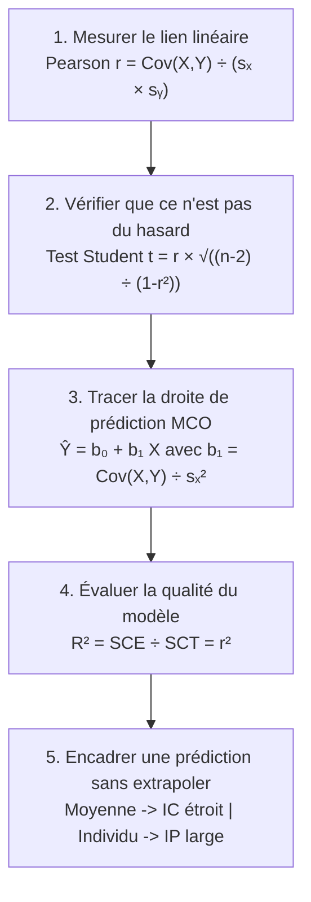

# 🧰 TD 3 — Formules & Explications Terre à Terre : Corrélation et Régression Linéaire

> ↖ [[MOC_Statistiques_Inferentielles|Statistiques Inférentielles (M1 IT)]] • 📄 [[TD3_Regression_Lineaire|Corrigé officiel TD 3]] • 📖 [[06_Correlation_et_Regression_Lineaire|Ch. 06 : Corrélation et Régression Linéaire]]

---

## 🧭 Comment enchaîner Corrélation et Régression ?

---

## 📋 Formulaire & Lexique récapitulatif du TD 3

> [!tip] Mémo rapide des formules utilisées dans le TD 3
> | Concept / Outil | Formule mathématique | Formule en français simple | Quand l'utiliser ? |
> | :--- | :--- | :--- | :--- |
> | **Moyennes $\overline{X}, \overline{Y}$** | $\overline{X} = \dfrac{1}{n}\sum X_i$, $\overline{Y} = \dfrac{1}{n}\sum Y_i$ | `Total des X ÷ n` et `Total des Y ÷ n` | Toujours la 1re étape avant écarts, covariance ou MCO. |
> | **Variances & Écarts-types** | $s_X^2 = \dfrac{1}{n}\sum (X_i - \overline{X})^2$, $s_X = \sqrt{s_X^2}$ | Moyenne des carrés des écarts ; `Écart-type = √Variance` | Diviser par $n$ ou $n-1$ donne exactement le même $r$ et le même $b_1$. |
> | **Covariance $\text{Cov}(X, Y)$** | $\text{Cov}(X,Y) = \dfrac{1}{n}\sum (X_i - \overline{X})(Y_i - \overline{Y})$ | `Moyenne des produits (Écart X × Écart Y)` | Positif si $X$ et $Y$ montent ensemble, négatif en sens inverse. |
> | **Corrélation de Pearson $r$** | $r = \dfrac{\text{Cov}(X,Y)}{s_X \cdot s_Y} \in [-1, +1]$ | `Covariance ÷ (Écart-type X × Écart-type Y)` | Mesure la force et le sens d'un **alignement en ligne droite**. |
> | **Test de significativité de $r$** | $t_{\text{obs}} = r\sqrt{\dfrac{n - 2}{1 - r^2}} \sim t(n - 2)$ | `r × √((Nb points - 2) ÷ (1 - r²))` | Vérifier si $r$ est réel ou dû au hasard ($H_0 : \rho = 0$). |
> | **Pente MCO $b_1$** | $b_1 = \dfrac{\text{Cov}(X, Y)}{s_X^2}$ | `Covariance(X, Y) ÷ Variance(X)` | Hausse moyenne de $\hat{Y}$ quand $X$ augmente de **1 unité**. |
> | **Ordonnée à l'origine $b_0$** | $b_0 = \overline{Y} - b_1 \overline{X}$ | `Moyenne Y - (Pente × Moyenne X)` | Valeur de $\hat{Y}$ quand $X = 0$ (la droite passe par $(\overline{X}, \overline{Y})$). |
> | **Droite de régression MCO** | $\hat{Y} = b_0 + b_1 X$ | `Prédiction = Coût fixe b₀ + (Taux b₁ × Variable X)` | Prédire $\hat{Y}$ dans la plage observée de $X$. |
> | **Décomposition & $R^2$** | $\text{SCT} = \text{SCE} + \text{SCR}$, $R^2 = \dfrac{\text{SCE}}{\text{SCT}} = r^2$ | `R² = Variation expliquée ÷ Variation totale` | Part en % de la variance de $Y$ expliquée par la droite. |
> | **IC vs IP (prédiction)** | $\text{IC}(E[Y \mid X_0])$ vs $\text{IP}(Y_0 \mid X_0)$ | **IC** = fourchette pour la **moyenne** ; **IP** = fourchette pour **1 individu** | L'IP est toujours plus large que l'IC (ajoute $\sigma^2$ individuel). |

---

## 🧠 Méthode : comment savoir quelle formule utiliser ?

Avec **deux variables en chiffres** $(X, Y)$, tu suis toujours ce même chemin :

| Indice lu dans l'énoncé | Choix de la formule / méthode |
| :--- | :--- |
| « force et sens du lien linéaire », « corrélation » | **Covariance puis Pearson $r = \dfrac{\text{Cov}(X,Y)}{s_X \cdot s_Y}$** |
| « $r$ est-il significatif ? », « tester $\rho = 0$ » | **Test de Student $t(n - 2)$** : $t = r\sqrt{\dfrac{n - 2}{1 - r^2}}$ |
| « prédire $Y$ à partir de $X$ », « ajuster une droite » | **Droite MCO** $\hat{Y} = b_0 + b_1 X$ avec $b_1 = \dfrac{\text{Cov}(X,Y)}{s_X^2}$ et $b_0 = \overline{Y} - b_1\overline{X}$ |
| « qualité du modèle », « part de variance expliquée » | **Coefficient de détermination $R^2 = \dfrac{\text{SCE}}{\text{SCT}} = r^2$** |
| « valeur moyenne attendue » vs « un individu précis » | **IC** (plus serré) pour une moyenne ; **IP** (plus large) pour un seul client ; **jamais de prédiction en dehors des données vues** (extrapolation invalide) |

---

## 📌 Exercice 1 – Analyse de la charge serveur et du temps de réponse

> [!question] Énoncé résumé & Données
> On mesure sur $n = 5$ paliers le nombre de requêtes simultanées $X_i$ et le temps de réponse serveur $Y_i$ (en ms) : $(100, 150)$, $(200, 250)$, $(300, 310)$, $(400, 400)$, $(500, 490)$. On demande les moyennes, variances, covariance et le coefficient de corrélation de Pearson $r$.

### 1. Moyennes $\overline{X}$ et $\overline{Y}$
Pour calculer les écarts et la covariance juste après, il faut d'abord trouver les deux moyennes :
$$\overline{X} = \frac{1}{n}\sum_{i=1}^5 X_i = \frac{100 + 200 + 300 + 400 + 500}{5} = \frac{1\,500}{5} = \mathbf{300\text{ requêtes}}$$
$$\overline{Y} = \frac{1}{n}\sum_{i=1}^5 Y_i = \frac{150 + 250 + 310 + 400 + 490}{5} = \frac{1\,600}{5} = \mathbf{320\text{ ms}}$$

### 2. Variances, écarts-types et covariance (sens de $\text{Cov}$ et pourquoi $n$ vs $n - 1$ ne change pas $r$)

| $i$ | $X_i$ | $Y_i$ | $X_i - 300$ | $(X_i - 300)^2$ | $Y_i - 320$ | $(Y_i - 320)^2$ | $(X_i - 300)(Y_i - 320)$ |
| :-: | :---: | :---: | :---: | :---: | :---: | :---: | :---: |
| 1 | $100$ | $150$ | $-200$ | $40\,000$ | $-170$ | $28\,900$ | $34\,000$ |
| 2 | $200$ | $250$ | $-100$ | $10\,000$ | $-70$ | $4\,900$ | $7\,000$ |
| 3 | $300$ | $310$ | $0$ | $0$ | $-10$ | $100$ | $0$ |
| 4 | $400$ | $400$ | $+100$ | $10\,000$ | $+80$ | $6\,400$ | $8\,000$ |
| 5 | $500$ | $490$ | $+200$ | $40\,000$ | $+170$ | $28\,900$ | $34\,000$ |
| **Total ($\sum$)** | **$1\,500$** | **$1\,600$** | **$0$** | **$100\,000$** | **$0$** | **$69\,200$** | **$83\,000$** |

*À quoi sert la covariance et pourquoi diviser par $n$ ou $n - 1$ ?* La covariance fait la moyenne des produits $(X_i - \overline{X})(Y_i - \overline{Y})$ : quand $X$ et $Y$ montent ensemble (ou descendent ensemble), le produit est **positif**. Ici, en divisant par $n = 5$ :
$$s_X^2 = \frac{1}{n}\sum (X_i - \overline{X})^2 = \frac{100\,000}{5} = \mathbf{20\,000} \implies s_X = \sqrt{20\,000} \approx \mathbf{141{,}4214}$$
$$s_Y^2 = \frac{1}{n}\sum (Y_i - \overline{Y})^2 = \frac{69\,200}{5} = \mathbf{13\,840} \implies s_Y = \sqrt{13\,840} \approx \mathbf{117{,}6435}$$
$$\text{Cov}(X, Y) = \frac{1}{n}\sum (X_i - \overline{X})(Y_i - \overline{Y}) = \frac{83\,000}{5} = \mathbf{16\,600}$$
*(Astuce examen : si tu divises par $n - 1 = 4$, ça donne $s_X^{\prime\,2} = \frac{100\,000}{4} = 25\,000$ ($s_X' \approx 158{,}11$), $s_Y^{\prime\,2} = \frac{69\,200}{4} = 17\,300$ ($s_Y' \approx 131{,}53$) et $\text{Cov}'(X,Y) = \frac{83\,000}{4} = 20\,750$. Pour le calcul de $r$ juste en dessous, que tu prennes $n$ ou $n - 1$, le facteur s'annule entre le haut et le bas : ça donne pile le même $r$ !)*

### 3. Corrélation de Pearson $r$ (pourquoi diviser par $s_X \cdot s_Y$ ?)
*Pourquoi cette formule ?* La covariance ($16\,600$) dépend des unités : si tu passes les temps en secondes au lieu des ms, elle devient $1\,000$ fois plus petite. En divisant par $s_X \cdot s_Y$, tu enlèves les unités et tu cales toujours $r$ entre **$-1$ et $+1$** :
$$r = \frac{\text{Cov}(X, Y)}{s_X \cdot s_Y} = \frac{16\,600}{141{,}4214 \times 117{,}6435} = \frac{16\,600}{16\,637{,}31} \approx \mathbf{0{,}9978}$$
*(Ou encore plus vite sans même diviser par $n$ : $r = \frac{83\,000}{\sqrt{100\,000 \times 69\,200}} = \frac{83\,000}{\sqrt{6\,920\,000\,000}} = \frac{83\,000}{83\,186{,}54} \approx \mathbf{0{,}9978}$.)*

### 4. Interprétation et conclusion
> [!check] Conclusion concrète
> $r \approx +0{,}998$ colle presque à $+1$ : il y a une **relation en ligne droite presque parfaite** entre le nombre de requêtes et le temps de réponse entre $100$ et $500$ requêtes.

---

## 📌 Exercice 2 – Test de significativité d'une corrélation en cybersécurité

> [!question] Énoncé résumé & Données
> Sur $n = 18$ plages horaires, un analyste SOC observe une corrélation $r = 0{,}52$ entre les connexions échouées et les alertes IDS. On teste si cette corrélation est significative au seuil $\alpha = 5\%$ ($t_{\text{critique}} = 2{,}120$, $p = 0{,}027$).

### 1. Hypothèses (pourquoi tester $r = 0{,}52$ sur $n = 18$ ?)
Sur seulement $18$ mesures, le hasard tout seul peut déjà donner un $r$ différent de $0$. On vérifie donc si le lien est réel ($\rho \ne 0$) ou si c'est juste un coup de chance (**test bilatéral**) :
$$H_0 : \rho = 0 \quad (\text{aucun lien réel}) \qquad \text{contre} \qquad H_1 : \rho \ne 0 \quad (\text{vrai lien linéaire})$$

### 2. Statistique $t$ de Student (pourquoi $n - 2 = 16$ ddl ?)
*Pourquoi Student et pourquoi $n - 2$ ddl ?* Une droite a **2 réglages** (la pente $b_1$ et le point de départ $b_0$), donc on enlève $2$ à $n$ au lieu de $1$ : ici $\nu = 18 - 2 = 16$. *En clair : `Statistique t = r × √((Nb observations - 2) ÷ (1 - r²))`.*
1. $r^2 = 0{,}52^2 = 0{,}2704 \implies 1 - r^2 = 1 - 0{,}2704 = 0{,}7296$.
2. $\frac{n - 2}{1 - r^2} = \frac{16}{0{,}7296} = 21{,}9298 \implies \sqrt{21{,}9298} = 4{,}6829$.
3. Statistique observée :
   $$t_{\text{obs}} = r\sqrt{\frac{n - 2}{1 - r^2}} = 0{,}52 \times 4{,}6829 \approx \mathbf{2{,}4351}$$

### 3. Région critique et décision à $\alpha = 5\%$
En Annexe C (ligne $\nu = 16$, colonne bilatérale `0,050`), $t_{\text{critique}} = \mathbf{2{,}120}$. Comme c'est bilatéral, on rejette $H_0$ si $|t_{\text{obs}}| > 2{,}120$, donc si on tombe dans $]-\infty \,;\, -2{,}120[ \cup ]2{,}120 \,;\, +\infty[$.
Ici $|t_{\text{obs}}| = 2{,}4351 > 2{,}120$, donc **le responsable sécurité rejette $H_0$**.

### 4. Confirmation par la $p$-value ($p = 0{,}027$)
> [!check] Conclusion concrète
> Comme $p = 2{,}7\% < 5\%$, le rejet est confirmé : il n'y avait que $2{,}7\%$ de chances de voir $r = 0{,}52$ par hasard, donc le lien est réel et ça vaut le coup de relier les alertes IDS aux échecs de connexion (détection de *brute-force*).

---

## 📌 Exercice 3 – Ajustement par MCO et estimation de projet IT

> [!question] Énoncé résumé & Données
> À partir de $n = 5$ projets passés, on relie la taille fonctionnelle $X$ (en Points de Fonction) à la charge de travail $Y$ (en jours-homme) : $\overline{X} = 120$ PF, $\overline{Y} = 450$ j-h, $s_X^2 = 800$, $s_Y^2 = 6\,800$, $\text{Cov}(X,Y) = 2\,200$. On estime le modèle MCO puis la charge pour $X_0 = 150$ PF.

### 1. Pente $b_1$ et ordonnée $b_0$ (pourquoi MCO et pourquoi diviser par $s_X^2$ ?)
Comme on veut **prédire** la charge $Y$ à partir de la taille $X$, on cherche la droite $\hat{Y} = b_0 + b_1 X$ qui passe le plus près possible des points (Moindres Carrés Ordinaires, MCO).
*Piège classique :* pour prédire $Y$ avec $X$, tu divises toujours par la variance de $X$ ($s_X^2$), jamais par $s_Y^2$ ! Et $b_0 = \overline{Y} - b_1 \overline{X}$ force la droite à passer pile par le point moyen $(\overline{X}, \overline{Y})$.
$$b_1 = \frac{\text{Cov}(X, Y)}{s_X^2} = \frac{2\,200}{800} = \mathbf{2{,}75\text{ j-h/PF}}$$
$$b_0 = \overline{Y} - b_1 \overline{X} = 450 - (2{,}75 \times 120) = 450 - 330 = \mathbf{120\text{ j-h}}$$

### 2. Équation de la droite MCO
$$\hat{Y} = b_0 + b_1 X \implies \hat{Y} = \mathbf{120 + 2{,}75 X}$$

### 3. Interprétation métier de $b_1$ et $b_0$
C'est tout simple : pense à un **tarif de taxi** :
- **Pente ($b_1 = 2{,}75$) :** c'est le prix au kilomètre — chaque Point de Fonction ajouté au projet demande en moyenne **2,75 jours-homme** de travail en plus.
- **Ordonnée à l'origine ($b_0 = 120$) :** c'est la prise en charge fixe de départ — même avant de coder le premier écran, il y a **120 jours-homme** de base (cadrage, mise en place, CI/CD, gestion de projet) *(à prendre avec prudence si $X = 0$ est loin des tailles de projets observées)*.

### 4. Estimation pour $X_0 = 150$ points de fonction
$$\hat{Y}(X_0) = b_0 + b_1 X_0 \implies \hat{Y}(150) = 120 + (2{,}75 \times 150) = 120 + 412{,}5 = \mathbf{532{,}5\text{ jours-homme}}$$

> [!check] Conclusion concrète
> Le modèle $\hat{Y} = 120 + 2{,}75 X$ prévoit **532,5 jours-homme** de travail pour un projet de $150$ points de fonction.

---

## 📌 Exercice 4 – Performance d'un modèle d'optimisation SQL

> [!question] Énoncé résumé & Données
> Une équipe DBA modélise le temps d'exécution de $n = 22$ requêtes SQL complexes en fonction de la taille de la table interrogée ($b_1 > 0$), obtenant $\text{SCT} = 12\,500$ et $\text{SCR} = 2\,750$.

### 1. Somme des Carrés Expliquée (pourquoi $\text{SCE} = \text{SCT} - \text{SCR}$ ?)
Imagine tous les écarts de temps entre les requêtes ($\text{SCT} = 12\,500$). Une partie est expliquée par ta droite ($\text{SCE}$), et le reste ce sont les erreurs autour de la droite ($\text{SCR} = 2\,750$). Comme $\text{SCT} = \text{SCE} + \text{SCR}$, une simple soustraction donne $\text{SCE}$ :
$$\text{SCE} = \text{SCT} - \text{SCR} = 12\,500 - 2\,750 = \mathbf{9\,750}$$

### 2. Coefficient de détermination $R^2$
$R^2$ te donne simplement le **pourcentage** de variation que ta droite arrive à expliquer :
$$R^2 = \frac{\text{SCE}}{\text{SCT}} = \frac{9\,750}{12\,500} = \mathbf{0{,}78} \quad (\mathbf{78\%})$$

### 3. Interprétation métier DBA
**78% des écarts de temps** entre les requêtes SQL s'expliquent directement par la taille de la table interrogée (en Go) : la droite explique déjà une grosse partie du comportement.

### 4. Retrouver Pearson $r$ (pourquoi regarder le signe de $b_1$ ?)
*Le piège classique :* on sait que $R^2 = r^2$, donc pour retrouver $r$, on prend $\sqrt{R^2}$. Mais un carré efface toujours le signe (car $(-0{,}8832)^2 = (+0{,}8832)^2 = 0{,}78$). Il faut donc **toujours** vérifier le signe de la pente $b_1$ : ici l'énoncé te dit $b_1 > 0$, donc $r$ est positif :
$$r = +\sqrt{R^2} = +\sqrt{0{,}78} \approx \mathbf{+0{,}8832}$$

### 5. Signification des $22\%$ non expliqués
$$\text{Part non expliquée} = 1 - R^2 = 1 - 0{,}78 = \mathbf{0{,}22} \quad (\mathbf{22\%})$$

> [!check] Conclusion concrète
> Le modèle explique $78\%$ de la variance ($r = +0{,}8832$). Les **$22\%$ qui restent** viennent de tout ce qui n'est pas la taille de la table : filtres `WHERE`, nombre de jointures, index manquants, charge du serveur ou cache RAM.

---

## 📌 Exercice 5 – Prédiction, IC/IP et limites d'un modèle Cloud

> [!question] Énoncé résumé & Données
> Un modèle MCO calibré sur $n = 25$ clients hébergés entre $[10\text{ TO} \,;\, 80\text{ TO}]$ prédit la facture mensuelle (k€) selon $\hat{Y} = 1{,}5 + 0{,}08 X$ ($R^2 = 0{,}85$). Pour $X_0 = 50$ TO, on donne deux intervalles à $95\%$ : $A = [5{,}15 \,;\, 5{,}85]$ et $B = [4{,}30 \,;\, 6{,}70]$. On teste ensuite une prédiction à $X_0 = 500$ TO.

### 1. Prévision ponctuelle pour $X_0 = 50$ TO
$50$ TO est bien entre $10$ et $80$ TO, donc on remplace simplement $X$ par $50$ dans l'équation :
$$\hat{Y}_0 = b_0 + b_1 X_0 = 1{,}5 + (0{,}08 \times 50) = 1{,}5 + 4{,}0 = \mathbf{5{,}5\text{ k€ / mois}}$$

### 2. Choisir entre IC et IP (pourquoi l'IP est plus large et adapté à un client unique ?)
*Comment ne plus jamais confondre IC et IP ?*
- L'**IC** (le plus serré), c'est pour prévoir la **moyenne** de plein de clients à $50$ TO : les hauts et les bas de chacun s'équilibrent.
- L'**IP** (le plus large), c'est pour prévoir la facture d'**un seul client précis** : là tu prends le flou de la droite **PLUS** les imprévus propres à ce client.

Calcul des largeurs ($\text{Borne sup} - \text{Borne inf}$) :
- **Intervalle A :** $\text{Largeur}_A = 5{,}85 - 5{,}15 = \mathbf{0{,}70\text{ k€}}$ (plus serré $\implies$ **IC** de la moyenne $E[Y \mid X_0 = 50]$).
- **Intervalle B :** $\text{Largeur}_B = 6{,}70 - 4{,}30 = \mathbf{2{,}40\text{ k€}}$ (plus large $\implies$ **IP** pour un client précis).

| Intervalle | Bornes à 95% | Largeur | Nature statistique |
| :---: | :---: | :---: | :--- |
| **A** | $[5{,}15 \,;\, 5{,}85]$ | $0{,}70$ | **Intervalle de Confiance (IC)** du coût *moyen* $E[Y \mid X_0 = 50]$ |
| **B** | $[4{,}30 \,;\, 6{,}70]$ | $2{,}40$ | **Intervalle de Prédiction (IP)** d'une facture *individuelle* |

Pour le financier qui veut prévoir la facture *exacte* d'un client particulier, il faut lui donner l'**Intervalle B ($[4{,}30 \,;\, 6{,}70]$ k€)**.

### 3. Pourquoi la prédiction à $X_0 = 500$ TO est invalide (piège d'extrapolation)
Si tu fais le calcul bêtement, ça donne :
$$\hat{Y}(500) = b_0 + b_1 \times 500 = 1{,}5 + (0{,}08 \times 500) = 1{,}5 + 40{,}0 = \mathbf{41{,}5\text{ k€ / mois}}$$
*Pourquoi ce chiffre n'a aucun sens ?* Parce que tu n'as observé des clients qu'entre $10$ et $80$ TO : à $500$ TO, tu sors complètement de ce que tu connais (**extrapolation**). Les tarifs Cloud ont des remises par volume et l'architecture change : rien ne garantit que la droite continue tout droit jusque là.

> [!check] Conclusion concrète
> À $50$ TO, la facture attendue est de $\mathbf{5{,}5\text{ k€}}$ avec un IP individuel de **$[4{,}30 \,;\, 6{,}70]$ k€**. Par contre, le chiffre de $41{,}5$ k€ à $500$ TO est **à rejeter** : on sort complètement de la plage $[10 \,;\, 80]$ TO.
