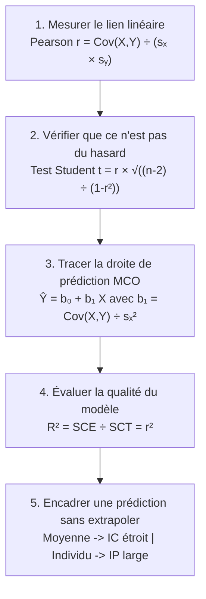

# 🧰 TD 3 — Formules & Explications Terre à Terre : Corrélation et Régression Linéaire

> ↖ [[MOC_Statistiques_Inferentielles|Statistiques Inférentielles (M1 IT)]] • 📄 [[TD3_Regression_Lineaire|Corrigé officiel TD 3]] • 📖 [[06_Correlation_et_Regression_Lineaire|Ch. 06 : Corrélation et Régression Linéaire]]

---

## 🧭 Comment enchaîner Corrélation et Régression ?

---

## 📋 Formulaire & Lexique récapitulatif du TD 3

> [!tip] Mémo rapide des formules utilisées dans le TD 3
> | Concept / Outil | Formule mathématique | Formule en français simple | Quand l'utiliser ? |
> | :--- | :--- | :--- | :--- |
> | **Moyennes $\overline{X}, \overline{Y}$** | $\overline{X} = \dfrac{1}{n}\sum X_i$, $\overline{Y} = \dfrac{1}{n}\sum Y_i$ | `Total des X ÷ n` et `Total des Y ÷ n` | Toujours la 1re étape avant écarts, covariance ou MCO. |
> | **Variances & Écarts-types** | $s_X^2 = \dfrac{1}{n}\sum (X_i - \overline{X})^2$, $s_X = \sqrt{s_X^2}$ | Moyenne des carrés des écarts ; `Écart-type = √Variance` | Diviser par $n$ ou $n-1$ donne exactement le même $r$ et le même $b_1$. |
> | **Covariance $\text{Cov}(X, Y)$** | $\text{Cov}(X,Y) = \dfrac{1}{n}\sum (X_i - \overline{X})(Y_i - \overline{Y})$ | `Moyenne des produits (Écart X × Écart Y)` | Positif si $X$ et $Y$ montent ensemble, négatif en sens inverse. |
> | **Corrélation de Pearson $r$** | $r = \dfrac{\text{Cov}(X,Y)}{s_X \cdot s_Y} \in [-1, +1]$ | `Covariance ÷ (Écart-type X × Écart-type Y)` | Mesure la force et le sens d'un **alignement en ligne droite**. |
> | **Test de significativité de $r$** | $t_{\text{obs}} = r\sqrt{\dfrac{n - 2}{1 - r^2}} \sim t(n - 2)$ | `r × √((Nb points - 2) ÷ (1 - r²))` | Vérifier si $r$ est réel ou dû au hasard ($H_0 : \rho = 0$). |
> | **Pente MCO $b_1$** | $b_1 = \dfrac{\text{Cov}(X, Y)}{s_X^2}$ | `Covariance(X, Y) ÷ Variance(X)` | Hausse moyenne de $\hat{Y}$ quand $X$ augmente de **1 unité**. |
> | **Ordonnée à l'origine $b_0$** | $b_0 = \overline{Y} - b_1 \overline{X}$ | `Moyenne Y - (Pente × Moyenne X)` | Valeur de $\hat{Y}$ quand $X = 0$ (la droite passe par $(\overline{X}, \overline{Y})$). |
> | **Droite de régression MCO** | $\hat{Y} = b_0 + b_1 X$ | `Prédiction = Coût fixe b₀ + (Taux b₁ × Variable X)` | Prédire $\hat{Y}$ dans la plage observée de $X$. |
> | **Décomposition & $R^2$** | $\text{SCT} = \text{SCE} + \text{SCR}$, $R^2 = \dfrac{\text{SCE}}{\text{SCT}} = r^2$ | `R² = Variation expliquée ÷ Variation totale` | Part en % de la variance de $Y$ expliquée par la droite. |
> | **IC vs IP (prédiction)** | $\text{IC}(E[Y \mid X_0])$ vs $\text{IP}(Y_0 \mid X_0)$ | **IC** = fourchette pour la **moyenne** ; **IP** = fourchette pour **1 individu** | L'IP est toujours plus large que l'IC (ajoute $\sigma^2$ individuel). |

---

## 📌 Exercice 1 – Analyse de la charge serveur et du temps de réponse

> [!question] Le problème en clair
> On observe la latence serveur $Y$ (ms) selon le nombre de requêtes simultanées $X$ sur $n = 5$ paliers : $(100, 150)$, $(200, 250)$, $(300, 310)$, $(400, 400)$, $(500, 490)$. On calcule les moyennes, variances, covariance et le coefficient de Pearson $r$.

> [!info] Comprendre la logique (terre à terre)
> **À quoi sert la covariance et pourquoi la diviser par $s_X s_Y$ ?**
> La covariance ($16\,600$) te donne juste le sens du lien : quand $X$ dépasse sa moyenne, $Y$ dépasse aussi sa moyenne, donc le produit est positif. Mais sa valeur dépend des unités choisies (en secondes au lieu de ms, elle serait $1\,000$ fois plus petite). Diviser par $s_X \cdot s_Y$ supprime les unités et enferme toujours le résultat $r$ entre **$-1$ et $+1$**.
>
> **Astuce examen :**
> Que tu divises par $n$ ou par $n - 1$, le facteur s'annule entre le numérateur et le dénominateur : $r$ est strictement identique dans les deux cas !

### Les formules utilisées
**Formules mathématiques :**
$$s_X^2 = \frac{1}{n}\sum (X_i - \overline{X})^2, \qquad s_Y^2 = \frac{1}{n}\sum (Y_i - \overline{Y})^2, \qquad \text{Cov}(X, Y) = \frac{1}{n}\sum (X_i - \overline{X})(Y_i - \overline{Y})$$
$$r = \frac{\text{Cov}(X, Y)}{s_X \cdot s_Y} = \frac{\sum (X_i - \overline{X})(Y_i - \overline{Y})}{\sqrt{\sum (X_i - \overline{X})^2 \cdot \sum (Y_i - \overline{Y})^2}}$$

**En français simple :**
`Covariance = Moyenne des produits (Écart de X × Écart de Y)`
`Pearson r = Covariance ÷ (Écart-type de X × Écart-type de Y)`

### Résolution détaillée pas-à-pas
On commence par les moyennes :
$$\overline{X} = \frac{1\,500}{5} = \mathbf{300\text{ requêtes}}, \qquad \overline{Y} = \frac{1\,600}{5} = \mathbf{320\text{ ms}}$$

| $i$ | $X_i$ | $Y_i$ | $X_i - 300$ | $(X_i - 300)^2$ | $Y_i - 320$ | $(Y_i - 320)^2$ | $(X_i - 300)(Y_i - 320)$ |
| :-: | :---: | :---: | :---: | :---: | :---: | :---: | :---: |
| 1 | $100$ | $150$ | $-200$ | $40\,000$ | $-170$ | $28\,900$ | $34\,000$ |
| 2 | $200$ | $250$ | $-100$ | $10\,000$ | $-70$ | $4\,900$ | $7\,000$ |
| 3 | $300$ | $310$ | $0$ | $0$ | $-10$ | $100$ | $0$ |
| 4 | $400$ | $400$ | $+100$ | $10\,000$ | $+80$ | $6\,400$ | $8\,000$ |
| 5 | $500$ | $490$ | $+200$ | $40\,000$ | $+170$ | $28\,900$ | $34\,000$ |
| **Total ($\sum$)** | **$1\,500$** | **$1\,600$** | **$0$** | **$100\,000$** | **$0$** | **$69\,200$** | **$83\,000$** |

$$s_X^2 = \frac{100\,000}{5} = \mathbf{20\,000} \ (s_X \approx \mathbf{141{,}4214}), \qquad s_Y^2 = \frac{69\,200}{5} = \mathbf{13\,840} \ (s_Y \approx \mathbf{117{,}6435})$$
$$\text{Cov}(X, Y) = \frac{83\,000}{5} = \mathbf{16\,600}$$
$$r = \frac{16\,600}{141{,}4214 \times 117{,}6435} = \frac{83\,000}{\sqrt{100\,000 \times 69\,200}} \approx \mathbf{0{,}9978}$$
*(Avec $n - 1 = 4$ : $s_X^{\prime\,2} = 25\,000$, $s_Y^{\prime\,2} = 17\,300$, $\text{Cov}' = 20\,750$, et même $r$.)*

> [!check] Conclusion concrète
> $r \approx +0{,}998$ montre une **relation linéaire positive quasi parfaite** entre charge et latence.

---

## 📌 Exercice 2 – Test de significativité d'une corrélation en cybersécurité

> [!question] Le problème en clair
> Sur $n = 18$ plages horaires, on observe une corrélation $r = 0{,}52$ entre connexions échouées et alertes IDS. Ce lien est-il significatif à $\alpha = 5\%$ ($t_{\text{critique}} = 2{,}120$, $p = 0{,}027$) ?

> [!info] Comprendre la logique (terre à terre)
> **Pourquoi tester $r = 0{,}52$ au lieu de conclure tout de suite à un vrai lien ?**
> Sur seulement $18$ observations, le pur hasard peut produire un $r$ non nul. Le test calcule combien il est improbable d'obtenir $0{,}52$ par accident ($2{,}7\%$ de chance).
>
> **Pourquoi $n - 2$ degrés de liberté (et pas $n - 1$) ?**
> Parce qu'une droite possède **2 paramètres** (pente et ordonnée à l'origine) qui consomment chacun $1$ degré de liberté.

### Les formules utilisées
**Formule mathématique :**
$$H_0 : \rho = 0 \quad \text{vs} \quad H_1 : \rho \ne 0, \qquad t_{\text{obs}} = r\sqrt{\frac{n - 2}{1 - r^2}} \sim t(n - 2)$$

**En français simple :**
`Statistique t = Corrélation r × √((Nb d'observations - 2) ÷ (1 - r²))`

### Résolution détaillée pas-à-pas
$$t_{\text{obs}} = 0{,}52 \sqrt{\frac{18 - 2}{1 - 0{,}52^2}} = 0{,}52 \sqrt{\frac{16}{0{,}7296}} = 0{,}52 \times 4{,}6829 \approx \mathbf{2{,}4351}$$
$$|t_{\text{obs}}| = 2{,}4351 > t_{\text{critique}} = 2{,}120 \quad \text{et} \quad p = 0{,}027 < \alpha = 0{,}05$$

> [!check] Conclusion concrète
> **On rejette $H_0$** : le lien est statistiquement significatif et justifie de corréler les règles IDS aux échecs d'authentification.

---

## 📌 Exercice 3 – Ajustement par MCO et estimation de projet IT

> [!question] Le problème en clair
> Sur $n = 5$ projets IT, on dispose de la taille fonctionnelle moyenne $\overline{X} = 120$ PF, de la charge moyenne $\overline{Y} = 450$ j-h, de $s_X^2 = 800$, $s_Y^2 = 6\,800$ et $\text{Cov}(X, Y) = 2\,200$. On ajuste la droite MCO puis on estime un projet de $X_0 = 150$ PF.

> [!info] Comprendre la logique (terre à terre)
> **À quoi correspond $\hat{Y} = b_0 + b_1 X$ dans un devis IT ?**
> C'est un tarif de taxi : **$b_0 = 120$ j-h** est la prise en charge fixe (cadrage, CI/CD, setup), et **$b_1 = 2{,}75$ j-h** est le prix au kilomètre (chaque Point de Fonction en plus coûte $2{,}75$ jours-homme).
>
> **Piège classique d'examen :**
> Ne divise jamais par $s_Y^2$ dans $b_1$ ! Pour prédire $Y$ à partir de $X$, on divise toujours par la variance de la variable **explicative** ($s_X^2$). Et $b_0 = \overline{Y} - b_1 \overline{X}$ garantit que ta droite passe exactement par le point moyen $(\overline{X}, \overline{Y})$.

### Les formules utilisées
**Formules mathématiques :**
$$b_1 = \frac{\text{Cov}(X, Y)}{s_X^2}, \qquad b_0 = \overline{Y} - b_1 \overline{X}, \qquad \hat{Y} = b_0 + b_1 X$$

**En français simple :**
`Pente b₁ = Covariance(X, Y) ÷ Variance de X`
`Ordonnée b₀ = Moyenne des Y - (Pente × Moyenne des X)`

### Résolution détaillée pas-à-pas
$$b_1 = \frac{2\,200}{800} = \mathbf{2{,}75\text{ j-h/PF}}$$
$$b_0 = 450 - 2{,}75 \times 120 = 450 - 330 = \mathbf{120\text{ j-h}}$$
$$\hat{Y} = \mathbf{120 + 2{,}75 X}$$
$$\hat{Y}(150) = 120 + 2{,}75 \times 150 = 120 + 412{,}5 = \mathbf{532{,}5\text{ jours-homme}}$$

> [!check] Conclusion concrète
> Le modèle $\hat{Y} = 120 + 2{,}75 X$ estime à **532,5 jours-homme** la charge d'un projet de $150$ PF.

---

## 📌 Exercice 4 – Performance d'un modèle d'optimisation SQL

> [!question] Le problème en clair
> Sur $n = 22$ requêtes SQL complexes ($b_1 > 0$), on connaît la variation totale $\text{SCT} = 12\,500$ et la variation résiduelle $\text{SCR} = 2\,750$. On calcule $\text{SCE}$, $R^2$, $r$ et la part non expliquée.

> [!info] Comprendre la logique (terre à terre)
> **La relation $\text{SCT} = \text{SCE} + \text{SCR}$ :**
> Imagine la dispersion totale des temps de requête ($\text{SCT} = 12\,500$). Notre droite en capture une grande partie ($\text{SCE} = 9\,750$, soit $78\%$), et le reste représente les erreurs autour de la droite ($\text{SCR} = 2\,750$, soit $22\%$).
>
> **Piège quand on remonte de $R^2$ vers $r$ :**
> $\sqrt{0{,}78}$ donne $0{,}8832$, mais $R^2$ perd le signe (car $(-0{,}8832)^2 = (+0{,}8832)^2 = 0{,}78$). Il faut donc **toujours** vérifier le signe de la pente $b_1$ pour savoir si $r$ est $+0{,}8832$ ou $-0{,}8832$.

### Les formules utilisées
**Formules mathématiques :**
$$\text{SCT} = \text{SCE} + \text{SCR} \implies \text{SCE} = \text{SCT} - \text{SCR}$$
$$R^2 = \frac{\text{SCE}}{\text{SCT}}, \qquad r = \text{signe}(b_1)\sqrt{R^2}$$

**En français simple :**
`Variation expliquée = Variation totale - Variation des erreurs`
`R² = Variation expliquée ÷ Variation totale`

### Résolution détaillée pas-à-pas
$$\text{SCE} = 12\,500 - 2\,750 = \mathbf{9\,750}$$
$$R^2 = \frac{9\,750}{12\,500} = \mathbf{0{,}78} \quad (\mathbf{78\%}\text{ expliqués})$$
$$r = +\sqrt{0{,}78} \approx \mathbf{+0{,}8832} \quad (\text{car } b_1 > 0)$$

> [!check] Conclusion concrète
> La taille de la table explique **$78\%$** de la variance des temps SQL ($r = +0{,}8832$) ; les **$22\%$** restants proviennent des index, clauses `WHERE`, jointures, CPU/I/O et cache RAM.

---

## 📌 Exercice 5 – Prédiction, IC/IP et limites d'un modèle Cloud

> [!question] Le problème en clair
> Un modèle Cloud calibré sur $n = 25$ clients entre $[10\text{ TO} \,;\, 80\text{ TO}]$ donne $\hat{Y} = 1{,}5 + 0{,}08 X$ ($R^2 = 0{,}85$). Pour $X_0 = 50$ TO, on compare $A = [5{,}15 \,;\, 5{,}85]$ et $B = [4{,}30 \,;\, 6{,}70]$, puis on évalue une prédiction à $X_0 = 500$ TO.

> [!info] Comprendre la logique (terre à terre)
> **Comment ne plus jamais confondre IC et IP :**
> L'**IC (le plus étroit)** répond à : *« Quel est le loyer mensuel moyen de tous les clients qui stockent 50 TO ? »* — les aléas individuels se compensent, la fourchette est serrée ($[5{,}15 \,;\, 5{,}85]$). L'**IP (le plus large)** répond à : *« Combien va payer ce client précis le mois prochain pour ses 50 TO ? »* — tu subis l'imprécision de la droite PLUS les écarts propres à ce client ($[4{,}30 \,;\, 6{,}70]$).
>
> **Pourquoi l'extrapolation à $500$ TO est dangereuse :**
> Ta droite n'a aucune donnée au-dessus de $80$ TO. À $500$ TO, les grilles tarifaires Cloud changent (remises volume, architecture distribuée, trafic inter-nœuds), et la relation n'est probablement plus linéaire.

### Les formules utilisées
**Formules mathématiques :**
$$\hat{Y}_0 = b_0 + b_1 X_0, \qquad \text{IC}_{95\%}(E[Y \mid X_0]) \subset \text{IP}_{95\%}(Y_0 \mid X_0)$$

**En français simple :**
`Largeur IP > Largeur IC (un individu fluctue toujours plus qu'une moyenne)`

### Résolution détaillée pas-à-pas
Pour $X_0 = 50$ TO :
$$\hat{Y}(50) = 1{,}5 + 0{,}08 \times 50 = 1{,}5 + 4{,}0 = \mathbf{5{,}5\text{ k€ / mois}}$$

| Intervalle | Bornes à 95% | Largeur | Rôle |
| :---: | :---: | :---: | :--- |
| **A** | $[5{,}15 \,;\, 5{,}85]$ | $0{,}70$ | **Intervalle de Confiance (IC)** du coût *moyen* |
| **B** | $[4{,}30 \,;\, 6{,}70]$ | $2{,}40$ | **Intervalle de Prédiction (IP)** individuel $\implies$ **à transmettre au responsable financier** |

Pour $X_0 = 500$ TO :
$$\hat{Y}(500) = 1{,}5 + 0{,}08 \times 500 = \mathbf{41{,}5\text{ k€ / mois}}$$

> [!check] Conclusion concrète
> Le financier doit budgéter avec l'IP **$[4{,}30 \,;\, 6{,}70]$ k€** pour un client à $50$ TO, et rejeter la prédiction à $500$ TO car elle sort totalement de la plage calibrée $[10 \,;\, 80]$ TO (**extrapolation invalide**).
