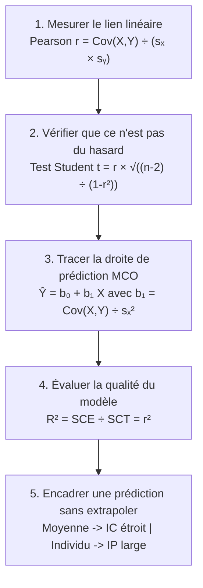

# 🧰 TD 3 — Formules & Explications Terre à Terre : Corrélation et Régression Linéaire

> ↖ [[MOC_Statistiques_Inferentielles|Statistiques Inférentielles (M1 IT)]] • 📄 [[TD3_Regression_Lineaire|Corrigé officiel TD 3]] • 📖 [[06_Correlation_et_Regression_Lineaire|Ch. 06 : Corrélation et Régression Linéaire]]

---

## 🧭 Comment enchaîner Corrélation et Régression ?

---

## 📋 Formulaire & Lexique récapitulatif du TD 3

> [!tip] Mémo rapide des formules utilisées dans le TD 3
> | Concept / Outil | Formule mathématique | Formule en français simple | Quand l'utiliser ? |
> | :--- | :--- | :--- | :--- |
> | **Moyennes $\overline{X}, \overline{Y}$** | $\overline{X} = \dfrac{1}{n}\sum X_i$, $\overline{Y} = \dfrac{1}{n}\sum Y_i$ | `Total des X ÷ n` et `Total des Y ÷ n` | Toujours la 1re étape avant écarts, covariance ou MCO. |
> | **Variances & Écarts-types** | $s_X^2 = \dfrac{1}{n}\sum (X_i - \overline{X})^2$, $s_X = \sqrt{s_X^2}$ | Moyenne des carrés des écarts ; `Écart-type = √Variance` | Diviser par $n$ ou $n-1$ donne exactement le même $r$ et le même $b_1$. |
> | **Covariance $\text{Cov}(X, Y)$** | $\text{Cov}(X,Y) = \dfrac{1}{n}\sum (X_i - \overline{X})(Y_i - \overline{Y})$ | `Moyenne des produits (Écart X × Écart Y)` | Positif si $X$ et $Y$ montent ensemble, négatif en sens inverse. |
> | **Corrélation de Pearson $r$** | $r = \dfrac{\text{Cov}(X,Y)}{s_X \cdot s_Y} \in [-1, +1]$ | `Covariance ÷ (Écart-type X × Écart-type Y)` | Mesure la force et le sens d'un **alignement en ligne droite**. |
> | **Test de significativité de $r$** | $t_{\text{obs}} = r\sqrt{\dfrac{n - 2}{1 - r^2}} \sim t(n - 2)$ | `r × √((Nb points - 2) ÷ (1 - r²))` | Vérifier si $r$ est réel ou dû au hasard ($H_0 : \rho = 0$). |
> | **Pente MCO $b_1$** | $b_1 = \dfrac{\text{Cov}(X, Y)}{s_X^2}$ | `Covariance(X, Y) ÷ Variance(X)` | Hausse moyenne de $\hat{Y}$ quand $X$ augmente de **1 unité**. |
> | **Ordonnée à l'origine $b_0$** | $b_0 = \overline{Y} - b_1 \overline{X}$ | `Moyenne Y - (Pente × Moyenne X)` | Valeur de $\hat{Y}$ quand $X = 0$ (la droite passe par $(\overline{X}, \overline{Y})$). |
> | **Droite de régression MCO** | $\hat{Y} = b_0 + b_1 X$ | `Prédiction = Coût fixe b₀ + (Taux b₁ × Variable X)` | Prédire $\hat{Y}$ dans la plage observée de $X$. |
> | **Décomposition & $R^2$** | $\text{SCT} = \text{SCE} + \text{SCR}$, $R^2 = \dfrac{\text{SCE}}{\text{SCT}} = r^2$ | `R² = Variation expliquée ÷ Variation totale` | Part en % de la variance de $Y$ expliquée par la droite. |
> | **IC vs IP (prédiction)** | $\text{IC}(E[Y \mid X_0])$ vs $\text{IP}(Y_0 \mid X_0)$ | **IC** = fourchette pour la **moyenne** ; **IP** = fourchette pour **1 individu** | L'IP est toujours plus large que l'IC (ajoute $\sigma^2$ individuel). |

---

## 🧠 Méthode : comment savoir quelle formule utiliser ?

Avec **deux variables quantitatives** $(X, Y)$, les questions suivent toujours cette progression logique :

| Indice lu dans l'énoncé | Choix de la formule / méthode |
| :--- | :--- |
| « force et sens du lien linéaire », « corrélation » | **Covariance puis Pearson $r = \dfrac{\text{Cov}(X,Y)}{s_X \cdot s_Y}$** |
| « $r$ est-il significatif ? », « tester $\rho = 0$ » | **Test de Student $t(n - 2)$** : $t = r\sqrt{\dfrac{n - 2}{1 - r^2}}$ |
| « prédire $Y$ à partir de $X$ », « ajuster une droite » | **Droite MCO** $\hat{Y} = b_0 + b_1 X$ avec $b_1 = \dfrac{\text{Cov}(X,Y)}{s_X^2}$ et $b_0 = \overline{Y} - b_1\overline{X}$ |
| « qualité du modèle », « part de variance expliquée » | **Coefficient de détermination $R^2 = \dfrac{\text{SCE}}{\text{SCT}} = r^2$** |
| « valeur moyenne attendue » vs « un individu précis » | **IC** (plus étroit) pour une moyenne ; **IP** (plus large) pour un individu ; **jamais de prédiction hors de la plage observée** (extrapolation invalide) |

---
## 📌 Exercice 1 – Analyse de la charge serveur et du temps de réponse

> [!question] Énoncé résumé & Données
> On mesure sur $n = 5$ paliers le nombre de requêtes simultanées $X_i$ et le temps de réponse serveur $Y_i$ (en ms) : $(100, 150)$, $(200, 250)$, $(300, 310)$, $(400, 400)$, $(500, 490)$. On demande les moyennes, variances, covariance et le coefficient de corrélation de Pearson $r$.

> [!info] Comprendre la logique (terre à terre)
> **À quoi sert la covariance et pourquoi la diviser par $s_X s_Y$ ?**
> La covariance ($16\,600$) te donne juste le sens du lien : quand $X$ dépasse sa moyenne, $Y$ dépasse aussi sa moyenne, donc le produit est positif. Mais sa valeur dépend des unités choisies (en secondes au lieu de ms, elle serait $1\,000$ fois plus petite). Diviser par $s_X \cdot s_Y$ supprime les unités et enferme toujours le résultat $r$ entre **$-1$ et $+1$**.
>
> **Astuce examen :**
> Que tu divises par $n$ ou par $n - 1$, le facteur s'annule entre le numérateur et le dénominateur : $r$ est strictement identique dans les deux cas !

> [!abstract] 🔎 Pourquoi cette méthode ? (indices de l'énoncé → choix)
> | Indice lu dans l'énoncé | Ce que ça implique |
> | :--- | :--- |
> | Couples $(X_i, Y_i)$ quantitatifs, « mesurer la force du lien » | Deux variables numériques : calculer moyennes, variances, covariance puis normaliser avec Pearson $r$. |
> | Aucune prédiction demandée ici | On s'arrête à la corrélation sans ajuster de droite MCO. |
> 
> **Donc :** $r = \frac{\text{Cov}(X, Y)}{s_X \cdot s_Y}$ pour mesurer l'alignement linéaire entre $-1$ et $+1$.

### Les formules utilisées
**Formules mathématiques :**
$$\overline{X} = \frac{1}{n}\sum_{i=1}^n X_i, \qquad \overline{Y} = \frac{1}{n}\sum_{i=1}^n Y_i$$
$$s_X^2 = \frac{1}{n}\sum (X_i - \overline{X})^2, \qquad s_Y^2 = \frac{1}{n}\sum (Y_i - \overline{Y})^2, \qquad \text{Cov}(X, Y) = \frac{1}{n}\sum (X_i - \overline{X})(Y_i - \overline{Y})$$
$$r = \frac{\text{Cov}(X, Y)}{s_X \cdot s_Y} = \frac{\sum (X_i - \overline{X})(Y_i - \overline{Y})}{\sqrt{\sum (X_i - \overline{X})^2 \cdot \sum (Y_i - \overline{Y})^2}}$$

**En français simple :**
`Covariance = Moyenne des produits (Écart de X × Écart de Y)`
`Pearson r = Covariance ÷ (Écart-type de X × Écart-type de Y)`

### Résolution détaillée pas-à-pas

#### 1. Moyennes $\overline{X}$ et $\overline{Y}$
$$\overline{X} = \frac{1}{n}\sum_{i=1}^5 X_i = \frac{100 + 200 + 300 + 400 + 500}{5} = \frac{1\,500}{5} = \mathbf{300\text{ requêtes}}$$
$$\overline{Y} = \frac{1}{n}\sum_{i=1}^5 Y_i = \frac{150 + 250 + 310 + 400 + 490}{5} = \frac{1\,600}{5} = \mathbf{320\text{ ms}}$$

#### 2. Variances, écarts-types et covariance

| $i$ | $X_i$ | $Y_i$ | $X_i - 300$ | $(X_i - 300)^2$ | $Y_i - 320$ | $(Y_i - 320)^2$ | $(X_i - 300)(Y_i - 320)$ |
| :-: | :---: | :---: | :---: | :---: | :---: | :---: | :---: |
| 1 | $100$ | $150$ | $-200$ | $40\,000$ | $-170$ | $28\,900$ | $34\,000$ |
| 2 | $200$ | $250$ | $-100$ | $10\,000$ | $-70$ | $4\,900$ | $7\,000$ |
| 3 | $300$ | $310$ | $0$ | $0$ | $-10$ | $100$ | $0$ |
| 4 | $400$ | $400$ | $+100$ | $10\,000$ | $+80$ | $6\,400$ | $8\,000$ |
| 5 | $500$ | $490$ | $+200$ | $40\,000$ | $+170$ | $28\,900$ | $34\,000$ |
| **Total ($\sum$)** | **$1\,500$** | **$1\,600$** | **$0$** | **$100\,000$** | **$0$** | **$69\,200$** | **$83\,000$** |

Selon la convention empirique (diviseur $n = 5$) :
$$s_X^2 = \frac{1}{n}\sum (X_i - \overline{X})^2 = \frac{100\,000}{5} = \mathbf{20\,000} \implies s_X = \sqrt{20\,000} \approx \mathbf{141{,}4214}$$
$$s_Y^2 = \frac{1}{n}\sum (Y_i - \overline{Y})^2 = \frac{69\,200}{5} = \mathbf{13\,840} \implies s_Y = \sqrt{13\,840} \approx \mathbf{117{,}6435}$$
$$\text{Cov}(X, Y) = \frac{1}{n}\sum (X_i - \overline{X})(Y_i - \overline{Y}) = \frac{83\,000}{5} = \mathbf{16\,600}$$
*(Note : avec le diviseur sans biais $n - 1 = 4$, on obtient $s_X^{\prime\,2} = \frac{100\,000}{4} = 25\,000$ ($s_X' \approx 158{,}11$), $s_Y^{\prime\,2} = \frac{69\,200}{4} = 17\,300$ ($s_Y' \approx 131{,}53$) et $\text{Cov}'(X,Y) = \frac{83\,000}{4} = 20\,750$. Le rapport $r$ ci-dessous est strictement identique.)*

#### 3. Coefficient de corrélation de Pearson $r$
$$r = \frac{\text{Cov}(X, Y)}{s_X \cdot s_Y} = \frac{16\,600}{141{,}4214 \times 117{,}6435} = \frac{16\,600}{16\,637{,}31} \approx \mathbf{0{,}9978}$$
*(Équivalent direct sans diviser par $n$ : $r = \frac{83\,000}{\sqrt{100\,000 \times 69\,200}} = \frac{83\,000}{\sqrt{6\,920\,000\,000}} = \frac{83\,000}{83\,186{,}54} \approx \mathbf{0{,}9978}$.)*

#### 4. Conclusion sur le lien
> [!check] Conclusion concrète
> $r \approx +0{,}998$ est très proche de $+1$ : il existe une **relation linéaire positive quasi parfaite** entre le nombre de requêtes simultanées et le temps de réponse sur la plage $[100; 500]$ requêtes.

---

## 📌 Exercice 2 – Test de significativité d'une corrélation en cybersécurité

> [!question] Énoncé résumé & Données
> Sur $n = 18$ plages horaires, un analyste SOC observe une corrélation $r = 0{,}52$ entre les connexions échouées et les alertes IDS. On teste si cette corrélation est significative au seuil $\alpha = 5\%$ ($t_{\text{critique}} = 2{,}120$, $p = 0{,}027$).

> [!info] Comprendre la logique (terre à terre)
> **Pourquoi tester $r = 0{,}52$ au lieu de conclure tout de suite à un vrai lien ?**
> Sur seulement $18$ observations, le pur hasard peut produire un $r$ non nul. Le test calcule combien il est improbable d'obtenir $0{,}52$ par accident ($2{,}7\%$ de chance).
>
> **Pourquoi $n - 2$ degrés de liberté (et pas $n - 1$) ?**
> Parce qu'une droite possède **2 paramètres** (pente et ordonnée à l'origine) qui consomment chacun $1$ degré de liberté.

> [!abstract] 🔎 Pourquoi cette méthode ? (indices de l'énoncé → choix)
> | Indice lu dans l'énoncé | Ce que ça implique |
> | :--- | :--- |
> | Corrélation $r = 0{,}52$ observée sur $n = 18$, « est-elle significative ? » | Vérifier si $r$ traduit un lien réel ($\rho \ne 0$) ou un accident d'échantillonnage. |
> | Droite à $2$ paramètres | La statistique suit une loi de Student à $n - 2$ degrés de liberté. |
> 
> **Donc :** test $t(n - 2)$ avec $t_{\text{obs}} = r\sqrt{\frac{n - 2}{1 - r^2}}$.

### Les formules utilisées
**Formule mathématique :**
$$H_0 : \rho = 0 \quad \text{vs} \quad H_1 : \rho \ne 0, \qquad t_{\text{obs}} = r\sqrt{\frac{n - 2}{1 - r^2}} \sim t(n - 2)$$

**En français simple :**
`Statistique t = Corrélation r × √((Nb d'observations - 2) ÷ (1 - r²))`

### Résolution détaillée pas-à-pas

#### 1. Formulation des hypothèses
$$H_0 : \rho = 0 \quad (\text{aucune corrélation linéaire dans la population})$$
$$H_1 : \rho \ne 0 \quad (\text{il existe une corrélation linéaire non nulle})$$

#### 2. Calcul de la statistique de test $t$ ($\text{ddl} = n - 2 = 18 - 2 = 16$)
On décompose le calcul étape par étape :
1. $r^2 = 0{,}52^2 = 0{,}2704 \implies 1 - r^2 = 1 - 0{,}2704 = 0{,}7296$.
2. $\frac{n - 2}{1 - r^2} = \frac{16}{0{,}7296} = 21{,}9298 \implies \sqrt{21{,}9298} = 4{,}6829$.
3. Statistique observée :
   $$t_{\text{obs}} = r\sqrt{\frac{n - 2}{1 - r^2}} = 0{,}52 \times 4{,}6829 \approx \mathbf{2{,}4351}$$

#### 3. Règle de décision et région critique ($\alpha = 5\%$)
En Annexe C (ligne $\nu = 16$, colonne bilatérale `0,050`), $t_{\text{critique}} = \mathbf{2{,}120}$. Pour un test bilatéral à $\alpha = 5\%$, on rejette $H_0$ si $|t_{\text{obs}}| > 2{,}120$, soit dans la région critique $]-\infty \,;\, -2{,}120[ \cup ]2{,}120 \,;\, +\infty[$.
Ici $|t_{\text{obs}}| = 2{,}4351 > 2{,}120$, donc **le responsable sécurité rejette $H_0$**.

#### 4. Confirmation via la $p$-value ($p = 0{,}027$)
> [!check] Conclusion concrète
> Comme $p = 0{,}027 < \alpha = 0{,}05$ (exact : $0{,}02696$), le rejet de $H_0$ est confirmé : il n'y a que $2{,}7\%$ de chance d'observer $r = 0{,}52$ par pur hasard, ce qui justifie de corréler les règles IDS aux échecs d'authentification (détection de *brute-force*).

---

## 📌 Exercice 3 – Ajustement par MCO et estimation de projet IT

> [!question] Énoncé résumé & Données
> À partir de $n = 5$ projets passés, on relie la taille fonctionnelle $X$ (en Points de Fonction) à la charge de travail $Y$ (en jours-homme) : $\overline{X} = 120$ PF, $\overline{Y} = 450$ j-h, $s_X^2 = 800$, $s_Y^2 = 6\,800$, $\text{Cov}(X,Y) = 2\,200$. On estime le modèle MCO puis la charge pour $X_0 = 150$ PF.

> [!info] Comprendre la logique (terre à terre)
> **À quoi correspond $\hat{Y} = b_0 + b_1 X$ dans un devis IT ?**
> C'est un tarif de taxi : **$b_0 = 120$ j-h** est la prise en charge fixe (cadrage, CI/CD, setup), et **$b_1 = 2{,}75$ j-h** est le prix au kilomètre (chaque Point de Fonction en plus coûte $2{,}75$ jours-homme).
>
> **Piège classique d'examen :**
> Ne divise jamais par $s_Y^2$ dans $b_1$ ! Pour prédire $Y$ à partir de $X$, on divise toujours par la variance de la variable **explicative** ($s_X^2$). Et $b_0 = \overline{Y} - b_1 \overline{X}$ garantit que ta droite passe exactement par le point moyen $(\overline{X}, \overline{Y})$.

> [!abstract] 🔎 Pourquoi cette méthode ? (indices de l'énoncé → choix)
> | Indice lu dans l'énoncé | Ce que ça implique |
> | :--- | :--- |
> | « prédire la charge $Y$ à partir de $X$ », $\overline{X}, \overline{Y}, s_X^2, \text{Cov}(X,Y)$ fournis | Il faut l'équation d'une droite de prédiction : méthode des Moindres Carrés Ordinaires (MCO). |
> | Prédiction demandée pour $X_0 = 150$ PF | Appliquer $\hat{Y} = b_0 + b_1 X_0$ une fois $b_1$ et $b_0$ calculés. |
> 
> **Donc :** MCO avec $b_1 = \frac{\text{Cov}(X,Y)}{s_X^2}$ et $b_0 = \overline{Y} - b_1\overline{X}$.

### Les formules utilisées
**Formules mathématiques :**
$$b_1 = \frac{\text{Cov}(X, Y)}{s_X^2}, \qquad b_0 = \overline{Y} - b_1 \overline{X}, \qquad \hat{Y} = b_0 + b_1 X$$

**En français simple :**
`Pente b₁ = Covariance(X, Y) ÷ Variance de X`
`Ordonnée b₀ = Moyenne des Y - (Pente × Moyenne des X)`

### Résolution détaillée pas-à-pas

#### 1. Pente $b_1$ et ordonnée à l'origine $b_0$
$$b_1 = \frac{\text{Cov}(X, Y)}{s_X^2} = \frac{2\,200}{800} = \mathbf{2{,}75\text{ j-h/PF}}$$
$$b_0 = \overline{Y} - b_1 \overline{X} = 450 - (2{,}75 \times 120) = 450 - 330 = \mathbf{120\text{ j-h}}$$

#### 2. Équation du modèle estimé
$$\hat{Y} = b_0 + b_1 X \implies \hat{Y} = \mathbf{120 + 2{,}75 X}$$

#### 3. Interprétation métier pour le Directeur de Projet IT
- **Pente ($b_1 = 2{,}75$) :** chaque point de fonction supplémentaire dans le périmètre d'un projet requiert en moyenne **2,75 jours-homme** de charge additionnelle.
- **Ordonnée à l'origine ($b_0 = 120$) :** charge fixe incompressible de base estimée à **120 jours-homme** (cadrage, mise en place de l'environnement, CI/CD, chefferie de projet) indépendante de la taille fonctionnelle *(à interpréter avec prudence si $X=0$ est loin des tailles observées)*.

#### 4. Estimation pour un projet de $X_0 = 150$ points de fonction
$$\hat{Y}(X_0) = b_0 + b_1 X_0 \implies \hat{Y}(150) = 120 + (2{,}75 \times 150) = 120 + 412{,}5 = \mathbf{532{,}5\text{ jours-homme}}$$

> [!check] Conclusion concrète
> Le modèle $\hat{Y} = 120 + 2{,}75 X$ estime à **532,5 jours-homme** la charge totale d'un projet de $150$ points de fonction.

---

## 📌 Exercice 4 – Performance d'un modèle d'optimisation SQL

> [!question] Énoncé résumé & Données
> Une équipe DBA modélise le temps d'exécution de $n = 22$ requêtes SQL complexes en fonction de la taille de la table interrogée ($b_1 > 0$), obtenant $\text{SCT} = 12\,500$ et $\text{SCR} = 2\,750$.

> [!info] Comprendre la logique (terre à terre)
> **La relation $\text{SCT} = \text{SCE} + \text{SCR}$ :**
> Imagine la dispersion totale des temps de requête ($\text{SCT} = 12\,500$). Notre droite en capture une grande partie ($\text{SCE} = 9\,750$, soit $78\%$), et le reste représente les erreurs autour de la droite ($\text{SCR} = 2\,750$, soit $22\%$).
>
> **Piège quand on remonte de $R^2$ vers $r$ :**
> $\sqrt{0{,}78}$ donne $0{,}8832$, mais $R^2$ perd le signe (car $(-0{,}8832)^2 = (+0{,}8832)^2 = 0{,}78$). Il faut donc **toujours** vérifier le signe de la pente $b_1$ pour savoir si $r$ est $+0{,}8832$ ou $-0{,}8832$.

> [!abstract] 🔎 Pourquoi cette méthode ? (indices de l'énoncé → choix)
> | Indice lu dans l'énoncé | Ce que ça implique |
> | :--- | :--- |
> | $\text{SCT}$ et $\text{SCR}$ fournies, « part de variance expliquée » | Retrouver $\text{SCE} = \text{SCT} - \text{SCR}$, puis calculer le pouvoir explicatif $R^2$. |
> | Indice « $b_1 > 0$ » donné avec $R^2$ | Comme $R^2 = r^2$ perd le signe, $b_1 > 0$ permet de choisir $+\sqrt{R^2}$. |
> 
> **Donc :** $R^2 = \frac{\text{SCE}}{\text{SCT}}$ puis $r = \text{signe}(b_1)\sqrt{R^2}$.

### Les formules utilisées
**Formules mathématiques :**
$$\text{SCT} = \text{SCE} + \text{SCR} \implies \text{SCE} = \text{SCT} - \text{SCR}$$
$$R^2 = \frac{\text{SCE}}{\text{SCT}}, \qquad r = \text{signe}(b_1)\sqrt{R^2}, \qquad \text{Part non expliquée} = 1 - R^2$$

**En français simple :**
`Variation expliquée = Variation totale - Variation des erreurs`
`R² = Variation expliquée ÷ Variation totale`

### Résolution détaillée pas-à-pas

#### 1. Somme des Carrés Expliquée (SCE)
$$\text{SCE} = \text{SCT} - \text{SCR} = 12\,500 - 2\,750 = \mathbf{9\,750}$$

#### 2. Coefficient de détermination $R^2$
$$R^2 = \frac{\text{SCE}}{\text{SCT}} = \frac{9\,750}{12\,500} = \mathbf{0{,}78} \quad (\mathbf{78\%})$$

#### 3. Interprétation métier pour l'équipe DBA
**78% de la variance totale** du temps d'exécution des requêtes complexes est expliquée linéairement par la taille de la table interrogée (en Go), indiquant un fort pouvoir explicatif.

#### 4. Coefficient de corrélation de Pearson $r$
En régression simple, $R^2 = r^2 \implies |r| = \sqrt{R^2} = \sqrt{0{,}78} \approx 0{,}8832$. Comme la pente $b_1$ est positive ($b_1 > 0$), $r$ est positif :
$$r = +\sqrt{R^2} = +\sqrt{0{,}78} \approx \mathbf{+0{,}8832}$$

#### 5. Signification des $22\%$ non expliqués
$$\text{Part non expliquée} = 1 - R^2 = 1 - 0{,}78 = \mathbf{0{,}22} \quad (\mathbf{22\%})$$

> [!check] Conclusion concrète
> Le modèle explique $78\%$ de la variance ($r = +0{,}8832$). Les **$22\%$ restants** correspondent à la variance résiduelle due à d'autres facteurs : sélectivité des clauses `WHERE`, nombre de jointures, fragmentation des index, charge CPU/I/O concurrente ou taux de *cache hit* en RAM.

---

## 📌 Exercice 5 – Prédiction, IC/IP et limites d'un modèle Cloud

> [!question] Énoncé résumé & Données
> Un modèle MCO calibré sur $n = 25$ clients hébergés entre $[10\text{ TO} \,;\, 80\text{ TO}]$ prédit la facture mensuelle (k€) selon $\hat{Y} = 1{,}5 + 0{,}08 X$ ($R^2 = 0{,}85$). Pour $X_0 = 50$ TO, on donne deux intervalles à $95\%$ : $A = [5{,}15 \,;\, 5{,}85]$ et $B = [4{,}30 \,;\, 6{,}70]$. On teste ensuite une prédiction à $X_0 = 500$ TO.

> [!info] Comprendre la logique (terre à terre)
> **Comment ne plus jamais confondre IC et IP :**
> L'**IC (le plus étroit)** répond à : *« Quel est le loyer mensuel moyen de tous les clients qui stockent 50 TO ? »* — les aléas individuels se compensent, la fourchette est serrée ($[5{,}15 \,;\, 5{,}85]$). L'**IP (le plus large)** répond à : *« Combien va payer ce client précis le mois prochain pour ses 50 TO ? »* — tu subis l'imprécision de la droite PLUS les écarts propres à ce client ($[4{,}30 \,;\, 6{,}70]$).
>
> **Pourquoi l'extrapolation à $500$ TO est dangereuse :**
> Ta droite n'a aucune donnée au-dessus de $80$ TO. À $500$ TO, les grilles tarifaires Cloud changent (remises volume, architecture distribuée, trafic inter-nœuds), et la relation n'est probablement plus linéaire.

> [!abstract] 🔎 Pourquoi cette méthode ? (indices de l'énoncé → choix)
> | Indice lu dans l'énoncé | Ce que ça implique |
> | :--- | :--- |
> | Deux intervalles pour $X_0 = 50$, « facture moyenne » vs « un client particulier » | Distinguer l'IC (pour la moyenne, plus étroit) de l'IP (pour un individu, plus large). |
> | Modèle calibré sur $[10 \,;\, 80]$ TO, question sur $X_0 = 500$ TO | $500$ est très loin hors du domaine calibré : alerte d'extrapolation invalide. |
> 
> **Donc :** transmettre l'IP pour budgéter un client individuel, et rejeter l'extrapolation à $500$ TO.

### Les formules utilisées
**Formules mathématiques :**
$$\hat{Y}_0 = b_0 + b_1 X_0, \qquad \text{Largeur} = \text{Borne sup} - \text{Borne inf}, \qquad \text{IC}_{95\%}(E[Y \mid X_0]) \subset \text{IP}_{95\%}(Y_0 \mid X_0)$$

**En français simple :**
`Largeur IP > Largeur IC (un individu fluctue toujours plus qu'une moyenne)`

### Résolution détaillée pas-à-pas

#### 1. Estimation ponctuelle pour $X_0 = 50$ TO
$$\hat{Y}_0 = b_0 + b_1 X_0 = 1{,}5 + (0{,}08 \times 50) = 1{,}5 + 4{,}0 = \mathbf{5{,}5\text{ k€ / mois}}$$

#### 2. Identification IC vs IP et choix pour le responsable financier
On compare les largeurs des deux intervalles donnés :
- **Intervalle A :** $\text{Largeur}_A = 5{,}85 - 5{,}15 = \mathbf{0{,}70\text{ k€}}$ (plus étroit $\implies$ **IC** de la moyenne).
- **Intervalle B :** $\text{Largeur}_B = 6{,}70 - 4{,}30 = \mathbf{2{,}40\text{ k€}}$ (plus large $\implies$ **IP** d'un client individuel).

| Intervalle | Bornes à 95% | Largeur | Nature statistique |
| :---: | :---: | :---: | :--- |
| **A** | $[5{,}15 \,;\, 5{,}85]$ | $0{,}70$ | **Intervalle de Confiance (IC)** du coût *moyen* $E[Y \mid X_0 = 50]$ |
| **B** | $[4{,}30 \,;\, 6{,}70]$ | $2{,}40$ | **Intervalle de Prédiction (IP)** d'une facture *individuelle* |

L'IP intègre la variabilité résiduelle individuelle ($\sigma^2$) en plus de l'erreur d'estimation du modèle $(b_0, b_1)$, ce qui le rend **systématiquement plus large** que l'IC. Pour le responsable financier qui budgète la facture *exacte* d'un client particulier, il faut lui transmettre l'**Intervalle B ($[4{,}30 \,;\, 6{,}70]$ k€)**.

#### 3. Projet Big Data massif estimé à $X_0 = 500$ TO
Le calcul mécanique donne :
$$\hat{Y}(500) = b_0 + b_1 \times 500 = 1{,}5 + (0{,}08 \times 500) = 1{,}5 + 40{,}0 = \mathbf{41{,}5\text{ k€ / mois}}$$

> [!check] Conclusion concrète
> Pour $50$ TO, la facture attendue est de $\mathbf{5{,}5\text{ k€}}$ avec un IP individuel de **$[4{,}30 \,;\, 6{,}70]$ k€**. En revanche, le chiffre de $41{,}5$ k€ à $500$ TO est **invalide (piège d'extrapolation)** car le modèle n'est calibré que sur $[10\text{ TO} \,;\, 80\text{ TO}]$, bien en deçà des changements de régime tarifaire et d'architecture à $500$ TO.
