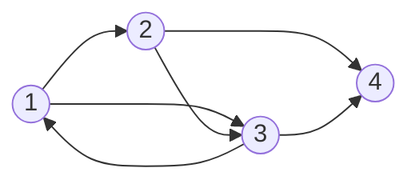
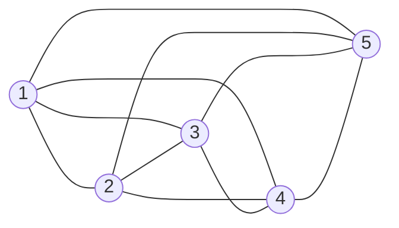
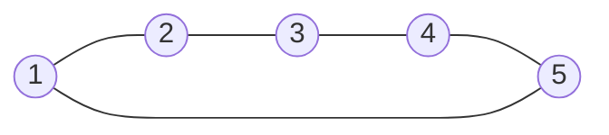
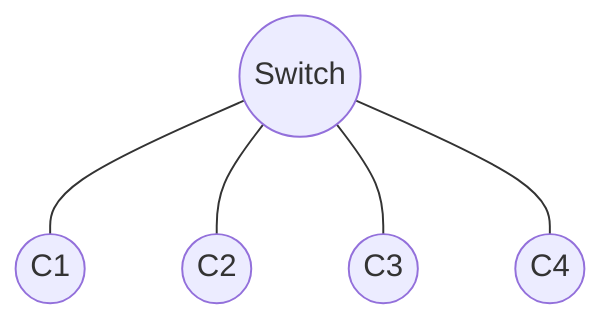

# Exercices – Chapitre 1 : Introduction et représentations des graphes

> **Matière :** [[MOC_Theorie_des_Graphes|Théorie des Graphes]] • **Cours associé :** [[01_Introduction_&_Representations_des_Graphes|01. Introduction, Définitions & Représentations]]

---

## Lexique de révision (Termes et notations à retenir)

> [!tip] Mémo rapide pour l'examen
> | Terme / Notation | Signification simple |
> | :--- | :--- |
> | **Ordre ($n = \|V\|$)** | Nombre total de sommets (nœuds / routeurs) du graphe. |
> | **Taille ($m = \|E\|$)** | Nombre total d'arêtes (non orientées) ou d'arcs (orientés). |
> | **Graphe simple** | Sans **boucle** ni **arête multiple** (au plus un lien entre deux sommets). |
> | **Multigraphe / $p$-graphe** | Autorise plusieurs arêtes entre deux sommets (en orienté : **$p$-graphe** = au plus $p$ arcs entre deux sommets ; on utilise surtout le $1$-graphe). |
> | **Boucle** | Lien reliant un sommet à lui-même ; en non orienté, une boucle compte pour **2** dans le degré du sommet (un graphe orienté sans boucle est dit *élémentaire*). |
> | **Graphe valué (pondéré)** | Chaque lien porte un poids $w(i, j)$ stocké dans la matrice ($0$, $\infty$ ou `null` s'il n'y a pas de lien). |
> | **Graphe partiel vs Sous-graphe** | **Graphe partiel** = mêmes sommets, on supprime des liens ($E' \subseteq E$) ; **Sous-graphe** = on supprime des sommets ($V' \subset V$) et leurs liens incidents. |
> | **Degré $d(v)$** | Nombre d'arêtes incidentes au sommet $v$ (nombre de connexions directes). |
> | **Successeurs / Prédécesseurs** | En orienté : $\text{succ}(v)$ = sommets où $v$ envoie ; $\text{pred}(v)$ = sommets qui envoient vers $v$. |
> | **Demi-degrés $d^-(u)$ / $d^+(u)$** | En orienté : **entrant** ($d^-$, colonne $u$) et **sortant** ($d^+$, ligne $u$). Degré total : $d(u) = d^+(u) + d^-(u)$. |
> | **$\Delta(G)$ et $\delta(G)$** | **Degré maximal** ($\Delta$, grand delta = le plus connecté) et **degré minimal** ($\delta$, petit delta = le moins connecté). |
> | **Degré moyen $\bar{d}(G)$** | Moyenne des degrés : $\frac{1}{n}\sum d(v) = \frac{2m}{n}$. |
> | **Sommet isolé** | Sommet de degré $0$ (aucune connexion). |
> | **Graphe $k$-régulier** | Tous les sommets ont exactement le même degré $k$ (équivaut à $\delta(G) = \Delta(G) = k$). |
> | **Chaîne, chemin & cycle** | **Chaîne** (non orienté) / **Chemin** (orienté) = suite de sommets reliés ; **simple** = sans arête répétée ; **élémentaire** = sans sommet répété ; **Cycle** = chaîne fermée élémentaire de longueur $k \ge 3$. |
> | **Lemme des Poignées de Main** | $\sum_{v \in V} d(v) = 2m$. La somme des degrés est toujours **paire**, et le **nombre de sommets de degré impair est toujours pair** (corollaire classique). |
> | **Algorithme de Havel-Hakimi** | Test constructif pour vérifier si une suite de degrés est réalisable par un graphe simple (tri décroissant, on relie le max $k$ aux $k$ suivants, on retire, on répète). |
> | **Principe des tiroirs (Dirichlet)** | Si on range $n$ objets dans au plus $n - 1$ boîtes, au moins une boîte contient $2$ objets (preuve qu'au moins $2$ sommets ont le même degré). |
> | **Matrice d'adjacence $A$** | Tableau $n \times n$ ($A_{ij} = 1$ s'il y a un lien $i \to j$, sinon $0$). Espace $\mathcal{O}(n^2)$, test d'arc en $\mathcal{O}(1)$, symétrique si non orienté. |
> | **Puissance $A^k$ et triangles** | $(A^k)_{i,j}$ = nombre de chemins de longueur $k$ de $i$ à $j$. En non orienté, le nombre de **triangles** (cycles de longueur 3) vaut $\frac{1}{6}\,\text{Tr}(A^3)$. |
> | **Liste d'adjacence $L$** | Tableau de $n$ listes contenant les voisins de chaque sommet. Espace $\mathcal{O}(n + m)$, idéal pour les graphes creux ($m \approx \mathcal{O}(n)$). |
> | **Topologies $K_n$, $C_n$, $S_n$** | **$K_n$** = graphe complet / maillage total ($m = \frac{n(n-1)}{2}$) ; **$C_n$** = cycle / anneau ($2$-régulier) ; **$S_n$** = étoile (1 centre de degré $n-1$, $n-1$ feuilles de degré $1$). |

---

## Exercice 1 – Modélisation et lemmes fondamentaux

### 1. Faisabilité des réseaux (7 serveurs)

D'après le **Lemme des Poignées de Main**, dans tout graphe non orienté $G = (V, E)$, la somme des degrés vaut $\sum_{v \in V} d(v) = 2|E|$. Cette somme doit donc être paire (de manière équivalente, le nombre de sommets de degré impair est pair).

* **(a) Cas A : $3, 3, 3, 3, 3, 3, 3$ — Impossible.**
  La somme des degrés est $7 \times 3 = 21$, qui est impaire (7 sommets de degré impair). Cela contredit le lemme des poignées de main.

* **(b) Cas B : $2, 3, 4, 4, 5, 5, 5$ — Possible.**
  La somme des degrés vaut $28$ (pair, soit $14$ connexions). En appliquant l'algorithme de Havel-Hakimi sur la suite triée $(5, 5, 5, 4, 4, 3, 2)$ :
  $$(5, 5, 5, 4, 4, 3, 2) \rightarrow (4, 4, 3, 3, 2, 2) \rightarrow (3, 2, 2, 2, 1) \rightarrow (1, 1, 1, 1) \rightarrow (1, 1, 0) \rightarrow (0, 0)$$
  La suite converge vers des zéros : un graphe simple réalisant ces degrés existe.

* **(c) Cas C : $1, 2, 2, 3, 4, 4, 4$ — Possible.**
  La somme des degrés vaut $20$ (pair, soit $10$ connexions). Par Havel-Hakimi sur $(4, 4, 4, 3, 2, 2, 1)$ :
  $$(4, 4, 4, 3, 2, 2, 1) \rightarrow (3, 3, 2, 2, 1, 1) \rightarrow (2, 1, 1, 1, 1) \rightarrow (1, 1, 0, 0) \rightarrow (0, 0, 0)$$
  La suite est également réalisable par un graphe simple.

> [!note] Comprendre la logique (terre à terre)
> * **Pourquoi la somme doit être paire ?** Imagine des câbles réseau entre serveurs. Chaque câble a forcément **2 extrémités** (une prise branchée de chaque côté). Si tu comptes toutes les prises occupées sur tous les serveurs, tu comptes forcément $2 \times \text{nombre de câbles}$, donc un nombre **pair**. Une somme de 21 voudrait dire qu'une demi-prise flotte dans le vide : impossible.
> * **Pourquoi tester Havel-Hakimi en plus de la somme ?** Avoir une somme paire est nécessaire, mais pas suffisant pour garantir qu'on peut construire un **graphe simple** (sans doublon de câble entre deux mêmes serveurs, ni câble qui boucle sur le même serveur). Par exemple, pour $(2, 2, 0)$, la somme est $4$ (paire), mais c'est impossible avec 3 serveurs sans doublon.
> * **Comment marche Havel-Hakimi ?** On trie les demandes décroissantes. On prend le serveur le plus demandeur (disons qu'il veut $k = 5$ câbles), on le relie aux $5$ autres serveurs qui demandent le plus de câbles (donc on baisse leurs besoins restants de $1$), puis on le retire puisqu'il est servi. On trie et on recommence : si on arrive à que des `0` sans jamais tomber sur un nombre négatif, le câblage est faisable.

### 2. Démonstration ($n \ge 2$ sommets)

Dans un graphe simple à $n \ge 2$ sommets, le degré de chaque sommet est compris entre $0$ et $n - 1$, soit $n$ valeurs théoriquement possibles.

Or, les degrés $0$ et $n - 1$ s'excluent mutuellement : si un sommet est de degré $n - 1$, il est relié à tous les autres sommets, donc aucun sommet ne peut être isolé (degré $0$). L'ensemble des degrés effectivement présents dans le graphe est donc inclus soit dans $\{0, 1, \dots, n - 2\}$, soit dans $\{1, 2, \dots, n - 1\}$, qui contiennent chacun au plus $n - 1$ valeurs distinctes.

Avec $n$ sommets à répartir dans au plus $n - 1$ valeurs de degrés, le **principe des tiroirs** garantit qu'au moins deux sommets ont exactement le même degré.

> [!note] Comprendre la logique (terre à terre)
> Imagine $n$ personnes dans une pièce et $n$ boîtes numérotées de `0` à `n-1` représentant « combien de personnes tu connais dans la pièce ».
> * La boîte `0` est pour celui qui ne connaît **personne** (**sommet isolé**).
> * La boîte `n-1` est pour celui qui connaît **tout le monde**.
> 
> Ces deux boîtes ne peuvent **jamais** être utilisées en même temps : si quelqu'un connaît tout le monde, il connaît forcément celui qui était censé ne connaître personne ! Il y a donc au moins une de ces deux boîtes qui reste vide. On doit donc ranger $n$ personnes dans au maximum $n - 1$ boîtes : forcément, au moins deux personnes finissent dans la même boîte (ont le même degré). C'est ça, le **principe des tiroirs** (ou principe de Dirichlet).

### 3. Signification concrète

Dans tout réseau comportant au moins deux entités (utilisateurs sur un réseau social, serveurs ou équipements informatiques reliés entre eux sans auto-connexion ni lien multiple), il existe toujours au moins deux utilisateurs ayant exactement le même nombre de contacts, ou deux équipements ayant exactement le même nombre de connexions.

---

## Exercice 2 – Représentations mémoire et complexité de stockage

### 1. Complexité en espace mémoire

* **(a) Matrice d'adjacence $A$ :** $\mathcal{O}(n^2)$ — tableau de taille $n \times n$, indépendant du nombre d'arcs $m$.
* **(b) Liste d'adjacence $L$ :** $\mathcal{O}(n + m)$ — un tableau de $n$ pointeurs (un par sommet) et $m$ éléments répartis dans les listes de successeurs.

> [!note] Comprendre la logique (terre à terre)
> * **Matrice d'adjacence = un grand tableau Excel $n \times n$** (routeurs en lignes et en colonnes). Même s'il n'y a que 3 câbles dans un réseau de 1 000 routeurs, le tableau prend $1\,000 \times 1\,000 = 1\,000\,000$ cases en mémoire ($\mathcal{O}(n^2)$).
> * **Liste d'adjacence = un carnet d'adresses.** Chaque routeur a sa propre ligne (ça fait $n$ entrées), et il n'y note **que** les voisins auxquels il est vraiment relié (au total $m$ voisins notés dans un graphe orienté, ou $2m$ dans un non orienté). On ne stocke rien pour les connexions qui n'existent pas ($\mathcal{O}(n + m)$).

### 2. Efficacité asymptotique des opérations (en temps)

| Opération                           | Matrice d'adjacence $A$                       | Liste d'adjacence $L$ (successeurs)                                                             |
| :---------------------------------- | :-------------------------------------------- | :---------------------------------------------------------------------------------------------- |
| **(a) Existence de l'arc $(u, v)$** | $\mathcal{O}(1)$ (accès direct à $A[u][v]$)   | $\mathcal{O}(d^+(u))$, soit $\mathcal{O}(n)$ au pire                                            |
| **(b) Degré entrant $d^-(u)$**      | $\mathcal{O}(n)$ (parcours de la colonne $u$) | $\mathcal{O}(n + m)$ (parcours de toutes les listes)                                            |
| **(c) Degré sortant $d^+(u)$**      | $\mathcal{O}(n)$ (parcours de la ligne $u$)   | $\mathcal{O}(d^+(u))$ (parcours de la liste de $u$ ; $\mathcal{O}(1)$ si sa taille est stockée) |

> [!note] Comprendre la logique (terre à terre)
> * **Tester si l'arc $(u, v)$ existe :**
>   * Dans la matrice : tu vas directement à la case `(ligne u, colonne v)` en 1 seule opération : $\mathcal{O}(1)$ (temps constant).
>   * Dans la liste : tu vas sur la ligne de $u$ et tu dois lire ses voisins un par un jusqu'à trouver $v$ (ou arriver au bout). Plus $u$ a de sorties ($d^+(u)$), plus c'est long.
> * **Calculer le degré sortant $d^+(u)$ (flèches qui partent de $u$) :**
>   * Dans la matrice : tu comptes les `1` sur la ligne de $u$ (il y a $n$ colonnes à lire, donc $\mathcal{O}(n)$).
>   * Dans la liste : tu comptes combien de voisins sont inscrits sur la ligne de $u$ ($\mathcal{O}(d^+(u))$, voire $\mathcal{O}(1)$ si le programme garde déjà un compteur de taille).
> * **Calculer le degré entrant $d^-(u)$ (flèches qui arrivent sur $u$) :**
>   * Dans la matrice : tu comptes les `1` dans la colonne $u$ ($\mathcal{O}(n)$).
>   * Dans la liste standard : chaque routeur note *où il envoie*, pas *qui lui envoie*. Pour savoir qui pointe vers $u$, tu es obligé de fouiller les carnets d'adresses de **tous** les routeurs du réseau : $\mathcal{O}(n + m)$.

### 3. Préconisations selon la densité du réseau

* **Réseau métropolitain très dense ($m \approx n^2$) :**
  * **Recommandée : Matrice d'adjacence $A$.** L'espace mémoire est déjà de l'ordre de $n^2$ dans les deux structures, mais la matrice évite le surcoût mémoire des pointeurs de listes et garantit un test d'existence de liaison en $\mathcal{O}(1)$.
  * **Déconseillée : Liste d'adjacence $L$.** Plus coûteuse en mémoire effective (pointeurs) et plus lente pour tester une connexion ($\mathcal{O}(n)$ au pire).

* **Réseau WAN très dispersé ($m \approx \mathcal{O}(n)$) :**
  * **Recommandée : Liste d'adjacence $L$.** L'occupation mémoire est linéaire $\mathcal{O}(n)$ au lieu de quadratique $\mathcal{O}(n^2)$, et le calcul des degrés sortants ou le parcours des voisins reste proportionnel au nombre réel de liaisons ($\mathcal{O}(d^+(u))$) plutôt qu'au nombre total de routeurs $n$.
  * **Déconseillée : Matrice d'adjacence $A$.** Gaspille la quasi-totalité des $n^2$ cases avec des zéros et impose des parcours en $\mathcal{O}(n)$ pour inspecter les liaisons d'un routeur.

> [!note] Comprendre la logique (terre à terre)
> * **Réseau dense** = presque tout le monde est connecté à tout le monde. Le tableau Excel est plein de `1`, donc zéro gâchis, et en plus une case ne coûte qu'un bit/octet alors qu'un maillon de liste coûte une adresse mémoire (pointeur) en plus de l'identifiant du voisin.
> * **Réseau dispersé (creux)** = chaque routeur n'est relié qu'à 2 ou 3 voisins (ex: fibre nationale). Le tableau Excel serait rempli à 99,9 % de zéros inutiles : la liste économise énormément de RAM.

---

## Exercice 3 – Matrice d'adjacence et chemins

### 1. Représentation du graphe orienté $G$

Les arcs issus de la matrice $A$ sont :
$$E = \{(1, 2), (1, 3), (2, 3), (2, 4), (3, 1), (3, 4)\}$$

> [!note] Convention de lecture d'une matrice orientée
> Retiens la règle d'or : **Ligne = Départ**, **Colonne = Arrivée**.
> Par exemple, dans $A$, la ligne $1$ vaut `(0, 1, 1, 0)` : il y a un `1` en colonne $2$ et en colonne $3$, donc les flèches qui **partent** de $1$ vont vers $2$ et $3$. La ligne $4$ vaut `(0, 0, 0, 0)` : rien ne part de $4$ (c'est un **puits**).

### 2. Degrés entrants et sortants

$d^+(i)$ correspond à la somme des coefficients de la ligne $i$, et $d^-(i)$ à la somme des coefficients de la colonne $i$ :

| Sommet $i$ | Degré entrant $d^-(i)$ | Degré sortant $d^+(i)$ |
| :---: | :---: | :---: |
| **1** | 1 | 2 |
| **2** | 1 | 2 |
| **3** | 2 | 2 |
| **4** | 2 | 0 |

### 3. Calcul de $A^2$ et $A^3$

$$A^2 = A \times A = \begin{pmatrix} 1 & 0 & 1 & 2 \\ 1 & 0 & 0 & 1 \\ 0 & 1 & 1 & 0 \\ 0 & 0 & 0 & 0 \end{pmatrix}$$

$$A^3 = A^2 \times A = \begin{pmatrix} 1 & 1 & 1 & 1 \\ 0 & 1 & 1 & 0 \\ 1 & 0 & 1 & 2 \\ 0 & 0 & 0 & 0 \end{pmatrix}$$

### 4. Chemins de longueur 3 reliant 1 à 4

Le nombre de chemins de longueur 3 de $1$ vers $4$ est donné par le coefficient $(A^3)_{1,4} = 1$.

Il existe donc **1 seul chemin** de longueur 3 reliant $1$ à $4$ :
$$1 \rightarrow 2 \rightarrow 3 \rightarrow 4$$

> [!note] Comprendre la logique (terre à terre)
> * **Pourquoi $A^2$ donne les chemins de longueur 2 ?** Quand tu fais le produit matriciel ligne $i$ $\times$ colonne $j$, tu calcules $\sum_k A_{i,k} \cdot A_{k,j}$. Le produit $A_{i,k} \cdot A_{k,j}$ vaut `1` **uniquement** s'il existe une flèche $i \to k$ **ET** une flèche $k \to j$. En additionnant pour tous les sommets $k$, tu comptes exactement combien d'étapes intermédiaires $k$ permettent de faire un trajet en **2 sauts** de $i$ vers $j$.
>   * Exemple visuel sur $(A^2)_{1,4} = 2$ : de $1$ à $4$ en 2 sauts, il y a deux trajets ($1 \to 2 \to 4$ et $1 \to 3 \to 4$).
> * **Et pour $A^3$ ?** On enchaîne un trajet de longueur 2 (lu dans $A^2$) puis un 3e saut (lu dans $A$) : on obtient le nombre exact de trajets de longueur **3** (en comptant aussi les trajets qui repassent par un même sommet, comme $1 \to 3 \to 1 \to 2$).
> * Ici, $(A^3)_{1,4} = 1$ te garantit qu'il n'y a qu'**un seul** chemin de longueur 3 entre $1$ et $4$, donc si tu en trouves un ($1 \to 2 \to 3 \to 4$), tu es sûr de ne pas en avoir oublié un deuxième.

---

## Exercice 4 – Analyse des topologies réseaux usuelles

### 1. Topologie totalement maillée ($K_n$)

* **Degré de chaque sommet :** $d(v) = n - 1$ (chaque nœud est relié à tous les autres).
* **Degré maximal et minimal :** $\Delta(K_n) = n - 1$ et $\delta(K_n) = n - 1$.
* **Nombre total d'arêtes :** $m = \frac{n(n - 1)}{2}$.

Exemple pour $n = 5$ ($K_5$) :

> [!note] Comprendre la logique (terre à terre)
> * Pourquoi $m = \frac{n(n - 1)}{2}$ ? Chacun des $n$ nœuds envoie un câble vers les $n - 1$ autres, ce qui donne $n(n - 1)$ extrémités de câbles. Comme chaque câble relie 2 nœuds, on divise par 2 pour ne pas compter chaque câble en double.

### 2. Topologie en anneau ($C_n$, avec $n \ge 3$)

* **Degré de chaque sommet :** $d(v) = 2$ (chaque nœud est relié à ses deux voisins immédiats).
* **Régularité :** tous les sommets ont le même degré égal à $2$ ; $C_n$ est un graphe **$2$-régulier**.

Exemple pour $n = 5$ ($C_5$) :

> [!note] Comprendre la logique (terre à terre)
> En boucle fermée, chaque machine a exactement un voisin à gauche et un voisin à droite, soit **2** câbles par machine. Quand **tous** les sommets d'un graphe ont exactement le même degré $k$, on dit que le graphe est **$k$-régulier** (ici $2$-régulier ; et $K_n$ est $(n-1)$-régulier).

### 3. Topologie en étoile ($S_n$, avec $n \ge 2$)

Le switch central a un degré de $n - 1$ et chacun des $n - 1$ clients a un degré de $1$ (pour un total de $m = n - 1$ arêtes) :

* **Degré maximal :** $\Delta(S_n) = n - 1$.
* **Degré minimal :** $\delta(S_n) = 1$.
* **Degré moyen :**
  $$\bar{d}(S_n) = \frac{2m}{n} = \frac{2(n - 1)}{n} = 2 - \frac{2}{n}$$

Exemple pour $n = 5$ ($S_5$) :

> [!note] Comprendre la logique (terre à terre)
> Le degré moyen vaut toujours $\frac{\text{somme des degrés}}{n} = \frac{2m}{n}$. Comme il y a $n - 1$ câbles entre le switch et les clients, la somme des degrés est $2(n - 1)$. Si tu divises par $n$, tu obtiens $2 - \frac{2}{n}$.
> Ce qui est frappant : même si tu branches 1 000 clients, le degré **moyen** reste inférieur à $2$ (car 999 clients n'ont qu'un seul câble), ce qui cache le fait que le switch central porte à lui seul 999 câbles ($\Delta = n - 1$).

### 4. Risque de goulot d'étranglement matériel

La **topologie en étoile ($S_n$)** présente le risque le plus élevé. Le switch central concentre à lui seul $\Delta(S_n) = n - 1$ liaisons et doit absorber l'intégralité du trafic inter-clients : lorsque $n$ augmente fortement, son fond de panier, ses ports et sa capacité de commutation saturent, créant un goulot d'étranglement (ainsi qu'un point de défaillance unique).

*(Note : en $K_n$, chaque équipement doit aussi disposer de $n - 1$ interfaces physiques, ce qui pose un problème de coût et de câblage en $\mathcal{O}(n^2)$, mais le trafic reste distribué sans concentrateur central).*

> [!note] Comprendre la logique (terre à terre)
> C'est l'effet « péage unique » : dans l'étoile, si le client C1 veut parler à C2, et C3 à C4, **tout** doit passer par la même boîte centrale (le switch). Si le réseau grossit énormément, cette boîte n'a ni assez de prises physiques, ni assez de débit interne pour tout traiter en même temps. En plus, si elle tombe en panne, tout le réseau est coupé (**point de défaillance unique** / *SPOF*).

---

## Exercice 5 – Degré d'un graphe et analyse matricielle

### 1. Expression du degré $d(v_i)$

$G$ étant un graphe simple non orienté, $a_{ij} = 1$ si $v_i$ et $v_j$ sont reliés par une arête, et $0$ sinon (avec $a_{ii} = 0$ puisqu'il n'y a pas de boucle). Le degré de $v_i$ est donc la somme des coefficients de sa ligne (ou de sa colonne, $A$ étant symétrique) :

$$d(v_i) = \sum_{j=1}^n a_{ij}$$
### 2. Somme de tous les éléments de $A$

En sommant sur toutes les lignes, on obtient la somme des degrés des sommets :

$$\sum_{i=1}^n \sum_{j=1}^n a_{ij} = \sum_{i=1}^n \left(\sum_{j=1}^n a_{ij}\right) = \sum_{i=1}^n d(v_i)$$

Or, chaque arête $\{v_i, v_j\}$ contribue exactement à deux coefficients égaux à $1$ dans la matrice ($a_{ij}$ et $a_{ji}$, avec $i \neq j$). D'après le Lemme des Poignées de Main, on en déduit :

$$\sum_{i=1}^n \sum_{j=1}^n a_{ij} = \sum_{i=1}^n d(v_i) = 2m$$

> [!note] Comprendre la logique (terre à terre)
> * Dans un graphe **non orienté**, une liaison entre le sommet $1$ et le sommet $3$ est à double sens. Donc dans le tableau, on met un `1` à la case `(1, 3)` **et** un `1` à la case `(3, 1)` : la matrice est **symétrique** par rapport à sa diagonale.
> * Comme il n'y a pas de boucle sur soi-même (graphe simple), toute la diagonale ($a_{11}, a_{22}, \dots$) ne contient que des `0`.
> * Du coup, si tu additionnes **tous les `1` du tableau**, tu comptes chaque arête exactement **deux fois** (une fois au-dessus de la diagonale, une fois en dessous). Le total vaut donc forcément $2m$ : c'est la traduction matricielle du Lemme des Poignées de Main.

### 3. Degrés $\Delta(G)$, $\delta(G)$ et degré moyen

En sommant chaque ligne de $A$ ($n = 4$) :

* $d(v_1) = 0 + 1 + 1 + 1 = 3$
* $d(v_2) = 1 + 0 + 1 + 0 = 2$
* $d(v_3) = 1 + 1 + 0 + 1 = 3$
* $d(v_4) = 1 + 0 + 1 + 0 = 2$

On en déduit :

* **Degré maximal :** $\Delta(G) = 3$
* **Degré minimal :** $\delta(G) = 2$
* **Degré moyen :** $\bar{d}(G) = \frac{3 + 2 + 3 + 2}{4} = \frac{10}{4} = 2{,}5$

### 4. Régularité du graphe

**Non**, ce graphe n'est pas régulier, car tous ses sommets n'ont pas le même degré ($\delta(G) = 2 \neq 3 = \Delta(G)$ ; par exemple $d(v_1) = 3$ tandis que $d(v_2) = 2$).

> [!note] Astuce examen pour la régularité sur matrice
> Pour vérifier si un graphe donné par sa matrice d'adjacence est régulier, additionne simplement chaque ligne :
> * Toutes les lignes ont la **même somme** $k$ $\implies$ le graphe est **$k$-régulier** ($\delta = \Delta = k$).
> * Au moins deux lignes ont des sommes différentes $\implies$ **non régulier** ($\delta \neq \Delta$).
