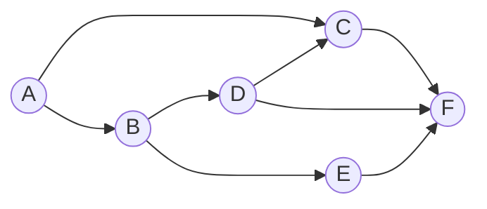
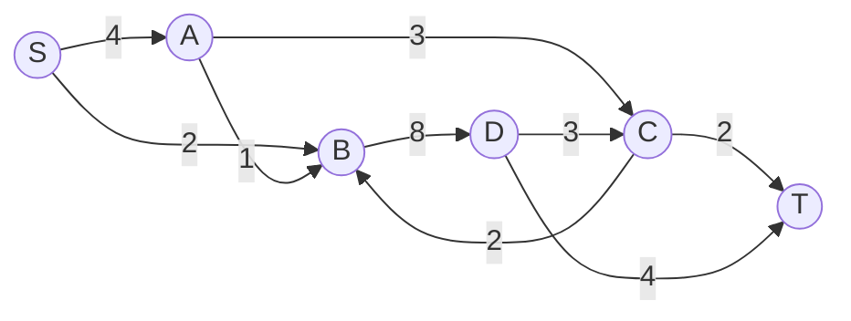
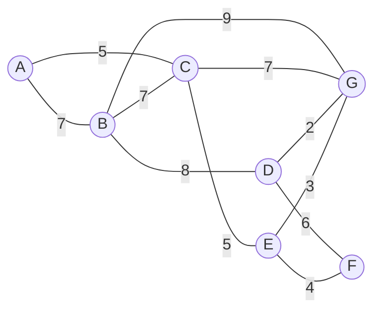
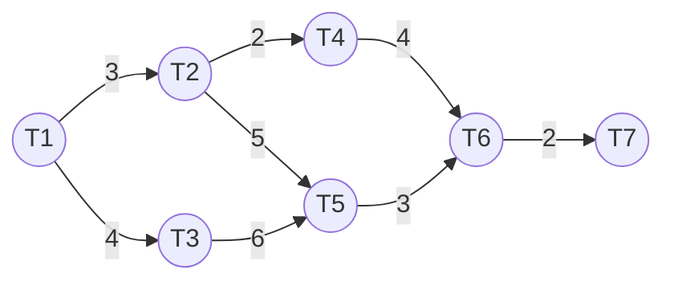
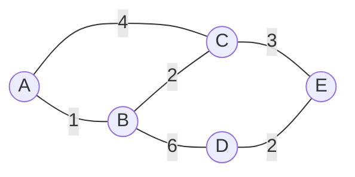

# Sujet Corrigé – Chapitre 3 : Les algorithmes sur les graphes

> **Matière :** [[MOC_Theorie_des_Graphes|Théorie des Graphes]] • **Cours associé :** [[03_Algorithmes_sur_les_Graphes|03. Algorithmes sur les Graphes]] • **Support :** Feuille d'exercices n° 3

---

## Lexique de révision (Termes et notations à retenir)

> [!tip] Mémo rapide pour l'examen
> | Terme / Notation | Signification simple |
> | :--- | :--- |
> | **BFS (Parcours en largeur)** | Explore couche par couche avec une **file FIFO**. Donne les **plus courts chemins** en nombre d'arcs (graphe non pondéré). |
> | **DFS (Parcours en profondeur)** | Plonge le plus loin possible avant de reculer (**pile LIFO** / récursivité). Produit les estampilles **$d[v]/f[v]$** (découverte / fin). |
> | **4 types d'arcs (DFS)** | **Arbre** (vers BLANC), **Arrière** (vers GRIS = preuve d'un cycle), **Avant** (vers NOIR descendant), **Croisé** (vers NOIR d'une autre branche). |
> | **Relâchement (*Relaxation*)** | Test de raccourci sur $(u, v)$ : si $d[u] + w(u, v) < d[v]$, on met à jour $d[v] \leftarrow d[u] + w(u, v)$ et $\pi[v] \leftarrow u$. |
> | **Algorithme de Dijkstra** | Plus courts chemins depuis une source. Stratégie **gloutonne** (fige toujours le plus petit $d[u]$). Exige **$w(u, v) \ge 0$**. Complexité $\mathcal{O}((\|V\| + \|E\|)\log \|V\|)$. |
> | **Algorithme de Bellman-Ford** | Plus courts chemins avec **poids négatifs autorisés**. Fait $\|V\| - 1$ passes sur tous les arcs + $1$ passe de contrôle. Complexité $\mathcal{O}(\|V\| \cdot \|E\|)$. |
> | **Cycle absorbant** | Circuit dont la somme des poids est **strictement négative** ($< 0$). Détecté à la $\|V\|$-ième passe de Bellman-Ford si un arc peut encore être relâché. |
> | **ACPM / ACM (MST)** | **Arbre Couvrant de Poids Minimal** : relie les $n$ sommets avec $n - 1$ arêtes et somme des poids minimale (unicité garantie si tous les poids sont distincts). |
> | **Kruskal + Union-Find** | Trie les arêtes par poids croissant et ajoute celles qui ne créent pas de cycle grâce à *Union-Find* (`Créer-Ensemble`, `Trouver-Ensemble`, `Union`). $\mathcal{O}(\|E\|\log \|V\|)$. |
> | **Prim** | Fait croître **un seul arbre** depuis une racine $r$, en choisissant à chaque pas l'arête minimale sortant de l'arbre. $\mathcal{O}(\|E\|\log \|V\|)$ avec tas binaire. |
> | **DAG & Tri topologique** | **DAG** = graphe orienté sans circuit. Le **tri topologique** range chaque arc $(u, v)$ avec $u$ avant $v$ (ordre décroissant des $f[v]$ d'un DFS). |
> | **PERT / MPM ($ES, LS, MT$)** | **$ES_i$** = date au plus tôt (`max` en avant) ; **$LS_i$** = date au plus tard (`min` en arrière) ; **Marge totale** $MT_i = LS_i - ES_i$. **Chemin critique** = suite de tâches à $MT_i = 0$. |
> | **Vecteur de distances (RIP)** | Bellman-Ford distribué : chaque routeur envoie périodiquement son vecteur $D^V$ à ses voisins directs. |
> | **Count-to-Infinity** | Dérive en boucle des coûts vers $\infty$ après une panne, car deux voisins se renvoient une route obsolète. Prévention : **Split Horizon** & **Poison Reverse**. |
> | **État de liens (OSPF)** | Chaque routeur diffuse l'état de ses liens (LSA) à tout le réseau, reconstruit la carte complète et calcule localement **Dijkstra**. |

---

## Exercice 1 – Parcours de graphes et classification des arcs (BFS et DFS)

On considère le réseau informatique représenté par le graphe orienté $G = (V, E)$ ci-dessous, où les sommets représentent des routeurs :

1. **Parcours en largeur (BFS) :**
   * (a) Donner l'ordre de découverte des sommets lors d'un parcours BFS en partant du sommet source $A$. *(En cas d'égalité de priorité, respecter l'ordre alphabétique).*
   * (b) Lister les arêtes formant l'arbre couvrant BFS.
   * (c) Déterminer la distance (nombre minimal d'arcs) reliant le sommet source $A$ à chacun des autres sommets du réseau.
2. **Parcours en profondeur (DFS) :**
   * (a) Exécuter l'algorithme DFS à partir du sommet source $A$ en indiquant pour chaque sommet ses dates de début et de fin de traitement sous la forme $d[v]/f[v]$.
   * (b) Classer l'ensemble des arcs du graphe selon les quatre catégories standard du DFS : **arcs d'arbre**, **arcs arrières**, **arcs avant** et **arcs croisés**.
3. **Propriétés algorithmiques :** Donner la complexité temporelle et spatiale théorique des algorithmes BFS et DFS lorsque le graphe est représenté par une liste d'adjacence.

> [!success]- Corrigé détaillé – Exercice 1
>
> ### 1. Parcours en largeur (BFS depuis $A$, priorité alphabétique)
>
> Déroulement avec une file FIFO :
> * **Init :** File $= [A]$, $d[A] = 0$, $\pi[A] = \text{NIL}$.
> * **Étape 1 (défile $A$) :** voisins $B, C$ sont BLANCS $\to$ $d[B]=1, \pi[B]=A$ ; $d[C]=1, \pi[C]=A$. File $= [B, C]$.
> * **Étape 2 (défile $B$) :** voisins $D, E$ sont BLANCS $\to$ $d[D]=2, \pi[D]=B$ ; $d[E]=2, \pi[E]=B$. File $= [C, D, E]$.
> * **Étape 3 (défile $C$) :** voisin $F$ est BLANC $\to$ $d[F]=2, \pi[F]=C$. File $= [D, E, F]$.
> * **Étapes 4 à 6 (défile $D, E, F$) :** tous les voisins ($C, F$) sont déjà découverts (GRIS ou NOIR). File $= [\,]$.
>
> * **(a) Ordre de découverte :**
>   $$A \rightarrow B \rightarrow C \rightarrow D \rightarrow E \rightarrow F$$
>
> * **(b) Arcs de l'arbre couvrant BFS ($n - 1 = 5$ arcs) :**
>   $$E_{\text{BFS}} = \{(A, B),\; (A, C),\; (B, D),\; (B, E),\; (C, F)\}$$
>
> * **(c) Distance minimale (en nombre d'arcs) depuis $A$ :**
>   $$d[A] = 0, \quad d[B] = 1, \quad d[C] = 1, \quad d[D] = 2, \quad d[E] = 2, \quad d[F] = 2$$
>
> > [!note] Comprendre la logique (terre à terre)
> > Le BFS fonctionne comme une **onde circulaire dans l'eau** :
> > * Vague $0$ : $A$.
> > * Vague $1$ : les voisins directs de $A$ ($B$ et $C$).
> > * Vague $2$ : tout ce qu'on atteint depuis la vague $1$ ($D$ et $E$ via $B$, et $F$ via $C$).
> > Attention : comme $C$ est défilé *avant* $D$ et $E$, c'est $C$ qui découvre $F$ le premier, prouvant que $F$ est à **2 sauts** de $A$ ($A \to C \to F$) et non $3$.
>
> ### 2. Parcours en profondeur (DFS depuis $A$, priorité alphabétique)
>
> * **(a) Déroulement et estampilles $d[v]/f[v]$ :**
>   1. $t=1$ : découvre $A$ ($d[A]=1$), explore $(A, B)$ $\to$ **Arbre**.
>   2. $t=2$ : découvre $B$ ($d[B]=2$), explore $(B, D)$ $\to$ **Arbre**.
>   3. $t=3$ : découvre $D$ ($d[D]=3$), explore $(D, C)$ $\to$ **Arbre**.
>   4. $t=4$ : découvre $C$ ($d[C]=4$), explore $(C, F)$ $\to$ **Arbre**.
>   5. $t=5$ : découvre $F$ ($d[F]=5$) ; aucun arc sortant $\implies t=6$ ferme $F$ ($f[F]=6$).
>   6. Retour en $C$ : plus de voisin $\implies t=7$ ferme $C$ ($f[C]=7$).
>   7. Retour en $D$ : examine $(D, F)$, mais $F$ est NOIR et $d[D]=3 < d[F]=5$ $\to$ **Avant**. Plus de voisin $\implies t=8$ ferme $D$ ($f[D]=8$).
>   8. Retour en $B$ : examine $(B, E)$ $\to$ **Arbre** ; $t=9$ découvre $E$ ($d[E]=9$).
>   9. Depuis $E$ : examine $(E, F)$, mais $F$ est NOIR et $d[E]=9 > f[F]=6$ $\to$ **Croisé**. Plus de voisin $\implies t=10$ ferme $E$ ($f[E]=10$).
>   10. Retour en $B$ : plus de voisin $\implies t=11$ ferme $B$ ($f[B]=11$).
>   11. Retour en $A$ : examine $(A, C)$, mais $C$ est NOIR et $d[A]=1 < d[C]=4$ $\to$ **Avant**. Plus de voisin $\implies t=12$ ferme $A$ ($f[A]=12$).
>
>   Estampilles finales :
>   $$A\,[1/12], \quad B\,[2/11], \quad D\,[3/8], \quad C\,[4/7], \quad F\,[5/6], \quad E\,[9/10]$$
>
> * **(b) Classification complète des $8$ arcs :**
>   * **Arcs d'arbre ($5$) :** $(A, B),\; (B, D),\; (D, C),\; (C, F),\; (B, E)$.
>   * **Arcs arrières ($0$) :** aucun (aucun arc ne pointe vers un ancêtre GRIS $\implies$ le graphe est acyclique).
>   * **Arcs avant ($2$) :** $(D, F)$ et $(A, C)$.
>   * **Arcs croisés ($1$) :** $(E, F)$.
>
> > [!note] Astuce examen (reconnaître les 4 types d'arcs par les dates `[d/f]`)
> > Quand l'arc $(u, v)$ n'est pas un arc d'arbre, il suffit de comparer les intervalles $[d[u], f[u]]$ et $[d[v], f[v]]$ :
> > * **Arc arrière** : $v$ est encore GRIS au moment où on l'atteint ($[d[u], f[u]] \subset [d[v], f[v]]$, soit $d[v] < d[u] < f[u] < f[v]$). Signale toujours un **cycle**.
> > * **Arc avant** : $v$ est déjà NOIR et son intervalle est **inclus dans celui de $u$** ($d[u] < d[v] < f[v] < f[u]$, ex. $F\,[5/6]$ dans $D\,[3/8]$).
> > * **Arc croisé** : $v$ est déjà NOIR et les intervalles sont **disjoints** avec $v$ terminé avant $u$ ($f[v] < d[u]$, ex. $F\,[5/6]$ avant $E\,[9/10]$).
>
> ### 3. Complexités théoriques (liste d'adjacence)
>
> * **Complexité temporelle :** $\mathcal{O}(|V| + |E|)$ pour BFS comme pour DFS. Chaque sommet est inséré/visité au plus une fois ($\mathcal{O}(|V|)$), et chaque liste d'adjacence est parcourue intégralement une seule fois ($\mathcal{O}(|E|)$).
> * **Complexité spatiale :** $\mathcal{O}(|V|)$ pour les structures auxiliaires de travail (tableaux de couleurs, distances/estampilles, pères, plus la file FIFO ou la pile de récursivité de hauteur au plus $|V|$) — hors stockage du graphe lui-même qui occupe $\mathcal{O}(|V| + |E|)$.

---

## Exercice 2 – Plus courts chemins et routage dynamique (Dijkstra et Bellman-Ford)

Un réseau d'entreprise interconnecte $6$ routeurs $\{S, A, B, C, D, T\}$. Les latences des liaisons (en ms) sont représentées par les poids des arcs dans le graphe orienté ci-dessous :

1. **Algorithme de Dijkstra :**
   * (a) Énoncer les conditions d'application de l'algorithme de Dijkstra.
   * (b) Exécuter l'algorithme de Dijkstra à partir du sommet source $S$ en consignant les étapes dans un tableau de résolution (étiquettes des distances et sommets fixes).
   * (c) Extraire la longueur minimale du trajet reliant $S$ à $T$ ainsi que la séquence exacte des routeurs traversés.
2. **Algorithme de Bellman-Ford et cycles négatifs :**
   * (a) Quel est l'intérêt principal de l'algorithme de Bellman-Ford par rapport à Dijkstra dans un protocole de routage ?
   * (b) On modifie le poids de l'arc $(B, D)$ tel que $w(B, D) = -5$. Dérouler l'algorithme de Bellman-Ford (étapes de relaxation des arcs) à partir du sommet source $S$.
   * (c) Détecter si cette modification introduit un cycle de poids négatif. Justifier formellement la condition d'arrêt/détection.
3. **Complexité :** Exprimer et comparer la complexité temporelle théorique de Dijkstra (avec tas binaire) et de Bellman-Ford pour un graphe à $n$ sommets et $m$ arcs.

> [!success]- Corrigé détaillé – Exercice 2
>
> ### 1. Algorithme de Dijkstra
>
> * **(a) Conditions d'application :**
>   Tous les poids des arcs du graphe doivent être **positifs ou nuls** :
>   $$\forall (u, v) \in E, \qquad w(u, v) \ge 0$$
>
> * **(b) Tableau de résolution depuis $S$** (les valeurs **en gras** sont définitivement fixées) :
>
> | Étape | Sommet fixé $u$ | Arcs examinés / relâchés | $d[S]$ | $d[A]$ | $d[B]$ | $d[C]$ | $d[D]$ | $d[T]$ | Sommets fixés |
> | :---: | :---: | :--- | :---: | :---: | :---: | :---: | :---: | :---: | :--- |
> | **0** | *Init* | – | **0** | $+\infty$ | $+\infty$ | $+\infty$ | $+\infty$ | $+\infty$ | $\emptyset$ |
> | **1** | **$S$** | $(S,A): 4,\; (S,B): 2$ | **0** | $4\,(S)$ | $2\,(S)$ | $+\infty$ | $+\infty$ | $+\infty$ | $\{S\}$ |
> | **2** | **$B$** | $(B,D): 2+8=10$ | **0** | $4\,(S)$ | **2** | $+\infty$ | $10\,(B)$ | $+\infty$ | $\{S, B\}$ |
> | **3** | **$A$** | $(A,B): 4+1=5 > 2$ ; $(A,C): 4+3=7$ | **0** | **4** | **2** | $7\,(A)$ | $10\,(B)$ | $+\infty$ | $\{S, B, A\}$ |
> | **4** | **$C$** | $(C,B): 7+2=9 > 2$ ; $(C,T): 7+2=9$ | **0** | **4** | **2** | **7** | $10\,(B)$ | $9\,(C)$ | $\{S, B, A, C\}$ |
> | **5** | **$T$** | Puits (aucun arc sortant) | **0** | **4** | **2** | **7** | $10\,(B)$ | **9** | $\{S, B, A, C, T\}$ |
> | **6** | **$D$** | $(D,C): 10+3 > 7$ ; $(D,T): 10+4 > 9$ | **0** | **4** | **2** | **7** | **10** | **9** | Tous |
>
> * **(c) Plus court chemin de $S$ à $T$ :**
>   En remontant les pères ($\pi[T] = C$, $\pi[C] = A$, $\pi[A] = S$) :
>   * **Longueur minimale :** **$d[T] = 9\text{ ms}$**.
>   * **Séquence exacte des routeurs :** **$S \rightarrow A \rightarrow C \rightarrow T$** ($4 + 3 + 2 = 9$).
>
> > [!note] Comprendre la logique (terre à terre)
> > À chaque tour, Dijkstra verrouille définitivement le routeur non encore fixé qui a la plus petite distance provisoire (ici $B=2$, puis $A=4$, etc.). Pourquoi a-t-il le droit de verrouiller sans regret ? Parce que tant que tous les arcs sont $\ge 0$, rajouter des sauts par ailleurs ne peut qu'augmenter ou laisser égale la distance — jamais la faire baisser ! C'est exactement ce qui casse si un arc négatif existe.
>
> ### 2. Algorithme de Bellman-Ford et cycles négatifs ($w(B, D) = -5$)
>
> * **(a) Intérêt principal par rapport à Dijkstra :**
>   1. **Poids négatifs :** Bellman-Ford fonctionne correctement même en présence d'arcs de poids négatif.
>   2. **Détection d'anomalies :** il détecte formellement la présence de cycles de poids négatif accessibles depuis la source.
>   3. **Nature distribuée :** chaque relaxation ne dépend que d'informations locales (voisins immédiats), ce qui permet son implémentation dans les protocoles de routage à vecteur de distances (ex. RIP).
>
> * **(b) Déroulement de Bellman-Ford depuis $S$** ($|V| = 6$, soit jusqu'à $|V| - 1 = 5$ passes sur les $9$ arcs dans l'ordre $(S,A), (S,B), (A,B), (A,C), (B,D), (C,B), (C,T), (D,C), (D,T)$) :
>
>   * **Initialisation :** $d[S] = 0$, tous les autres à $+\infty$.
>   * **Passe 1 :**
>     * $(S,A) : d[A] = 0 + 4 = 4\;(\pi=S)$
>     * $(S,B) : d[B] = 0 + 2 = 2\;(\pi=S)$
>     * $(A,B) : 4 + 1 = 5 \not< 2$ (inchangé)
>     * $(A,C) : d[C] = 4 + 3 = 7\;(\pi=A)$
>     * $(B,D) : d[D] = 2 + (-5) = -3\;(\pi=B)$
>     * $(C,B) : 7 + 2 = 9 \not< 2$ (inchangé)
>     * $(C,T) : d[T] = 7 + 2 = 9\;(\pi=C)$
>     * $(D,C) : d[C] = -3 + 3 = 0\;(\pi=D)$
>     * $(D,T) : d[T] = -3 + 4 = 1\;(\pi=D)$
>   * **Passe 2 :** on vérifie les $9$ arcs — en particulier $(C,B) : 0 + 2 = 2 \not< 2$ et $(C,T) : 0 + 2 = 2 \not< 1$ — **aucune distance ne diminue**. Les passes $3$, $4$ et $5$ sont donc également sans modification (convergence atteinte).
>
> | Itération | $d[S]$ | $d[A]$ | $d[B]$ | $d[C]$ | $d[D]$ | $d[T]$ | Pères $\pi$ |
> | :---: | :---: | :---: | :---: | :---: | :---: | :---: | :--- |
> | **0 (Init)** | $0$ | $+\infty$ | $+\infty$ | $+\infty$ | $+\infty$ | $+\infty$ | – |
> | **1** | $0$ | $4$ | $2$ | $0$ | $-3$ | $1$ | $\pi[A]=S,\; \pi[B]=S,\; \pi[D]=B,\; \pi[C]=D,\; \pi[T]=D$ |
> | **2 à 5** | **$0$** | **$4$** | **$2$** | **$0$** | **$-3$** | **$1$** | Stabilisé (aucune relaxation supplémentaire) |
>
>   *(Note : si l'on déroulait les relâchements par vagues synchrones sans réutiliser les valeurs de la passe en cours, la stabilisation interviendrait à la passe $3$ avec exactement les mêmes distances finales $(0, 4, 2, 0, -3, 1)$.)*
>
>   Le nouveau plus court chemin de $S$ à $T$ est **$S \rightarrow B \rightarrow D \rightarrow T$**, de coût $2 - 5 + 4 = \mathbf{1\text{ ms}}$.
>
> * **(c) Détection de cycle de poids négatif :**
>   * **Condition formelle :** après les $|V| - 1 = 5$ passes principales, on exécute une $|V|$-ième ($6^e$) passe de vérification sur tous les arcs $(u, v) \in E$. Un cycle de poids strictement négatif accessible depuis $S$ existe **si et seulement si** :
>     $$\exists (u, v) \in E \quad \text{tel que} \quad d[v] > d[u] + w(u, v)$$
>   * **Application ici :** le graphe contient un unique cycle orienté $B \rightarrow D \rightarrow C \rightarrow B$, dont la somme des poids vaut :
>     $$w(B, D) + w(D, C) + w(C, B) = -5 + 3 + 2 = \mathbf{0}$$
>     C'est un cycle de poids **nul** (non strictement négatif). Sur la $6^e$ passe, aucune inégalité stricte $d[v] > d[u] + w(u, v)$ n'est vérifiée (sur le cycle : $-3 \le 2-5$, $0 \le -3+3$, $2 \le 0+2$). **Cette modification n'introduit donc pas de cycle de poids négatif.**
>
> > [!note] Piège classique (cycle nul vs cycle négatif)
> > Ne te laisse pas piéger en croyant le graphe sans cycle : il possède bien le circuit $B \to D \to C \to B$ ! Avec $w(B,D) = -5$, on tombe exactement à la frontière (poids total $= 0$), donc le test de Bellman-Ford ne déclenche pas d'alerte. En revanche, dès $w(B,D) = -6$, le poids du cycle passerait à $-1 < 0$ et le critère $d[v] > d[u] + w(u,v)$ resterait vrai indéfiniment à la $6^e$ passe.
>
> ### 3. Comparaison des complexités ($n = |V|$, $m = |E|$)
>
> | Algorithme | Complexité temporelle | Contrainte sur les poids | Avis d'utilisation |
> | :--- | :--- | :--- | :--- |
> | **Dijkstra (tas binaire)** | $\mathcal{O}((n + m)\log n)$ | Poids positifs ou nuls ($w \ge 0$) | **Recommandé** dès que tous les coûts sont $\ge 0$ : nettement plus rapide, surtout sur les graphes creux ($m \approx \mathcal{O}(n)$). **Déconseillé (invalide)** si un seul poids est négatif. |
> | **Bellman-Ford** | $\mathcal{O}(n \cdot m)$ | Poids quelconques ($w \in \mathbb{R}$) | **Recommandé** en présence de poids négatifs, pour détecter un circuit absorbant ou en routage distribué. **Déconseillé** sur de grands graphes à poids positifs car beaucoup plus lent (jusqu'à $\mathcal{O}(n^3)$ sur graphe dense). |

---

## Exercice 3 – Optimisation d'infrastructures et arbres couvrants minimaux (Kruskal et Prim)

Une entreprise souhaite interconnecter $7$ centres de données $\{A, B, C, D, E, F, G\}$ par de la fibre optique à moindre coût. Les coûts de déploiement (en dizaines de milliers d'euros) sont modélisés par le graphe non orienté pondéré ci-dessous :

1. **Algorithme de Kruskal et structure Union-Find :**
   * (a) Énoncer le principe de l'algorithme de Kruskal et expliquer le rôle de la structure de données des ensembles disjoints (*Union-Find*) dans la prévention des cycles.
   * (b) Dresser la liste triée de toutes les arêtes du graphe par ordre croissant de leurs poids.
   * (c) Dérouler l'algorithme de Kruskal en indiquant clairement pour chaque arête si elle est retenue ou rejetée (avec le motif du rejet).
2. **Algorithme de Prim :**
   * (a) Expliquer la différence de stratégie de construction entre l'algorithme de Prim et l'algorithme de Kruskal.
   * (b) Dérouler l'algorithme de Prim à partir du sommet source $A$, en précisant à chaque étape l'arête sélectionnée, son poids, et la nouvelle composante en croissance.
3. **Analyse des résultats :**
   * (a) Calculer le poids total de l'arbre couvrant minimal (ACM) obtenu.
   * (b) L'arbre couvrant minimal d'un graphe est-il toujours unique ? Justifier la réponse au regard des poids des arêtes de ce graphe.

> [!success]- Corrigé détaillé – Exercice 3
>
> ### 1. Algorithme de Kruskal et structure Union-Find
>
> * **(a) Principe et rôle de la structure Union-Find :**
>   L'algorithme de Kruskal adopte une approche **gloutonne centrée sur les arêtes** : il trie toutes les arêtes par poids croissant et les ajoute une à une à l'arbre couvrant si et seulement si elles ne créent pas de cycle, jusqu'à obtenir $n - 1 = 6$ arêtes.
>   La structure des **ensembles disjoints (*Union-Find*)** maintient les composantes connexes en cours de construction grâce à $3$ opérations (en temps quasi-constant $\mathcal{O}(\alpha(n))$ amorti) :
>   * `Créer-Ensemble(v)` : place initialement chaque sommet dans sa propre composante $\{v\}$.
>   * `Trouver-Ensemble(v)` (*Find*) : vérifie si les deux extrémités d'une arête $\{u, v\}$ sont déjà dans la même composante. Si `Find(u) == Find(v)`, ajouter l'arête formerait un cycle $\to$ elle est rejetée.
>   * `Union(u, v)` : fusionne les deux composantes distinctes lorsqu'une arête est acceptée.
>
> * **(b) Liste triée des $11$ arêtes par poids croissant :**
>   $$\{D,G\}:2,\quad \{E,G\}:3,\quad \{E,F\}:4,\quad \{A,C\}:5,\quad \{C,E\}:5,\quad \{D,F\}:6,\quad \{A,B\}:7,\quad \{B,C\}:7,\quad \{C,G\}:7,\quad \{B,D\}:8,\quad \{B,G\}:9$$
>
> * **(c) Déroulement pas à pas de Kruskal :**
>
> | Étape | Arête examinée | Poids | Décision | Composantes / Motif |
> | :---: | :---: | :---: | :--- | :--- |
> | **1** | $\{D, G\}$ | 2 | **Retenue** | $\{D, G\}, \{A\}, \{B\}, \{C\}, \{E\}, \{F\}$ |
> | **2** | $\{E, G\}$ | 3 | **Retenue** | $\{D, E, G\}, \{A\}, \{B\}, \{C\}, \{F\}$ |
> | **3** | $\{E, F\}$ | 4 | **Retenue** | $\{D, E, F, G\}, \{A\}, \{B\}, \{C\}$ |
> | **4** | $\{A, C\}$ | 5 | **Retenue** | $\{A, C\}, \{D, E, F, G\}, \{B\}$ |
> | **5** | $\{C, E\}$ | 5 | **Retenue** | $\{A, C, D, E, F, G\}, \{B\}$ |
> | **6** | $\{D, F\}$ | 6 | **Rejetée** | $D$ et $F$ sont déjà dans la même composante (cycle $D-G-E-F-D$) |
> | **7** | $\{A, B\}$ | 7 | **Retenue** | $\{A, B, C, D, E, F, G\}$ — **$6$ arêtes $= n - 1$, arrêt** |
>
> *(Les $4$ arêtes restantes — $\{B, C\}:7$, $\{C, G\}:7$, $\{B, D\}:8$ et $\{B, G\}:9$ — seraient toutes rejetées car tous les sommets sont déjà dans une unique composante.)*
>
> ### 2. Algorithme de Prim
>
> * **(a) Différence de stratégie entre Prim et Kruskal :**
>   * **Kruskal** est centré sur les **arêtes** : il sélectionne les moins chères globalement sur tout le graphe, faisant croître plusieurs petits arbres disjoints (une forêt) qui finissent par fusionner.
>   * **Prim** est centré sur les **sommets** : il fait croître **un seul arbre connexe** à partir d'une racine choisie $r$, en ajoutant à chaque étape l'arête de poids minimal reliant un sommet déjà dans l'arbre à un sommet extérieur à l'arbre.
>
> * **(b) Déroulement de Prim depuis le sommet source $A$ :**
>
> | Étape | Arête candidate minimale | Poids | Sommet ajouté | Composante en croissance $T$ |
> | :---: | :---: | :---: | :---: | :--- |
> | **0** | – | – | $A$ (racine) | $\{A\}$ |
> | **1** | $\{A, C\}$ | 5 | $C$ | $\{A, C\}$ |
> | **2** | $\{C, E\}$ | 5 | $E$ | $\{A, C, E\}$ |
> | **3** | $\{E, G\}$ | 3 | $G$ | $\{A, C, E, G\}$ |
> | **4** | $\{G, D\}$ | 2 | $D$ | $\{A, C, D, E, G\}$ |
> | **5** | $\{E, F\}$ | 4 | $F$ | $\{A, C, D, E, F, G\}$ |
> | **6** | $\{A, B\}$ *(ou $\{C, B\}$ ex-æquo)* | 7 | $B$ | $\{A, B, C, D, E, F, G\}$ |
>
> ### 3. Analyse des résultats
>
> * **(a) Poids total de l'arbre couvrant minimal (ACM) :**
>   $$W = 2 + 3 + 4 + 5 + 5 + 7 = \mathbf{26}$$
>   Soit un coût total de déploiement de **$260\,000\text{ €}$**.
>
> * **(b) Unicité de l'ACM :**
>   **Non**, l'arbre couvrant minimal d'un graphe n'est pas toujours unique. La condition suffisante d'unicité est que **tous les poids des arêtes soient strictement distincts deux à deux**.
>   Ici, ce n'est pas le cas : plusieurs arêtes partagent un même poids (notamment $\{A, B\}$, $\{B, C\}$ et $\{C, G\}$ de poids $7$). Comme $\{A, B\}$ et $\{B, C\}$ relient toutes deux le sommet $B$ au reste de l'arbre $\{A, C, D, E, F, G\}$ pour un même coût de $7$, **on peut remplacer $\{A, B\}$ par $\{B, C\}$** tout en gardant le poids minimal $26$. Ce graphe admet donc **deux ACM distincts**.
>
> > [!note] Comprendre la logique (terre à terre)
> > * **Kruskal** = tu achètes les câbles les moins chers du catalogue sur toute la carte, même s'ils ne se touchent pas encore, du moment qu'ils ne font pas de boucle.
> > * **Prim** = tu pars du datacenter $A$ et tu étends ton réseau de proche en proche en prenant toujours le câble le moins cher qui part de ta zone déjà câblée.
> > Les deux arrivent au même coût optimal ($26$), mais s'il y a égalité entre deux câbles concurrents ($7$ sur $AB$ et $7$ sur $BC$), tu peux choisir l'un ou l'autre sans changer la facture totale.

---

## Exercice 4 – Analyse de dépendances et chemin critique dans un DAG

Un projet de déploiement réseau est découpé en $7$ tâches $\{T_1, T_2, T_3, T_4, T_5, T_6, T_7\}$. Le graphe orienté acyclique (DAG) ci-dessous modélise la séquence d'exécution : un arc $(T_i, T_j)$ de poids $w$ indique une contrainte de précédence où $T_i$ requiert $w$ jours d'exécution avant que $T_j$ ne puisse débuter.

1. **Tri topologique et ordonnancement :**
   * (a) Définir formellement un tri topologique et rappeler la condition nécessaire et suffisante d'existence d'un tel tri dans un graphe orienté.
   * (b) Obtenir un ordonnancement valide des tâches en appliquant l'algorithme du tri topologique basé sur le parcours en profondeur (DFS).
2. **Calcul des dates et du chemin critique :**
   * (a) Calculer pour chaque tâche la date au plus tôt ($ES_i$) et la date au plus tard ($LS_i$).
   * (b) Déterminer la durée minimale indispensable pour réaliser la totalité du projet.
   * (c) Identifier le chemin critique du projet et expliciter les tâches dont le retard impacterait directement la livraison finale.
3. **Marge et sensibilité aux retards :**
   * (a) Calculer la marge totale de la tâche $T_4$.
   * (b) Si la réalisation de la tâche $T_2$ subit un retard imprévu de $2$ jours, la date de livraison finale du projet sera-t-elle modifiée ? Justifier formellement.

> [!success]- Corrigé détaillé – Exercice 4
>
> ### 1. Tri topologique et ordonnancement
>
> * **(a) Définition formelle et condition nécessaire et suffisante (CNS) :**
>   Un **tri topologique** d'un graphe orienté $G = (V, E)$ est un ordre linéaire (bijection) de ses sommets tel que pour tout arc $(u, v) \in E$, le sommet $u$ précède strictement $v$ dans l'ordre.
>   **CNS d'existence :** un graphe orienté admet un tri topologique **si et seulement si il est sans circuit (c'est un DAG)**.
>
> * **(b) Tri topologique obtenu par parcours en profondeur (DFS depuis $T_1$) :**
>   En explorant les successeurs par indice croissant :
>   * Dates de début / fin $[d/f]$ :
>     $$T_1\,[1/14], \quad T_2\,[2/11], \quad T_4\,[3/8], \quad T_6\,[4/7], \quad T_7\,[5/6], \quad T_5\,[9/10], \quad T_3\,[12/13]$$
>   * En classant les sommets par **ordre décroissant de date de fin $f[v]$**, on obtient l'ordonnancement valide :
>     $$T_1 \;\rightarrow\; T_3 \;\rightarrow\; T_2 \;\rightarrow\; T_5 \;\rightarrow\; T_4 \;\rightarrow\; T_6 \;\rightarrow\; T_7$$
>   *(Remarque : tout autre ordre respectant les flèches, comme $T_1, T_2, T_3, T_4, T_5, T_6, T_7$, est également un tri topologique valide.)*
>
> ### 2. Calcul des dates et du chemin critique
>
> Règles de calcul sur les contraintes $(T_i, T_j)$ de poids $w(i, j)$ :
> * **Date au plus tôt ($ES_j$) :** $ES_1 = 0$, et $ES_j = \max_{(i,j)\in E} \big(ES_i + w(i, j)\big)$.
> * **Date au plus tard ($LS_i$) :** $LS_7 = ES_7$, et $LS_i = \min_{(i,j)\in E} \big(LS_j - w(i, j)\big)$.
> * **Marge totale ($MT_i$) :** $MT_i = LS_i - ES_i$.
>
> * **(a) Tableau des dates au plus tôt et au plus tard :**
>
> | Tâche | Calcul $ES_i$ | $ES_i$ | Calcul $LS_i$ | $LS_i$ | Marge totale ($LS_i - ES_i$) | Critique ? |
> | :---: | :--- | :---: | :--- | :---: | :---: | :---: |
> | **$T_1$** | Début du projet | **0** | $\min(5-3,\; 4-4)$ | **0** | **0** | **Oui** |
> | **$T_2$** | $0 + 3$ | **3** | $\min(9-2,\; 10-5)$ | **5** | 2 | Non |
> | **$T_3$** | $0 + 4$ | **4** | $10 - 6$ | **4** | **0** | **Oui** |
> | **$T_4$** | $3 + 2$ | **5** | $13 - 4$ | **9** | 4 | Non |
> | **$T_5$** | $\max(3+5,\; 4+6) = \max(8, 10)$ | **10** | $13 - 3$ | **10** | **0** | **Oui** |
> | **$T_6$** | $\max(5+4,\; 10+3) = \max(9, 13)$ | **13** | $15 - 2$ | **13** | **0** | **Oui** |
> | **$T_7$** | $13 + 2$ | **15** | Fin du projet | **15** | **0** | **Oui** |
>
> * **(b) Durée minimale du projet :** **$15$ jours** ($ES_7 = 15$).
>
> * **(c) Chemin critique et tâches sensibles :**
>   Le chemin critique (composé des tâches de marge nulle) est :
>   $$T_1 \rightarrow T_3 \rightarrow T_5 \rightarrow T_6 \rightarrow T_7$$
>   Tout retard sur l'une des tâches critiques **$T_1, T_3, T_5, T_6, T_7$** décale directement la date de livraison finale du projet.
>
> ### 3. Marge et sensibilité aux retards
>
> * **(a) Marge totale de $T_4$ :**
>   $$MT(T_4) = LS_4 - ES_4 = 9 - 5 = \mathbf{4\text{ jours}}$$
>
> * **(b) Impact d'un retard de $2$ jours sur $T_2$ :**
>   La marge totale de $T_2$ vaut $MT(T_2) = LS_2 - ES_2 = 5 - 3 = 2\text{ jours}$.
>   Comme le retard de $2$ jours est **inférieur ou égal à sa marge totale ($2 \le 2$)** :
>   * La fin d'exécution sur la branche $T_1 \to T_2 \to T_5$ passe de $3 + 5 = 8\text{ j}$ à $(3 + 2) + 5 = 10\text{ j}$, ce qui égale exactement l'arrivée de $T_3$ ($4 + 6 = 10\text{ j}$) sans augmenter $ES_5 = 10$.
>   * Sur la branche $T_1 \to T_2 \to T_4 \to T_6$, on passe de $9\text{ j}$ à $11\text{ j} \le 13\text{ j}$.
>   **Conclusion : la date de livraison finale (15 jours) ne sera pas modifiée** (en revanche, la marge de $T_2$ devient nulle et le trajet par $T_2 \to T_5$ devient lui aussi critique).
>
> > [!note] Comprendre la logique (terre à terre)
> > * Pour la **date au plus tôt ($ES$)**, on prend un **`max`** : si $T_5$ attend la fin de $T_2$ (jour $8$) **et** la fin de $T_3$ (jour $10$), il ne peut pas démarrer avant que les **deux** soient terminées, donc au jour $10$.
> > * Pour la **date au plus tard ($LS$)**, on prend un **`min`** : si $T_2$ doit permettre à $T_4$ de démarrer avant le jour $9$ ($9-2=7$) **et** à $T_5$ avant le jour $10$ ($10-5=5$), il faut respecter la contrainte la plus serrée, donc le jour $5$.

---

## Exercice 5 – Routage distribué, vecteur de distances et tolérance aux pannes

Un sous-réseau régional est constitué de $5$ routeurs $\{A, B, C, D, E\}$ interconnectés par des liaisons point-à-point modélisées par le graphe pondéré non orienté ci-dessous. Le réseau utilise un protocole de routage à vecteur de distances basé sur l'algorithme de Bellman-Ford distribué.

1. **Convergence des vecteurs de distances :**
   * (a) Donner l'état initial du vecteur de distances $D^A = (d(A, A), d(A, B), d(A, C), d(A, D), d(A, E))$ mesuré directement par le routeur $A$ à l'étape $t = 0$.
   * (b) Énoncer la formule de mise à jour de Bellman-Ford permettant au routeur $A$ de réévaluer la distance $d(A, Y)$ vers une destination $Y$ connaissant les estimations $d(V, Y)$ transmises par ses voisins $V \in \{B, C\}$.
   * (c) Dresser le tableau des étapes successives d'échange d'informations jusqu'à la convergence globale des tables de routage de l'ensemble des $5$ routeurs.
2. **Gestion des pannes et comptage à l'infini :**
   * (a) La liaison directe $\{A, B\}$ subit une rupture physique (son coût devient infini : $w(A, B) = \infty$). Expliquer comment les estimations de coût vers $B$ dérivent progressivement.
   * (b) Expliciter le phénomène de comptage à l'infini (*Count-to-Infinity*) et ses conséquences sur la saturation du réseau.
   * (c) Définir et expliquer le principe des mécanismes de prévention **Split Horizon** (horizon divisé) et **Poison Reverse** (empoisonnement de route).
3. **Comparaison synthétique :** Présenter sous forme de tableau comparatif les caractéristiques essentielles des algorithmes de routage à **Vecteur de distances** (ex : RIP) et à **État de liens** (ex : OSPF), selon les critères suivants : complexité temporelle, volume de trafic de contrôle échangé et vitesse de convergence en cas de panne.

> [!success]- Corrigé détaillé – Exercice 5
>
> ### 1. Convergence des vecteurs de distances
>
> * **(a) État initial du vecteur $D^A$ à $t = 0$ :**
>   À l'initialisation, $A$ ne connaît que lui-même (coût $0$) et ses voisins directs $B$ et $C$ :
>   $$D^A(0) = \big(d(A,A)=0,\; d(A,B)=1,\; d(A,C)=4,\; d(A,D)=\infty,\; d(A,E)=\infty\big)$$
>
> * **(b) Formule de mise à jour de Bellman-Ford pour $A$ :**
>   Pour toute destination $Y \in V \setminus \{A\}$, en notant $c(A, V)$ le coût du lien physique vers le voisin $V \in \{B, C\}$ et $d(V, Y)$ l'estimation annoncée par $V$ :
>   $$d(A, Y) = \min_{V \in \{B, C\}} \Big( c(A, V) + d(V, Y) \Big)$$
>
> * **(c) Tableau des étapes d'échange jusqu'à convergence globale :**
>   À chaque étape synchrone, chaque routeur applique la relation de Bellman-Ford à partir des vecteurs annoncés par ses voisins directs à l'étape précédente :
>
> | Étape | $D^A = (A,B,C,D,E)$ | $D^B = (A,B,C,D,E)$ | $D^C = (A,B,C,D,E)$ | $D^D = (A,B,C,D,E)$ | $D^E = (A,B,C,D,E)$ |
> | :---: | :---: | :---: | :---: | :---: | :---: |
> | **$t = 0$** | $(0, 1, 4, \infty, \infty)$ | $(1, 0, 2, 6, \infty)$ | $(4, 2, 0, \infty, 3)$ | $(\infty, 6, \infty, 0, 2)$ | $(\infty, \infty, 3, 2, 0)$ |
> | **$t = 1$** | $(0, 1, 3, 7, 7)$ | $(1, 0, 2, 6, 5)$ | $(3, 2, 0, 5, 3)$ | $(7, 6, 5, 0, 2)$ | $(7, 5, 3, 2, 0)$ |
> | **$t = 2$** | **$(0, 1, 3, 7, 6)$** | **$(1, 0, 2, 6, 5)$** | **$(3, 2, 0, 5, 3)$** | **$(7, 6, 5, 0, 2)$** | **$(6, 5, 3, 2, 0)$** |
>
>   *Détail des dernières améliorations à $t = 2$ :*
>   * Pour $A$ vers $E$ : $c(A, B) + d_{t=1}(B, E) = 1 + 5 = 6 < 7$ (route optimale $A - B - C - E$ de coût $1 + 2 + 3 = 6$).
>   * Pour $E$ vers $A$ : $c(E, C) + d_{t=1}(C, A) = 3 + 3 = 6 < 7$ (route symétrique $E - C - B - A$).
>   À $t = 3$, aucune table ne change : **la convergence globale est atteinte en $2$ étapes d'échange**.
>
> ### 2. Gestion des pannes et comptage à l'infini
>
> * **(a) Rupture physique de la liaison $\{A, B\}$ ($w(A, B) = \infty$) :**
>   * **Mécanisme sur le réseau :** avant la panne, $B$ joignait $A$ directement ($d(B,A) = 1$) et $C$ passait par $B$ ($d(C,A) = 3$). Lorsque $\{A, B\}$ casse :
>     * $A$ perd son lien direct vers $B$ et bascule sur le chemin de secours via $C$ : $d(A, B) = c(A, C) + d(C, B) = 4 + 2 = 6$.
>     * Du côté de $B$, si $C$ lui annonce encore son ancienne estimation $d(C, A) = 3$ (qui transitait en réalité par $B$ lui-même), $B$ ignore que cette route passe par lui : il croit qu'un chemin existe via $C$ et met à jour $d(B, A) = c(B, C) + d(C, A) = 2 + 3 = 5$, créant une **boucle de routage temporaire** $B \leftrightarrow C$ avant que $C$ ne recalcule via son lien direct $c(C, A) = 4$ (amenant finalement $d(B,A) = 2 + 4 = 6$, $d(E,A) = 7$, $d(D,A) = 9$).
>   * **Cas général de dérive vers $B$ :** dans tout scénario où un voisin $C$ n'atteignait $B$ que par $A$, $A$ récupère l'annonce obsolète de $C$ ($d(A, B) \leftarrow c(A,C) + d(C,B)$), puis $C$ réévalue sa distance à partir de la nouvelle valeur de $A$ ($d(C, B) \leftarrow c(C,A) + d(A,B)$), faisant grimper l'estimation de coût vers $B$ par à-coups successifs à chaque échange.
>
> * **(b) Phénomène de comptage à l'infini (*Count-to-Infinity*) et conséquences :**
>   Sans mécanisme de protection, deux routeurs voisins s'auto-alimentent avec une route fantôme dont le coût augmente de $+c(A,C)+c(C,A)$ (ou de $+1$ en nombre de sauts) à chaque mise à jour périodique, jusqu'à atteindre le seuil conventionnel d'infini du protocole (par exemple $16$ sauts dans RIP).
>   * **Conséquences :** boucles de routage durables, paquets tournant en rond jusqu'à épuisement du TTL, **saturation des liens et des CPU**, et **temps de convergence très long** pendant lequel la destination reste injoignable.
>
> * **(c) Mécanismes de prévention :**
>   * **Split Horizon (Horizon divisé) :** un routeur s'interdit de réannoncer une route vers une destination $Y$ au voisin $V$ même par lequel il a appris sa meilleure route vers $Y$ (il omet cette entrée dans les annonces envoyées vers $V$).
>   * **Poison Reverse (Empoisonnement de route) :** le routeur inclut tout de même la route dans son annonce vers le voisin $V$, mais en lui attribuant explicitement un **coût infini ($\infty$)**, forçant $V$ à invalider immédiatement tout trajet qui rebouclerait par lui.
>
> ### 3. Comparaison synthétique : Vecteur de distances (RIP) vs État de liens (OSPF)
>
> | Critère | Vecteur de distances (ex : RIP) | État de liens (ex : OSPF) |
> | :--- | :--- | :--- |
> | **Algorithme sous-jacent** | Bellman-Ford distribué (calcul par voisins) | Dijkstra local sur carte topologique globale |
> | **Complexité temporelle** | Faible par routeur à chaque échange ($\mathcal{O}(d \cdot \|V\|)$), mais convergence globale lente en $\mathcal{O}(\|V\| \cdot \text{diamètre})$ (ou $\infty_{\max}$) | Calcul local plus coûteux ($\mathcal{O}((\|V\|+\|E\|)\log \|V\|)$), mais convergence globale quasi instantanée |
> | **Trafic de contrôle échangé** | **Périodique** : envoi de la table complète aux voisins directs à intervalle fixe (ex. toutes les 30 s) | **Événementiel** : inondation (*LSA Flooding*) uniquement des changements de liens, envoyés à tout le domaine |
> | **Convergence en cas de panne** | **Lente** ; sensible aux boucles temporaires et au *Count-to-Infinity* | **Très rapide et sans boucle** : tous les routeurs recalculent leur arbre sur la même carte à jour |
>
> * **Préconisation d'usage :**
>   * **État de liens (OSPF) — Recommandé** pour la grande majorité des réseaux d'entreprise, campus et opérateurs : il converge rapidement après une panne, évite structurellement le *Count-to-Infinity* et passe bien à l'échelle (découpage en aires).
>   * **Vecteur de distances (RIP) — Déconseillé** sur les réseaux moyens/grands ou critiques en disponibilité (limite stricte de $15$ sauts, trafic périodique inutile, convergence lente en cas de coupure) ; tolérable uniquement sur de très petits réseaux simples et stables à faible nombre de nœuds.
>
> > [!note] Comprendre la logique (terre à terre)
> > * **Vecteur de distances (RIP) = le bouche-à-oreille.** Chaque routeur ne voit que le panneau affiché par ses voisins immédiats (« *moi je suis à 3 sauts de Paris* »), sans jamais savoir par quelle route ça passe. Si la route casse, deux voisins peuvent se persuader mutuellement qu'il reste un chemin en passant l'un par l'autre : c'est le *Count-to-Infinity*.
> > * **État de liens (OSPF) = la carte GPS complète.** Dès qu'une route coupe quelque part, l'alerte est diffusée à tout le monde, chacun met à jour exactement la même carte du réseau et relance Dijkstra de son côté en une fraction de seconde.
