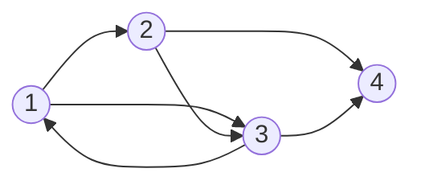
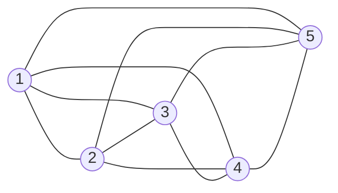
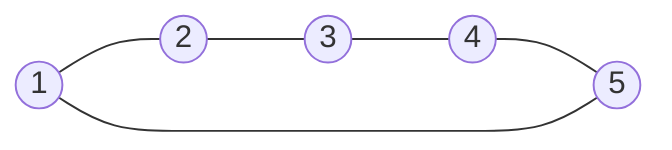
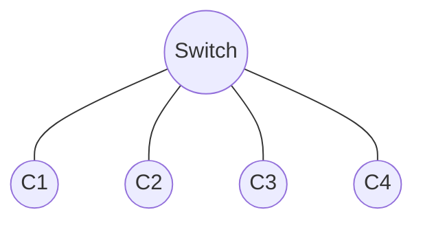

# Exercices – Chapitre 1 : Introduction et représentations des graphes

> **Matière :** [[MOC_Theorie_des_Graphes|Théorie des Graphes]] • **Cours associé :** [[01_Introduction_&_Representations_des_Graphes|01. Introduction, Définitions & Représentations]]

---

## Exercice 1 – Modélisation et lemmes fondamentaux

### 1. Faisabilité des réseaux (7 serveurs)

D'après le **Lemme des Poignées de Main**, dans tout graphe non orienté $G = (V, E)$, la somme des degrés vaut $\sum_{v \in V} d(v) = 2|E|$. Cette somme doit donc être paire (de manière équivalente, le nombre de sommets de degré impair est pair).

* **(a) Cas A : $3, 3, 3, 3, 3, 3, 3$ — Impossible.**
  La somme des degrés est $7 \times 3 = 21$, qui est impaire (7 sommets de degré impair). Cela contredit le lemme des poignées de main.

* **(b) Cas B : $2, 3, 4, 4, 5, 5, 5$ — Possible.**
  La somme des degrés vaut $28$ (pair, soit $14$ connexions). En appliquant l'algorithme de Havel-Hakimi sur la suite triée $(5, 5, 5, 4, 4, 3, 2)$ :
  $$(5, 5, 5, 4, 4, 3, 2) \rightarrow (4, 4, 3, 3, 2, 2) \rightarrow (3, 2, 2, 2, 1) \rightarrow (1, 1, 1, 1) \rightarrow (1, 1, 0) \rightarrow (0, 0)$$
  La suite converge vers des zéros : un graphe simple réalisant ces degrés existe.

* **(c) Cas C : $1, 2, 2, 3, 4, 4, 4$ — Possible.**
  La somme des degrés vaut $20$ (pair, soit $10$ connexions). Par Havel-Hakimi sur $(4, 4, 4, 3, 2, 2, 1)$ :
  $$(4, 4, 4, 3, 2, 2, 1) \rightarrow (3, 3, 2, 2, 1, 1) \rightarrow (2, 1, 1, 1, 1) \rightarrow (1, 1, 0, 0) \rightarrow (0, 0, 0)$$
  La suite est également réalisable par un graphe simple.

### 2. Démonstration ($n \ge 2$ sommets)

Dans un graphe simple à $n \ge 2$ sommets, le degré de chaque sommet est compris entre $0$ et $n - 1$, soit $n$ valeurs théoriquement possibles.

Or, les degrés $0$ et $n - 1$ s'excluent mutuellement : si un sommet est de degré $n - 1$, il est relié à tous les autres sommets, donc aucun sommet ne peut être isolé (degré $0$). L'ensemble des degrés effectivement présents dans le graphe est donc inclus soit dans $\{0, 1, \dots, n - 2\}$, soit dans $\{1, 2, \dots, n - 1\}$, qui contiennent chacun au plus $n - 1$ valeurs distinctes.

Avec $n$ sommets à répartir dans au plus $n - 1$ valeurs de degrés, le **principe des tiroirs** garantit qu'au moins deux sommets ont exactement le même degré.

### 3. Signification concrète

Dans tout réseau comportant au moins deux entités (utilisateurs sur un réseau social, serveurs ou équipements informatiques reliés entre eux sans auto-connexion ni lien multiple), il existe toujours au moins deux utilisateurs ayant exactement le même nombre de contacts, ou deux équipements ayant exactement le même nombre de connexions.

---

## Exercice 2 – Représentations mémoire et complexité de stockage

### 1. Complexité en espace mémoire

* **(a) Matrice d'adjacence $A$ :** $\mathcal{O}(n^2)$ — tableau de taille $n \times n$, indépendant du nombre d'arcs $m$.
* **(b) Liste d'adjacence $L$ :** $\mathcal{O}(n + m)$ — un tableau de $n$ pointeurs (un par sommet) et $m$ éléments répartis dans les listes de successeurs.

### 2. Efficacité asymptotique des opérations (en temps)

| Opération | Matrice d'adjacence $A$ | Liste d'adjacence $L$ (successeurs) |
| :--- | :--- | :--- |
| **(a) Existence de l'arc $(u, v)$** | $\mathcal{O}(1)$ (accès direct à $A[u][v]$) | $\mathcal{O}(d^+(u))$, soit $\mathcal{O}(n)$ au pire |
| **(b) Degré entrant $d^-(u)$** | $\mathcal{O}(n)$ (parcours de la colonne $u$) | $\mathcal{O}(n + m)$ (parcours de toutes les listes) |
| **(c) Degré sortant $d^+(u)$** | $\mathcal{O}(n)$ (parcours de la ligne $u$) | $\mathcal{O}(d^+(u))$ (parcours de la liste de $u$ ; $\mathcal{O}(1)$ si sa taille est stockée) |

### 3. Préconisations selon la densité du réseau

* **Réseau métropolitain très dense ($m \approx n^2$) :**
  * **Recommandée : Matrice d'adjacence $A$.** L'espace mémoire est déjà de l'ordre de $n^2$ dans les deux structures, mais la matrice évite le surcoût mémoire des pointeurs de listes et garantit un test d'existence de liaison en $\mathcal{O}(1)$.
  * **Déconseillée : Liste d'adjacence $L$.** Plus coûteuse en mémoire effective (pointeurs) et plus lente pour tester une connexion ($\mathcal{O}(n)$ au pire).

* **Réseau WAN très dispersé ($m \approx \mathcal{O}(n)$) :**
  * **Recommandée : Liste d'adjacence $L$.** L'occupation mémoire est linéaire $\mathcal{O}(n)$ au lieu de quadratique $\mathcal{O}(n^2)$, et le calcul des degrés sortants ou le parcours des voisins reste proportionnel au nombre réel de liaisons ($\mathcal{O}(d^+(u))$) plutôt qu'au nombre total de routeurs $n$.
  * **Déconseillée : Matrice d'adjacence $A$.** Gaspille la quasi-totalité des $n^2$ cases avec des zéros et impose des parcours en $\mathcal{O}(n)$ pour inspecter les liaisons d'un routeur.

---

## Exercice 3 – Matrice d'adjacence et chemins

### 1. Représentation du graphe orienté $G$

Les arcs issus de la matrice $A$ sont :
$$E = \{(1, 2), (1, 3), (2, 3), (2, 4), (3, 1), (3, 4)\}$$

### 2. Degrés entrants et sortants

$d^+(i)$ correspond à la somme des coefficients de la ligne $i$, et $d^-(i)$ à la somme des coefficients de la colonne $i$ :

| Sommet $i$ | Degré entrant $d^-(i)$ | Degré sortant $d^+(i)$ |
| :---: | :---: | :---: |
| **1** | 1 | 2 |
| **2** | 1 | 2 |
| **3** | 2 | 2 |
| **4** | 2 | 0 |

### 3. Calcul de $A^2$ et $A^3$

$$A^2 = A \times A = \begin{pmatrix} 1 & 0 & 1 & 2 \\ 1 & 0 & 0 & 1 \\ 0 & 1 & 1 & 0 \\ 0 & 0 & 0 & 0 \end{pmatrix}$$

$$A^3 = A^2 \times A = \begin{pmatrix} 1 & 1 & 1 & 1 \\ 0 & 1 & 1 & 0 \\ 1 & 0 & 1 & 2 \\ 0 & 0 & 0 & 0 \end{pmatrix}$$

### 4. Chemins de longueur 3 reliant 1 à 4

Le nombre de chemins de longueur 3 de $1$ vers $4$ est donné par le coefficient $(A^3)_{1,4} = 1$.

Il existe donc **1 seul chemin** de longueur 3 reliant $1$ à $4$ :
$$1 \rightarrow 2 \rightarrow 3 \rightarrow 4$$

---

## Exercice 4 – Analyse des topologies réseaux usuelles

### 1. Topologie totalement maillée ($K_n$)

* **Degré de chaque sommet :** $d(v) = n - 1$ (chaque nœud est relié à tous les autres).
* **Degré maximal et minimal :** $\Delta(K_n) = n - 1$ et $\delta(K_n) = n - 1$.
* **Nombre total d'arêtes :** $m = \frac{n(n - 1)}{2}$.

Exemple pour $n = 5$ ($K_5$) :

### 2. Topologie en anneau ($C_n$, avec $n \ge 3$)

* **Degré de chaque sommet :** $d(v) = 2$ (chaque nœud est relié à ses deux voisins immédiats).
* **Régularité :** tous les sommets ont le même degré égal à $2$ ; $C_n$ est un graphe **$2$-régulier**.

Exemple pour $n = 5$ ($C_5$) :

### 3. Topologie en étoile ($S_n$, avec $n \ge 2$)

Le switch central a un degré de $n - 1$ et chacun des $n - 1$ clients a un degré de $1$ (pour un total de $m = n - 1$ arêtes) :

* **Degré maximal :** $\Delta(S_n) = n - 1$.
* **Degré minimal :** $\delta(S_n) = 1$.
* **Degré moyen :**
  $$\bar{d}(S_n) = \frac{2m}{n} = \frac{2(n - 1)}{n} = 2 - \frac{2}{n}$$

Exemple pour $n = 5$ ($S_5$) :

### 4. Risque de goulot d'étranglement matériel

La **topologie en étoile ($S_n$)** présente le risque le plus élevé. Le switch central concentre à lui seul $\Delta(S_n) = n - 1$ liaisons et doit absorber l'intégralité du trafic inter-clients : lorsque $n$ augmente fortement, son fond de panier, ses ports et sa capacité de commutation saturent, créant un goulot d'étranglement (ainsi qu'un point de défaillance unique).

*(Note : en $K_n$, chaque équipement doit aussi disposer de $n - 1$ interfaces physiques, ce qui pose un problème de coût et de câblage en $\mathcal{O}(n^2)$, mais le trafic reste distribué sans concentrateur central).*

---

## Exercice 5 – Degré d'un graphe et analyse matricielle

### 1. Expression du degré $d(v_i)$

$G$ étant un graphe simple non orienté, $a_{ij} = 1$ si $v_i$ et $v_j$ sont reliés par une arête, et $0$ sinon (avec $a_{ii} = 0$ puisqu'il n'y a pas de boucle). Le degré de $v_i$ est donc la somme des coefficients de sa ligne (ou de sa colonne, $A$ étant symétrique) :

$$d(v_i) = \sum_{j=1}^n a_{ij}$$

### 2. Somme de tous les éléments de $A$

En sommant sur toutes les lignes, on obtient la somme des degrés des sommets :

$$\sum_{i=1}^n \sum_{j=1}^n a_{ij} = \sum_{i=1}^n \left(\sum_{j=1}^n a_{ij}\right) = \sum_{i=1}^n d(v_i)$$

Or, chaque arête $\{v_i, v_j\}$ contribue exactement à deux coefficients égaux à $1$ dans la matrice ($a_{ij}$ et $a_{ji}$, avec $i \neq j$). D'après le Lemme des Poignées de Main, on en déduit :

$$\sum_{i=1}^n \sum_{j=1}^n a_{ij} = \sum_{i=1}^n d(v_i) = 2m$$

### 3. Degrés $\Delta(G)$, $\delta(G)$ et degré moyen

En sommant chaque ligne de $A$ ($n = 4$) :

* $d(v_1) = 0 + 1 + 1 + 1 = 3$
* $d(v_2) = 1 + 0 + 1 + 0 = 2$
* $d(v_3) = 1 + 1 + 0 + 1 = 3$
* $d(v_4) = 1 + 0 + 1 + 0 = 2$

On en déduit :

* **Degré maximal :** $\Delta(G) = 3$
* **Degré minimal :** $\delta(G) = 2$
* **Degré moyen :** $\bar{d}(G) = \frac{3 + 2 + 3 + 2}{4} = \frac{10}{4} = 2{,}5$

### 4. Régularité du graphe

**Non**, ce graphe n'est pas régulier, car tous ses sommets n'ont pas le même degré ($\delta(G) = 2 \neq 3 = \Delta(G)$ ; par exemple $d(v_1) = 3$ tandis que $d(v_2) = 2$).
