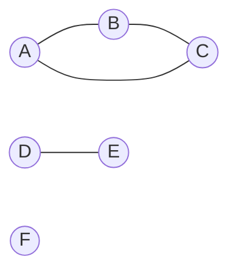
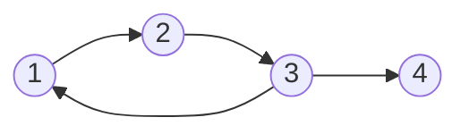
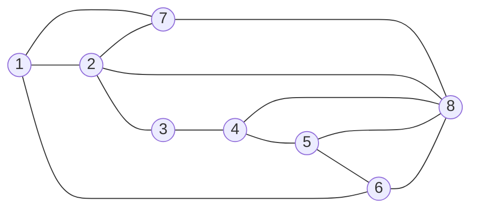
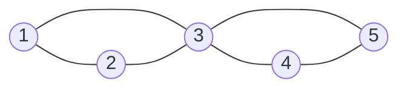
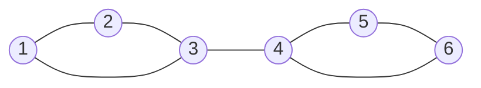
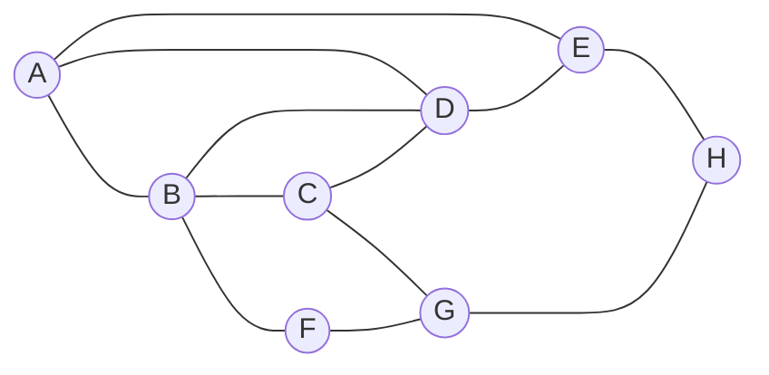
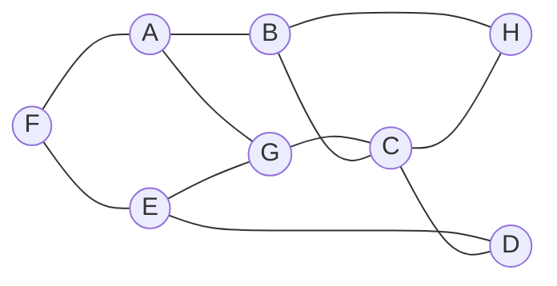
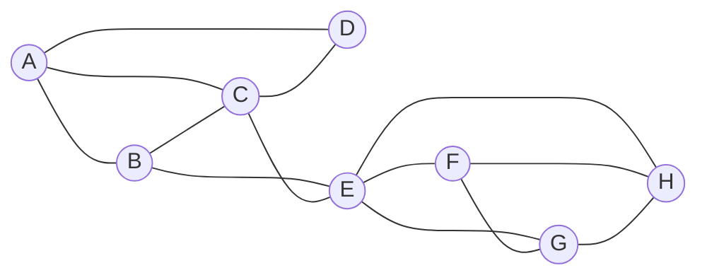

# Exercices – Chapitre 2 : Propriétés fondamentales des graphes

> **Matière :** [[MOC_Theorie_des_Graphes|Théorie des Graphes]] • **Cours associé :** [[02_Proprietes_Fondamentales_des_Graphes|02. Propriétés Fondamentales des Graphes]]

---

## Lexique de révision (Termes et notations à retenir)

> [!tip] Mémo rapide pour l'examen
> | Terme / Notation | Signification simple |
> | :--- | :--- |
> | **Graphe connexe** | Graphe non orienté où tout sommet est relié à n'importe quel autre par au moins une chaîne. |
> | **Composante connexe** | Sous-graphe connexe maximal (un « bloc isolé » du graphe). Pour relier $k$ composantes, il faut au minimum **$k - 1$ arêtes**. |
> | **Forte connexité & CFC** | En orienté : pour toute paire $(u, v)$, il existe un chemin de $u$ vers $v$ **et** un chemin de $v$ vers $u$. Les **CFC** sont les blocs maximaux fortement connexes. |
> | **Chaîne / Cycle eulérien** | Parcours passant **exactement une fois par chaque arête** (cycle = fermé). Théorème d'Euler (connexe) : cycle $\iff 0$ sommet impair ; chaîne $\iff$ exactement $2$ sommets impairs. |
> | **Circuit / Chemin eulérien** | Version orientée : circuit eulérien $\iff$ fortement connexe et $d^+(v) = d^-(v)$ partout ; chemin de $u$ à $v$ $\iff d^+(u)=d^-(u)+1$, $d^+(v)=d^-(v)-1$ et égalité ailleurs. |
> | **Chaîne / Cycle hamiltonien** | Parcours passant **exactement une fois par chaque sommet** (problème NP-complet ; pas de critère simple nécessaire et suffisant). |
> | **Théorèmes de Dirac & Ore** | Conditions **suffisantes** (pour $n \ge 3$) d'existence d'un cycle hamiltonien : **Dirac** ($\forall v,\; d(v) \ge \frac{n}{2}$) et **Ore** ($\forall \{u,v\} \notin E,\; d(u)+d(v) \ge n$). |
> | **Arbre (6 caractérisations)** | Graphe connexe sans cycle ($\iff$ sans cycle avec $m = n-1$ $\iff$ connexe avec $m = n-1$ $\iff$ chaîne unique entre deux sommets). Tout arbre fini ($n \ge 2$) possède au moins deux feuilles ($d = 1$). |
> | **Forêt** | Graphe sans cycle dont chaque composante connexe est un arbre. Pour $n$ sommets et $c$ composantes connexes : **$m = n - c$**. |
> | **Graphe planaire & Euler** | Peut être dessiné dans le plan sans croisement d'arêtes. Si connexe et plan : **$S - A + F = 2$** (en comptant la face extérieure infinie). |
> | **Inégalités de planarité & Kuratowski** | Graphe planaire simple ($S \ge 3$) : **$A \le 3S - 6$** (et **$A \le 2S - 4$** s'il est sans triangle). Critère de Kuratowski : pas de sous-graphe homéomorphe à **$K_5$** ni à **$K_{3,3}$**. |
> | **Coloration & $\chi(G)$** | Attribution de couleurs aux sommets telle que deux sommets adjacents aient des couleurs distinctes. $\chi(G)$ = **nombre chromatique** (minimum de couleurs). |
> | **Théorème des 4 couleurs** | Tout graphe planaire est $4$-coloriable : $\chi(G) \le 4$. |
> | **Welsh-Powell & DSATUR** | Heuristiques gloutonnes de coloration : **Welsh-Powell** trie par degré décroissant ; **DSATUR** choisit le sommet de plus fort degré de saturation (couleurs déjà présentes chez ses voisins). |
> | **Clique & $\omega(G)$** | Sous-ensemble de sommets **tous reliés deux à deux** (sous-graphe complet). $\omega(G)$ = taille de la plus grande clique. |
> | **Ensemble stable & $\alpha(G)$** | Sous-ensemble de sommets **deux à deux non adjacents** (indépendants). $\alpha(G)$ = **nombre de stabilité** (taille max). |
> | **Complémentaire $\overline{G}$ & borne** | $\overline{G}$ inverse arêtes et non-arêtes : **$S$ stable dans $G \iff S$ clique dans $\overline{G}$**, soit $\alpha(G) = \omega(\overline{G})$. Toujours **$\omega(G) \le \chi(G)$**. |
> | **Diamètre & Puissances $M^p$** | Distance géodésique entre $u$ et $v$ = plus petit $p$ tel que $(M^p)_{u,v} > 0$. Le **diamètre** est la plus grande de ces distances sur toutes les paires de sommets. |

---

## Exercice 1 – Connexité, forte connexité et composantes connexes

### 1. Réseau local non orienté $G_1 = (V, E)$

Le graphe $G_1$ comporte $6$ sommets $V = \{A, B, C, D, E, F\}$ et $4$ arêtes $E = \{\{A, B\}, \{A, C\}, \{B, C\}, \{D, E\}\}$ ($F$ est isolé) :

* **(a) Composantes connexes et connexité :**
  Le graphe se partitionne en **3 composantes connexes** (sous-graphes connexes maximaux) :
  $$C_1 = \{A, B, C\}, \qquad C_2 = \{D, E\}, \qquad C_3 = \{F\}$$
  Comme le graphe compte $k = 3 > 1$ composantes connexes, **le réseau $G_1$ n'est pas connexe** (il n'existe par exemple aucune chaîne reliant $A$ à $D$, ni aucun nœud à $F$).

* **(b) Nombre minimal d'arêtes à ajouter :**
  Pour fusionner $k$ composantes connexes en une seule, chaque nouvelle arête réduit le nombre de composantes d'au plus $1$. Il faut donc au minimum **$k - 1 = 3 - 1 = 2$ arêtes** (par exemple $\{C, D\}$ pour relier $C_1$ à $C_2$, puis $\{E, F\}$ pour relier l'ensemble à $C_3$).

> [!note] Comprendre la logique (terre à terre)
> Imagine des îles séparées par la mer : chaque **composante connexe** est une île sur laquelle on peut circuler partout à pied, mais sans aucun pont vers les autres îles.
> Si tu as $3$ îles ($C_1$, $C_2$ et l'îlot solitaire $F$), combien de ponts faut-il construire au minimum pour tout relier ? Toujours **$k - 1$ ponts** : un pont relie deux îles et n'en forme plus qu'une ; avec $2$ ponts, tes $3$ îles ne forment plus qu'un seul réseau connexe.

### 2. Réseau orienté $G_2$

Le graphe orienté $G_2$ comporte $4$ sommets $V = \{1, 2, 3, 4\}$ et $4$ arcs $E = \{(1, 2), (2, 3), (3, 1), (3, 4)\}$ :

* **(a) Composantes fortement connexes (CFC) :**
  $G_2$ possède **2 composantes fortement connexes** :
  * **$K_1 = \{1, 2, 3\}$ :** ces trois sommets forment le circuit $1 \rightarrow 2 \rightarrow 3 \rightarrow 1$, donc chacun peut atteindre tous les autres et en revenir.
  * **$K_2 = \{4\}$ :** le sommet $4$ est un **puits** ($d^+(4) = 0$) ; on peut l'atteindre depuis $\{1, 2, 3\}$ via $(3, 4)$, mais aucun chemin orienté ne repart de $4$.

* **(b) $G_2$ est-il fortement connexe ?**
  **Non.** Un graphe orienté est fortement connexe s'il ne possède qu'une seule composante fortement connexe (tout couple $(u, v)$ doit être mutuellement accessible). Ici, il existe un chemin de $3$ vers $4$, mais **aucun chemin orienté de $4$ vers $1$, $2$ ou $3$**.

> [!note] Comprendre la logique (terre à terre)
> En graphe orienté, les liaisons sont des **rues à sens unique**. Le triangle $1 \to 2 \to 3 \to 1$ forme un rond-point où l'on peut toujours faire le tour pour rejoindre n'importe qui du groupe. En revanche, la flèche $3 \to 4$ mène dans une **impasse** sans sortie : une fois arrivé en $4$, impossible de remonter vers $1, 2$ ou $3$. Le quartier $\{4\}$ reste donc enfermé dans sa propre composante.

---

## Exercice 2 – Parcours eulériens et hamiltoniens dans un réseau de routage

### 1. Graphes eulériens

* **(a) Énoncé du théorème d'Euler :**
  Soit $G$ un graphe non orienté **connexe** :
  * $G$ admet un **cycle (circuit) eulérien** (parcours fermé empruntant chaque arête une et une seule fois) **si et seulement si tous ses sommets sont de degré pair** ($0$ sommet de degré impair).
  * $G$ admet une **chaîne eulérienne** ouverte (d'un sommet $u$ vers un sommet $v \neq u$) **si et seulement si exactement deux sommets sont de degré impair** ($u$ et $v$, qui sont obligatoirement le point de départ et le point d'arrivée).
  *(Note : dans un graphe orienté fortement connexe, un circuit eulérien existe $\iff \forall v,\; d^+(v) = d^-(v)$.)*

* **(b) Analyse du réseau de degrés $d(A)=4, d(B)=2, d(C)=3, d(D)=3, d(E)=2$ :**
  En supposant le réseau connexe, on compte **2 sommets de degré impair** ($C$ et $D$, de degré $3$) et $3$ sommets de degré pair ($A, B, E$).
  * **Circuit (cycle) eulérien :** **Impossible**, car tous les sommets ne sont pas de degré pair ($C$ et $D$ sont impairs).
  * **Chaîne eulérienne :** **Possible**, car le graphe possède **exactement $2$ sommets de degré impair**. Le technicien pourra inspecter chaque câble une seule fois en partant obligatoirement de $C$ pour terminer en $D$ (ou en partant de $D$ pour terminer en $C$).

> [!note] Comprendre la logique (terre à terre)
> Chaque fois que le technicien **traverse** un routeur sans s'y arrêter, il arrive par un câble et repart par un autre câble neuf : cela consomme **2 câbles** (un nombre pair).
> Seuls deux endroits échappent à cette règle : l'endroit d'où il **part** (1 sortie de plus que d'entrées) et l'endroit où il **s'arrête** (1 entrée de plus que de sorties). S'il veut revenir au départ (cycle fermé), personne ne peut avoir un nombre impair de câbles. S'il accepte de finir ailleurs (chaîne ouverte), il faut exactement $2$ sommets impairs : l'un est le départ, l'autre est l'arrivée.

### 2. Graphes hamiltoniens

* **(a) Identification du parcours :**
  Un parcours qui visite **chaque sommet (routeur) une et une seule fois** avant de revenir à son point de départ est un **cycle hamiltonien** (le graphe est alors qualifié de *graphe hamiltonien*).

* **(b) Théorème de Dirac et théorème de Ore :**
  Pour tout graphe simple non orienté $G = (V, E)$ d'ordre $n \ge 3$ :
  * **Théorème de Dirac (1952) :** Si pour tout sommet $v \in V$,
    $$d(v) \ge \frac{n}{2}$$
    alors $G$ admet un cycle hamiltonien.
  * **Théorème de Ore (1960) :** Si pour toute paire de sommets **non adjacents** $\{u, v\} \notin E$,
    $$d(u) + d(v) \ge n$$
    alors $G$ admet un cycle hamiltonien.

* **(c) Graphe simple à $6$ sommets ($n = 6$) où $\forall v \in V,\; d(v) \ge 3$ :**
  **Oui, nécessairement.**
  On vérifie directement les hypothèses du **théorème de Dirac** :
  * Le graphe est simple et $n = 6 \ge 3$.
  * Pour chaque sommet $v \in V$, $d(v) \ge 3 = \frac{6}{2} = \frac{n}{2}$.
  *(De manière équivalente, pour toute paire de sommets non adjacents, $d(u) + d(v) \ge 3 + 3 = 6 = n$, donc la condition de Ore est également satisfaite.)*
  Le graphe admet donc obligatoirement un cycle hamiltonien.

> [!note] Comprendre la logique (terre à terre)
> * **Eulérien = inspecteur de câbles** (on passe sur toutes les *arêtes*) ; **Hamiltonien = livreur de colis** (on passe dans toutes les *villes/sommets*).
> * Contrairement à Euler, il n'existe **aucune formule miracle « si et seulement si »** facile à calculer pour les cycles hamiltoniens (problème NP-complet). Dirac et Ore ne donnent que des **conditions suffisantes** : si tous les routeurs sont très connectés ($\ge n/2$ voisins chacun), on est *sûr* qu'il existe une tournée fermée. En revanche, un simple anneau $C_6$ ($d(v)=2 < 3$) est aussi hamiltonien : ne pas satisfaire Dirac n'empêche pas d'être hamiltonien !

---

## Exercice 3 – Arbres, arborescences et planarité

### 1. Démonstration par récurrence : tout arbre à $n$ sommets possède $n - 1$ arêtes

Soit la propriété $P(n)$ : « *Tout arbre $T$ à $n$ sommets possède exactement $n - 1$ arêtes.* »

* **Initialisation ($n = 1$) :**
  Un arbre d'ordre $1$ comporte un seul sommet et ne peut contenir de boucle (car il est sans cycle). Il possède donc $0 = 1 - 1$ arête. $P(1)$ est vraie.

* **Hypothèse de récurrence :**
  Soit $k \ge 1$ un entier fixé. Supposons que tout arbre à $k$ sommets possède exactement $k - 1$ arêtes ($P(k)$ vraie).

* **Hérédité ($n = k + 1$) :**
  Soit $T = (V, E)$ un arbre à $k + 1 \ge 2$ sommets.
  1. **Existence d'une feuille :** $T$ possède au moins un sommet $v$ de degré $d(v) = 1$ (une *feuille*). En effet :
     * Aucun sommet n'est de degré $0$ car $T$ est connexe avec $k + 1 \ge 2$ sommets.
     * Si tous les sommets avaient un degré $\ge 2$, en suivant une chaîne élémentaire maximale de proche en proche, arrivée à son extrémité, celle-ci devrait posséder au moins un autre voisin déjà visité sur la chaîne, ce qui formerait un cycle — impossible dans un arbre.
  2. **Suppression de la feuille :** Retirons $v$ et l'unique arête $e = \{v, u\}$ qui lui est incidente pour former $T' = (V \setminus \{v\}, E \setminus \{e\})$ à $k$ sommets.
     * $T'$ reste **sans cycle**, puisqu'on n'a fait que retirer un sommet et une arête.
     * $T'$ reste **connexe** : pour deux sommets quelconques de $V \setminus \{v\}$, l'unique chaîne simple les reliant dans $T$ ne peut pas passer par $v$ (sinon $v$ aurait au moins deux arêtes incidentes et donc un degré $\ge 2$). Cette chaîne existe donc toujours dans $T'$.
  3. **Conclusion au rang $k + 1$ :** $T'$ est un arbre à $k$ sommets. Par hypothèse de récurrence, $|E(T')| = k - 1$. Donc :
     $$|E(T)| = |E(T')| + 1 = (k - 1) + 1 = k = (k + 1) - 1$$
     $P(k+1)$ est vérifiée.

* **Conclusion :** Par le principe de récurrence, tout arbre à $n \ge 1$ sommets possède exactement **$n - 1$ arêtes**. $\blacksquare$

> [!note] Comprendre la logique (terre à terre)
> Pourquoi prend-on la peine de prouver qu'il existe une **feuille** (sommet de degré $1$) avant de la couper ?
> Parce que si tu supprimes un sommet situé *au milieu* de l'arbre (degré $\ge 2$), tu casses l'arbre en plusieurs morceaux non connexes et tu ne peux plus appliquer l'hypothèse de récurrence ! En coupant une extrémité qui ne tient que par une seule branche, l'arbre reste intact en un seul bloc, avec $1$ sommet en moins et $1$ arête en moins.

### 2. Planarité

* **(a) Formule d'Euler :**
  Pour tout graphe **connexe** dessiné dans le plan sans que deux arêtes ne se croisent en dehors de leurs extrémités :
  $$S - A + F = 2$$
  où $S$ est le nombre de sommets, $A$ le nombre d'arêtes et $F$ le nombre de faces (régions délimitées du plan, **en comptant la face infinie extérieure**).

* **(b) Vérification de la formule sur le graphe de la figure :**

  Décompte exhaustif sur la figure :
  * **Sommets :** $S = 8$ ($\{1, 2, 3, 4, 5, 6, 7, 8\}$).
  * **Arêtes :** $A = 13$ :
    * Contour extérieur ($6$) : $\{1,2\}, \{2,3\}, \{3,4\}, \{4,5\}, \{5,6\}, \{6,1\}$.
    * Arêtes autour de $7$ ($3$) : $\{1,7\}, \{2,7\}, \{7,8\}$.
    * Autres arêtes autour de $8$ ($4$) : $\{2,8\}, \{4,8\}, \{5,8\}, \{6,8\}$.
    *(Vérification par les degrés : $3+4+2+3+3+3+3+5 = 26 = 2 \times 13$.)*
  * **Faces :** $F = 7$ :
    * $6$ régions intérieures fermées : les $4$ triangles $(1,2,7)$, $(2,7,8)$, $(4,5,8)$, $(5,6,8)$ et les $2$ quadrilatères $(1,6,8,7)$, $(2,3,4,8)$.
    * $1$ région extérieure infinie (tout autour du contour $1-2-3-4-5-6$).
  * **Vérification :**
    $$S - A + F = 8 - 13 + 7 = \mathbf{2}$$
    La formule d'Euler est exactement vérifiée.

* **(c) Démonstration que $K_5$ n'est pas plan à l'aide de $A \le 3S - 6$ :**
  *(Rappel de l'inégalité : dans un graphe planaire simple connexe à $S \ge 3$ sommets, chaque face est bordée par au moins $3$ arêtes et chaque arête borde au plus $2$ faces, donc $3F \le 2A \implies F \le \frac{2}{3}A$. Injecté dans $S - A + F = 2$, cela donne $S - A + \frac{2}{3}A \ge 2 \iff A \le 3S - 6$.)*
  Pour le graphe complet $K_5$ :
  * Nombre de sommets : $S = 5$.
  * Nombre d'arêtes : $A = \frac{5 \times 4}{2} = 10$.
  * Or, l'inégalité nécessaire à la planarité impose :
    $$A \le 3S - 6 = 3 \times 5 - 6 = 9$$
  On obtient $10 \le 9$, ce qui est **contradictoire**. Par conséquent, **$K_5$ n'est pas planaire**.

> [!note] Astuce examen (ne jamais oublier la face extérieure !)
> Lors du décompte des faces $F$, l'oubli classique est de ne compter que les polygones à l'intérieur du dessin ($6$ ici) et d'obtenir $S - A + F = 1$. N'oublie **jamais** l'océan infini tout autour du graphe qui compte toujours pour **$+1$ face**.
> Et pour retrouver $3F \le 2A$ sans par cœur : chaque région intérieure est au minimum un triangle ($3$ côtés par face), et chaque arête sert de frontière à $2$ régions (une de chaque côté). Donc compter les côtés de toutes les faces donne au moins $3F$, tout en ne dépassant jamais $2A$.

---

## Exercice 4 – Coloriage de graphes et allocation de fréquences radio

Le graphe des interférences à $5$ antennes forme deux triangles $\{1, 2, 3\}$ et $\{3, 4, 5\}$ reliés au sommet central $3$ :

### 1. Degré de chaque sommet

* $d(1) = 2$ (voisins : $2, 3$)
* $d(2) = 2$ (voisins : $1, 3$)
* $d(3) = 4$ (voisins : $1, 2, 4, 5$)
* $d(4) = 2$ (voisins : $3, 5$)
* $d(5) = 2$ (voisins : $3, 4$)

### 2. Nombre chromatique $\chi(G)$

* **Borne inférieure :** le sous-graphe $\{1, 2, 3\}$ (comme $\{3, 4, 5\}$) est une clique de taille $3$ ($K_3$), dont les trois sommets sont deux à deux en interférence. Il faut donc au moins $3$ fréquences : $\chi(G) \ge \omega(G) = 3$.
* **Borne supérieure :** $3$ fréquences suffisent, par exemple $f_1 : \{3\}$, $f_2 : \{1, 4\}$, $f_3 : \{2, 5\}$ (aucune arête entre $1$ et $4$, ni entre $2$ et $5$).

Donc **$\chi(G) = 3$**.

### 3. Application de l'algorithme glouton de Welsh-Powell

1. **Tri des sommets par degré décroissant** (à degré égal, ordre croissant d'indice) :
   $$3\,(d=4),\quad 1\,(d=2),\quad 2\,(d=2),\quad 4\,(d=2),\quad 5\,(d=2)$$

2. **Attribution séquentielle des fréquences (couleurs) :**

| Couleur / Fréquence | Sommet choisi | Parcours des sommets restants | Sommets colorés |
| :--- | :---: | :--- | :---: |
| **Fréquence 1 ($C_1$)** | **$3$** | $1, 2, 4, 5$ sont tous adjacents à $3$ $\to$ refusés | $\{3\}$ |
| **Fréquence 2 ($C_2$)** | **$1$** | $2$ adjacent à $1$ (refusé) ; **$4$** non adjacent à $1$ (**accepté**) ; $5$ adjacent à $4$ (refusé) | $\{1, 4\}$ |
| **Fréquence 3 ($C_3$)** | **$2$** | **$5$** non adjacent à $2$ (**accepté**) | $\{2, 5\}$ |

Tous les sommets sont colorés avec **$3$ fréquences**, ce qui correspond exactement au minimum théorique $\chi(G) = 3$ :
* **Fréquence 1 :** Antenne $3$
* **Fréquence 2 :** Antennes $1$ et $4$
* **Fréquence 3 :** Antennes $2$ et $5$

> [!note] Comprendre la logique (terre à terre)
> Pourquoi Welsh-Powell trie-t-il par **degré décroissant** ?
> On s'occupe d'abord de l'antenne la plus problématique (ici l'antenne $3$, qui brouille tout le monde), puis on parcourt la liste dans l'ordre en « tassant » dans la même fréquence toutes les antennes compatibles (non reliées ni au premier sommet du groupe, ni à ceux qu'on vient d'y ajouter).
> **Attention :** Welsh-Powell est une *heuristique* gloutonne : elle donne toujours une coloration valide rapidement, souvent optimale comme ici, mais sur certains graphes particuliers elle peut consommer une couleur de plus que $\chi(G)$.

---

## Exercice 5 – Cliques et ensembles stables

Le graphe $G$ à $6$ sommets est composé de deux triangles $\{1, 2, 3\}$ et $\{4, 5, 6\}$ reliés par une unique arête $\{3, 4\}$ :

### 1. Définitions formelles

Soit $G = (V, E)$ un graphe simple non orienté :
* **Clique :** un sous-ensemble $C \subseteq V$ est une clique si tous ses sommets sont adjacents deux à deux (le sous-graphe induit est complet) :
  $$\forall u, v \in C,\; u \neq v \implies \{u, v\} \in E$$
* **Ensemble stable (ou indépendant) :** un sous-ensemble $S \subseteq V$ est un stable si aucune paire de ses sommets n'est reliée par une arête :
  $$\forall u, v \in S,\; u \neq v \implies \{u, v\} \notin E$$

### 2. Nombre de clique $\omega(G)$

* Les sous-ensembles $\{1, 2, 3\}$ et $\{4, 5, 6\}$ forment chacun une clique de taille $3$ ($K_3$).
* Aucune clique de taille $4$ ne peut exister : dans un $K_4$, chaque sommet doit être de degré $\ge 3$. Or seuls $3$ et $4$ ont un degré égal à $3$ (les sommets $1, 2, 5, 6$ sont de degré $2$).

Donc **$\omega(G) = 3$**.

### 3. Nombre de stabilité $\alpha(G)$

* L'ensemble des $6$ sommets se partitionne en deux cliques : $C_1 = \{1, 2, 3\}$ et $C_2 = \{4, 5, 6\}$.
* Par le principe des tiroirs, tout sous-ensemble de $3$ sommets contient au moins $2$ sommets issus d'une même clique, qui sont donc forcément reliés par une arête. On a donc $\alpha(G) \le 2$.
* Il existe bien des stables de taille $2$, par exemple $\{1, 5\}$, $\{1, 4\}$, $\{2, 6\}$ (attention : $\{3, 4\}$ n'est pas stable car l'arête $\{3, 4\}$ existe).

Donc **$\alpha(G) = 2$**.

### 4. Relation entre stable dans $G$ et clique dans le graphe complémentaire $\overline{G}$

Par définition du graphe complémentaire $\overline{G} = (V, \overline{E})$, deux sommets distincts $u$ et $v$ sont reliés dans $\overline{G}$ **si et seulement si** ils ne sont **pas** reliés dans $G$ :
$$\{u, v\} \in \overline{E} \iff \{u, v\} \notin E$$
Par conséquent, un sous-ensemble $S \subseteq V$ est un **ensemble stable dans $G$ si et seulement si $S$ est une clique dans $\overline{G}$** (et réciproquement). On en déduit immédiatement les égalités duales :
$$\alpha(G) = \omega(\overline{G}) \qquad \text{et} \qquad \omega(G) = \alpha(\overline{G})$$

> [!note] Comprendre la logique (terre à terre)
> * Une **clique**, c'est un groupe d'antennes où tout le monde se brouille mutuellement (chacune exige sa propre fréquence : d'où $\omega(G) \le \chi(G)$).
> * Un **ensemble stable**, c'est au contraire un groupe d'antennes qui peuvent **toutes utiliser la même fréquence** sans interférer.
> * Le graphe complémentaire $\overline{G}$ est le « négatif photo » de $G$ : toutes les lignes dessinées disparaissent, et tous les espaces vides deviennent des traits. Donc un groupe sans aucun trait dans $G$ (un **stable**) devient automatiquement un groupe où tous les traits apparaissent dans $\overline{G}$ (une **clique**).

---

## Exercice 6 – Routage et redondance dans un réseau informatique d'entreprise

Le réseau $G = (V, E)$ comporte $n = 8$ commutateurs $V = \{A, B, C, D, E, F, G, H\}$ et $m = 12$ liaisons :

### 1. Complétude et connexité

* **(a) Graphe complet ? Non.**
  Un graphe simple complet à $8$ sommets ($K_8$) possède $\frac{8 \times 7}{2} = 28$ arêtes (chaque sommet est de degré $7$). Ici, $G$ ne compte que $m = 12$ arêtes (par exemple, les commutateurs $A$ et $C$ ne sont pas directement reliés).

* **(b) Graphe connexe ? Oui.**
  Tout commutateur peut communiquer avec n'importe quel autre : la chaîne $A - B - F - G - H - E - D - C$ passe déjà par l'ensemble des $8$ sommets du réseau, garantissant l'existence d'une chaîne entre toute paire de sommets.

### 2. Existence d'une chaîne eulérienne

Calculons le degré de chaque sommet :

| Sommet | $A$ | $B$ | $C$ | $D$ | $E$ | $F$ | $G$ | $H$ |
| :---: | :---: | :---: | :---: | :---: | :---: | :---: | :---: | :---: |
| **Degré $d(v)$** | **3** | 4 | **3** | 4 | **3** | 2 | **3** | 2 |

*(Vérification : somme des degrés $= 24 = 2 \times 12$ arêtes.)*

Le graphe comporte **4 sommets de degré impair** ($A, C, E, G$). Or, d'après le théorème d'Euler, un graphe connexe n'admet une chaîne eulérienne que s'il possède $0$ ou $2$ sommets de degré impair. **Le graphe $G$ n'admet donc pas de chaîne eulérienne.**

### 3. Matrice d'adjacence $M$ (ordre alphabétique $A, B, C, D, E, F, G, H$)

$$M = \begin{pmatrix}
0 & 1 & 0 & 1 & 1 & 0 & 0 & 0 \\
1 & 0 & 1 & 1 & 0 & 1 & 0 & 0 \\
0 & 1 & 0 & 1 & 0 & 0 & 1 & 0 \\
1 & 1 & 1 & 0 & 1 & 0 & 0 & 0 \\
1 & 0 & 0 & 1 & 0 & 0 & 0 & 1 \\
0 & 1 & 0 & 0 & 0 & 0 & 1 & 0 \\
0 & 0 & 1 & 0 & 0 & 1 & 0 & 1 \\
0 & 0 & 0 & 0 & 1 & 0 & 1 & 0
\end{pmatrix}$$

### 4. Acheminement de $B$ vers $H$ et diamètre du réseau

Calcul des puissances $M^2$ et $M^3$ (lignes et colonnes indexées par $A, B, C, D, E, F, G, H$) :

$$M^2 = \begin{pmatrix}
3 & 1 & 2 & 2 & 1 & 1 & 0 & 1 \\
1 & 4 & 1 & 2 & 2 & 0 & 2 & 0 \\
2 & 1 & 3 & 1 & 1 & 2 & 0 & 1 \\
2 & 2 & 1 & 4 & 1 & 1 & 1 & 1 \\
1 & 2 & 1 & 1 & 3 & 0 & 1 & 0 \\
1 & 0 & 2 & 1 & 0 & 2 & 0 & 1 \\
0 & 2 & 0 & 1 & 1 & 0 & 3 & 0 \\
1 & 0 & 1 & 1 & 0 & 1 & 0 & 2
\end{pmatrix}, \qquad
M^3 = \begin{pmatrix}
4 & 8 & 3 & 7 & 6 & 1 & 4 & 1 \\
8 & 4 & 8 & 8 & 3 & 6 & 1 & 4 \\
3 & 8 & 2 & 7 & 4 & 1 & 6 & 1 \\
7 & 8 & 7 & 6 & 7 & 3 & 3 & 2 \\
6 & 3 & 4 & 7 & 2 & 3 & 1 & 4 \\
1 & 6 & 1 & 3 & 3 & 0 & 5 & 0 \\
4 & 1 & 6 & 3 & 1 & 5 & 0 & 4 \\
1 & 4 & 1 & 2 & 4 & 0 & 4 & 0
\end{pmatrix}$$

* **(a) Nombre minimal de sauts de $B$ à $H$ :**
  En observant l'entrée $(B, H)$ (ligne $2$, colonne $8$) :
  * $M_{B,H} = 0$ (aucun trajet en $1$ saut),
  * $(M^2)_{B,H} = 0$ (aucun trajet en $2$ sauts),
  * $(M^3)_{B,H} = 4 > 0$.
  Le paquet doit effectuer au minimum **3 sauts** pour aller de $B$ à $H$.

* **(b) Liste des trajets de longueur $3$ de $B$ à $H$ :**
  Puisque $(M^3)_{B,H} = 4$, il existe exactement **4 trajets possibles** en $3$ liaisons :
  1. $B - A - E - H$
  2. $B - C - G - H$
  3. $B - D - E - H$
  4. $B - F - G - H$

* **(c) Tout couple de commutateurs est-il relié en $3$ sauts ou moins ?**
  **Oui.** En examinant la somme $M + M^2$, les seules paires de sommets distincts qui ne sont reliées ni en $1$ saut ni en $2$ sauts (coefficient nul à la fois dans $M$ et dans $M^2$) sont :
  $$\{A, G\}, \qquad \{B, H\}, \qquad \{E, F\}$$
  Or, dans $M^3$, toutes ces paires deviennent strictement positives :
  $$(M^3)_{A,G} = 4 > 0, \qquad (M^3)_{B,H} = 4 > 0, \qquad (M^3)_{E,F} = 3 > 0$$
  Tout commutateur peut donc joindre n'importe quel autre en au plus **$3$ sauts** (le diamètre du graphe vaut $3$).

> [!note] Comprendre la logique (terre à terre)
> Pour répondre à la question *(c)* sans te noyer dans $64$ coefficients :
> 1. Regarde d'abord $M^2$ : partout où il y a un nombre $> 0$ hors diagonale, les deux nœuds sont déjà à distance $\le 2$ (donc en $\le 3$ sauts, c'est réglé !).
> 2. Repère uniquement les rares **`0` hors diagonale** dans $M^2$ : ici il n'y a que trois paires ($\{A,G\}$, $\{B,H\}$ et $\{E,F\}$).
> 3. Vérifie juste ces $3$ cases dans $M^3$ (ici $4$, $4$ et $3$) : toutes sont non nulles, donc **aucune paire n'est à distance $\ge 4$**.

---

## Exercice 7 – Optimisation d'une tournée de collecte de déchets électroniques

Le réseau routier $G = (V, E)$ relie $n = 8$ stations $V = \{A, B, C, D, E, F, G, H\}$ par $m = 11$ tronçons :

### 1. Complétude et connexité

* **(a) Graphe complet ? Non.**
  $K_8$ requiert $\frac{8 \times 7}{2} = 28$ arêtes ; ce graphe n'en compte que $m = 11$ (par exemple $A$ et $C$ ne sont pas directement reliés).

* **(b) Graphe connexe ? Oui.**
  Il existe une chaîne reliant toutes les stations entre elles, par exemple $F - A - B - H - C - D - E - G$.

### 2. Existence d'une chaîne eulérienne

Degrés des $8$ stations :

| Sommet | $A$ | $B$ | $C$ | $D$ | $E$ | $F$ | $G$ | $H$ |
| :---: | :---: | :---: | :---: | :---: | :---: | :---: | :---: | :---: |
| **Degré $d(v)$** | **3** | **3** | 4 | 2 | **3** | 2 | **3** | 2 |

*(Vérification : somme des degrés $= 22 = 2 \times 11$ arêtes.)*

Le graphe comporte **4 sommets de degré impair** ($A, B, E, G$). D'après le théorème d'Euler ($0$ ou $2$ sommets impairs requis), **il n'existe pas de chaîne eulérienne** permettant de parcourir chaque axe routier exactement une fois.

### 3. Matrice d'adjacence $M$ (ordre alphabétique $A, B, C, D, E, F, G, H$)

$$M = \begin{pmatrix}
0 & 1 & 0 & 0 & 0 & 1 & 1 & 0 \\
1 & 0 & 1 & 0 & 0 & 0 & 0 & 1 \\
0 & 1 & 0 & 1 & 0 & 0 & 1 & 1 \\
0 & 0 & 1 & 0 & 1 & 0 & 0 & 0 \\
0 & 0 & 0 & 1 & 0 & 1 & 1 & 0 \\
1 & 0 & 0 & 0 & 1 & 0 & 0 & 0 \\
1 & 0 & 1 & 0 & 1 & 0 & 0 & 0 \\
0 & 1 & 1 & 0 & 0 & 0 & 0 & 0
\end{pmatrix}$$

### 4. Trajet de $F$ vers $H$ et diamètre du réseau

$$M^2 = \begin{pmatrix}
3 & 0 & 2 & 0 & 2 & 0 & 0 & 1 \\
0 & 3 & 1 & 1 & 0 & 1 & 2 & 1 \\
2 & 1 & 4 & 0 & 2 & 0 & 0 & 1 \\
0 & 1 & 0 & 2 & 0 & 1 & 2 & 1 \\
2 & 0 & 2 & 0 & 3 & 0 & 0 & 0 \\
0 & 1 & 0 & 1 & 0 & 2 & 2 & 0 \\
0 & 2 & 0 & 2 & 0 & 2 & 3 & 1 \\
1 & 1 & 1 & 1 & 0 & 0 & 1 & 2
\end{pmatrix}, \qquad
M^3 = \begin{pmatrix}
0 & 6 & 1 & 4 & 0 & 5 & 7 & 2 \\
6 & 2 & 7 & 1 & 4 & 0 & 1 & 4 \\
1 & 7 & 2 & 6 & 0 & 4 & 8 & 5 \\
4 & 1 & 6 & 0 & 5 & 0 & 0 & 1 \\
0 & 4 & 0 & 5 & 0 & 5 & 7 & 2 \\
5 & 0 & 4 & 0 & 5 & 0 & 0 & 1 \\
7 & 1 & 8 & 0 & 7 & 0 & 0 & 2 \\
2 & 4 & 5 & 1 & 2 & 1 & 2 & 2
\end{pmatrix}$$

* **(a) Nombre minimal de tronçons de $F$ à $H$ :**
  En lisant le coefficient $(F, H)$ (ligne $6$, colonne $8$) :
  * $M_{F,H} = 0$,
  * $(M^2)_{F,H} = 0$,
  * $(M^3)_{F,H} = 1 > 0$.
  Il faut parcourir au minimum **3 tronçons routiers**.

* **(b) Liste des itinéraires de $3$ tronçons de $F$ à $H$ :**
  Comme $(M^3)_{F,H} = 1$, il n'existe qu'**un unique itinéraire** en $3$ tronçons :
  $$F - A - B - H$$

* **(c) Deux stations quelconques sont-elles toujours reliées en $3$ tronçons ou moins ?**
  **Oui.** Les seules paires de sommets distincts nulles à la fois dans $M$ et dans $M^2$ sont :
  $$\{A, D\}, \qquad \{B, E\}, \qquad \{C, F\}, \qquad \{E, H\}, \qquad \{F, H\}$$
  Or, toutes ont un coefficient strictement positif dans $M^3$ :
  $$(M^3)_{A,D} = 4, \quad (M^3)_{B,E} = 4, \quad (M^3)_{C,F} = 4, \quad (M^3)_{E,H} = 2, \quad (M^3)_{F,H} = 1$$
  Toute paire de stations est donc reliée en au plus $3$ tronçons (diamètre égal à $3$).

> [!note] Astuce examen (calculer $(M^3)_{F,H}$ sans calculer tout $M^3$ à la main)
> En examen écrit, pour trouver uniquement $(M^3)_{F,H}$, il est inutile de multiplier les $64$ cases de $M^2 \times M$. Il suffit d'effectuer le seul produit scalaire **(ligne $F$ de $M^2$) $\times$ (colonne $H$ de $M$)** :
> $$(0, 1, 0, 1, 0, 2, 2, 0) \cdot (0, 1, 1, 0, 0, 0, 0, 0)^T = 1 \times 1 = 1$$
> Comme le seul produit non nul correspond au sommet $B$ ($2^e$ position), tu sais instantanément que l'unique trajet en $3$ sauts passe par $B$ en avant-dernière étape : $F \to (\text{voisin de } F \text{ et } B) \to B \to H$, soit $F - A - B - H$.

---

## Exercice 8 – Architecture de distribution d'eau potable

Le réseau de conduites $G = (V, E)$ comporte $n = 8$ vannes $V = \{A, B, C, D, E, F, G, H\}$ et $m = 13$ conduites :

### 1. Complétude et connexité

* **(a) Graphe complet ? Non.**
  $K_8$ comporte $28$ arêtes ; ici $m = 13 < 28$ (par exemple il n'y a aucune conduite directe entre $A$ et $H$).

* **(b) Graphe connexe ? Oui.**
  L'eau peut circuler entre toute paire de vannes : la chaîne $D - A - B - C - E - F - G - H$ parcourt les $8$ vannes du réseau (la vanne centrale $E$ relie le bloc gauche $\{A, B, C, D\}$ au bloc droit $\{E, F, G, H\}$).

### 2. Existence d'une chaîne eulérienne

Degrés des $8$ vannes :

| Sommet | $A$ | $B$ | $C$ | $D$ | $E$ | $F$ | $G$ | $H$ |
| :---: | :---: | :---: | :---: | :---: | :---: | :---: | :---: | :---: |
| **Degré $d(v)$** | **3** | **3** | 4 | 2 | **5** | **3** | **3** | **3** |

*(Vérification : somme des degrés $= 26 = 2 \times 13$ conduites.)*

Le graphe compte **6 sommets de degré impair** ($A, B, E, F, G, H$), alors que le théorème d'Euler n'autorise que $0$ ou $2$ sommets impairs. **Le graphe $G$ n'admet donc pas de chaîne eulérienne.**

### 3. Matrice d'adjacence $M$ (ordre alphabétique $A, B, C, D, E, F, G, H$)

$$M = \begin{pmatrix}
0 & 1 & 1 & 1 & 0 & 0 & 0 & 0 \\
1 & 0 & 1 & 0 & 1 & 0 & 0 & 0 \\
1 & 1 & 0 & 1 & 1 & 0 & 0 & 0 \\
1 & 0 & 1 & 0 & 0 & 0 & 0 & 0 \\
0 & 1 & 1 & 0 & 0 & 1 & 1 & 1 \\
0 & 0 & 0 & 0 & 1 & 0 & 1 & 1 \\
0 & 0 & 0 & 0 & 1 & 1 & 0 & 1 \\
0 & 0 & 0 & 0 & 1 & 1 & 1 & 0
\end{pmatrix}$$

### 4. Acheminement de $A$ vers $H$ et diamètre du réseau

$$M^2 = \begin{pmatrix}
3 & 1 & 2 & 1 & 2 & 0 & 0 & 0 \\
1 & 3 & 2 & 2 & 1 & 1 & 1 & 1 \\
2 & 2 & 4 & 1 & 1 & 1 & 1 & 1 \\
1 & 2 & 1 & 2 & 1 & 0 & 0 & 0 \\
2 & 1 & 1 & 1 & 5 & 2 & 2 & 2 \\
0 & 1 & 1 & 0 & 2 & 3 & 2 & 2 \\
0 & 1 & 1 & 0 & 2 & 2 & 3 & 2 \\
0 & 1 & 1 & 0 & 2 & 2 & 2 & 3
\end{pmatrix}, \qquad
M^3 = \begin{pmatrix}
4 & 7 & 7 & 5 & 3 & 2 & 2 & 2 \\
7 & 4 & 7 & 3 & 8 & 3 & 3 & 3 \\
7 & 7 & 6 & 6 & 9 & 3 & 3 & 3 \\
5 & 3 & 6 & 2 & 3 & 1 & 1 & 1 \\
3 & 8 & 9 & 3 & 8 & 9 & 9 & 9 \\
2 & 3 & 3 & 1 & 9 & 6 & 7 & 7 \\
2 & 3 & 3 & 1 & 9 & 7 & 6 & 7 \\
2 & 3 & 3 & 1 & 9 & 7 & 7 & 6
\end{pmatrix}$$

* **(a) Nombre minimal de conduites de $A$ à $H$ :**
  À la position $(A, H)$ (ligne $1$, colonne $8$) :
  * $M_{A,H} = 0$,
  * $(M^2)_{A,H} = 0$,
  * $(M^3)_{A,H} = 2 > 0$.
  Il faut traverser au minimum **3 conduites**.

* **(b) Liste des parcours de $3$ conduites de $A$ à $H$ :**
  Puisque $(M^3)_{A,H} = 2$, il existe exactement **2 parcours possibles** en $3$ conduites :
  1. $A - B - E - H$
  2. $A - C - E - H$

* **(c) Deux vannes quelconques sont-elles toujours reliées en au plus $3$ conduites ?**
  **Oui.** Les seules paires de vannes non reliées en $1$ ou $2$ conduites (nulles dans $M$ et $M^2$) sont les $6$ couples reliant $\{A, D\}$ à $\{F, G, H\}$ :
  $$\{A, F\},\; \{A, G\},\; \{A, H\},\; \{D, F\},\; \{D, G\},\; \{D, H\}$$
  Dans $M^3$, les coefficients correspondants valent tous $2$ (pour $A$) et $1$ (pour $D$), donc ils sont tous strictement positifs. Toute paire de vannes peut être reliée en au plus $3$ conduites (diamètre égal à $3$).

> [!note] Comprendre la logique (terre à terre)
> Regarde la silhouette du réseau : il forme un **sablier** dont le goulot unique est la vanne **$E$** (appelée *point d'articulation*).
> * À gauche ($A, B, C, D$), tout le monde touche $E$ en **au plus 2 pas** ($B, C$ en $1$ pas ; $A, D$ en $2$ pas via $B$ ou $C$).
> * À droite ($\{E, F, G, H\}$ forment un $K_4$), tout le monde touche tout le monde en **$1$ pas**.
> Donc même pour aller des vannes les plus éloignées ($A$ ou $D$) vers le bout droit ($F, G$ ou $H$), tu fais au pire $2 \text{ pas jusqu'à } E + 1 \text{ pas depuis } E = \mathbf{3\text{ conduites}}$.
