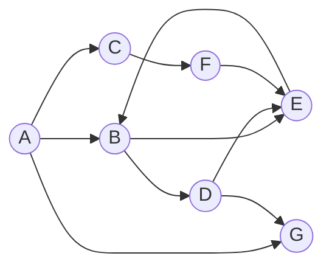
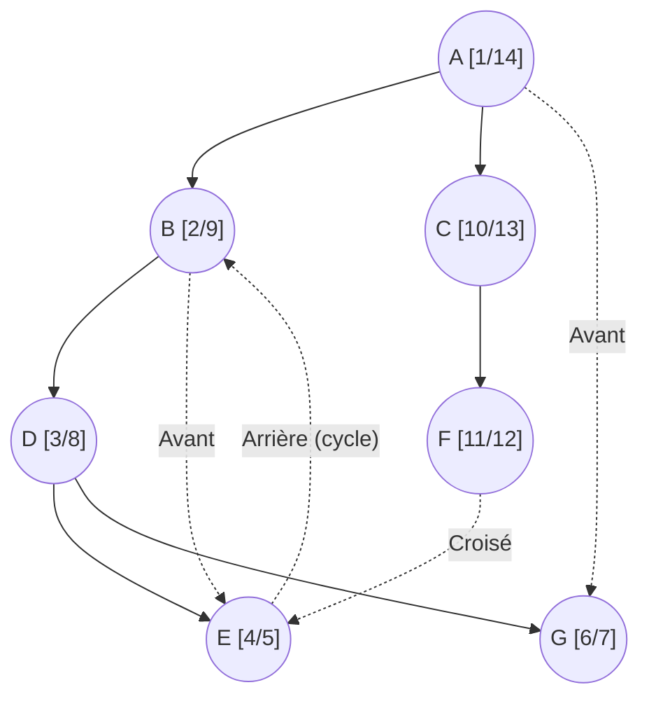
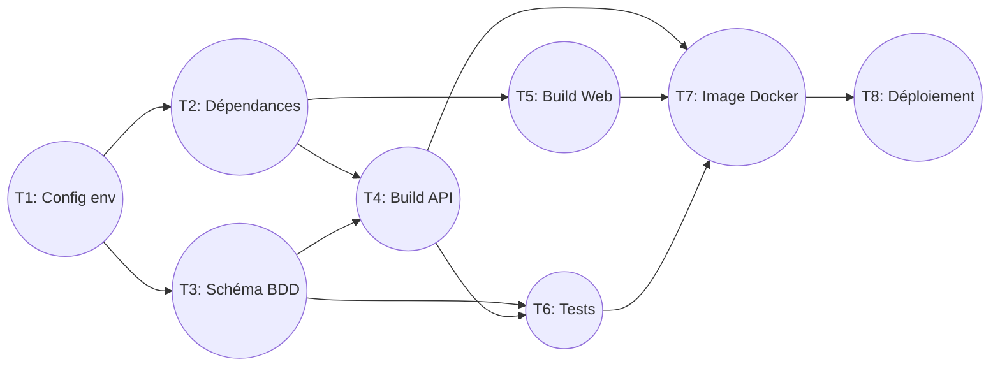

<div align="center">

**ASCENCIA KEYCE — CAMPUS DE LOMÉ**  
*Master IT — Année académique 2026-2027*

---

# RAPPORT DE RECHERCHE — SUJET 2

## Le parcours en profondeur (DFS) pour l'exploration et l'analyse de la structure d'un graphe

*Étude théorique, complexité, implémentation et applications pratiques*

---

**Unité d'enseignement :** Théorie des Graphes  
**Enseignant responsable :** M. Edem K. HOVI  

**Membres du groupe :**
- `[Nom Prénom 1]`
- `[Nom Prénom 2]`
- `[Nom Prénom 3]`
- `[Nom Prénom 4]`

**Date de remise :** `[Jour / Mois / Année]`

</div>

---

## Table des matières

- [1. Introduction générale](#1-introduction-générale)
- [2. Problématique et objectifs](#2-problématique-et-objectifs)
  - [2.1 Problématique](#21-problématique)
  - [2.2 Objectif général et objectifs spécifiques](#22-objectif-général-et-objectifs-spécifiques)
- [3. Notions théoriques nécessaires](#3-notions-théoriques-nécessaires)
  - [3.1 Définitions fondamentales](#31-définitions-fondamentales)
  - [3.2 Connexité, composantes connexes et graphe orienté acyclique (DAG)](#32-connexité-composantes-connexes-et-graphe-orienté-acyclique-dag)
  - [3.3 Représentations d'un graphe en mémoire](#33-représentations-dun-graphe-en-mémoire)
- [4. Présentation de l'algorithme DFS et son pseudo-code](#4-présentation-de-lalgorithme-dfs-et-son-pseudo-code)
  - [4.1 Principe du parcours en profondeur et retour en arrière](#41-principe-du-parcours-en-profondeur-et-retour-en-arrière)
  - [4.2 Version récursive et pseudo-code](#42-version-récursive-et-pseudo-code)
  - [4.3 Version itérative avec pile explicite (LIFO) et pseudo-code](#43-version-itérative-avec-pile-explicite-lifo-et-pseudo-code)
  - [4.4 Analyse du graphe : dates de visite, types d'arcs et applications](#44-analyse-du-graphe--dates-de-visite-types-darcs-et-applications)
- [5. Analyse de la complexité](#5-analyse-de-la-complexité)
  - [5.1 Complexité temporelle](#51-complexité-temporelle)
  - [5.2 Complexité spatiale et gestion de la pile](#52-complexité-spatiale-et-gestion-de-la-pile)
- [6. Illustration détaillée sur un graphe](#6-illustration-détaillée-sur-un-graphe)
  - [6.1 Présentation du graphe d'exemple](#61-présentation-du-graphe-dexemple)
  - [6.2 Exécution pas à pas : visites, choix de branche et retours en arrière](#62-exécution-pas-à-pas--visites-choix-de-branche-et-retours-en-arrière)
  - [6.3 Ordre final de visite, arbre DFS et classification des arcs](#63-ordre-final-de-visite-arbre-dfs-et-classification-des-arcs)
- [7. Description de l'implémentation](#7-description-de-limplémentation)
  - [7.1 Environnement, langage choisi et structure du programme](#71-environnement-langage-choisi-et-structure-du-programme)
  - [7.2 Implémentation de DFS (récursif et itératif)](#72-implémentation-de-dfs-récursif-et-itératif)
  - [7.3 Implémentation des applications](#73-implémentation-des-applications)
- [8. Résultats expérimentaux et leur interprétation](#8-résultats-expérimentaux-et-leur-interprétation)
  - [8.1 Exécution sur des graphes de formes différentes](#81-exécution-sur-des-graphes-de-formes-différentes)
  - [8.2 Résultats des applications concrètes](#82-résultats-des-applications-concrètes)
  - [8.3 Interprétation, limites de DFS et comparaison avec BFS](#83-interprétation-limites-de-dfs-et-comparaison-avec-bfs)
- [9. Conclusion](#9-conclusion)
- [10. Références bibliographiques](#10-références-bibliographiques)

---

## 1. Introduction générale

En informatique, on utilise les graphes pour représenter des réseaux, des liens entre pages web ou des dépendances entre tâches. Avant même de calculer un plus court chemin ou d'optimiser un flux, il faut souvent parcourir le graphe pour comprendre comment il est organisé : est-il d'un seul bloc, contient-il des boucles, ou dans quel ordre peut-on exécuter ses tâches ?

Pour explorer un graphe, il existe deux méthodes de base : le parcours en largeur (BFS) et le parcours en profondeur (DFS). Le BFS avance niveau par niveau autour du point de départ, comme des vagues dans l'eau. Le DFS fait l'inverse : il avance le plus loin possible sur une branche jusqu'à tomber sur une impasse, puis il revient en arrière (*backtracking*) pour explorer les autres branches [1, 2]. En notant à quel moment chaque sommet est découvert puis fermé, DFS permet non seulement de visiter le graphe, mais aussi de détecter des cycles, d'isoler des sous-réseaux et d'ordonner des tâches dépendantes [5].

Dans ce rapport, nous présentons d'abord les notions de base sur les graphes, puis le fonctionnement et le pseudo-code de DFS en version récursive et itérative, ainsi que sa complexité. Nous déroulons ensuite une trace complète étape par étape sur un graphe d'exemple, avant de montrer notre implémentation en Python, nos tests sur différentes formes de graphes et trois applications pratiques.

---

## 2. Problématique et objectifs

### 2.1 Problématique

Dans beaucoup de projets informatiques (gestion de dépendances entre paquets, pipelines de déploiement, détection de blocages ou supervision de réseaux), on a besoin de vérifier rapidement la structure du graphe : y a-t-il une boucle qui bloque l'exécution ? Dans quel ordre lancer des tâches qui dépendent les unes des autres ? Certains nœuds du réseau sont-ils isolés du reste ?

La problématique de ce travail est donc la suivante : **comment le parcours en profondeur (DFS) permet-il d'explorer un graphe et d'en analyser la structure, notamment pour détecter des cycles, identifier des composantes connexes ou ordonner des tâches dépendantes ?**

### 2.2 Objectif général et objectifs spécifiques

L'objectif général est d'étudier le fonctionnement de DFS et de montrer comment on l'utilise pour analyser la structure d'un graphe.

Plus précisément, notre travail consiste à :
1. Rappeler les notions de graphe utiles pour comprendre le parcours.
2. Expliquer DFS avec une procédure récursive et avec une pile explicite (LIFO).
3. Écrire les pseudo-codes et calculer la complexité en temps et en mémoire selon la représentation du graphe.
4. Détailler étape par étape l'ordre de visite, les choix de branche, les retours en arrière et les types d'arcs sur un exemple concret.
5. Étudier l'utilisation de DFS pour détecter des cycles, trouver les composantes connexes et réaliser le tri topologique d'un DAG.
6. Coder l'algorithme en Python, le tester sur plusieurs formes de graphes et analyser ses limites.

---

## 3. Notions théoriques nécessaires

### 3.1 Définitions fondamentales

Un **graphe** est un couple $G = (V, E)$ où $V$ est un ensemble fini de **sommets** (de taille $n = |V|$) et $E$ est un ensemble de liaisons entre ces sommets (de taille $m = |E|$) [4, 5].

- **Graphe non orienté :** les liaisons de $E$ sont des **arêtes** $\{u, v\}$ sans sens précis. Si $u$ est relié à $v$, alors $v$ est relié à $u$. Le degré $d(u)$ d'un sommet est le nombre d'arêtes touchant $u$.
- **Graphe orienté :** les liaisons de $E$ sont des **arcs** $(u, v)$ qui vont de $u$ vers $v$. On distingue le demi-degré sortant $d^+(u)$ (nombre d'arcs qui partent de $u$) et le demi-degré entrant $d^-(u)$ (nombre d'arcs qui arrivent sur $u$).
- **Chaîne et chemin :** une suite de sommets $(v_0, v_1, \dots, v_k)$ reliés deux à deux forme une **chaîne** (graphe non orienté) ou un **chemin** (graphe orienté) de longueur $k$. Un chemin est simple s'il ne repasse pas deux fois par le même sommet.
- **Cycle et circuit :** c'est une chaîne (cycle) ou un chemin (circuit) qui revient à son point de départ ($v_0 = v_k$), avec au moins une arête ou un arc.

### 3.2 Connexité, composantes connexes et graphe orienté acyclique (DAG)

Pour décrire l'organisation globale d'un graphe, on s'appuie sur trois notions simples :

- **Connexité et composantes connexes :** un graphe non orienté est **connexe** si on peut aller de n'importe quel sommet à n'importe quel autre. S'il est coupé en plusieurs morceaux isolés, chaque morceau maximal forme une **composante connexe** [1, 5].
- **Arbre et forêt :** un **arbre** est un graphe non orienté connexe et sans cycle (il a toujours $m = n - 1$ arêtes). Une **forêt** est un graphe sans cycle composé d'un ou plusieurs arbres séparés.
- **DAG (*Directed Acyclic Graph*) :** c'est un graphe orienté qui ne contient aucun circuit. On s'en sert pour modéliser des tâches avec prérequis, car l'absence de boucle garantit qu'il existe au moins un ordre d'exécution valide [1, 5].

### 3.3 Représentations d'un graphe en mémoire

Pour stocker un graphe en machine, on utilise le plus souvent l'une des deux structures suivantes [1, 5] :

1. **Matrice d'adjacence :** c'est un tableau de taille $|V| \times |V|$ où la case $(i, j)$ vaut $1$ s'il existe un arc de $v_i$ vers $v_j$, et $0$ sinon. Savoir si un arc existe est immédiat ($\mathcal{O}(1)$), mais pour lister les voisins d'un sommet, il faut lire toute sa ligne, même les zéros.
2. **Listes d'adjacence :** pour chaque sommet $u$, on garde simplement la liste $\text{Adj}[u]$ des voisins vers lesquels il pointe. Cela ne prend que la place des sommets et des arcs réellement présents.

| Critère | Matrice d'adjacence | Listes d'adjacence |
| :--- | :---: | :---: |
| Place en mémoire | $\Theta(\lvert V \rvert^2)$ | $\Theta(\lvert V \rvert + \lvert E \rvert)$ |
| Tester si l'arc $(u, v)$ existe | $\mathcal{O}(1)$ | $\mathcal{O}(d^+(u))$ |
| Parcourir tous les voisins de $u$ | $\Theta(\lvert V \rvert)$ | $\Theta(d^+(u))$ |
| Ajouter un arc $(u, v)$ | $\mathcal{O}(1)$ | $\mathcal{O}(1)$ |
| Adaptée aux graphes denses ($\lvert E \rvert \approx \lvert V \rvert^2$) | Oui | Possible (un peu plus de pointeurs) |
| Adaptée aux parcours (DFS / BFS) | Moins adaptée ($\Theta(\lvert V \rvert^2)$) | Oui, optimale ($\Theta(\lvert V \rvert + \lvert E \rvert)$) |

*Tableau 1 : Comparaison entre matrice d'adjacence et listes d'adjacence pour un graphe orienté [1, 5].*

Comme le montre le **Tableau 1**, les listes d'adjacence sont le meilleur choix pour DFS : on ne regarde que les voisins réels de chaque sommet, sans perdre de temps sur les cases vides.

---

## 4. Présentation de l'algorithme DFS et son pseudo-code

### 4.1 Principe du parcours en profondeur et retour en arrière

Le principe de DFS est direct : depuis le sommet courant $u$, on prend le premier voisin non visité $v$ et on descend tout de suite dedans. On remet à plus tard les autres voisins de $u$. Quand on arrive sur un sommet qui n'a plus aucun voisin à découvrir, c'est une impasse : on revient en arrière (*backtracking*) vers le sommet précédent pour tester sa branche suivante [1, 3].

Pour éviter de tourner en rond s'il y a des cycles, on donne une couleur à chaque sommet :
- **BLANC :** le sommet n'a pas encore été visité.
- **GRIS :** le sommet est en cours d'exploration (il est ouvert et ses voisins ne sont pas encore tous vus).
- **NOIR :** le sommet est terminé (tous ses voisins et descendants ont été visités).

Si le graphe comporte plusieurs parties séparées ou des sommets inatteignables depuis le point de départ, la boucle principale relance un DFS à partir du prochain sommet encore `BLANC`. On obtient alors une **forêt couvrante DFS** [1, 5].

### 4.2 Version récursive et pseudo-code

La version récursive utilise la pile d'appels du langage pour mémoriser le chemin suivi et revenir automatiquement en arrière dès qu'une fonction `DFS-Visiter(u)` se termine. Le **Listing 1** utilise aussi un compteur `temps` pour noter deux dates sur chaque sommet : la date de découverte $d[u]$ (passage en `GRIS`) et la date de fin $f[u]$ (passage en `NOIR`) [1, 5].

```text
Algorithme DFS-Recursif(G = (V, E))
Entrée  : Graphe G représenté par listes d'adjacence Adj
Sorties : Tableaux couleur, prédécesseurs pi, dates d (découverte) et f (clôture)

1.  Pour chaque sommet u ∈ V faire
2.      couleur[u] ← BLANC
3.      pi[u] ← NIL
4.  Fin Pour
5.  temps ← 0
6.  Pour chaque sommet u ∈ V faire
7.      Si couleur[u] = BLANC alors
8.          DFS-Visiter(G, u)
9.      Fin Si
10. Fin Pour

Procédure DFS-Visiter(G, u)
1.  temps ← temps + 1
2.  d[u] ← temps
3.  couleur[u] ← GRIS
4.  Pour chaque sommet v ∈ Adj[u] faire
5.      Si couleur[v] = BLANC alors
6.          pi[v] ← u
7.          DFS-Visiter(G, v)        // Descente sur la branche (arc d'arbre)
8.      Fin Si
9.  Fin Pour
10. couleur[u] ← NOIR
11. temps ← temps + 1
12. f[u] ← temps                     // Retour en arrière vers pi[u] à la sortie
```

*Listing 1 : Pseudo-code du parcours en profondeur récursif avec dates de début et de fin $[d, f]$ [1].*

Dans le **Listing 1**, le retour en arrière se produit naturellement à la fin de `DFS-Visiter(G, u)` (ligne 12) : une fois tous les voisins de $u$ traités, le programme reprend là où il s'était arrêté dans le parent `pi[u]`.

### 4.3 Version itérative avec pile explicite (LIFO) et pseudo-code

Si le graphe est très profond (par exemple une chaîne de plusieurs milliers de sommets), la récursion risque de dépasser la taille maximale de la pile d'appels du système (`Stack Overflow` ou `RecursionError` en Python). On remplace alors la récursion par une **pile explicite LIFO** (*Last-In, First-Out*, dernier entré, premier sorti) stockée en mémoire classique [3].

On peut coder cette pile de deux façons :
- Empiler uniquement les sommets à visiter (en poussant les voisins dans l'ordre inverse). C'est court à écrire, mais cela ne donne pas directement la date de fermeture $f[u]$ dans le même ordre que la version récursive.
- Empiler des couples `(u, idx)` où `idx` indique la position du prochain voisin à lire dans `Adj[u]`. C'est cette méthode, écrite dans le **Listing 2**, que nous retenons : elle produit exactement le même parcours, les mêmes dates $[d, f]$ et les mêmes retours en arrière que la version récursive, sans limite de profondeur.

```text
Algorithme DFS-Iteratif-Pile(G = (V, E))
Entrée  : Graphe G représenté par listes d'adjacence Adj
Sorties : Tableaux couleur, pi, d et f

1.  Pour chaque sommet u ∈ V faire
2.      couleur[u] ← BLANC ; pi[u] ← NIL
3.  Fin Pour
4.  temps ← 0 ; P ← PileVide()
5.  Pour chaque sommet depart ∈ V faire
6.      Si couleur[depart] = BLANC alors
7.          temps ← temps + 1 ; d[depart] ← temps
8.          couleur[depart] ← GRIS
9.          Empiler(P, (depart, 0))
10.         Tant que Non EstVide(P) faire
11.             (u, idx) ← SommetDePile(P)
12.             Si idx < Longueur(Adj[u]) alors
13.                 v ← Adj[u][idx]
14.                 ModifierSommetDePile(P, (u, idx + 1))
15.                 Si couleur[v] = BLANC alors
16.                     pi[v] ← u
17.                     temps ← temps + 1 ; d[v] ← temps
18.                     couleur[v] ← GRIS
19.                     Empiler(P, (v, 0))      // Avancée sur la nouvelle branche
20.                 Fin Si
21.             Sinon
22.                 Depiler(P)                      // Retour en arrière (backtracking)
23.                 temps ← temps + 1 ; f[u] ← temps
24.                 couleur[u] ← NOIR
25.             Fin Si
26.         Fin Tant que
27.     Fin Si
28. Fin Pour
```

*Listing 2 : Pseudo-code du parcours en profondeur itératif avec une pile explicite de couples `(u, idx)`.*

### 4.4 Analyse du graphe : dates de visite, types d'arcs et applications

Les dates $[d[u], f[u]]$ respectent toujours $1 \le d[u] < f[u] \le 2|V|$ et vérifient la **propriété du parenthésage** [1, 5] : pour deux sommets $u$ et $v$, soit les intervalles $[d[u], f[u]]$ et $[d[v], f[v]]$ sont complètement séparés, soit l'un est entièrement contenu dans l'autre ($u$ est un ancêtre de $v$ dans l'arbre DFS si et seulement si $d[u] < d[v] < f[v] < f[u]$).

Quand DFS examine un arc $(u, v)$ depuis $u$, la couleur de $v$ à ce moment précis permet de classer l'arc en 4 catégories (**Tableau 2**) [1, 5].

| Type de l'arc $(u, v)$ | Couleur de $v$ au moment du test | Relation entre les dates | Rôle dans le graphe |
| :--- | :---: | :---: | :--- |
| **Arc d'arbre** | `BLANC` | $d[u] < d[v] < f[v] < f[u]$ | Découvre $v$ pour la première fois ; sert à descendre dans le parcours. |
| **Arc arrière** | `GRIS` | $d[v] \le d[u] < f[u] < f[v]$ | Remonte vers un ancêtre encore ouvert sur la pile ; **prouve qu'il y a un cycle**. |
| **Arc avant** | `NOIR` | $d[u] < d[v] < f[v] < f[u]$ | Va vers un descendant déjà fermé plus tôt. |
| **Arc croisé** | `NOIR` | $f[v] < d[u]$ | Relie deux branches différentes sans lien parent-enfant. |

*Tableau 2 : Classification des 4 types d'arcs lors d'un parcours DFS sur un graphe orienté [1, 5].*

Sur un graphe **non orienté**, il n'existe que des arêtes d'arbre et des arêtes arrière (on considère qu'une arête vers un sommet déjà visité est un cycle uniquement si ce sommet n'est pas le parent direct $\pi[u]$).

Grâce au **Tableau 2**, DFS permet de résoudre directement trois problèmes courants :

1. **Détecter des cycles :** dans un graphe orienté, il y a un circuit si et seulement si DFS rencontre au moins un **arc arrière** (un arc vers un sommet `GRIS` encore présent dans la pile) [1]. Dans un graphe non orienté, il y a un cycle dès qu'on rencontre un voisin déjà visité qui n'est pas $\pi[u]$.
2. **Trouver les composantes connexes :** sur un graphe non orienté, chaque appel lancé depuis la boucle principale (lignes 6–9 du **Listing 1**) visite tout un bloc isolé d'un seul coup. Compter combien de fois on entre dans cette boucle donne donc le nombre de composantes connexes, et chaque appel liste les sommets d'une composante [5].
3. **Faire un tri topologique (DAG) :** dans un graphe orienté sans cycle, on veut classer les sommets pour que chaque arc $(u, v)$ place $u$ avant $v$. Comme il n'y a aucun arc arrière, tout sommet $v$ qui dépend de $u$ se ferme forcément avant $u$ ($f[v] < f[u]$). Il suffit donc de lancer DFS, de vérifier qu'il n'y a pas de cycle, puis de ranger les sommets par **ordre décroissant de date de fin $f[u]$** [1, 5], comme écrit dans le **Listing 3**.

```text
Algorithme Tri-Topologique-DFS(G = (V, E))
1. Exécuter DFS(G) en surveillant les arcs arrière
2. Si un arc (u, v) avec couleur[v] = GRIS est détecté alors
3.     Retourner ERREUR ("Le graphe contient un cycle : tri impossible")
4. Fin Si
5. Retourner la liste des sommets triée par f[u] décroissant
   (ce qui revient à mettre chaque sommet au début de la liste quand il devient NOIR)
```

*Listing 3 : Pseudo-code du tri topologique d'un DAG avec DFS.*

---

## 5. Analyse de la complexité

### 5.1 Complexité temporelle

Avec des **listes d'adjacence**, on calcule facilement le nombre total d'opérations effectuées par DFS [1] :

- **Initialisation :** la première boucle met chaque sommet à `BLANC` et `NIL`, ce qui coûte $\Theta(|V|)$.
- **Visite des sommets :** `DFS-Visiter(G, u)` (ou l'empilement initial du sommet) n'est appelée que si $u$ est `BLANC`, et elle le passe aussitôt à `GRIS`. Comme un sommet ne redevient jamais `BLANC`, chaque sommet est visité **une seule fois**.
- **Parcours des voisins :** pendant cette unique visite de $u$, l'algorithme parcourt sa liste `Adj[u]`. Sur tout le graphe, la somme des longueurs des listes vaut $|E|$ si le graphe est orienté, ou $2|E|$ s'il est non orienté.

En additionnant le passage sur les sommets et le passage sur les arcs, on obtient une complexité temporelle linéaire :
$$T_{\text{listes}}(|V|, |E|) = \Theta(|V| + |E|)$$

Si on utilise une **matrice d'adjacence**, l'algorithme doit lire toute la ligne de taille $|V|$ pour chaque sommet afin de repérer ses voisins. La complexité devient donc quadratique :
$$T_{\text{matrice}}(|V|, |E|) = \Theta(|V|^2)$$

Les trois applications vues plus haut (détection de cycle sur test `GRIS`, comptage des composantes connexes et insertion en tête lors de la fermeture) n'ajoutent qu'un test ou une écriture en temps constant $\mathcal{O}(1)$ par étape. Elles gardent donc toutes une complexité en $\Theta(|V| + |E|)$ [1, 5].

### 5.2 Complexité spatiale et gestion de la pile

En plus du graphe lui-même, DFS a besoin de mémoire pour deux choses :
1. Les tableaux `couleur`, `pi`, `d` et `f`, qui prennent chacun $\Theta(|V|)$.
2. La pile d'appels (version récursive) ou la pile LIFO (version itérative). Dans le pire cas, si le graphe est une longue chaîne de $|V|$ sommets, la pile contient tous les sommets en même temps, soit une hauteur maximale de $|V|$.

La complexité spatiale est donc $\mathcal{O}(|V|)$ dans les deux cas (et $\Theta(|V|)$ si l'on stocke les tableaux d'états et de dates). En pratique, il existe une différence importante : la version récursive utilise la pile système du langage, qui est limitée en taille (par exemple $1\,000$ appels imbriqués par défaut en Python), alors que la version itérative utilise la mémoire normale (le tas) et ne bloque pas sur les graphes très profonds [3]. Le **Tableau 3** résume ces résultats.

| Version / Représentation | Complexité en temps | Complexité en espace | Risque de blocage (pile pleine) |
| :--- | :---: | :---: | :--- |
| DFS Récursif — Listes d'adjacence | $\Theta(\lvert V \rvert + \lvert E \rvert)$ | $\mathcal{O}(\lvert V \rvert)$ | Oui (si profondeur $\ge$ limite système) |
| DFS Itératif (LIFO) — Listes d'adjacence | $\Theta(\lvert V \rvert + \lvert E \rvert)$ | $\mathcal{O}(\lvert V \rvert)$ | Non (pile gérée en mémoire libre) |
| DFS — Matrice d'adjacence | $\Theta(\lvert V \rvert^2)$ | $\mathcal{O}(\lvert V \rvert)$ | Selon récursif / itératif |

*Tableau 3 : Récapitulatif des complexités de DFS en temps et en mémoire [1, 3, 5].*

---

## 6. Illustration détaillée sur un graphe

### 6.1 Présentation du graphe d'exemple

Pour montrer concrètement comment DFS avance, choisit ses branches, revient en arrière et classe les arcs, nous avons construit un graphe orienté d'exemple $G_{\text{ex}}$ de $7$ sommets ($V = \{A, B, C, D, E, F, G\}$) et $10$ arcs, dessiné sur la **Figure 1**.



*Figure 1 : Graphe orienté d'exemple $G_{\text{ex}}$ à 7 sommets et 10 arcs.*

On démarre le parcours depuis le sommet $A$. Lorsqu'un sommet a plusieurs voisins, on les regarde par ordre alphabétique :
- $\text{Adj}[A] = [B, C, G]$
- $\text{Adj}[B] = [D, E]$
- $\text{Adj}[C] = [F]$
- $\text{Adj}[D] = [E, G]$
- $\text{Adj}[E] = [B]$
- $\text{Adj}[F] = [E]$
- $\text{Adj}[G] = [\,]$

### 6.2 Exécution pas à pas : visites, choix de branche et retours en arrière

Le **Tableau 4** détaille chaque étape depuis le départ en $A$ : l'instant $t$, l'action effectuée, le contenu de la pile active (les sommets actuellement `GRIS`), le choix de branche et les retours en arrière.

| Instant $t$ | Événement | Sommet | Pile active | Ce qui se passe (choix de branche ou retour en arrière) |
| :---: | :--- | :---: | :--- | :--- |
| **1** | Découverte | $A$ | `[A]` | $d[A] = 1$, $A$ devient `GRIS`. Voisins de $A$ : $[B, C, G]$. On choisit d'abord $(A \to B)$ (**Arbre**). |
| **2** | Découverte | $B$ | `[A, B]` | $d[B] = 2$, $B$ devient `GRIS`. Voisins de $B$ : $[D, E]$. On choisit $(B \to D)$ (**Arbre**). |
| **3** | Découverte | $D$ | `[A, B, D]` | $d[D] = 3$, $D$ devient `GRIS`. Voisins de $D$ : $[E, G]$. On choisit $(D \to E)$ (**Arbre**). |
| **4** | Découverte et test | $E$ | `[A, B, D, E]` | $d[E] = 4$, $E$ devient `GRIS`. Son seul voisin $B$ est déjà `GRIS` $\implies$ $(E \to B)$ est un **arc arrière** (cycle $B \to D \to E \to B$). |
| **5** | Fermeture et retour | $E \to D$ | `[A, B, D]` | $E$ n'a plus d'autre voisin $\implies f[E] = 5$, $E$ devient `NOIR`. **Retour en arrière #1** vers $D$. Le voisin suivant de $D$ est $G$ (`BLANC`) : on descend par $(D \to G)$ (**Arbre**). |
| **6** | Découverte | $G$ | `[A, B, D, G]` | $d[G] = 6$, $G$ devient `GRIS`. $G$ n'a aucun arc sortant (impasse). |
| **7** | Fermeture et retour | $G \to D$ | `[A, B, D]` | $f[G] = 7$, $G$ devient `NOIR`. **Retour en arrière #2** vers $D$. |
| **8** | Fermeture et retour | $D \to B$ | `[A, B]` | Tous les voisins de $D$ ($E, G$) sont vus $\implies f[D] = 8$, $D$ devient `NOIR`. **Retour en arrière #3** vers $B$. Le voisin suivant de $B$ est $E$, déjà `NOIR` avec $d[B] < d[E]$ $\implies$ $(B \to E)$ est un **arc avant**. |
| **9** | Fermeture et retour | $B \to A$ | `[A]` | $B$ n'a plus de voisin $\implies f[B] = 9$, $B$ devient `NOIR`. **Retour en arrière #4** vers $A$. Le voisin suivant de $A$ est $C$ (`BLANC`) : on descend par $(A \to C)$ (**Arbre**). |
| **10** | Découverte | $C$ | `[A, C]` | $d[C] = 10$, $C$ devient `GRIS`. Son seul voisin $F$ est `BLANC` : on choisit $(C \to F)$ (**Arbre**). |
| **11** | Découverte et test | $F$ | `[A, C, F]` | $d[F] = 11$, $F$ devient `GRIS`. Son seul voisin $E$ est déjà `NOIR` et $f[E] = 5 < d[F] = 11$ $\implies$ $(F \to E)$ est un **arc croisé**. |
| **12** | Fermeture et retour | $F \to C$ | `[A, C]` | $F$ n'a plus de voisin $\implies f[F] = 12$, $F$ devient `NOIR`. **Retour en arrière #5** vers $C$. |
| **13** | Fermeture et retour | $C \to A$ | `[A]` | $C$ n'a plus de voisin $\implies f[C] = 13$, $C$ devient `NOIR`. **Retour en arrière #6** vers $A$. Le dernier voisin de $A$ est $G$, déjà `NOIR` avec $d[A] < d[G]$ $\implies$ $(A \to G)$ est un **arc avant**. |
| **14** | Fermeture finale | $A$ | `[]` | Tous les voisins de $A$ sont vus $\implies f[A] = 14$, $A$ devient `NOIR`. La pile est vide, fin du parcours. |

*Tableau 4 : Déroulement complet étape par étape de DFS sur $G_{\text{ex}}$ à partir de $A$.*

Dans le **Tableau 4**, on voit bien comment la pile grandit quand l'algorithme descend sur une branche (jusqu'à 4 sommets aux instants $t=4$ et $t=6$), puis rétrécit d'un cran à chaque retour en arrière pour explorer les branches laissées en attente.

### 6.3 Ordre final de visite, arbre DFS et classification des arcs

Une fois le parcours terminé, tous les sommets ont été vus depuis $A$ :
- **Ordre de découverte :** $A \to B \to D \to E \to G \to C \to F$.
- **Ordre de fermeture :** $E \to G \to D \to B \to F \to C \to A$.
- **Estampilles $[d / f]$ :** $A\,[1/14]$, $B\,[2/9]$, $C\,[10/13]$, $D\,[3/8]$, $E\,[4/5]$, $F\,[11/12]$, $G\,[6/7]$.
- **Nombre de retours en arrière :** $6$.

La **Figure 2** dessine l'arbre couvrant DFS (flèches pleines) ainsi que les autres arcs rencontrés (en pointillés), et le **Tableau 5** récapitule la catégorie des $10$ arcs.



*Figure 2 : Arbre couvrant DFS obtenu sur $G_{\text{ex}}$ avec les dates $[d/f]$ et la nature des arcs hors arbre.*

| Arc $(u \to v)$ | État de $v$ au test | Dates $[d, f]$ | Type d'arc | Explication |
| :---: | :---: | :--- | :---: | :--- |
| $(A \to B)$ | `BLANC` | $[2, 9] \subset [1, 14]$ | **Arbre** | Première branche suivie depuis $A$ |
| $(B \to D)$ | `BLANC` | $[3, 8] \subset [2, 9]$ | **Arbre** | Descente depuis $B$ |
| $(D \to E)$ | `BLANC` | $[4, 5] \subset [3, 8]$ | **Arbre** | Descente vers $E$ depuis $D$ |
| $(E \to B)$ | `GRIS` | $[4, 5] \subset [2, 9]$ | **Arrière** | **Preuve du cycle $B \to D \to E \to B$** |
| $(D \to G)$ | `BLANC` | $[6, 7] \subset [3, 8]$ | **Arbre** | Deuxième branche de $D$ après le retour de $E$ |
| $(B \to E)$ | `NOIR` | $[4, 5] \subset [2, 9]$ | **Avant** | Raccourci vers un descendant déjà fermé |
| $(A \to C)$ | `BLANC` | $[10, 13] \subset [1, 14]$ | **Arbre** | Deuxième branche de $A$ après fermeture de $B$ |
| $(C \to F)$ | `BLANC` | $[11, 12] \subset [10, 13]$ | **Arbre** | Descente de $C$ vers $F$ |
| $(F \to E)$ | `NOIR` | $f[E]=5 < d[F]=11$ | **Croisé** | Relie deux branches différentes |
| $(A \to G)$ | `NOIR` | $[6, 7] \subset [1, 14]$ | **Avant** | Raccourci direct de $A$ vers son descendant $G$ |

*Tableau 5 : Classification des 10 arcs de $G_{\text{ex}}$ vérifiée avec les dates $[d, f]$.*

Comme le montre le **Tableau 5**, l'arc $(E \to B)$ pointe vers un sommet encore `GRIS` : on sait donc immédiatement que le graphe contient le cycle $B \to D \to E \to B$ et qu'il ne peut pas être trié topologiquement.

---

## 7. Description de l'implémentation

### 7.1 Environnement, langage choisi et structure du programme

Nous avons codé le projet en **Python 3** (sous Linux, uniquement avec la bibliothèque standard) dans le fichier `projet_sujet2_dfs.py`. Le choix de Python permet d'écrire un code clair, proche du pseudo-code, tout en mesurant facilement le comportement des deux versions (récursive et itérative) sur différentes formes de graphes.

Le programme comprend :
- Une classe `Graphe(oriente: bool)` qui stocke les sommets et leurs voisins sous forme de listes d'adjacence (`Dict[str, List[str]]`).
- Les deux fonctions de parcours : `dfs_recursif` et `dfs_iteratif_pile`.
- Les trois fonctions d'application : `detecter_cycle_oriente`, `composantes_connexes` et `tri_topologique_dag`.
- Une fonction `main()` qui exécute automatiquement la trace de $G_{\text{ex}}$, les cas pratiques et les tests sur les 6 types de graphes.

### 7.2 Implémentation de DFS (récursif et itératif)

Les deux fonctions renvoient un objet `ResultatDFS` contenant l'ordre de découverte, l'ordre de fermeture, les dates `d` et `f`, les parents `pi`, la liste des arcs classés, la trace étape par étape et le nombre de retours en arrière. L'**Extrait 1** montre la boucle principale de `dfs_iteratif_pile`.

```python
    for depart in sommets:
        if couleur[depart] != Couleur.BLANC:
            continue

        temps += 1
        decouverte[depart] = temps
        couleur[depart] = Couleur.GRIS
        ordre_visite.append(depart)
        pile.append([depart, 0])

        while pile:
            u = str(pile[-1][0])
            idx = int(pile[-1][1])
            voisins = listes_voisins[u]

            if idx < len(voisins):
                v = voisins[idx]
                pile[-1][1] = idx + 1
                if couleur[v] == Couleur.BLANC:
                    parents[v] = u
                    arcs_classes.append((u, v, TypeArc.ARBRE))
                    temps += 1
                    decouverte[v] = temps
                    couleur[v] = Couleur.GRIS
                    ordre_visite.append(v)
                    pile.append([v, 0])
                elif couleur[v] == Couleur.GRIS:
                    arcs_classes.append((u, v, TypeArc.ARRIERE))
                else:
                    type_arc = TypeArc.AVANT if decouverte[u] < decouverte[v] else TypeArc.CROISE
                    arcs_classes.append((u, v, type_arc))
            else:
                temps += 1
                cloture[u] = temps
                couleur[u] = Couleur.NOIR
                ordre_cloture.append(u)
                pile.pop()
                if pile:
                    retours_arriere += 1
```

*Extrait 1 : Boucle du DFS itératif avec pile LIFO et classification des arcs (`projet_sujet2_dfs.py`).*

Dans l'**Extrait 1**, chaque élément `[u, idx]` de la pile retient quel voisin de `u` doit être testé ensuite. Tant qu'il reste un voisin `BLANC`, on empile ce voisin ; quand `idx` atteint la fin de la liste, on ferme `u` en `NOIR`, on le dépile et on incrémente `retours_arriere`. On obtient exactement la même trace que la version récursive.

### 7.3 Implémentation des applications

À partir du même parcours DFS, nous avons codé les trois applications :

1. **Détection et reconstruction de cycle (`detecter_cycle_oriente`) :** la fonction cherche s'il existe un arc classé `ARRIERE` $(u \to v)$. Comme $v$ est forcément un ancêtre de $u$ sur la pile, on remonte les parents depuis $u$ jusqu'à retrouver $v$, puis on inverse cette liste pour afficher le cycle complet dans le bon sens.
2. **Tri topologique d'un pipeline de tâches (`tri_topologique_dag`) :** pour illustrer une application concrète, nous avons modélisé un pipeline de déploiement logiciel de $8$ tâches ($T_1$ à $T_8$), représenté sur la **Figure 3**. Comme le montre l'**Extrait 2**, la fonction vérifie d'abord l'absence de cycle ; si le graphe est bien un DAG, elle retourne l'inverse de `ordre_cloture` (donc les dates $f[u]$ décroissantes).



*Figure 3 : DAG des 8 tâches du pipeline logiciel utilisé pour démontrer le tri topologique.*

```python
def tri_topologique_dag(graphe: Graphe) -> Tuple[bool, List[str]]:
    if not graphe.oriente:
        raise ValueError("Le tri topologique ne s'applique qu'aux graphes orientés.")

    cycle = detecter_cycle_oriente(graphe)
    if cycle is not None:
        return False, cycle

    resultat = dfs_iteratif_pile(graphe, enregistrer_trace=False)
    ordre_topologique = list(reversed(resultat.ordre_cloture))
    return True, ordre_topologique
```

*Extrait 2 : Fonction de tri topologique avec vérification préalable de cycle (`projet_sujet2_dfs.py`).*

3. **Recherche de composantes connexes (`composantes_connexes`) :** sur un graphe non orienté, la fonction parcourt les sommets dans l'ordre et lance un DFS à partir de chaque sommet non encore visité afin de regrouper tous les nœuds d'un même sous-réseau.

---

## 8. Résultats expérimentaux et leur interprétation

### 8.1 Exécution sur des graphes de formes différentes

Pour tester notre implémentation dans des situations variées, nous avons exécuté les versions récursive et itérative sur six types de graphes différents (avec une graine aléatoire fixée à `42` pour que les mesures soient reproductibles). Le **Tableau 6** donne les temps mesurés et le diagnostic produit.

| Topologie testée | Orientation | $\lvert V \rvert$ | $\lvert E \rvert$ | Temps récursif (ms) | Temps itératif (ms) | Résultat de l'analyse |
| :--- | :--- | :---: | :---: | :---: | :---: | :--- |
| Chaîne linéaire | Orienté | 500 | 499 | 1,48 | 1,26 | Acyclique (DAG) |
| Arbre binaire complet | Orienté | 511 | 510 | 1,04 | 1,41 | Acyclique (DAG) |
| Graphe complet dense | Orienté | 200 | 39 800 | 28,05 | 35,30 | Cycle détecté (19 900 arcs arrière) |
| Graphe non connexe (5 îlots) | Non orienté | 500 | 737 | 1,70 | 2,08 | 5 composantes connexes |
| DAG aléatoire | Orienté | 500 | 1 500 | 1,76 | 2,96 | Acyclique (DAG) |
| Graphe cyclique | Orienté | 500 | 1 200 | 1,48 | 2,72 | Cycle détecté (352 arcs arrière) |

*Tableau 6 : Résultats et temps d'exécution de DFS sur 6 formes de graphes différentes.*

On peut tirer trois constats simples du **Tableau 6** :
- Sur les graphes de $500$ sommets peu denses ($|E| \le 1\,500$), DFS s'exécute en $1$ à $3\text{ ms}$, ce qui correspond bien à une complexité linéaire en $|V| + |E|$.
- Sur le graphe complet dense ($200$ sommets mais $39\,800$ arcs), le temps monte autour de $28\text{–}35\text{ ms}$ car l'algorithme doit inspecter presque $40\,000$ arcs.
- La version récursive est un peu plus rapide en Python quand le graphe est très dense, car les appels de fonction sont gérés directement en C par l'interpréteur, tant que la profondeur reste raisonnable.

Nous avons ensuite testé une chaîne linéaire de $2\,000$ sommets ($|E| = 1\,999$) avec la limite de récursion par défaut de Python (`1000`). Comme le montre la **Sortie 1**, la version récursive plante alors que la version itérative avec pile explicite passe sans problème.

```text
Limite de récursion Python active : 1000
DFS récursif : ÉCHEC (RecursionError — dépassement de la pile d'appels)
DFS itératif (pile LIFO) : SUCCÈS en 4.68 ms (2000 sommets visités, 1999 retours arrière)
```

*Sortie 1 : Test comparatif sur une chaîne de 2 000 sommets.*

### 8.2 Résultats des applications concrètes

Sur le graphe d'exemple $G_{\text{ex}}$, le programme retrouve exactement la trace faite à la main en section 6 (`A -> B -> D -> E -> G -> C -> F` en découverte, `E -> G -> D -> B -> F -> C -> A` en fermeture, $6$ retours en arrière et détection du cycle `B -> D -> E -> B`).

Pour le pipeline logiciel de la **Figure 3**, la **Sortie 2** présente deux cas : d'abord le calcul de l'ordre d'exécution valide quand le graphe est un DAG, puis la détection automatique d'un blocage quand on ajoute par erreur une dépendance `T7 -> T2`.

```text
[2] APPLICATION : ORDONNANCEMENT D'UN PIPELINE LOGICIEL (DAG vs CYCLE)
Vérification DAG valide : True
Ordre d'exécution topologique obtenu :
  1. T1 — Configuration environnement & variables
  2. T3 — Génération du schéma BDD & migrations
  3. T2 — Installation des dépendances
  4. T5 — Compilation du frontend Web
  5. T4 — Compilation du backend API
  6. T6 — Tests unitaires et d'intégration
  7. T7 — Construction de l'image Docker
  8. T8 — Déploiement en pré-production

Après ajout d'une dépendance fautive (T7 -> T2) -> DAG valide ? False
Cycle bloquant identifié : T2 -> T4 -> T6 -> T7 -> T2
```

*Sortie 2 : Tri topologique du pipeline de tâches et détection d'une boucle bloquante après ajout de `T7 -> T2`.*

Sur la **Sortie 2**, toutes les règles du pipeline valide sont respectées : `T1` passe avant `T2` et `T3`, `T2` et `T3` passent avant `T4`, et `T4`, `T5`, `T6` passent toutes avant `T7` et `T8`. Dès qu'on injecte l'arc `(T7 -> T2)`, le programme détecte le cycle `T2 -> T4 -> T6 -> T7 -> T2` et refuse de lancer le tri.

Enfin, sur un réseau non orienté de $9$ routeurs (`R1` à `R9`), `composantes_connexes` retrouve bien les $3$ sous-réseaux séparés (**Sortie 3**).

```text
[3] APPLICATION : COMPOSANTES CONNEXES D'UN RÉSEAU NON ORIENTÉ
Nombre de sous-réseaux isolés détectés : 3
  Composante 1 : ['R1', 'R2', 'R3', 'R4']
  Composante 2 : ['R5', 'R6', 'R7']
  Composante 3 : ['R8', 'R9']
```

*Sortie 3 : Extraction des trois composantes connexes sur le réseau test.*

### 8.3 Interprétation, limites de DFS et comparaison avec BFS

Ces tests montrent l'efficacité de DFS pour analyser un graphe, mais aussi ses limites qu'il faut connaître :

- **Pas de plus court chemin :** contrairement à BFS, DFS ne cherche pas le chemin le plus court en nombre d'arcs. Il peut faire un très long détour sur une branche avant d'atteindre le sommet cible.
- **Ordre de visite non unique :** le résultat dépend de l'ordre dans lequel les voisins sont rangés dans `Adj[u]`. Dans la **Sortie 2**, `T3` apparaît avant `T2` alors que les deux dépendent de `T1`, simplement parce que la branche de `T2` est explorée et fermée avant celle de `T3`, ce qui place `T3` plus haut quand on inverse l'ordre de fermeture. Les deux ordres restent valides car `T2` et `T3` sont indépendantes.
- **Limite de la récursion :** sur de grands graphes profonds, seule la version itérative avec pile explicite est fiable (**Sortie 1**).
- **Composantes fortement connexes :** dans un graphe orienté, un seul DFS suffit pour les cycles et le tri topologique, mais trouver les composantes *fortement* connexes demande un algorithme dérivé comme celui de Kosaraju (deux DFS) ou celui de Tarjan [2].

| Critère | DFS (Parcours en profondeur) | BFS (Parcours en largeur) |
| :--- | :--- | :--- |
| Structure utilisée | Pile LIFO (ou récursivité) | File FIFO |
| Manière d'avancer | Au bout de chaque branche puis retour arrière | Niveau par niveau (par distance) |
| Complexité en temps (listes) | $\Theta(\lvert V \rvert + \lvert E \rvert)$ | $\Theta(\lvert V \rvert + \lvert E \rvert)$ |
| Place en mémoire (pire cas) | $\mathcal{O}(h)$ ($h$ = profondeur max, $\le \lvert V \rvert$) | $\mathcal{O}(w)$ ($w$ = largeur max d'un niveau, $\le \lvert V \rvert$) |
| Donne le plus court chemin (non pondéré) | Non | **Oui** |
| Cas d'usage principaux | Cycles, tri topologique (DAG), composantes connexes ou fortement connexes | Plus court chemin en nombre d'arcs, calcul de sauts réseau |

*Tableau 7 : Comparaison rapide entre DFS et BFS [1, 5].*

Le **Tableau 7** résume pourquoi les deux parcours se complètent : on choisit BFS pour les questions de distance minimale, et DFS dès qu'on veut étudier la structure du graphe.

---

## 9. Conclusion

Dans ce travail, nous avons étudié le parcours en profondeur (DFS) sur le plan théorique et pratique. Avec une simple pile LIFO, trois couleurs (`BLANC`, `GRIS`, `NOIR`) et les dates de début et de fin $[d, f]$, DFS visite tout le graphe en temps linéaire $\Theta(|V| + |E|)$ tout en révélant sa structure interne.

La trace détaillée sur l'exemple $G_{\text{ex}}$ a permis de voir comment se font les choix de branche, les retours en arrière et le classement des arcs en quatre types (arbre, arrière, avant, croisé). L'implémentation en Python a montré que les versions récursive et itérative donnent exactement les mêmes résultats, tout en prouvant que la pile explicite évite les erreurs sur les graphes très profonds. Enfin, nos tests sur l'ordonnancement de tâches (tri topologique), la détection de boucles bloquantes et les composantes connexes montrent concrètement pourquoi DFS est utilisé à la base de nombreux outils informatiques.

Pour aller plus loin, ce même principe de parcours sert de base aux algorithmes de Tarjan pour repérer les composantes fortement connexes et les points faibles (ponts et points d'articulation) d'un réseau [2].

---

## 10. Références bibliographiques

1. **Cormen, T. H., Leiserson, C. E., Rivest, R. L., & Stein, C.** (2022). *Introduction to Algorithms* (4e éd., Chapitre 20 : *Elementary Graph Algorithms*, p. 549–584). MIT Press. *(Édition française : Algorithmique, Dunod).*
2. **Tarjan, R. E.** (1972). Depth-first search and linear graph algorithms. *SIAM Journal on Computing*, 1(2), 146–160.
3. **Sedgewick, R., & Wayne, K.** (2011). *Algorithms* (4e éd., Chapitre 4 : *Graphs*). Addison-Wesley Professional.
4. **Gondran, M., & Minoux, M.** (2009). *Graphes et algorithmes* (4e éd.). Éditions Lavoisier / Tec & Doc.
5. **Hovi, E. K.** (2026). *Théorie des graphes — Support de cours et travaux dirigés (Master IT)*. ASCENCIA KEYCE, Campus de Lomé.
